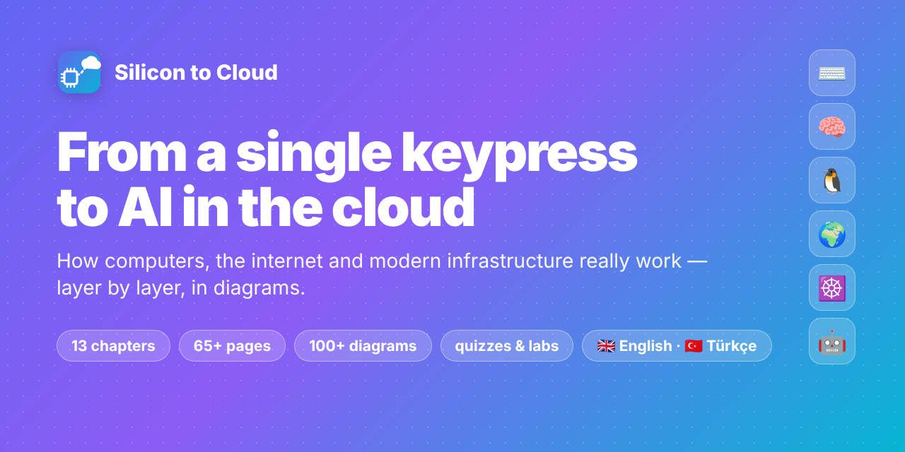
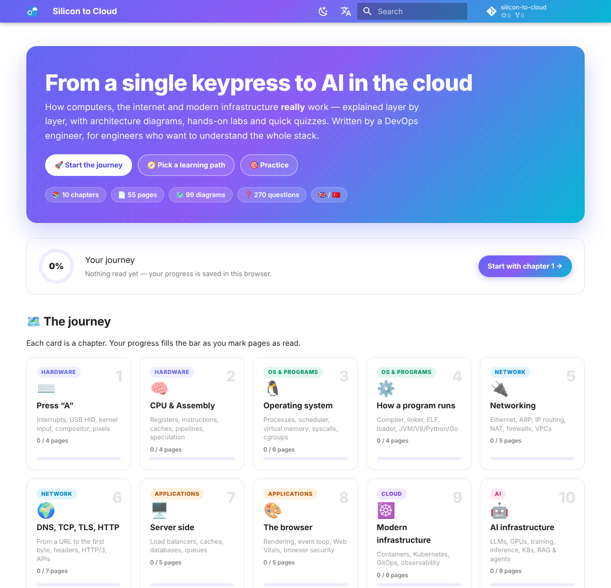
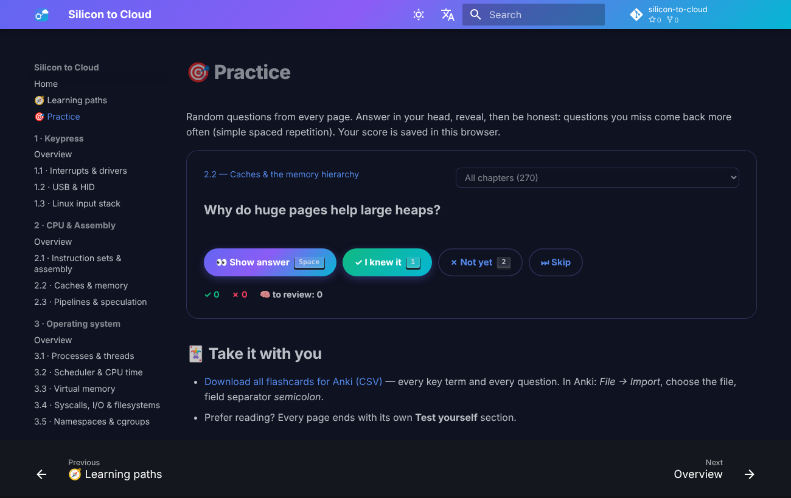

<p align="center">
  <a href="https://gaskinimbuspro.github.io/silicon-to-cloud/"></a>
</p>

<p align="center">
  <a href="https://gaskinimbuspro.github.io/silicon-to-cloud/"><b>📖 Read the site</b></a> ·
  <a href="https://gaskinimbuspro.github.io/silicon-to-cloud/tr/"><b>🇹🇷 Türkçe</b></a> ·
  <a href="https://gaskinimbuspro.github.io/silicon-to-cloud/paths/">🧭 Learning paths</a> ·
  <a href="https://gaskinimbuspro.github.io/silicon-to-cloud/practice/">🎯 Practice</a> ·
  <a href="labs/">🧪 Labs</a>
</p>

<p align="center">
  <a href="https://github.com/gaskinimbuspro/silicon-to-cloud/actions/workflows/deploy.yml"></a>
  <a href="https://github.com/gaskinimbuspro/silicon-to-cloud/actions/workflows/quality.yml"></a>
  <a href="https://github.com/gaskinimbuspro/silicon-to-cloud/actions/workflows/labs.yml"></a>
  
  
  <a href="https://codespaces.new/gaskinimbuspro/silicon-to-cloud"></a>
</p>

**Silicon to Cloud** explains what really happens between pressing a key and an AI answer appearing on screen —
CPU, operating system, programs, networks, the internet, servers, browsers, Kubernetes, security, distributed systems,
cloud cost and AI infrastructure — layer by layer, with architecture diagrams, hands-on labs and quizzes.
Written by a DevOps engineer while learning it properly, in **English and Turkish**.

## ✨ What makes it different

| | |
|---|---|
| 🗺️ **100+ architecture diagrams** | Every page starts with the big picture, then concept diagrams for each mechanism |
| 📖 **No unexplained jargon** | Every page opens with a key-terms table; hover any acronym on the site for its meaning |
| 🔧 **DevOps connection** | Each topic ends with how it shows up in production: OOMKilled, 502s, DNS delays, throttling… |
| 🚨 **Incident stories** | Realistic outages to debug step by step, one per chapter |
| 🧪 **Labs** | Runnable scripts for every chapter, one click away in GitHub Codespaces |
| 🎯 **Practice mode** | 270+ questions with spaced repetition, plus [Anki flashcards](docs/assets/data/) |
| 📈 **Progress tracking** | Mark pages as read, see your progress per chapter, keep a daily streak (stored only in your browser) |

<p align="center"> </p>

## 📚 Chapters

| # | Chapter | Deep dives |
|---|---|---|
| 1 | [What happens when you press “A”?](docs/01-keypress/index.md) | interrupts & drivers · USB & HID · Linux input stack |
| 2 | [CPU & Assembly](docs/02-cpu/index.md) | ISA & assembly · caches & memory · pipelines & speculation |
| 3 | [The operating system](docs/03-os/index.md) | processes · scheduler · virtual memory · I/O · namespaces & cgroups |
| 4 | [How a program runs](docs/04-program/index.md) | compiling & linking · ELF & loader · runtimes |
| 5 | [Networking](docs/05-network/index.md) | Ethernet/ARP/VLAN · IP & routing · NAT & firewalls · cloud VPCs |
| 6 | [DNS, TCP, TLS, HTTP](docs/06-internet/index.md) | headers · DNS · TCP · TLS · HTTP/2-3 · APIs |
| 7 | [Server side](docs/07-server/index.md) | load balancing · caching · databases · queues |
| 8 | [The browser](docs/08-browser/index.md) | rendering · event loop · Web Vitals · browser security |
| 9 | [Modern infrastructure](docs/09-infra/index.md) | containers · Kubernetes · K8s networking · GitOps · observability |
| 10 | [AI infrastructure](docs/10-ai/index.md) | LLMs · GPUs · CUDA · training · inference · K8s · RAG & agents |
| 11 | [Security](docs/11-security/index.md) | identity · secrets · zero trust · supply chain |
| 12 | [Distributed systems](docs/12-distributed/index.md) | consensus · CAP · consistency · resilience |
| 13 | [Cloud cost (FinOps)](docs/13-finops/index.md) | where the money goes · Kubernetes cost · saving |

Every chapter has a Turkish version next to it (`index.tr.md`).

## 🧪 Try things yourself

```bash
# One click: a ready dev environment with Docker, kind, kubectl, perf and friends
#   → https://codespaces.new/gaskinimbuspro/silicon-to-cloud
# or locally:
git clone https://github.com/gaskinimbuspro/silicon-to-cloud && cd silicon-to-cloud
./labs/run.sh 03-os        # run the labs of one chapter
```

## 🛠️ Run the site locally

```bash
pip install -r requirements.txt
python3 tools/build_data.py && python3 tools/build_home.py   # quiz data, flashcards, tooltips, home page
mkdocs serve                                                 # http://127.0.0.1:8000
```

Diagrams are code: `diagrams/specs/*.mjs` → `node diagrams/render-all.mjs` → PNG (EN + TR).
See [CONTENT_STANDARD.md](CONTENT_STANDARD.md) for how every page is structured.

## 🤝 Contributing

Found a mistake, a broken command or a topic you'd like explained? [Open an issue](https://github.com/gaskinimbuspro/silicon-to-cloud/issues/new/choose) —
see [CONTRIBUTING.md](CONTRIBUTING.md).

## 📄 License

Text and diagrams: [CC BY-SA 4.0](LICENSE-CONTENT.md) · Code (tools, renderer, labs, site scripts): [MIT](LICENSE).
