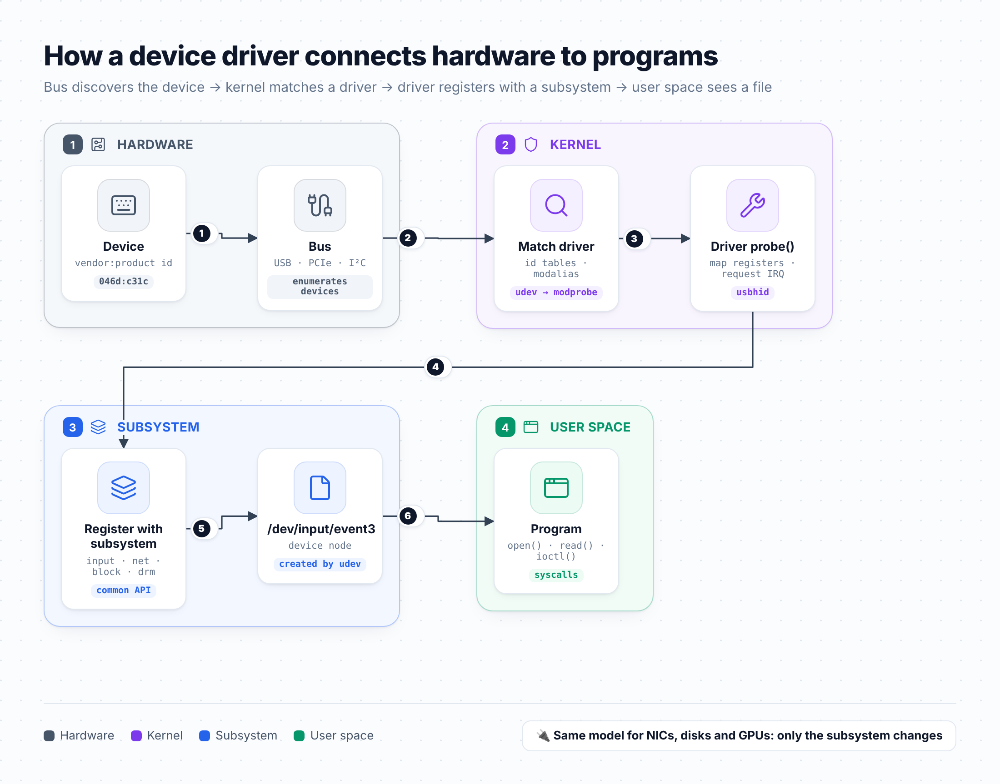
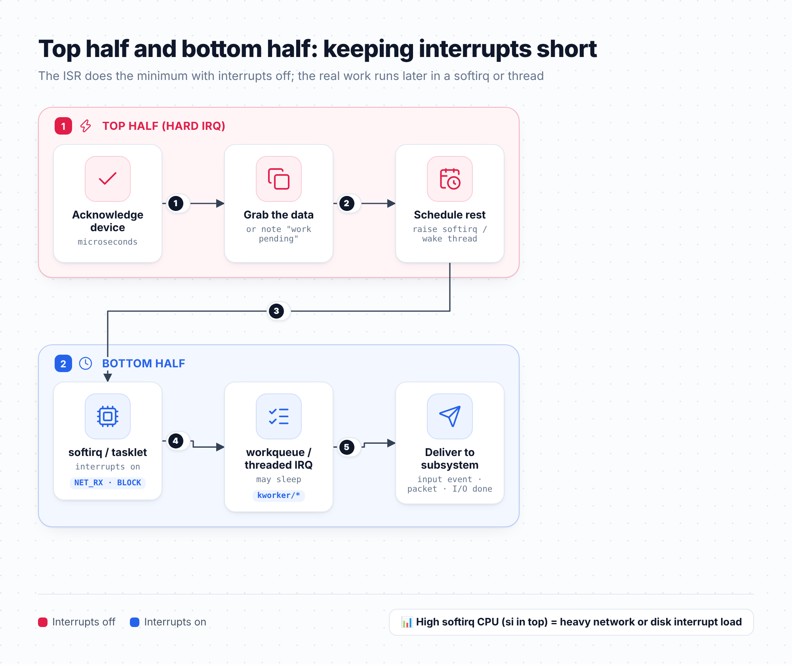

# 1.1 — Interrupts & device drivers

!!! abstract "In short"
    Devices are slow and unpredictable. So instead of the CPU constantly asking "anything new?", a device **interrupts**
    the CPU when something happens. A small kernel **interrupt handler** runs and defers the heavy work to a **bottom
    half**. A **device driver**, matched to the hardware by its IDs, turns the device's raw registers into a standard
    interface programs can use.

## 📖 Key terms & abbreviations

| Term | Stands for | What it is | How it works (one line) |
|---|---|---|---|
| **Interrupt** | — | Signal that makes the CPU pause and run a handler | Hardware raises it; CPU jumps via the IDT |
| **IRQ** | Interrupt Request | An interrupt line/number | `cat /proc/interrupts` lists them |
| **Polling** | — | CPU repeatedly checks a device | Wastes CPU when idle; great at very high load |
| **DMA** | Direct Memory Access | Device copies data to RAM itself | Driver gives it buffer addresses (rings) |
| **MSI / MSI-X** | Message Signaled Interrupts | Interrupt sent as a memory write | One vector per queue, can target any core |
| **APIC** | Advanced Programmable Interrupt Controller | Delivers interrupts to cores | Local APIC per core + I/O APIC |
| **ISR / top half** | Interrupt Service Routine | Code run immediately on the interrupt | Must be very short, can't sleep |
| **Bottom half** | — | Deferred part of interrupt work | softirq, tasklet, workqueue, threaded IRQ |
| **softirq** | software interrupt | Kernel's high-priority deferred work | `si` in `top`; NET_RX, BLOCK, TIMER |
| **Driver** | — | Kernel code for one kind of device | `probe()` when matched, then serves a subsystem |
| **Kernel module** | — | Loadable piece of the kernel (`.ko`) | `modprobe`, `lsmod` |
| **udev** | userspace device manager | Reacts to kernel device events | Loads modules, creates `/dev` nodes, names devices |
| **IRQ affinity** | — | Which cores handle an IRQ | `/proc/irq/N/smp_affinity`, irqbalance |
| **NAPI** | New API | Network drivers switch to polling under load | Interrupt once, then poll a batch of packets |

## 🗺️ Big picture



---

## 1 · Why interrupts?

### What is the problem?

A keyboard sends maybe 10 events per second; a 100 Gbit NIC can deliver millions of packets per second. The CPU can't know *when* data arrives. It has three options:

| Approach | How it works | Good for | Bad for |
|---|---|---|---|
| **Polling** | CPU checks a status register in a loop | Very high, steady load (DPDK, NVMe at high queue depth) | Burns a core while idle |
| **Interrupts** | Device signals; CPU runs a handler | Low/irregular load, latency-sensitive input | Interrupt storms at very high rates |
| **DMA + interrupts** | Device writes data to RAM itself, then interrupts once per batch | Disks, NICs, GPUs | Needs careful buffer management |

Real systems mix them: Linux network drivers use **NAPI**, which takes one interrupt, disables it, and then **polls** a batch of packets until the queue is empty.

## 2 · How an interrupt is delivered

1. The device raises an interrupt. Modern PCIe devices use **MSI-X**: they *write* a small message to a special address, and the **APIC** turns it into an interrupt **vector** on a chosen core.
2. The core finishes its current instruction, saves state, switches to kernel mode and jumps to the handler listed in the **IDT** for that vector (chapter 1 diagram).
3. The handler runs, acknowledges the device, and returns with `iret`.

Each NIC queue or NVMe queue gets its **own MSI-X vector**, so work can be spread across cores. `/proc/interrupts` shows the per-core counters.

## 3 · Top half and bottom half



### Why split?

While the top half runs, other interrupts on that core are blocked and the handler **cannot sleep**. So it does only the minimum (acknowledge, grab data pointers) and schedules the rest:

- **softirq / tasklet:** runs soon after, with interrupts enabled, still can't sleep. Network receive (`NET_RX`) and block I/O completion live here.
- **workqueue / threaded IRQ:** runs in a kernel thread (`kworker`, `irq/42-…`), *can* sleep, can be scheduled like any thread.

When the softirq load is too high, the kernel hands it to the **`ksoftirqd/N`** threads; seeing them at the top of `top` means the box is drowning in interrupt work.

## 4 · Drivers: how the right code gets loaded

### How does it work?

1. The **bus** (USB, PCIe, I²C) enumerates devices and reads their IDs (vendor, product, class).
2. The kernel sends a **uevent**; **udev** looks up the matching module by its `modalias` and runs `modprobe`.
3. The driver's **`probe()`** runs: map device registers, allocate DMA rings, `request_irq()`.
4. It registers with a **subsystem** (input, net, block, DRM). The subsystem gives a standard interface: a keyboard becomes `/dev/input/eventN`, a NIC becomes `eth0`, a disk becomes `/dev/nvme0n1`.

That's why user space never talks to hardware directly: it uses the same `read()` / `ioctl()` for every keyboard, whatever the brand.

## 🔧 DevOps connection

- **High `si` / `ksoftirqd`** on a network-heavy node → spread queues across cores (RSS, `ethtool -L`), check IRQ affinity and irqbalance, consider RPS/RFS.
- **IRQs pinned to one core** → that core is saturated while others idle. Compare columns in `/proc/interrupts`.
- **Latency-sensitive workloads** (trading, real-time, some GPU nodes) pin IRQs away from application cores (`isolcpus`, CPU manager in Kubernetes).
- **Drivers in containers:** containers share the host kernel and its drivers. GPU drivers, RDMA and special NICs must be on the node (that's what the NVIDIA GPU Operator installs).
- **SR-IOV** lets one NIC present many "virtual functions" with their own queues and interrupts, passed directly to VMs or pods.

## 🧪 Try it yourself

```bash
cat /proc/interrupts | head -20                 # interrupt counters per core
watch -n1 -d 'grep -E "i8042|xhci|eth|ens|nvme" /proc/interrupts'   # type/move the mouse: counters rise
cat /proc/softirqs                              # deferred work per type and core
top   # press 1 for per-core view, look at "si"
lspci -k | head -30                             # PCI devices and the driver in use
lsusb -t                                        # USB tree with drivers
lsmod | head; modinfo usbhid | head             # loaded modules and their info
udevadm monitor --kernel --udev                 # plug in a USB device and watch the events
sudo ethtool -l eth0 2>/dev/null                # NIC queues (channels)
```

## 🃏 Cheat sheet

| Want to know | Command |
|---|---|
| Which IRQs fire, on which core | `/proc/interrupts` |
| Softirq load | `/proc/softirqs`, `si` in `top`, `mpstat -P ALL 1` |
| Driver for a device | `lspci -k`, `lsusb -t`, `ethtool -i eth0` |
| Load/unload a module | `modprobe X`, `modprobe -r X` |
| Device events live | `udevadm monitor` |
| Move an IRQ | `echo 4 > /proc/irq/N/smp_affinity_list` |

## ❓ Test yourself

??? question "1. Why can't an interrupt handler sleep or do heavy work?"
    It runs with interrupts (at least on that line/core) blocked and outside any process context; sleeping would freeze that core's interrupt handling. Heavy work goes to a bottom half.

??? question "2. What does NAPI do and why?"
    After the first interrupt it disables the NIC's interrupt and polls batches of packets until the queue is empty, avoiding an interrupt storm at high packet rates.

??? question "3. How does Linux know which driver to load for a newly plugged device?"
    The bus reads the device IDs, the kernel emits a uevent with a modalias, udev matches it to a module and runs modprobe; the driver's probe() then claims the device.

??? question "4. A node shows one core at 100% in `si` while others are idle. What do you check?"
    `/proc/interrupts`: NIC queue IRQs probably land on one core. Add queues / RSS, fix IRQ affinity or enable irqbalance, consider RPS.

??? question "5. Why must GPU drivers be installed on the node and not just in the container?"
    Drivers are kernel code. Containers share the host kernel; they only carry user-space libraries that talk to the host's driver.

---

## 📚 Sources

- [Linux kernel docs — Generic IRQ handling](https://docs.kernel.org/core-api/genericirq.html)
- [Linux kernel docs — Driver model](https://docs.kernel.org/driver-api/driver-model/index.html)
- [Linux kernel docs — NAPI](https://docs.kernel.org/networking/napi.html)
- [Linux kernel docs — Scaling in the networking stack (RSS, RPS, RFS)](https://docs.kernel.org/networking/scaling.html)

## ✍️ My notes

> Run `watch -d cat /proc/interrupts` and type on the keyboard. Which line changes, and on which core?
