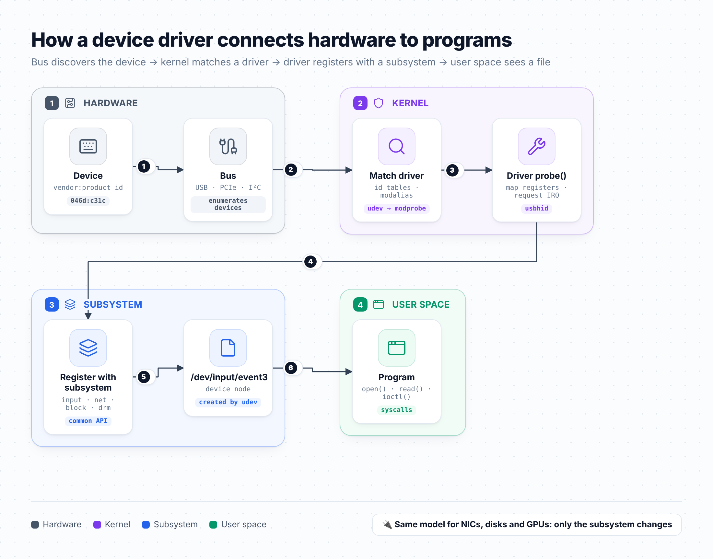
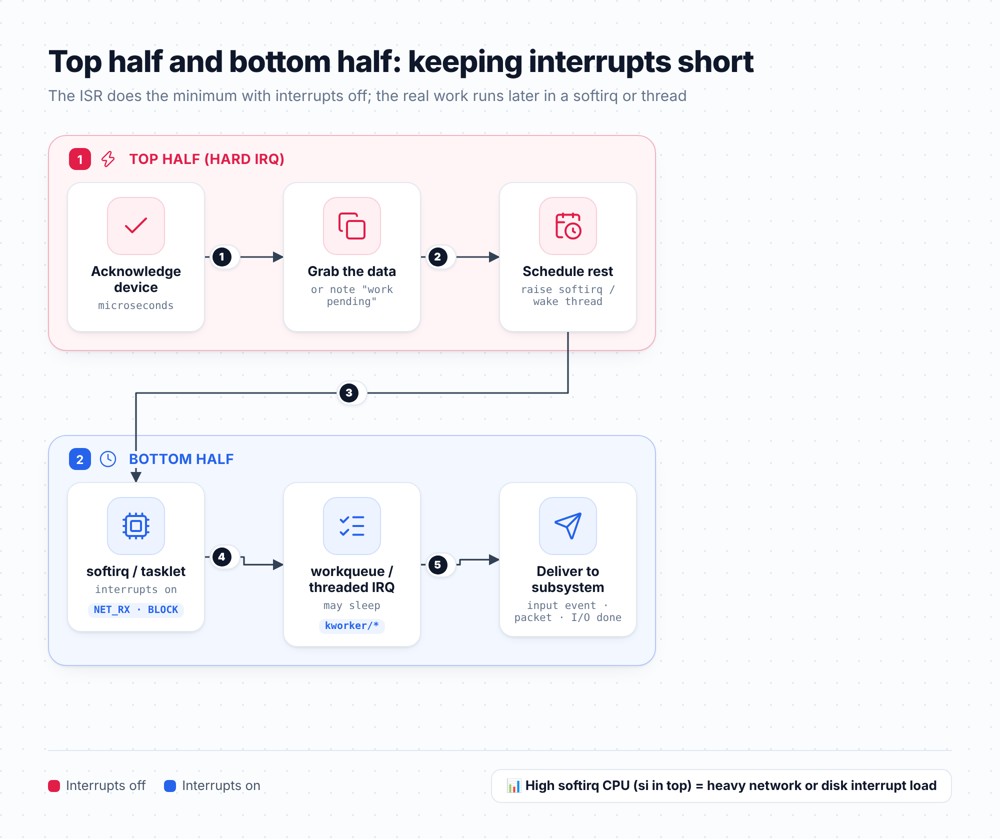

# 1.1 — Kesmeler ve cihaz sürücüleri

!!! abstract "Tek cümlede"
    Cihazlar yavaş ve öngörülemezdir; CPU sürekli "yeni bir şey var mı?" diye sormak yerine, bir şey olduğunda cihaz CPU'yu
    **keser**. Küçük bir kernel **kesme handler'ı** çalışır, ağır işi bir **alt yarıya** erteler ve donanıma kimlikleriyle
    eşlenen bir **cihaz sürücüsü**, cihazın ham register ve tamponlarını programların kullanabileceği standart bir kernel
    arayüzüne çevirir.

## 📖 Temel terimler ve kısaltmalar

| Terim | Açılımı | Nedir | Nasıl çalışır (tek satır) |
|---|---|---|---|
| **Kesme** | Interrupt | CPU'yu durdurup bir handler çalıştırtan sinyal | Donanım üretir; CPU IDT üzerinden atlar |
| **IRQ** | Interrupt Request | Bir kesme hattı/numarası | `cat /proc/interrupts` listeler |
| **Polling** | — | CPU'nun bir cihazı sürekli kontrol etmesi | Boştayken CPU yakar; çok yüksek yükte harika |
| **DMA** | Direct Memory Access | Cihazın veriyi RAM'e kendisinin kopyalaması | Sürücü ona tampon adresleri (ring) verir |
| **MSI / MSI-X** | Message Signaled Interrupts | Bellek yazması olarak gönderilen kesme | Kuyruk başına bir vektör, her çekirdeğe yönlenebilir |
| **APIC** | Advanced Programmable Interrupt Controller | Kesmeleri çekirdeklere iletir | Çekirdek başına Local APIC + I/O APIC |
| **ISR / üst yarı** | Interrupt Service Routine | Kesmede hemen çalışan kod | Çok kısa olmalı, uyuyamaz |
| **Alt yarı** | Bottom half | Kesme işinin ertelenen kısmı | softirq, tasklet, workqueue, threaded IRQ |
| **softirq** | software interrupt | Kernel'in yüksek öncelikli ertelenmiş işi | `top`'ta `si`; NET_RX, BLOCK, TIMER |
| **Sürücü** | Driver | Bir cihaz türü için kernel kodu | Eşlenince `probe()`, sonra bir alt sisteme hizmet |
| **Kernel modülü** | — | Kernel'in yüklenebilir parçası (`.ko`) | `modprobe`, `lsmod` |
| **udev** | userspace device manager | Kernel cihaz olaylarına tepki verir | Modül yükler, `/dev` dosyaları oluşturur, isim verir |
| **IRQ affinity** | — | Bir IRQ'yu hangi çekirdeklerin işleyeceği | `/proc/irq/N/smp_affinity`, irqbalance |
| **NAPI** | New API | Ağ sürücülerinin yük altında polling'e geçmesi | Bir kesme, sonra bir paket grubu yoklanır |

## 🗺️ Büyük resim



---

## 1 · Neden kesmeler?

### Sorun ne?

Bir klavye saniyede belki 10 olay gönderir; 100 Gbit'lik bir NIC saniyede milyonlarca paket teslim edebilir. CPU verinin *ne zaman* geleceğini bilemez. Üç seçeneği var:

| Yaklaşım | Nasıl çalışır | İyi olduğu yer | Kötü olduğu yer |
|---|---|---|---|
| **Polling** | CPU bir döngüde durum register'ını kontrol eder | Çok yüksek, sabit yük (DPDK, yüksek kuyruk derinliğinde NVMe) | Boştayken bir çekirdeği yakar |
| **Kesmeler** | Cihaz sinyal verir; CPU handler çalıştırır | Düşük/düzensiz yük, gecikmeye hassas girdi | Çok yüksek hızda kesme fırtınası |
| **DMA + kesme** | Cihaz veriyi RAM'e kendisi yazar, grup başına bir kesme | Diskler, NIC'ler, GPU'lar | Dikkatli tampon yönetimi ister |

Gerçek sistemler karıştırır: Linux ağ sürücüleri **NAPI** kullanır; bir kesme alır, onu kapatır, sonra kuyruk boşalana kadar bir grup paketi **yoklar**.

## 2 · Bir kesme nasıl iletilir

1. Cihaz bir kesme üretir. Modern PCIe cihazları **MSI-X** kullanır: özel bir adrese küçük bir mesaj *yazarlar*, **APIC** bunu seçilen bir çekirdekte bir kesme **vektörüne** çevirir.
2. Çekirdek mevcut komutunu bitirir, durumu kaydeder, kernel moduna geçer ve **IDT**'de o vektör için kayıtlı handler'a atlar (1. bölüm diagramı).
3. Handler çalışır, cihazı onaylar ve `iret` ile döner.

Her NIC kuyruğu ya da NVMe kuyruğu **kendi MSI-X vektörünü** alır; iş çekirdeklere dağıtılabilir. `/proc/interrupts` çekirdek başına sayaçları gösterir.

## 3 · Üst yarı ve alt yarı



### Neden bölünür?

Üst yarı çalışırken o çekirdekteki diğer kesmeler bloklanır ve handler **uyuyamaz**. Bu yüzden en azını yapar (onayla, veri pointer'larını al) ve kalanını planlar:

- **softirq / tasklet:** kısa süre sonra, kesmeler açıkken çalışır; yine uyuyamaz. Ağ alımı (`NET_RX`) ve blok I/O tamamlanması burada.
- **workqueue / threaded IRQ:** bir kernel thread'inde (`kworker`, `irq/42-…`) çalışır, uyuyabilir, her thread gibi zamanlanabilir.

softirq yükü çok yükselince kernel onu **`ksoftirqd/N`** thread'lerine verir; bunları `top`'un tepesinde görmek makinenin kesme işinde boğulduğu anlamına gelir.

## 4 · Sürücüler: doğru kod nasıl yüklenir

### Nasıl çalışır?

1. **Bus** (USB, PCIe, I²C) cihazları sıralar ve kimliklerini (vendor, product, sınıf) okur.
2. Kernel bir **uevent** gönderir; **udev** eşleşen modülü `modalias` ile bulur ve `modprobe` çalıştırır.
3. Sürücünün **`probe()`** fonksiyonu çalışır: cihaz register'larını eşler, DMA ring'lerini ayırır, `request_irq()` çağırır.
4. Bir **alt sisteme** (input, net, block, DRM) kaydolur. Alt sistem standart bir arayüz verir: klavye `/dev/input/eventN`, NIC `eth0`, disk `/dev/nvme0n1` olur.

Bu yüzden user space donanımla hiç doğrudan konuşmaz: markası ne olursa olsun her klavye için aynı `read()` / `ioctl()`'ü kullanır.

## 🔧 DevOps bağlantısı

- **Ağ yükü yoğun bir node'da yüksek `si` / `ksoftirqd`** → kuyrukları çekirdeklere yay (RSS, `ethtool -L`), IRQ affinity ve irqbalance'ı kontrol et, RPS/RFS'i düşün.
- **IRQ'lar tek çekirdeğe sabitlenmiş** → o çekirdek doyarken diğerleri boş. `/proc/interrupts`'taki sütunları karşılaştır.
- **Gecikmeye hassas iş yükleri** (trading, gerçek zamanlı, bazı GPU node'ları) IRQ'ları uygulama çekirdeklerinden uzak tutar (`isolcpus`, Kubernetes CPU manager).
- **Container'larda sürücüler:** container'lar host kernel'ini ve sürücülerini paylaşır. GPU sürücüleri, RDMA ve özel NIC'ler node'da olmalı (NVIDIA GPU Operator'ın kurduğu şey bu).
- **SR-IOV** tek bir NIC'in kendi kuyrukları ve kesmeleri olan çok sayıda "sanal fonksiyon" sunmasını sağlar; doğrudan VM'lere ya da pod'lara verilir.

## 🧪 Kendin dene

```bash
cat /proc/interrupts | head -20                 # çekirdek başına kesme sayaçları
watch -n1 -d 'grep -E "i8042|xhci|eth|ens|nvme" /proc/interrupts'   # yaz/fareyi oynat: sayaçlar artar
cat /proc/softirqs                              # tür ve çekirdek başına ertelenmiş iş
top   # çekirdek başına görünüm için 1'e bas, "si"ye bak
lspci -k | head -30                             # PCI cihazları ve kullanılan sürücü
lsusb -t                                        # sürücüleriyle USB ağacı
lsmod | head; modinfo usbhid | head             # yüklü modüller ve bilgileri
udevadm monitor --kernel --udev                 # bir USB cihaz tak ve olayları izle
sudo ethtool -l eth0 2>/dev/null                # NIC kuyrukları (kanallar)
```

## 🃏 Hatırlatma kartı

| Öğrenmek istediğin | Komut |
|---|---|
| Hangi IRQ'lar hangi çekirdekte | `/proc/interrupts` |
| softirq yükü | `/proc/softirqs`, `top`'ta `si`, `mpstat -P ALL 1` |
| Bir cihazın sürücüsü | `lspci -k`, `lsusb -t`, `ethtool -i eth0` |
| Modül yükle/kaldır | `modprobe X`, `modprobe -r X` |
| Canlı cihaz olayları | `udevadm monitor` |
| Bir IRQ'yu taşı | `echo 4 > /proc/irq/N/smp_affinity_list` |

## ❓ Kendini test et

??? question "1. Bir kesme handler'ı neden uyuyamaz ya da ağır iş yapamaz?"
    Kesmeler (en azından o hatta/çekirdekte) bloklu ve herhangi bir process bağlamı dışında çalışır; uyumak o çekirdeğin kesme işlemesini dondurur. Ağır iş alt yarıya gider.

??? question "2. NAPI ne yapar ve neden?"
    İlk kesmeden sonra NIC'in kesmesini kapatır ve kuyruk boşalana kadar paket gruplarını yoklar; yüksek paket hızlarında kesme fırtınasını önler.

??? question "3. Linux yeni takılan bir cihaz için hangi sürücüyü yükleyeceğini nasıl bilir?"
    Bus cihaz kimliklerini okur, kernel modalias içeren bir uevent yayar, udev bunu bir modülle eşler ve modprobe çalıştırır; sonra sürücünün probe()'u cihazı sahiplenir.

??? question "4. Bir node'da bir çekirdek `si`'de %100, diğerleri boş. Neye bakarsın?"
    `/proc/interrupts`: NIC kuyruk IRQ'ları muhtemelen tek çekirdeğe düşüyor. Kuyruk / RSS ekle, IRQ affinity'yi düzelt ya da irqbalance'ı aç, RPS'i düşün.

??? question "5. GPU sürücüleri neden sadece container'a değil node'a kurulmalı?"
    Sürücüler kernel kodudur. Container'lar host kernel'ini paylaşır; sadece host'un sürücüsüyle konuşan user-space kütüphanelerini taşırlar.

---

## 📚 Kaynaklar

- [Linux kernel docs — Generic IRQ handling](https://docs.kernel.org/core-api/genericirq.html)
- [Linux kernel docs — Driver model](https://docs.kernel.org/driver-api/driver-model/index.html)
- [Linux kernel docs — NAPI](https://docs.kernel.org/networking/napi.html)
- [Linux kernel docs — Scaling in the networking stack (RSS, RPS, RFS)](https://docs.kernel.org/networking/scaling.html)

## ✍️ Notlarım

> `watch -d cat /proc/interrupts` çalıştır ve klavyede yaz. Hangi satır, hangi çekirdekte değişiyor?

-
