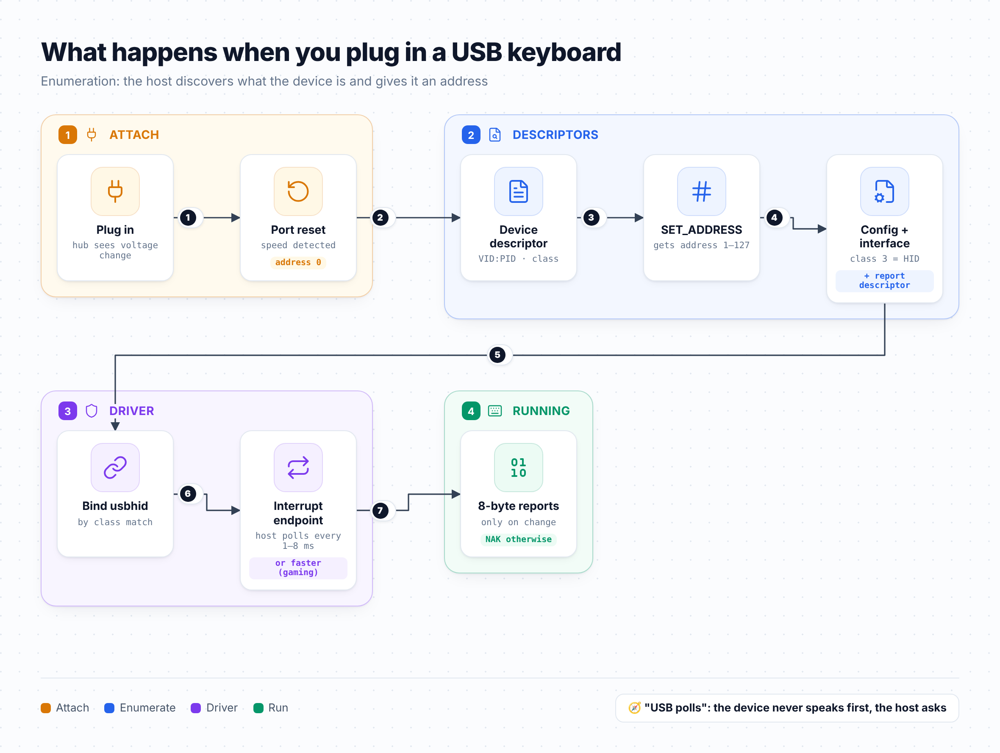
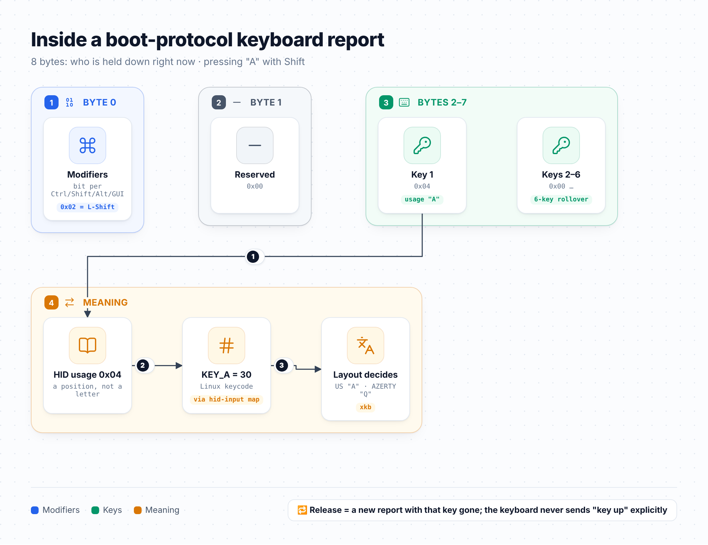

# 1.2 — USB & HID

!!! abstract "In short"
    **USB** is a **host-driven** bus: the computer discovers each device (**enumeration**), reads its **descriptors** to
    learn what it is, assigns it an address, and then **polls** it on a schedule. A keyboard belongs to the **HID**
    class, which describes its data with a **report descriptor**. Every time you press or release a key it answers the
    next poll with a small **report** listing which keys are currently down.

## 📖 Key terms & abbreviations

| Term | Stands for | What it is | How it works (one line) |
|---|---|---|---|
| **USB** | Universal Serial Bus | Host-controlled peripheral bus | Host schedules all traffic; devices only answer |
| **Host controller (xHCI)** | eXtensible Host Controller Interface | Chip that runs the USB bus | Executes transfer rings in RAM, raises interrupts |
| **Hub** | — | Port multiplier | Reports attach/detach to the host |
| **Enumeration** | — | Discovering a newly attached device | Reset → descriptors → address → configuration |
| **Descriptor** | — | Self-description data a device returns | Device, configuration, interface, endpoint, HID report |
| **VID / PID** | Vendor ID / Product ID | 16-bit IDs of maker and model | `046d:c31c` = Logitech keyboard |
| **Endpoint** | — | A data channel on a device | EP0 control + others (IN/OUT) |
| **Transfer types** | — | Control, interrupt, bulk, isochronous | Keyboard: interrupt; disk: bulk; audio: isochronous |
| **Polling interval** | — | How often the host asks an interrupt endpoint | 1–8 ms for keyboards (125–1000 Hz), faster for gaming |
| **HID** | Human Interface Device | Device class for input devices | Self-describing reports, no special driver needed |
| **Report descriptor** | — | Describes the layout of the device's reports | Usage pages, sizes, counts |
| **Usage** | — | Meaning of a field (e.g. "Keyboard A") | Numbers from the HID Usage Tables |
| **Boot protocol** | — | Fixed simple 8-byte keyboard format | Works in BIOS/UEFI without parsing descriptors |
| **NKRO** | N-Key RollOver | Any number of simultaneous keys | Uses a bitmap report instead of 6 slots |

## 🗺️ Big picture



---

## 1 · What makes USB different: the host asks

On USB, **devices never talk first**. The host controller (xHCI) keeps a schedule of transfers in RAM and works through it:

- **Control transfers** (endpoint 0): setup and configuration, used during enumeration.
- **Interrupt transfers:** small, periodic, guaranteed latency. Keyboards, mice. ("Interrupt" here only means "polled regularly"; the *device* doesn't interrupt anything.)
- **Bulk transfers:** large, whenever bandwidth is free. Storage, printers.
- **Isochronous transfers:** fixed bandwidth, no retries. Audio, webcams.

When an interrupt endpoint has nothing new, it answers **NAK**. When it has a report, the controller DMAs it into RAM and raises a real CPU interrupt (MSI) to tell the kernel.

## 2 · Enumeration: how the host learns what you plugged in

1. **Attach:** the hub sees a voltage change on a port and tells the host.
2. **Reset:** the host resets the port; the device answers at address 0 and its speed is detected.
3. **Device descriptor:** VID, PID, USB version, device class.
4. **SET_ADDRESS:** the device gets a unique address (1–127 per bus).
5. **Configuration, interface and endpoint descriptors:** for a keyboard, an interface with **class 3 (HID)** and an **interrupt IN endpoint** with a polling interval.
6. **HID report descriptor:** the exact layout of the reports.
7. The kernel matches the **`usbhid`** driver by class; it hands reports to the HID core, which creates an **input device** (`/dev/input/eventN`).

## 3 · HID and the keyboard report



### What is it?

**HID** devices describe themselves. The report descriptor says, for example: "8 one-bit fields for modifier keys, 1 reserved byte, 6 byte-sized key slots from usage page *Keyboard*". So one generic driver handles every keyboard, mouse, game pad and barcode scanner.

### How does a key press look?

| Action | Report bytes |
|---|---|
| Nothing pressed | `00 00 00 00 00 00 00 00` |
| `a` pressed | `00 00 04 00 00 00 00 00` |
| Shift + `a` | `02 00 04 00 00 00 00 00` |
| Released | `00 00 00 00 00 00 00 00` |

- `0x04` is the **HID usage for the key in the "A" position**, not the letter. The layout (US, Turkish-Q, AZERTY) is applied much later, by xkb (1.3).
- The report lists **keys currently down**; a release is just a report without that key. **Key repeat** is generated by software, not the keyboard.
- The 6 slots mean the boot protocol supports 6 simultaneous keys (**6KRO**); gaming keyboards use a bitmap report for **NKRO**.

## 4 · Polling rate and latency

At **125 Hz** polling the host asks every 8 ms, so a press waits 0–8 ms (avg 4 ms) just to leave the keyboard. At **1000 Hz** it's 0–1 ms; some gaming devices go to 8000 Hz. Add the keyboard's own **matrix scan + debounce** (often 1–10 ms) and you have most of the "keyboard latency" before the OS even sees the event.

## 🔧 DevOps connection

- **Servers and VMs:** BMC/IPMI virtual consoles and hypervisors (KVM/QEMU, VMware) emulate USB HID keyboards/tablets; "typing into the console" goes through this same HID path.
- **USB passthrough:** `usbip`, QEMU `-device usb-host`, or VM "USB redirection" forwards a real device into a VM. In Kubernetes, USB devices reach pods via device plugins or `hostPath` device mounts (rarely, e.g. HSMs, licence dongles, edge sensors).
- **Security:** a malicious "keyboard" (BadUSB, Rubber Ducky) can type commands. Hardened hosts use **USBGuard** to allow-list devices, and many cloud images disable USB storage.
- **Troubleshooting edge devices:** `dmesg -w` while plugging tells you whether enumeration fails (power, cable, descriptor errors) or the driver is missing.

## 🧪 Try it yourself

```bash
lsusb                                   # devices with VID:PID
lsusb -t                                # tree: bus, port, speed, driver
sudo lsusb -v -d 046d: 2>/dev/null | grep -E 'bInterfaceClass|bEndpointAddress|bInterval|wMaxPacketSize'
sudo dmesg -w                           # plug in a USB device and watch enumeration
sudo usbhid-dump -m 046d 2>/dev/null | head   # raw report descriptor (package: usbutils/usbhid-dump)
sudo evtest                             # pick your keyboard; see EV_KEY events per press
ls /sys/bus/usb/devices/                # sysfs view of the bus
```

## 🃏 Cheat sheet

| Concept | Remember |
|---|---|
| Who starts transfers | Always the host |
| Keyboard transfer type | Interrupt IN, polled every 1–8 ms |
| Device class | HID = class 3 |
| Report | 1 modifier byte + 1 reserved + 6 key usages |
| `0x04` | Key in "A" position, layout comes later |
| Release / repeat | New report without the key / done in software |

## ❓ Test yourself

??? question "1. If USB devices can't speak first, how does a key press reach the computer?"
    The host polls the keyboard's interrupt endpoint every 1–8 ms; the next poll after the press returns a report instead of NAK.

??? question "2. Why does one generic driver work for almost every keyboard and mouse?"
    HID devices describe their report layout in a report descriptor, so the HID core can parse any of them.

??? question "3. Does the keyboard send the letter 'a'?"
    No. It sends usage `0x04`, a key position. The layout (xkb in user space) decides it means "a", "q" or something else.

??? question "4. How much latency can a 125 Hz polling rate add?"
    Up to 8 ms (average ~4 ms) before the host even sees the report.

??? question "5. Why do some hardened servers block unknown USB devices?"
    A device can claim to be a keyboard and type commands (BadUSB). Allow-listing with USBGuard prevents that.

---

## 📚 Sources

- [USB-IF — Device Class Definition for HID 1.11](https://www.usb.org/document-library/device-class-definition-hid-111)
- [USB-IF — HID Usage Tables](https://usb.org/document-library/hid-usage-tables-15)
- [USB in a NutShell (Beyond Logic)](https://www.beyondlogic.org/usbnutshell/usb1.shtml)
- [Linux kernel docs — HID I/O transport drivers](https://docs.kernel.org/hid/hid-transport.html)
- [USBGuard](https://usbguard.github.io/)

## ✍️ My notes

> Run `evtest` on your keyboard and press Shift+A. Write down every event you see and match it to the report bytes above.
