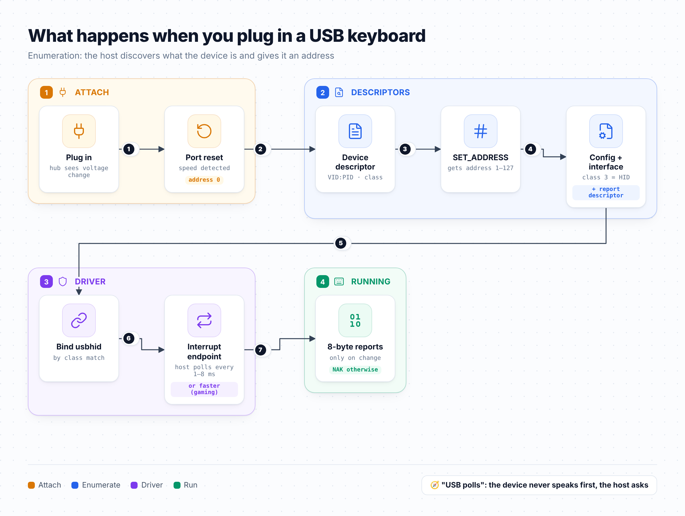
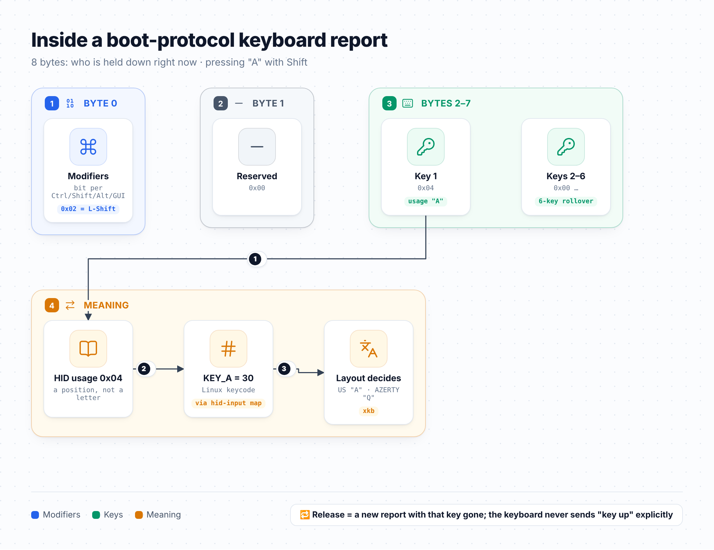

# 1.2 — USB ve HID

!!! abstract "Tek cümlede"
    **USB** **host güdümlü** bir bus'tır: bilgisayar her cihazı keşfeder (**enumeration**), ne olduğunu öğrenmek için
    **tanımlayıcılarını** okur, ona bir adres verir ve sonra onu bir takvime göre **yoklar**. Klavye **HID** sınıfına aittir;
    verisini bir **rapor tanımlayıcısıyla** tarif eder ve her tuşa bastığında ya da bıraktığında bir sonraki yoklamayı o anda
    basılı tuşları listeleyen küçük bir **raporla** cevaplar.

## 📖 Temel terimler ve kısaltmalar

| Terim | Açılımı | Nedir | Nasıl çalışır (tek satır) |
|---|---|---|---|
| **USB** | Universal Serial Bus | Host kontrollü çevre birimi bus'ı | Tüm trafiği host planlar; cihazlar sadece cevaplar |
| **Host denetleyici (xHCI)** | eXtensible Host Controller Interface | USB bus'ını yöneten çip | RAM'deki aktarım ring'lerini çalıştırır, kesme üretir |
| **Hub** | — | Port çoğaltıcı | Takma/çıkarma olaylarını host'a bildirir |
| **Enumeration** | — | Yeni takılan cihazı keşfetmek | Reset → tanımlayıcılar → adres → yapılandırma |
| **Tanımlayıcı** | Descriptor | Cihazın döndürdüğü öz tanım verisi | Cihaz, yapılandırma, arayüz, endpoint, HID rapor |
| **VID / PID** | Vendor ID / Product ID | Üretici ve modelin 16 bitlik kimlikleri | `046d:c31c` = Logitech klavye |
| **Endpoint** | — | Cihaz üzerindeki bir veri kanalı | EP0 kontrol + diğerleri (IN/OUT) |
| **Aktarım tipleri** | Transfer types | Control, interrupt, bulk, isochronous | Klavye: interrupt; disk: bulk; ses: isochronous |
| **Yoklama aralığı** | Polling interval | Host'un bir interrupt endpoint'ine ne sıklıkla sorduğu | Klavyede 1–8 ms (125–1000 Hz), oyun cihazlarında daha hızlı |
| **HID** | Human Interface Device | Girdi cihazları için cihaz sınıfı | Kendini tarif eden raporlar, özel sürücü gerekmez |
| **Rapor tanımlayıcısı** | Report descriptor | Cihazın rapor düzenini tarif eder | Usage page'ler, boyutlar, sayılar |
| **Usage** | — | Bir alanın anlamı (ör. "Keyboard A") | HID Usage Tables'tan numaralar |
| **Boot protokolü** | Boot protocol | Sabit, basit 8 byte'lık klavye formatı | BIOS/UEFI'de tanımlayıcı ayrıştırmadan çalışır |
| **NKRO** | N-Key RollOver | Aynı anda istenen sayıda tuş | 6 slot yerine bitmap rapor kullanır |

## 🗺️ Büyük resim



---

## 1 · USB'yi farklı kılan: host sorar

USB'de **cihazlar asla önce konuşmaz**. Host denetleyici (xHCI) RAM'de bir aktarım takvimi tutar ve onu işler:

- **Control aktarımları** (endpoint 0): kurulum ve yapılandırma, enumeration sırasında kullanılır.
- **Interrupt aktarımları:** küçük, periyodik, garantili gecikme. Klavyeler, fareler. (Buradaki "interrupt" sadece "düzenli yoklanır" demek; *cihaz* hiçbir şeyi kesmez.)
- **Bulk aktarımları:** büyük, bant genişliği boşaldıkça. Depolama, yazıcılar.
- **Isochronous aktarımları:** sabit bant genişliği, yeniden deneme yok. Ses, webcam'ler.

Bir interrupt endpoint'inde yeni bir şey yoksa **NAK** ile cevap verir. Bir rapor varsa denetleyici onu DMA ile RAM'e yazar ve kernel'e haber vermek için gerçek bir CPU kesmesi (MSI) üretir.

## 2 · Enumeration: host taktığın şeyi nasıl öğrenir

1. **Takma:** hub bir portta voltaj değişimi görür ve host'a söyler.
2. **Reset:** host portu resetler; cihaz adres 0'da cevap verir ve hızı belirlenir.
3. **Cihaz tanımlayıcısı:** VID, PID, USB sürümü, cihaz sınıfı.
4. **SET_ADDRESS:** cihaz benzersiz bir adres alır (bus başına 1–127).
5. **Yapılandırma, arayüz ve endpoint tanımlayıcıları:** bir klavye için **sınıf 3 (HID)** olan bir arayüz ve yoklama aralığı olan bir **interrupt IN endpoint**.
6. **HID rapor tanımlayıcısı:** raporların tam düzeni.
7. Kernel **`usbhid`** sürücüsünü sınıfa göre eşler; raporları HID çekirdeğine verir, o da bir **girdi cihazı** (`/dev/input/eventN`) oluşturur.

## 3 · HID ve klavye raporu



### Nedir?

**HID** cihazları kendilerini tarif eder. Rapor tanımlayıcısı örneğin şunu söyler: "değiştirici tuşlar için 8 adet tek bitlik alan, 1 ayrılmış byte, *Keyboard* usage page'inden 6 adet byte'lık tuş slotu". Böylece tek bir genel sürücü her klavyeyi, fareyi, oyun kolunu ve barkod okuyucuyu yönetir.

### Bir tuşa basış nasıl görünür?

| Eylem | Rapor byte'ları |
|---|---|
| Hiçbir şey basılı değil | `00 00 00 00 00 00 00 00` |
| `a` basılı | `00 00 04 00 00 00 00 00` |
| Shift + `a` | `02 00 04 00 00 00 00 00` |
| Bırakıldı | `00 00 00 00 00 00 00 00` |

- `0x04`, harf değil, **"A" konumundaki tuşun HID usage'ıdır**. Düzen (US, Türkçe-Q, AZERTY) çok sonra xkb tarafından uygulanır (1.3).
- Rapor **şu an basılı tuşları** listeler; bırakma sadece o tuşun olmadığı bir rapordur. **Tuş tekrarı** klavyeden değil yazılımdan gelir.
- 6 slot, boot protokolünün aynı anda 6 tuşu desteklediği anlamına gelir (**6KRO**); oyun klavyeleri **NKRO** için bitmap rapor kullanır.

## 4 · Yoklama hızı ve gecikme

**125 Hz** yoklamada host 8 ms'de bir sorar; bir basış sadece klavyeden çıkmak için 0–8 ms (ortalama 4 ms) bekler. **1000 Hz**'de 0–1 ms; bazı oyun cihazları 8000 Hz'e çıkar. Klavyenin kendi **matris taraması + titreşim giderme** süresini (çoğu zaman 1–10 ms) ekleyince, işletim sistemi olayı görmeden önceki "klavye gecikmesinin" çoğunu bulmuş olursun.

## 🔧 DevOps bağlantısı

- **Sunucular ve VM'ler:** BMC/IPMI sanal konsolları ve hypervisor'lar (KVM/QEMU, VMware) USB HID klavye/tablet taklit eder; "konsola yazmak" bu aynı HID yolundan geçer.
- **USB passthrough:** `usbip`, QEMU `-device usb-host` ya da VM "USB yönlendirme" gerçek bir cihazı VM'e aktarır. Kubernetes'te USB cihazları pod'lara device plugin'ler ya da `hostPath` cihaz bağlamalarıyla ulaşır (nadiren; HSM'ler, lisans dongle'ları, uç sensörler).
- **Güvenlik:** kötü niyetli bir "klavye" (BadUSB, Rubber Ducky) komut yazabilir. Sıkılaştırılmış host'lar cihazları izin listesine almak için **USBGuard** kullanır, birçok bulut imajı USB depolamayı kapatır.
- **Uç cihazlarda sorun giderme:** takarken `dmesg -w`, enumeration'ın mı başarısız olduğunu (güç, kablo, tanımlayıcı hataları) yoksa sürücünün mü eksik olduğunu söyler.

## 🧪 Kendin dene

```bash
lsusb                                   # VID:PID ile cihazlar
lsusb -t                                # ağaç: bus, port, hız, sürücü
sudo lsusb -v -d 046d: 2>/dev/null | grep -E 'bInterfaceClass|bEndpointAddress|bInterval|wMaxPacketSize'
sudo dmesg -w                           # bir USB cihaz tak ve enumeration'ı izle
sudo usbhid-dump -m 046d 2>/dev/null | head   # ham rapor tanımlayıcısı (paket: usbutils/usbhid-dump)
sudo evtest                             # klavyeni seç; her basışta EV_KEY olaylarını gör
ls /sys/bus/usb/devices/                # bus'ın sysfs görünümü
```

## 🃏 Hatırlatma kartı

| Kavram | Hatırla |
|---|---|
| Aktarımı kim başlatır | Her zaman host |
| Klavye aktarım tipi | Interrupt IN, her 1–8 ms'de yoklanır |
| Cihaz sınıfı | HID = sınıf 3 |
| Rapor | 1 değiştirici byte + 1 ayrılmış + 6 tuş usage'ı |
| `0x04` | "A" konumundaki tuş, düzen sonra gelir |
| Bırakma / tekrar | Tuşsuz yeni rapor / yazılımda yapılır |

## ❓ Kendini test et

??? question "1. USB cihazları önce konuşamıyorsa bir tuşa basış bilgisayara nasıl ulaşır?"
    Host klavyenin interrupt endpoint'ini her 1–8 ms'de yoklar; basıştan sonraki ilk yoklama NAK yerine bir rapor döner.

??? question "2. Neden tek bir genel sürücü neredeyse her klavye ve fare için çalışır?"
    HID cihazları rapor düzenlerini bir rapor tanımlayıcısında tarif eder; HID çekirdeği hepsini ayrıştırabilir.

??? question "3. Klavye 'a' harfini mi gönderir?"
    Hayır. Bir tuş konumu olan `0x04` usage'ını gönderir. Bunun "a" mı, "q" mu ya da başka bir şey mi olduğuna düzen (user space'teki xkb) karar verir.

??? question "4. 125 Hz yoklama hızı ne kadar gecikme ekleyebilir?"
    Host raporu görmeden önce 8 ms'ye kadar (ortalama ~4 ms).

??? question "5. Bazı sıkılaştırılmış sunucular neden bilinmeyen USB cihazlarını engeller?"
    Bir cihaz kendini klavye olarak tanıtıp komut yazabilir (BadUSB). USBGuard ile izin listesi bunu önler.

---

## 📚 Kaynaklar

- [USB-IF — Device Class Definition for HID 1.11](https://www.usb.org/document-library/device-class-definition-hid-111)
- [USB-IF — HID Usage Tables](https://usb.org/document-library/hid-usage-tables-15)
- [USB in a NutShell (Beyond Logic)](https://www.beyondlogic.org/usbnutshell/usb1.shtml)
- [Linux kernel docs — HID I/O transport drivers](https://docs.kernel.org/hid/hid-transport.html)
- [USBGuard](https://usbguard.github.io/)

## ✍️ Notlarım

> Klavyende `evtest` çalıştır ve Shift+A'ya bas. Gördüğün her olayı yaz ve yukarıdaki rapor byte'larıyla eşleştir.

-
