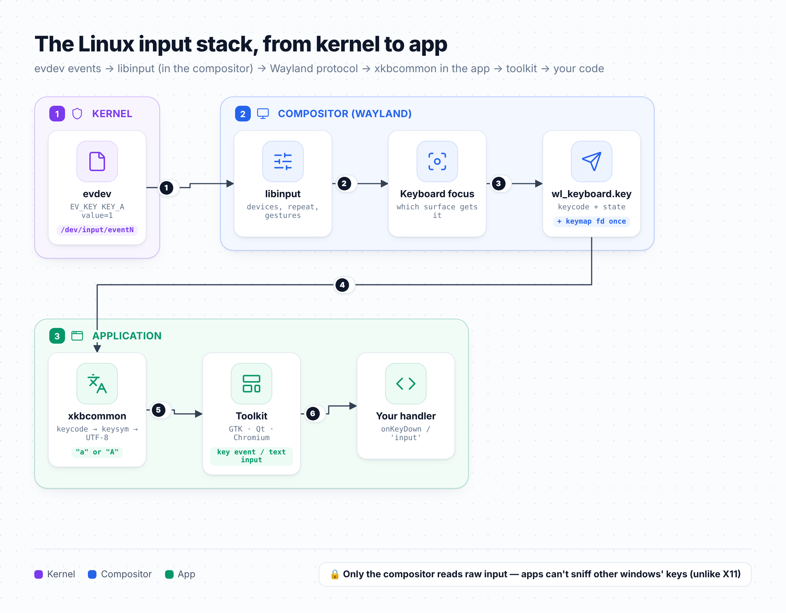

# 1.3 — The Linux input stack

!!! abstract "In short"
    The kernel turns the keyboard report into an **evdev** event (`KEY_A pressed`). The **compositor** reads it through
    **libinput**, decides which window has **keyboard focus**, and sends that window a raw **keycode** over the
    **Wayland** protocol. The app's **xkbcommon** applies the **keymap** (layout + modifiers) to get a **keysym** and
    the text `"a"`, and the toolkit or browser delivers it to your code as a key event.

## 📖 Key terms & abbreviations

| Term | Stands for | What it is | How it works (one line) |
|---|---|---|---|
| **Input subsystem** | — | Kernel layer for all input devices | Drivers report events; it fans them out |
| **evdev** | event device | Generic interface `/dev/input/eventN` | `struct input_event`: time, type, code, value |
| **EV_KEY / EV_SYN** | — | Event types | Key press/release/repeat; "end of this batch" |
| **Keycode** | — | Number for a physical key | `KEY_A = 30` in Linux (+8 in xkb) |
| **libinput** | — | Library handling input devices | Device setup, pointer accel, gestures, key state |
| **Compositor** | — | Display server in Wayland (GNOME Mutter, KDE KWin, Sway) | Owns input + output, composes windows |
| **Wayland / X11** | — | Display protocols | Wayland: compositor routes input; X11: X server does |
| **Focus** | — | Which surface receives keyboard input | Chosen by the compositor |
| **Keymap** | — | Rules from keycodes to symbols | Layout, variant, options (e.g. `tr`, `us`, `caps:escape`) |
| **xkbcommon** | X Keyboard Extension common library | Keymap engine used by apps and compositors | Tracks modifier state, returns keysym + UTF-8 |
| **Keysym** | key symbol | Meaning of a key in a layout | `XKB_KEY_a`, `XKB_KEY_A`, `XKB_KEY_Return` |
| **Modifier / level** | — | Shift, AltGr, Ctrl… / which symbol on a key | Shift = level 2, AltGr = level 3 |
| **IME** | Input Method Editor | Composes text for complex scripts | ibus/fcitx via text-input protocol |
| **KeyboardEvent** | — | Browser's key event | `key` (meaning), `code` (physical position) |

## 🗺️ Big picture



---

## 1 · evdev: the kernel's view

### What is it?

Every input device gets a `/dev/input/eventN` file. Reading it returns fixed-size **`input_event`** records:

```text
time        type     code       value
...123456   EV_MSC   MSC_SCAN   0x70004     (raw HID usage)
...123456   EV_KEY   KEY_A      1           (1 = press)
...123456   EV_SYN   SYN_REPORT 0           (end of batch)
...223401   EV_KEY   KEY_A      0           (0 = release)
```

The kernel doesn't know about layouts or text: `KEY_A` only means "the key in the A position". Anyone with read access to these files could log every keystroke, so they're **root/`input`-group only**.

## 2 · The compositor and focus

### How does it work?

- On **Wayland**, the compositor (GNOME Shell/Mutter, KDE KWin, Sway, Hyprland) opens the evdev devices through **libinput** (with permission from **logind**, which hands them over for the active session).
- It handles **global shortcuts** first (Super, Alt+Tab, screenshot).
- Then it sends the event **only to the focused surface**: `wl_keyboard.key(serial, time, keycode, pressed)`. When focus changes, the new window gets `enter` with the set of keys already down.
- It also sends the **keymap** once (as a file descriptor) and `modifiers` events, so the app and compositor agree on layout and Shift/Caps state.

On **X11**, the X server did this, but any X client could listen to all keystrokes, which is a big reason for the move to Wayland.

## 3 · Keymaps: from keycode to character

### How does it work?

1. Keycode `30` (+8 = xkb keycode 38, named `<AC01>`).
2. The keymap for layout `tr` says `<AC01>` has symbols `[ a, A ]` on levels 1–2.
3. xkbcommon looks at the current **modifier state** (Shift? Caps Lock? AltGr?) to pick the **level** → keysym `a` or `A`.
4. `xkb_state_key_get_utf8()` returns the text `"a"`.

That's why the same physical key gives `a` on US-QWERTY and `q` on AZERTY, and why `ı`/`i` on the Turkish layout just works: it's all in the keymap. Dead keys and compose sequences (`´` + `e` = `é`) are handled at this layer; full input methods for Chinese/Japanese use an **IME** via the `text-input` protocol.

**Key repeat** is generated by the client/toolkit using the rate and delay the compositor advertises (`repeat_info`), not by the keyboard.

## 4 · In the toolkit and the browser

GTK, Qt and Chromium wrap all of the above. In the browser your JS sees a **`KeyboardEvent`**:

| Field | Shift + key in "A" position (Turkish Q layout) | Meaning |
|---|---|---|
| `event.code` | `"KeyA"` | Physical position (layout-independent) |
| `event.key` | `"A"` | What it means in the current layout |
| `event.shiftKey` | `true` | Modifier state |
| `event.repeat` | `false` | Auto-repeat? |

Use `code` for game controls ("WASD" positions), `key` for shortcuts and text, and the `input` event (not `keydown`) for text fields so IMEs and paste work.

## 🔧 DevOps connection

- **Remote desktops / VDI / browser consoles** (noVNC, cloud serial consoles) translate keycodes between layouts; "wrong characters in the console" is usually a keymap mismatch between client and server. Typing passwords with special characters there is risky.
- **Headless servers:** `localectl set-keymap` / `set-x11-keymap` configure layouts for the console and for X/Wayland sessions; `loadkeys` for the TTY.
- **Kiosks and test automation** inject input with `uinput` (a virtual evdev device), `ydotool` (Wayland) or `xdotool` (X11).
- **Security model:** on Wayland apps can't read other windows' keys or inject input globally; tools that need that (screen sharing, automation) must go through portals.

## 🧪 Try it yourself

```bash
sudo evtest                                 # raw evdev events of one device
sudo libinput debug-events                  # what libinput sees (needs libinput-tools)
echo $XDG_SESSION_TYPE                      # wayland or x11
localectl status                            # current console and X/Wayland layouts
xkbcli compile-keymap --layout tr | grep -A3 '<AC01>'   # keymap entry for the "A" key (libxkbcommon-tools)
xkbcli interactive-wayland 2>/dev/null || xkbcli interactive-evdev   # keycode → keysym → UTF-8 live
```

```js
// Browser console: watch code vs key
addEventListener('keydown', e => console.log(e.code, e.key, e.shiftKey, e.repeat));
```

## 🃏 Cheat sheet

| Layer | Knows | Example |
|---|---|---|
| Keyboard (HID) | Key position | usage `0x04` |
| Kernel (evdev) | Linux keycode | `KEY_A` = 30 |
| Compositor | Which window, shortcuts | `wl_keyboard.key 30 pressed` |
| xkbcommon | Layout + modifiers | keysym `A`, text `"A"` |
| Browser | Both | `code: "KeyA"`, `key: "A"` |

## ❓ Test yourself

??? question "1. Where does the letter (as opposed to the key position) get decided on a Wayland desktop?"
    In the application, by xkbcommon applying the keymap the compositor sent, using the current modifier state.

??? question "2. Why are `/dev/input/event*` files not readable by normal users?"
    Reading them would let any program capture every keystroke system-wide (a keylogger).

??? question "3. Why could any X11 app capture your passwords, but not on Wayland?"
    X11 let any client listen to all input; on Wayland the compositor only sends input to the focused surface.

??? question "4. A game should use WASD on every layout. Which KeyboardEvent field should it read?"
    `event.code`, the physical key position, not `event.key`.

??? question "5. Who generates key repeat when you hold a key down?"
    The client/toolkit, using the rate and delay advertised by the compositor; the keyboard only reports that the key is still down.

---

## 📚 Sources

- [Linux kernel docs — Input subsystem / event interface](https://docs.kernel.org/input/input.html)
- [libinput documentation](https://wayland.freedesktop.org/libinput/doc/latest/)
- [Wayland book — Seats: keyboard input](https://wayland-book.com/seat/keyboard.html)
- [xkbcommon documentation](https://xkbcommon.org/doc/current/)
- [MDN — KeyboardEvent](https://developer.mozilla.org/en-US/docs/Web/API/KeyboardEvent)

## ✍️ My notes

> Open the browser snippet above, switch your layout between `tr` and `us`, and press the same keys. Which field changes and which stays the same?
