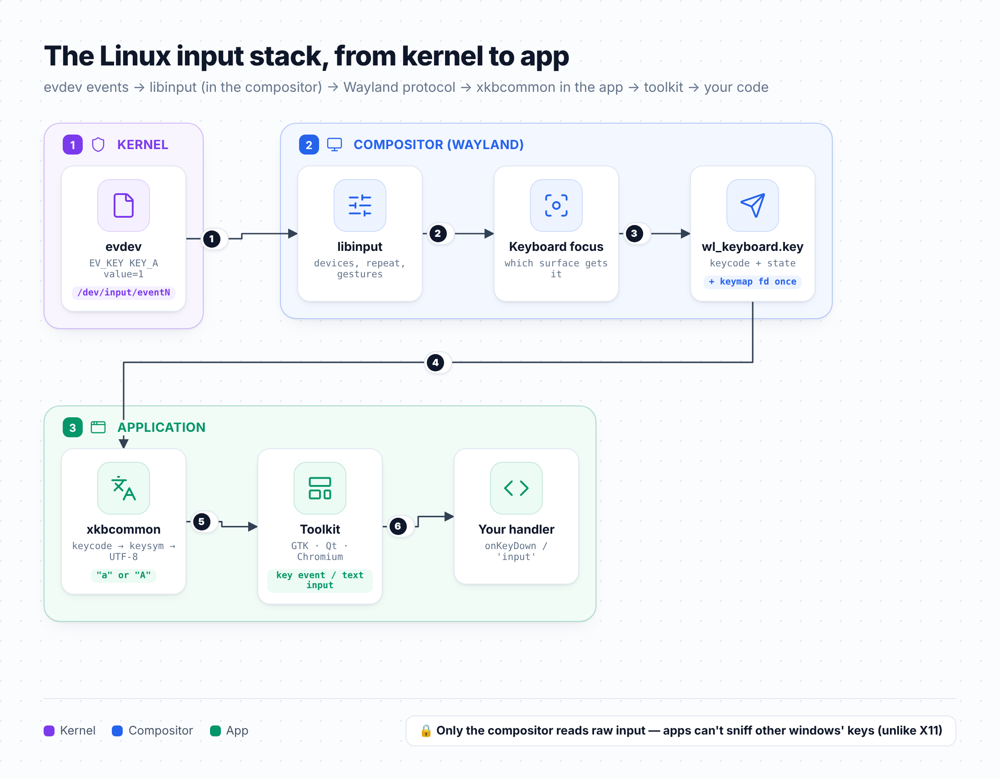

# 1.3 — Linux girdi yığını

!!! abstract "Tek cümlede"
    Kernel klavye raporunu bir **evdev** olayına çevirir (`KEY_A basıldı`); **compositor** onu **libinput** ile okur,
    **klavye odağının** hangi pencerede olduğuna karar verir ve o pencereye **Wayland** protokolüyle ham bir **keycode**
    gönderir; uygulamadaki **xkbcommon** **keymap**'i (düzen + değiştiriciler) uygulayıp bir **keysym** ve `"a"` metnini
    elde eder; toolkit ya da tarayıcı bunu koduna bir tuş olayı olarak verir.

## 📖 Temel terimler ve kısaltmalar

| Terim | Açılımı | Nedir | Nasıl çalışır (tek satır) |
|---|---|---|---|
| **Input alt sistemi** | — | Tüm girdi cihazları için kernel katmanı | Sürücüler olay bildirir; o dağıtır |
| **evdev** | event device | Genel arayüz `/dev/input/eventN` | `struct input_event`: zaman, tip, kod, değer |
| **EV_KEY / EV_SYN** | — | Olay tipleri | Tuş bas/bırak/tekrar; "bu grubun sonu" |
| **Keycode** | — | Fiziksel bir tuşun numarası | Linux'ta `KEY_A = 30` (xkb'de +8) |
| **libinput** | — | Girdi cihazlarını yöneten kütüphane | Cihaz kurulumu, imleç ivmesi, jestler, tuş durumu |
| **Compositor** | — | Wayland'da görüntü sunucusu (GNOME Mutter, KDE KWin, Sway) | Girdi + çıktının sahibi, pencereleri birleştirir |
| **Wayland / X11** | — | Görüntü protokolleri | Wayland: girdiyi compositor yönlendirir; X11: X sunucusu |
| **Odak** | Focus | Klavye girdisini hangi yüzeyin aldığı | Compositor seçer |
| **Keymap** | — | Keycode'lardan sembollere kurallar | Düzen, varyant, seçenekler (ör. `tr`, `us`, `caps:escape`) |
| **xkbcommon** | X Keyboard Extension common library | Uygulamaların ve compositor'ların kullandığı keymap motoru | Değiştirici durumunu izler, keysym + UTF-8 döner |
| **Keysym** | key symbol | Bir tuşun bir düzendeki anlamı | `XKB_KEY_a`, `XKB_KEY_A`, `XKB_KEY_Return` |
| **Değiştirici / seviye** | Modifier / level | Shift, AltGr, Ctrl… / tuştaki hangi sembol | Shift = seviye 2, AltGr = seviye 3 |
| **IME** | Input Method Editor | Karmaşık yazı sistemleri için metin oluşturur | text-input protokolü üzerinden ibus/fcitx |
| **KeyboardEvent** | — | Tarayıcının tuş olayı | `key` (anlam), `code` (fiziksel konum) |

## 🗺️ Büyük resim



---

## 1 · evdev: kernel'in bakışı

### Nedir?

Her girdi cihazı bir `/dev/input/eventN` dosyası alır. Onu okumak sabit boyutlu **`input_event`** kayıtları döner:

```text
time        type     code       value
...123456   EV_MSC   MSC_SCAN   0x70004     (ham HID usage)
...123456   EV_KEY   KEY_A      1           (1 = basıldı)
...123456   EV_SYN   SYN_REPORT 0           (grubun sonu)
...223401   EV_KEY   KEY_A      0           (0 = bırakıldı)
```

Kernel düzenleri ya da metni bilmez: `KEY_A` sadece "A konumundaki tuş" demektir. Bu dosyaları okuyabilen herkes her tuş vuruşunu loglayabilir; bu yüzden **sadece root/`input` grubu** okuyabilir.

## 2 · Compositor ve odak

### Nasıl çalışır?

- **Wayland**'da compositor (GNOME Shell/Mutter, KDE KWin, Sway, Hyprland) evdev cihazlarını **libinput** ile açar (aktif oturum için onları teslim eden **logind**'in izniyle).
- Önce **global kısayolları** işler (Super, Alt+Tab, ekran görüntüsü).
- Sonra olayı **sadece odaktaki yüzeye** gönderir: `wl_keyboard.key(serial, time, keycode, pressed)`. Odak değişince yeni pencere, zaten basılı tuşların listesiyle bir `enter` alır.
- **Keymap**'i bir kez (dosya tanımlayıcısı olarak) ve `modifiers` olaylarını da gönderir; böylece uygulama ve compositor düzen ve Shift/Caps durumu konusunda anlaşır.

**X11**'de bunu X sunucusu yapıyordu ama her X istemcisi tüm tuş vuruşlarını dinleyebiliyordu; Wayland'a geçişin büyük sebeplerinden biri bu.

## 3 · Keymap'ler: keycode'dan karaktere

### Nasıl çalışır?

1. Keycode `30` (+8 = xkb keycode 38, adı `<AC01>`).
2. `tr` düzeninin keymap'i `<AC01>`'in seviye 1–2'de `[ a, A ]` sembolleri olduğunu söyler.
3. xkbcommon **seviyeyi** seçmek için mevcut **değiştirici durumuna** (Shift? Caps Lock? AltGr?) bakar → keysym `a` ya da `A`.
4. `xkb_state_key_get_utf8()` `"a"` metnini döner.

Aynı fiziksel tuşun US-QWERTY'de `a`, AZERTY'de `q` vermesinin ve Türkçe düzende `ı`/`i`'nin sorunsuz çalışmasının sebebi bu: hepsi keymap'te. Ölü tuşlar ve compose dizileri (`´` + `e` = `é`) bu katmanda işlenir; Çince/Japonca için tam girdi yöntemleri `text-input` protokolü üzerinden bir **IME** kullanır.

**Tuş tekrarı** klavyede değil, compositor'ın duyurduğu hız ve gecikmeyle (`repeat_info`) istemci/toolkit tarafından üretilir.

## 4 · Toolkit'te ve tarayıcıda

GTK, Qt ve Chromium yukarıdakilerin hepsini sarar. Tarayıcıda JS'in bir **`KeyboardEvent`** görür:

| Alan | Shift + "A" konumundaki tuş (Türkçe Q düzeni) | Anlamı |
|---|---|---|
| `event.code` | `"KeyA"` | Fiziksel konum (düzenden bağımsız) |
| `event.key` | `"A"` | Mevcut düzendeki anlamı |
| `event.shiftKey` | `true` | Değiştirici durumu |
| `event.repeat` | `false` | Otomatik tekrar mı? |

Oyun kontrolleri için `code` ("WASD" konumları), kısayollar ve metin için `key`, metin alanları için de IME ve yapıştırma çalışsın diye `keydown` değil `input` olayını kullan.

## 🔧 DevOps bağlantısı

- **Uzak masaüstü / VDI / tarayıcı konsolları** (noVNC, bulut seri konsolları) keycode'ları düzenler arasında çevirir; "konsolda yanlış karakterler" genelde istemci ile sunucu arasındaki keymap uyumsuzluğudur. Orada özel karakterli şifre yazmak risklidir.
- **Headless sunucular:** `localectl set-keymap` / `set-x11-keymap` konsol ve X/Wayland oturumları için düzeni ayarlar; TTY için `loadkeys`.
- **Kiosklar ve test otomasyonu** girdiyi `uinput` (sanal bir evdev cihazı), `ydotool` (Wayland) ya da `xdotool` (X11) ile enjekte eder.
- **Güvenlik modeli:** Wayland'da uygulamalar diğer pencerelerin tuşlarını okuyamaz ya da global girdi enjekte edemez; buna ihtiyaç duyan araçlar (ekran paylaşımı, otomasyon) portal'lardan geçmek zorunda.

## 🧪 Kendin dene

```bash
sudo evtest                                 # tek bir cihazın ham evdev olayları
sudo libinput debug-events                  # libinput'un gördükleri (libinput-tools gerekir)
echo $XDG_SESSION_TYPE                      # wayland ya da x11
localectl status                            # mevcut konsol ve X/Wayland düzenleri
xkbcli compile-keymap --layout tr | grep -A3 '<AC01>'   # "A" tuşunun keymap girdisi (libxkbcommon-tools)
xkbcli interactive-wayland 2>/dev/null || xkbcli interactive-evdev   # canlı keycode → keysym → UTF-8
```

```js
// Tarayıcı konsolu: code ve key farkını izle
addEventListener('keydown', e => console.log(e.code, e.key, e.shiftKey, e.repeat));
```

## 🃏 Hatırlatma kartı

| Katman | Bildiği | Örnek |
|---|---|---|
| Klavye (HID) | Tuş konumu | usage `0x04` |
| Kernel (evdev) | Linux keycode | `KEY_A` = 30 |
| Compositor | Hangi pencere, kısayollar | `wl_keyboard.key 30 pressed` |
| xkbcommon | Düzen + değiştiriciler | keysym `A`, metin `"A"` |
| Tarayıcı | İkisi de | `code: "KeyA"`, `key: "A"` |

## ❓ Kendini test et

??? question "1. Wayland masaüstünde harfe (tuş konumunun aksine) nerede karar verilir?"
    Uygulamada; xkbcommon compositor'ın gönderdiği keymap'i mevcut değiştirici durumuyla uygular.

??? question "2. `/dev/input/event*` dosyaları neden normal kullanıcılar tarafından okunamaz?"
    Onları okumak herhangi bir programın sistem genelinde her tuş vuruşunu yakalamasına izin verirdi (keylogger).

??? question "3. Neden her X11 uygulaması şifrelerini yakalayabiliyordu ama Wayland'da yakalayamaz?"
    X11 her istemcinin tüm girdiyi dinlemesine izin veriyordu; Wayland'da compositor girdiyi sadece odaktaki yüzeye gönderir.

??? question "4. Bir oyun her düzende WASD kullanmalı. Hangi KeyboardEvent alanını okumalı?"
    `event.key` değil, fiziksel tuş konumu olan `event.code`.

??? question "5. Bir tuşu basılı tuttuğunda tuş tekrarını kim üretir?"
    Compositor'ın duyurduğu hız ve gecikmeyle istemci/toolkit; klavye sadece tuşun hâlâ basılı olduğunu bildirir.

---

## 📚 Kaynaklar

- [Linux kernel docs — Input subsystem / event interface](https://docs.kernel.org/input/input.html)
- [libinput documentation](https://wayland.freedesktop.org/libinput/doc/latest/)
- [Wayland book — Seats: keyboard input](https://wayland-book.com/seat/keyboard.html)
- [xkbcommon documentation](https://xkbcommon.org/doc/current/)
- [MDN — KeyboardEvent](https://developer.mozilla.org/en-US/docs/Web/API/KeyboardEvent)

## ✍️ Notlarım

> Yukarıdaki tarayıcı kodunu çalıştır, düzenini `tr` ile `us` arasında değiştir ve aynı tuşlara bas. Hangi alan değişiyor, hangisi aynı kalıyor?

-
