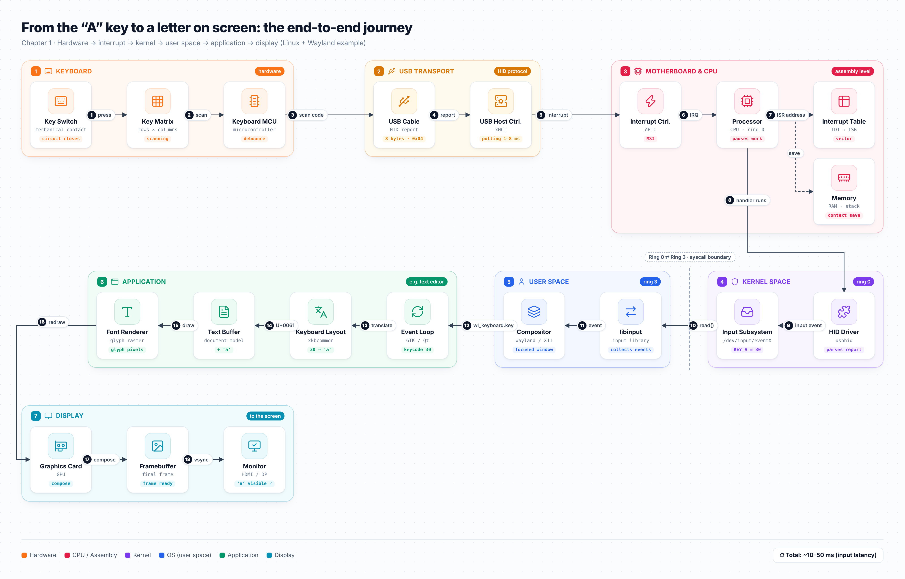

# Chapter 1 — What happens when you press “A”?

!!! abstract "In one sentence"
    A tiny computer inside the keyboard turns the keypress into a **number**, USB carries it to the host,
    an **interrupt** makes the CPU drop what it's doing and run the kernel, the kernel hands the event to
    **user space**, the application translates the number into the letter **'a'** using the keyboard layout and draws it,
    and the GPU sends the new frame to the monitor. All of this takes **~10–50 ms**.



> Reference setup: Linux + Wayland + USB keyboard. On Windows and macOS the layer names differ, but the logic is the same
> (see [Other operating systems](#other-operating-systems)).

---

## Layer by layer

### 1 · Keyboard (hardware)

| # | What happens | Why it matters |
|---|---|---|
| 1 | The **key switch** closes: two metal contacts touch and complete a circuit. | A keyboard has no idea what a "letter" is. It only knows which circuits are closed. |
| 2 | **Key matrix:** keys are wired into a rows × columns grid. The microcontroller drives each row in turn and checks which column responds (*scanning*). | ~8 × 18 lines are enough for 100+ keys instead of 100+ wires. |
| — | **Debounce:** contacts physically bounce for a few ms. The MCU filters this so it counts as a single press. | Without it, one press would type "aaaa". |
| 3 | The MCU converts the key into a **code**. On USB this is called a *HID usage*: “A” = **`0x04`**. | The code describes the key's **position**, not a letter. The same physical key sends the same code on any layout. |

### 2 · USB transport

| # | What happens |
|---|---|
| 3 | The MCU builds a **HID report**. In boot protocol it is 8 bytes: `[modifiers, 0x00, k1, k2, k3, k4, k5, k6]`. Pressing A gives `00 00 04 00 00 00 00 00`. |
| 4 | **The keyboard never speaks first.** The **USB Host Controller (xHCI)** on the computer asks it "anything new?" at a fixed interval (*polling*): 8 ms (125 Hz) on a normal keyboard, 1 ms (1000 Hz) on a gaming one. |
| — | When a new report arrives, xHCI writes it straight into RAM via **DMA**, without involving the CPU. |

### 3 · Motherboard & CPU (assembly level)

| # | What happens |
|---|---|
| 5 | xHCI raises an **interrupt** to say "done". On modern systems this is a write to a special memory address (**MSI**). |
| 6 | The **APIC** (interrupt controller) delivers it to a CPU core as a **vector number**. |
| — | The CPU may be running something else, say Spotify. It **finishes the current instruction and stops**. |
| 7 | It looks up the **handler address (ISR)** for that vector in the **IDT** (Interrupt Descriptor Table). |
| — | So it can come back later, the CPU pushes `RIP`, `CS`, `RFLAGS`, `RSP` and `SS` onto the **kernel stack** (*context save*) and switches from ring 3 to **ring 0** if needed. |
| 8 | It jumps to the handler. **Kernel code** is now running. |

Through assembly eyes, simplified:

```nasm
; --- The hardware does this automatically (no code from us) ---
; push SS, RSP, RFLAGS, CS, RIP   → "where the interrupted program was"
; RIP ← IDT[vector].handler        → jump to the handler

xhci_isr:
    push rax                    ; save the registers we will use
    push rdi
    ; ... (in Linux this calls into C: xhci_irq())
    mov  dword [lapic_eoi], 0   ; tell the APIC "interrupt handled" (End Of Interrupt)
    pop  rdi
    pop  rax
    iretq                       ; restore saved state → Spotify resumes where it was
```

!!! tip "Remember this"
    An **interrupt** is how hardware says "listen to me" to the CPU. The CPU drops everything, saves its state,
    runs the kernel, and returns with `iretq`. *Every* I/O device works this way: network cards, disks, keyboards.

### 4 · Kernel space (ring 0)

| # | What happens |
|---|---|
| 8 | `xhci_irq()` reads the event from RAM and tells the **usbhid** driver "your report arrived". |
| 9 | The HID layer parses the report: HID usage `0x04` maps to the Linux key code **`KEY_A = 30`**. The **input core** and **evdev** queue it as an event on `/dev/input/eventX`: `EV_KEY, KEY_A, 1 (pressed)` followed by `EV_SYN`. |

> Linux's "everything is a file" idea applies here too: the keyboard is a file, and keypresses are records you read from it.

### 5 · User space (ring 3)

| # | What happens |
|---|---|
| 10 | The compositor (Mutter on GNOME, KWin on KDE) was waiting on that file through **libinput** with `epoll`. It wakes up and fetches the event with the **`read()` syscall**. This is the dashed line in the diagram: **ring 0 → ring 3**. |
| 11 | libinput processes the event: is it a shortcut, a key repeat, and so on. |
| 12 | The compositor knows **which window has keyboard focus** and sends the event to that app over the Wayland protocol: `wl_keyboard.key(key=30, state=pressed)`. |

### 6 · Application

| # | What happens |
|---|---|
| 13 | The app's **event loop** (GTK or Qt) receives the message. |
| 14 | **xkbcommon** translates code `30` using the **keyboard layout**: `30 → keysym 'a' → Unicode U+0061`. With Shift held it would be 'A'; on a French AZERTY layout the same key gives 'q'. **This is the first moment a "letter" exists.** |
| 15 | The character is inserted into the **text buffer** and the widget marks itself "needs redraw". The font engine (HarfBuzz + FreeType) turns the shape of 'a' (*glyph*) into pixels. |
| 16 | The app draws the new frame into a buffer and hands it to the compositor with `wl_surface.commit`. |

### 7 · Display

| # | What happens |
|---|---|
| 17 | The compositor uses the **GPU** to combine all windows into a single frame in the **framebuffer**. |
| 18 | On the monitor's next refresh (**vsync**, every 16.7 ms at 60 Hz) the frame is sent over HDMI/DP, the pixels change, and **'a' appears.** |

---

## Where does the latency come from? (~10–50 ms)

| Source | Typical |
|---|---|
| Debounce + MCU | 1–5 ms |
| USB polling | 1–8 ms |
| Interrupt + kernel + compositor + app | < 1–5 ms |
| Waiting for the next frame (60 Hz) | 0–16.7 ms |
| Monitor processing + pixel response | 2–15 ms |

> DevOps connection: an HTTP request's **latency budget** works exactly the same way. The total is the sum of every hop, and the slowest hop sets what users feel.

---

## 🧪 Try it yourself (Linux)

On a Mac, run these labs in a Linux VM (UTM, Multipass) or on a Linux machine.

```bash
# 1) Check your keyboard's polling interval (bInterval)
lsusb                                   # find the keyboard's Bus/Device numbers
sudo lsusb -v -s <bus>:<dev> | grep -E "bInterval|bInterfaceProtocol"

# 2) Watch the interrupt counter climb while you type
watch -n0.2 "grep -i xhci /proc/interrupts"

# 3) See what the kernel produces (step 9): you'll see MSC_SCAN 70004 and KEY_A
sudo evtest                             # pick your keyboard, press A

# 4) Events as libinput sees them (steps 10–11)
sudo libinput debug-events

# 5) What the application receives (steps 12–14)
wev        # Wayland: key 30 → sym: a, utf8: 'a'
xev        # X11:     keycode 38 (= 30 + 8) → keysym 0x61, a
```

**Exercise:** in the `evtest` output, find the **press** (`value 1`), **hold/repeat** (`value 2`) and **release** (`value 0`) events for A. Think about who is responsible for key repeat.

---

## 🃏 Cheat sheet

```text
Key → circuit closes → matrix scan → MCU: HID usage 0x04
   → USB HID report (8 bytes) → xHCI polling + DMA → RAM
   → MSI interrupt → APIC → CPU: stop, save, IDT → ISR (ring 0)
   → xhci → usbhid → KEY_A(30) → evdev /dev/input/eventX
   → [syscall read()] → libinput → compositor → wl_keyboard.key(30)
   → app event loop → xkbcommon (layout) → 'a' U+0061
   → text buffer → glyph → buffer commit → GPU compose → vsync → monitor
```

- The keyboard sends a **position**, not a **letter**. The letter only appears at the keymap inside the app.
- A USB keyboard **never speaks first**. The host polls it.
- **Interrupt = grabbing the CPU's attention.** It saves state, runs the handler, and returns with `iret`.
- The **ring 0 / ring 3** boundary is crossed with a **syscall**.

---

## ❓ Test yourself

??? question "1. If you switch from QWERTY to AZERTY, does the code sent over USB change for the same physical key?"
    No. The code (`0x04`) describes the key's **position**. Translating it to a character is done by the OS or the app, using the layout.

??? question "2. With 8 ms polling, how long can a keypress wait in the worst case?"
    About 8 ms. If you press right after a poll, the report waits until the next one.

??? question "3. What happens to the program the CPU was running when the interrupt arrived?"
    The CPU finishes the current instruction, saves the program's state (`RIP`, `RFLAGS`, …) on the stack, runs the handler, and resumes the program exactly where it was with `iretq`. The program never notices.

??? question "4. Why don't applications read the keyboard directly from /dev/input?"
    Security and focus. If every app could read every key, every app would be a keylogger. The compositor only delivers events to the **focused** window.

??? question "5. Why is the 'A' keycode 38 on X11 but 30 on Wayland?"
    For historical reasons X11 adds 8 to the evdev code (`30 + 8 = 38`). Wayland sends the evdev code as is.

---

## Other operating systems

| Layer | Linux | Windows | macOS |
|---|---|---|---|
| HID driver | usbhid + input core | kbdhid.sys / HID class | IOHIDFamily (IOKit) |
| Event queue | evdev | Raw Input / message queue | IOHIDSystem → WindowServer |
| Window system | Wayland / X11 compositor | DWM + win32k | WindowServer |
| Message to the app | wl_keyboard.key | WM_KEYDOWN / WM_CHAR | NSEvent keyDown |

---

## 📚 Sources

- [Linux Input Subsystem documentation](https://www.kernel.org/doc/html/latest/input/input.html)
- [USB HID Usage Tables (Keyboard/Keypad page 0x07)](https://usb.org/document-library/hid-usage-tables-15)
- [The Wayland Protocol (book): Seat & keyboard](https://wayland-book.com/seat/keyboard.html)
- [libxkbcommon](https://xkbcommon.org/)
- Intel® 64 and IA-32 SDM, Vol. 3A, Chapter 6 “Interrupt and Exception Handling”

## ✍️ My notes

> After reading, explain this chapter in your own words in 5 lines. The parts you can't explain are the parts you don't understand yet.

-
