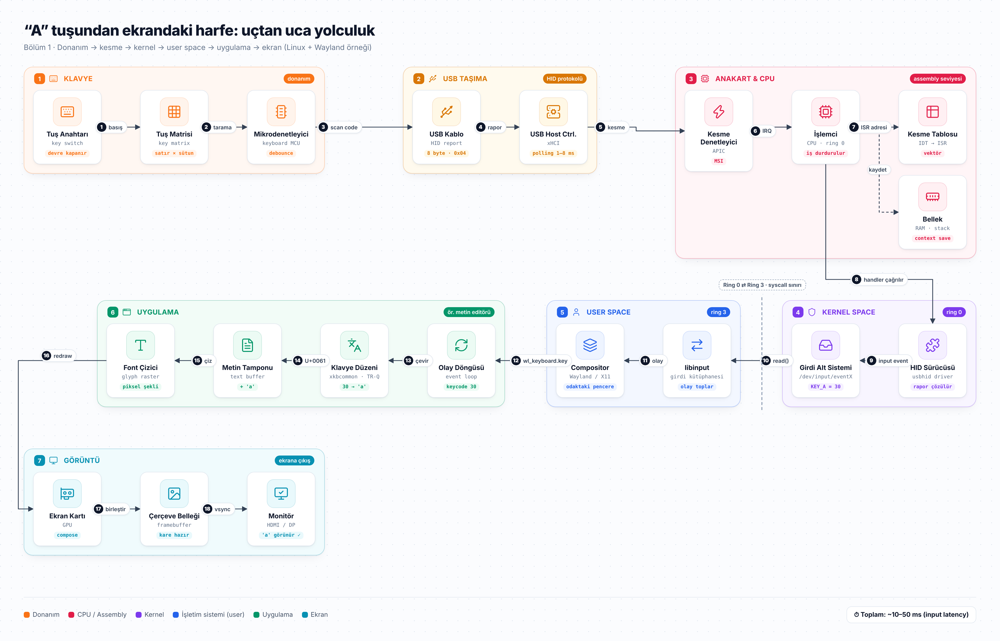
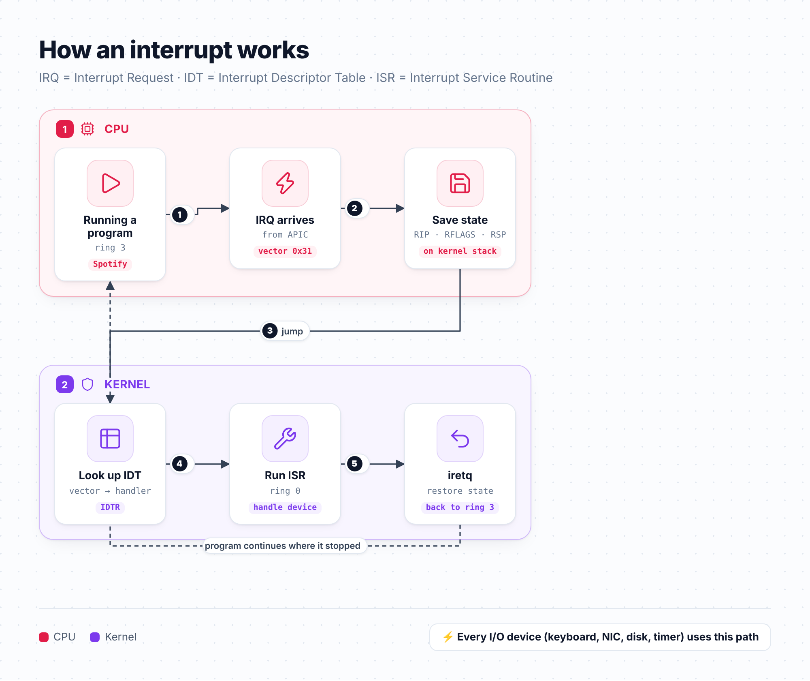

# Bölüm 1 — “A” tuşuna bastığımızda ne olur?

!!! abstract "Kısaca"
    Tuşa basınca klavyedeki küçük bir bilgisayar bunu **sayıya** çevirir. USB bu sayıyı bilgisayara taşır. CPU'ya bir
    **kesme (interrupt)** gelir, CPU işini bırakıp kernel'i çalıştırır. Kernel olayı **user space**'e iletir, uygulama
    sayıyı klavye düzenine göre **'a' harfine** çevirip çizer ve GPU bu kareyi monitöre yollar. Bunların hepsi **~10–50
    ms** içinde olur.

## 📖 Temel terimler ve kısaltmalar

| Terim | Açılımı | Nedir | Nasıl çalışır (tek satır) |
|---|---|---|---|
| **MCU** | Microcontroller Unit | Klavyenin içindeki minik bilgisayar | Tuş matrisini tarar, titreşimi giderir, HID raporu üretir |
| **HID** | Human Interface Device | Klavye ve fareler için USB cihaz sınıfı | Sabit formatlı raporlar gönderir (klavyede 8 byte) |
| **USB** | Universal Serial Bus | Klavye ile PC arasındaki kablo/protokol | Host cihazları sabit aralıklarla yoklar |
| **xHCI** | eXtensible Host Controller Interface | USB host denetleyici çipi | Cihazları yoklar, veriyi DMA ile RAM'e yazar, kesme üretir |
| **DMA** | Direct Memory Access | Cihazın CPU olmadan RAM'e yazması | CPU çalışmaya devam ederken denetleyici veriyi kopyalar |
| **IRQ / MSI** | Interrupt Request / Message Signaled Interrupt | Bir cihazın CPU'ya sinyali | MSI = APIC'in kesmeye çevirdiği özel bir adrese yazma |
| **APIC** | Advanced Programmable Interrupt Controller | Kesmeleri CPU çekirdeklerine yönlendirir | Bir çekirdeğe vektör numarası iletir |
| **IDT / ISR** | Interrupt Descriptor Table / Interrupt Service Routine | Handler tablosu / handler'ın kendisi | CPU vektörü IDT'de bulur ve ISR'a atlar |
| **Ring 0 / ring 3** | — | Kernel modu / kullanıcı modu | CPU yetki seviyeleri; syscall ve kesmeler bu sınırı geçer |
| **evdev** | event device | Linux'un genel girdi olay arayüzü | Tuş olaylarını /dev/input/eventX'te kuyruğa koyar |
| **Compositor** | — | Pencereleri birleştiren görüntü sunucusu (Wayland/X11) | Girdiyi okur, odaktaki pencereye yollar, kareleri birleştirir |
| **xkb** | X Keyboard Extension | Klavye düzeni veritabanı/kütüphanesi | Keycode + düzen + değiştiricileri bir karaktere eşler |
| **GPU / framebuffer** | Graphics Processing Unit | Grafik çipi / son kareyi tutan bellek | Pencereleri framebuffer'da birleştirir, monitöre gönderir |
| **vsync** | vertical synchronization | Monitörün yenilenme anı | Yeni kareler sadece her yenilemede görünür (60 Hz'de 16,7 ms) |

## 🗺️ Büyük resim



> Örnek ortam: Linux + Wayland + USB klavye. Windows ve macOS'ta katmanların isimleri değişir ama mantık aynıdır
> (bkz. [Diğer işletim sistemleri](#diger-isletim-sistemleri)).

---

## Katman katman

### 1 · Klavye (donanım)

| # | Ne oluyor | Neden önemli |
|---|---|---|
| 1 | **Tuş anahtarı** basılınca iki metal kontak birbirine değer ve devre kapanır. | Klavyede “harf” diye bir şey yoktur, sadece kapanan devreler vardır. |
| 2 | **Tuş matrisi:** tuşlar satır × sütun ızgarasına bağlıdır. Mikrodenetleyici satırlara sırayla sinyal verir ve hangi sütunun cevap verdiğine bakar (*scanning*). | 100+ tuş için 100+ kablo yerine yaklaşık 8 × 18 hat yeter. |
| — | **Debounce:** kontak basılınca birkaç ms boyunca titrer (açılıp kapanır). MCU bu titreşimi tek bir basış olarak sayar. | Aksi halde bir basış “aaaa” olarak yazılırdı. |
| 3 | MCU basılan tuşu bir **koda** çevirir. USB'de bu kodun adı *HID usage*'dır: “A” = **`0x04`**. | Kod harfi değil, tuşun **konumunu** gösterir. Türkçe ya da İngilizce klavyede aynı tuş aynı kodu üretir. |

### 2 · USB taşıma

| # | Ne oluyor |
|---|---|
| 3 | MCU bir **HID raporu** hazırlar. Boot protokolünde bu rapor 8 byte'tır: `[modifier, 0x00, k1, k2, k3, k4, k5, k6]`. A'ya basıldığında rapor `00 00 04 00 00 00 00 00` olur. |
| 4 | **Klavye kendiliğinden veri göndermez.** Bilgisayardaki **USB Host Controller (xHCI)** klavyeye düzenli aralıklarla “yeni bir şey var mı?” diye sorar (*polling*). Bu aralık normal klavyede 8 ms (125 Hz), oyuncu klavyesinde 1 ms (1000 Hz) olur. |
| — | Yeni rapor geldiğinde xHCI onu **DMA** ile doğrudan RAM'e yazar. Bu sırada CPU meşgul edilmez. |

### 3 · Anakart & CPU (assembly seviyesi)

| # | Ne oluyor |
|---|---|
| 5 | xHCI “işim bitti” demek için bir **kesme** üretir. Modern sistemlerde bu kesme özel bir bellek adresine yapılan yazmadır (**MSI**). |
| 6 | **APIC** (kesme denetleyicisi) bu kesmeyi bir **vektör numarasıyla** CPU'ya iletir. |
| — | CPU o an başka bir programı çalıştırıyor olabilir, örneğin Spotify. Elindeki **komutu bitirir ve durur.** |
| 7 | CPU, **IDT** (Interrupt Descriptor Table) tablosunda vektör numarasına karşılık gelen **handler adresini (ISR)** bulur. |
| — | CPU, kesilen programa geri dönebilmek için `RIP`, `CS`, `RFLAGS`, `RSP` ve `SS` register'larını **kernel stack**'ine kaydeder (*context save*). Gerekirse ring 3'ten **ring 0**'a geçer. |
| 8 | CPU handler'a atlar. Artık **kernel kodu** çalışıyor. |

Assembly gözüyle, sadeleştirilmiş hali:

```nasm
; --- Donanım bunu otomatik yapar (biz kod yazmayız) ---
; push SS, RSP, RFLAGS, CS, RIP   → kesilen programın "kaldığı yer"
; RIP ← IDT[vektör].handler        → handler'a atla

xhci_isr:
    push rax                ; kullanacağımız register'ları sakla
    push rdi
    ; ... (Linux'ta burası C kodu: xhci_irq() çağrılır)
    mov  dword [lapic_eoi], 0   ; APIC'e "kesmeyi aldım" (End Of Interrupt)
    pop  rdi
    pop  rax
    iretq                   ; kaydedilenleri geri yükle → Spotify kaldığı yerden devam
```

!!! tip "Bunu hatırla"
    **Kesme**, donanımın CPU'ya “beni dinle” deme yoludur. CPU her şeyi bırakır, kaydeder, kernel'i çalıştırır
    ve `iretq` ile kaldığı yere döner. Bilgisayardaki *her* G/Ç işlemi bu mekanizmayla yürür: ağ kartı, disk, klavye.

### 4 · Kernel space (ring 0)

| # | Ne oluyor |
|---|---|
| 8 | `xhci_irq()` RAM'deki olayı okur ve **usbhid** sürücüsüne “raporun geldi” der. |
| 9 | HID katmanı raporu çözer. HID usage `0x04`, Linux tuş kodu **`KEY_A = 30`** olarak eşleştirilir. **input core** ve **evdev** bu bilgiyi bir olay olarak `/dev/input/eventX` dosyasının kuyruğuna koyar: `EV_KEY, KEY_A, 1(basıldı)`, ardından `EV_SYN`. |

> Linux'ta “her şey dosyadır” fikri burada da geçerli: klavye bir dosyadır ve basışlar o dosyadan okunan kayıtlardır.

### 5 · User space (ring 3)

| # | Ne oluyor |
|---|---|
| 10 | Compositor (GNOME'da Mutter, KDE'de KWin), **libinput** üzerinden bu dosyayı `epoll` ile bekliyordu. Uyanır ve **`read()` syscall**'u ile olayı okur. Kesikli çizgi bu sınırı gösteriyor: **ring 0 → ring 3**. |
| 11 | libinput olayı işler. Kısayol mu, tuş tekrarı mı gibi kontroller yapar. |
| 12 | Compositor klavyenin **hangi pencerede** olduğunu bilir ve olayı Wayland protokolüyle o uygulamaya gönderir: `wl_keyboard.key(key=30, state=pressed)`. |

### 6 · Uygulama

| # | Ne oluyor |
|---|---|
| 13 | Uygulamanın **event loop**'u (GTK veya Qt) mesajı alır. |
| 14 | **xkbcommon**, `30` kodunu **klavye düzenine** (Türkçe-Q) göre çevirir: `30 → keysym 'a' → Unicode U+0061`. Shift basılı olsaydı 'A', Türkçe-F düzeninde ise 'u' çıkardı. **Harf ilk kez burada ortaya çıkıyor.** |
| 15 | Karakter **metin tamponuna** eklenir. Widget “yeniden çizilmem lazım” der. Font motoru (HarfBuzz ile FreeType) 'a' harfinin şeklini (*glyph*) piksellere çevirir. |
| 16 | Uygulama yeni kareyi bir buffer'a çizer ve compositor'a teslim eder: `wl_surface.commit`. |

### 7 · Görüntü

| # | Ne oluyor |
|---|---|
| 17 | Compositor tüm pencereleri **GPU** ile tek bir kareye birleştirir ve **framebuffer**'a yazar. |
| 18 | Monitörün bir sonraki yenilenmesinde (**vsync**, 60 Hz'de her 16,7 ms) kare HDMI/DP üzerinden gönderilir. Pikseller değişir ve **'a' görünür.** |

### Kesme (interrupt) nasıl çalışır?

CPU bir programı çalıştırıyor. Bir cihaz **IRQ** üretir; bir sonraki komut sınırında CPU RIP/RFLAGS/RSP'yi kernel stack'ine kaydeder, ring 0'a geçer, vektörü **IDT**'de bulur ve **ISR**'a atlar. Handler en azını yapar (cihazı onayla, işi kuyruğa koy), sonra `iretq` kaydedilen durumu geri yükler ve program hiçbir şey olmamış gibi devam eder.



---

## Gecikme nereden geliyor? (~10–50 ms)

| Kaynak | Tipik süre |
|---|---|
| Debounce + MCU | 1–5 ms |
| USB polling | 1–8 ms |
| Kesme + kernel + compositor + uygulama | < 1–5 ms |
| Bir sonraki kareyi bekleme (60 Hz) | 0–16,7 ms |
| Monitörün iç işlemesi + piksel tepki süresi | 2–15 ms |

> DevOps bağlantısı: aynı mantık bir HTTP isteğinin **latency budget**'ında da var. Toplam süre, zincirdeki her halkanın süresinin toplamıdır ve en yavaş halka hissedilen süreyi belirler.

---

## 🚨 Olay hikâyesi: bir çekirdek kesmelerde boğuluyor

!!! failure "Alarm"
    Trafik artışından sonra yoğun bir API node'unun p99 gecikmesi ikiye katlanıyor. Ortalama CPU sadece %35 ama `top` bir çekirdeği **%100 `si`**'de gösteriyor, `ksoftirqd/0` process listesinin tepesinde.

Önce kendin teşhis etmeye çalış, sonra ipuçlarını tek tek aç.

??? info "🔍 İpucu 1"
    `/proc/interrupts`: NIC kuyruk kesmelerinin hepsi sadece **CPU0** sütununda artıyor; diğer 15 sütun neredeyse kıpırdamıyor.

??? info "🔍 İpucu 2"
    `ethtool -l eth0` `Combined: 1` gösteriyor: NIC **tek kuyrukla** çalışıyor. `systemctl status irqbalance` → minimal imajda kurulu değil.

??? success "🎯 Kök neden"
    Tüm paket işleme (hard IRQ + NET_RX softirq) tek bir çekirdeğe düşüyor. O çekirdek doyarken diğerleri boşta; paketler kuyrukta bekliyor ve *ortalama* CPU iyi görünse de gecikme artıyor.

??? tip "🛠️ Çözüm ve ders"
    Çoklu kuyruk aç (`ethtool -L eth0 combined 8`), IRQ'larını dağıt (irqbalance ya da `smp_affinity`), RPS/RFS'i düşün. **Ders:** ortalama CPU çekirdek başı doygunluğu gizler; `mpstat -P ALL`'a ve `si` sütununa bak.

## 🧭 Daha derine in

| Sayfa | Neler var |
|---|---|
| **[1.1 — Kesmeler ve cihaz sürücüleri](01-interrupts-drivers.md)** | Kesmeler nedir ve neden var, polling, kesme ve DMA farkı, MSI/MSI-X ve IRQ affinity, üst ve alt yarılar, sürücüler nasıl eşlenip yüklenir ve bunların üretimde nasıl göründüğü (softirq, irqbalance, NIC kuyrukları). |
| **[1.2 — USB ve HID](02-usb-hid.md)** | USB nasıl çalışır (host güdümlü yoklama, enumeration, tanımlayıcılar, endpoint'ler ve aktarım tipleri), HID sınıfı ve rapor tanımlayıcıları, 8 byte'lık klavye raporu, yoklama hızı ve gecikme, sunucularda, VM'lerde ve container'larda USB. |
| **[1.3 — Linux girdi yığını](03-input-stack.md)** | evdev ve girdi olayları, libinput, compositor ile Wayland ve X11 farkı, klavye odağı, xkbcommon ile keymap'ler (keycode → keysym → karakter), tuş tekrarı, girdi yöntemleri ve tarayıcıların bunu KeyboardEvent'e nasıl çevirdiği. |

## 🧪 Kendin dene (Linux)

!!! example "🧪 Hazır lab"
    Bu bölümün deneyleri tek komutla: `./labs/run.sh 01-keypress` ([script'ler](https://github.com/gaskinimbuspro/silicon-to-cloud/tree/main/labs/01-keypress/)). Kurulum istemiyorsan [Codespaces'te aç](https://codespaces.new/gaskinimbuspro/silicon-to-cloud). <!-- s2c-lab -->


Mac kullanıyorsan bu laboratuvarları bir Linux VM'de (UTM, Multipass) ya da bir Linux makinede yap.

```bash
# 1) Klavyenin polling aralığına bak (bInterval)
lsusb                                   # klavyenin Bus/Device numarasını bul
sudo lsusb -v -s <bus>:<dev> | grep -E "bInterval|bInterfaceProtocol"

# 2) Kesme sayacı: yazarken xhci satırının arttığını izle
watch -n0.2 "grep -i xhci /proc/interrupts"

# 3) Kernel'in ürettiği olayları gör (step 9): MSC_SCAN 70004 ve KEY_A görünecek
sudo evtest                             # listeden klavyeyi seç, A'ya bas

# 4) libinput'un gördüğü olaylar (step 10-11)
sudo libinput debug-events

# 5) Uygulamanın aldığı olay (step 12-14)
wev        # Wayland: key 30 → sym: a, utf8: 'a'
xev        # X11:     keycode 38 (= 30 + 8) → keysym 0x61, a
```

**Görev:** `evtest` çıktısında A'ya **basma** (`value 1`), **basılı tutma** (`value 2`) ve **bırakma** (`value 0`) olaylarını bul. Tuş tekrarını kimin yaptığını düşün.

---

## 🃏 Hatırlatma kartı

```text
Tuş → devre kapanır → matris taraması → MCU: HID usage 0x04
   → USB HID raporu (8 byte) → xHCI polling + DMA → RAM
   → MSI kesme → APIC → CPU: dur, kaydet, IDT → ISR (ring 0)
   → xhci → usbhid → KEY_A(30) → evdev /dev/input/eventX
   → [syscall read()] → libinput → compositor → wl_keyboard.key(30)
   → app event loop → xkbcommon (TR-Q) → 'a' U+0061
   → text buffer → glyph → buffer commit → GPU compose → vsync → monitör
```

- Klavye **harf** değil **konum** gönderir. Harf, uygulamadaki keymap'te ortaya çıkar.
- USB klavye **sorulmadan konuşmaz**, host onu polling ile yoklar.
- **Kesme = CPU'nun dikkatini çekmek.** CPU kaydeder, handler'ı çalıştırır, `iret` ile döner.
- **Ring 0 / ring 3** sınırı **syscall** ile geçilir.

---

## ❓ Kendini test et

??? question "1. Türkçe-F klavyede aynı fiziksel tuşa basınca USB'den giden kod değişir mi?"
    Hayır. Kod (`0x04`) tuşun **konumunu** gösterir. Çeviriyi işletim sistemi ya da uygulama klavye düzenine göre yapar.

??? question "2. Polling 8 ms ise bir tuş basışı en kötü ihtimalle ne kadar bekler?"
    Yaklaşık 8 ms. Basış, bir yoklamanın hemen ardından gelirse bir sonraki yoklamaya kadar bekler.

??? question "3. CPU başka bir programı çalıştırırken kesme gelirse o programa ne olur?"
    CPU elindeki komutu bitirir. Program durumunu (`RIP`, `RFLAGS`, …) stack'e kaydeder, handler'ı çalıştırır ve `iretq` ile programı kaldığı yerden devam ettirir. Program bunu fark etmez.

??? question "4. Uygulama klavyeyi neden doğrudan /dev/input'tan okumuyor?"
    Güvenlik ve odak yüzünden. Her uygulama tüm tuşları okuyabilseydi her uygulama bir keylogger olurdu. Compositor olayı sadece **odaktaki** pencereye verir.

??? question "5. X11'de 'A' tuşunun keycode'u neden 38, Wayland'de neden 30?"
    X11 tarihsel nedenlerle evdev koduna 8 ekler (`30 + 8 = 38`). Wayland evdev kodunu olduğu gibi gönderir.

---

## Diğer işletim sistemleri

| Katman | Linux | Windows | macOS |
|---|---|---|---|
| HID sürücüsü | usbhid + input core | kbdhid.sys / HID class | IOHIDFamily (IOKit) |
| Olay kuyruğu | evdev | Raw Input / message queue | IOHIDSystem → WindowServer |
| Pencere sistemi | Wayland / X11 compositor | DWM + win32k | WindowServer |
| Uygulamaya mesaj | wl_keyboard.key | WM_KEYDOWN / WM_CHAR | NSEvent keyDown |

---

## 📚 Kaynaklar

- [Linux Input Subsystem dokümantasyonu](https://www.kernel.org/doc/html/latest/input/input.html)
- [USB HID Usage Tables (Keyboard/Keypad page 0x07)](https://usb.org/document-library/hid-usage-tables-15)
- [The Wayland Protocol (kitap): Seat & keyboard bölümü](https://wayland-book.com/seat/keyboard.html)
- [libxkbcommon](https://xkbcommon.org/)
- Intel® 64 and IA-32 SDM, Vol. 3A, Bölüm 6 “Interrupt and Exception Handling”

## ✍️ Kendi notlarım

> Bu bölümü okuduktan sonra kendi cümlelerinle 5 satırda anlat. Anlatamadığın yer, henüz anlamadığın yerdir.
