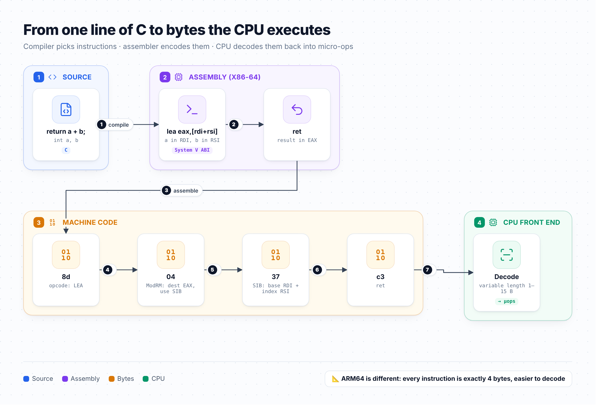
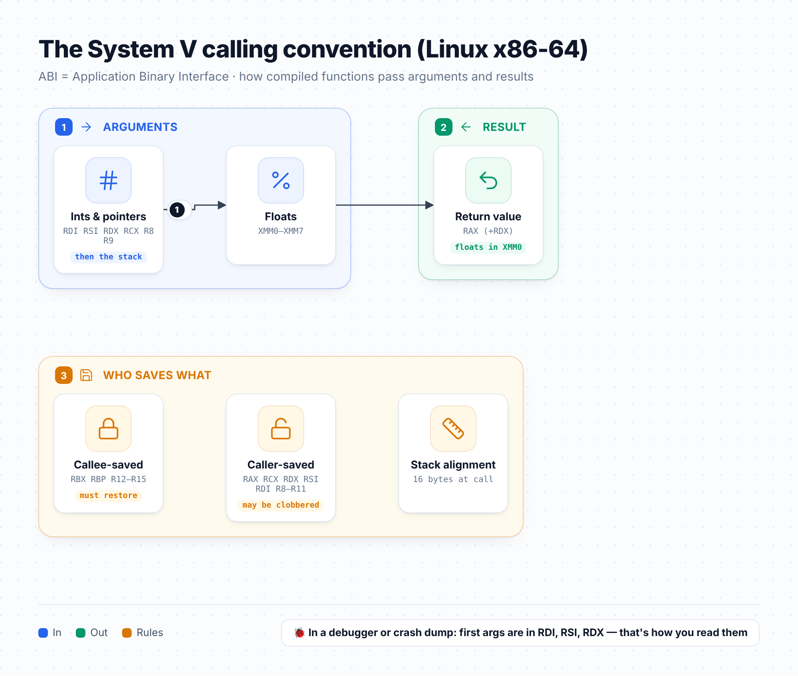

# 2.1 — Instruction sets & assembly

!!! abstract "In one sentence"
    An **ISA** is the contract between software and a CPU: the list of instructions, registers and rules the chip
    promises to understand. Compilers turn your code into those instructions, the assembler **encodes** them into bytes,
    and the **calling convention** (part of the **ABI**) says how functions pass arguments and results, which is exactly
    what you need to read compiler output, `perf` profiles and crash dumps.

## 📖 Key terms & abbreviations

| Term | Stands for | What it is | How it works (one line) |
|---|---|---|---|
| **ISA** | Instruction Set Architecture | The instructions + registers a CPU family understands | x86-64, ARM64 (AArch64), RISC-V |
| **CISC / RISC** | Complex / Reduced Instruction Set Computer | Two design philosophies | Many variable-length instructions vs few fixed-length ones |
| **Opcode** | operation code | The bytes that say which instruction | `8d` = LEA, `c3` = RET |
| **Operand** | — | What an instruction works on | Register, memory address, immediate value |
| **Addressing mode** | — | How a memory operand is computed | `[base + index*scale + disp]` |
| **ModRM / SIB** | Mod-Reg-R/M / Scale-Index-Base | x86 bytes encoding operands | Pick registers and address form |
| **Immediate** | — | A constant inside the instruction | `mov eax, 42` |
| **Flags (RFLAGS)** | — | Bits set by arithmetic | ZF (zero), CF (carry), SF (sign), OF (overflow) |
| **Jump / branch** | — | Changes RIP | `jmp`, conditional `je`, `jne`, `jl` … after `cmp` |
| **SIMD** | Single Instruction, Multiple Data | One instruction on many values | SSE, AVX2, AVX-512 (x86); NEON, SVE (ARM) |
| **µop** | micro-operation | Internal simpler operation | x86 decodes instructions into µops |
| **ABI** | Application Binary Interface | Binary-level rules between compiled code | Calling convention, struct layout, syscalls |
| **Calling convention** | — | How args/returns/registers are handled in calls | System V on Linux/macOS, Microsoft x64 on Windows |
| **Disassembler** | — | Turns bytes back into assembly | `objdump -d`, `gdb`, Compiler Explorer |

## 🗺️ Big picture



---

## 1 · What is an ISA?

### What is it?

The ISA is the **visible interface** of a CPU: registers, instructions, memory model, privilege levels. Any chip implementing it (Intel, AMD, different generations) runs the same binaries, even though their insides differ completely. That's why you build separate images for **`linux/amd64`** and **`linux/arm64`**.

| | x86-64 | ARM64 (AArch64) | RISC-V |
|---|---|---|---|
| Style | CISC | RISC | RISC (open standard) |
| Instruction length | 1–15 bytes | always 4 bytes | 4 (2 with compressed ext.) |
| General registers | 16 (RAX…R15) | 31 (X0…X30) | 31 (x1…x31) |
| Memory operands | Most instructions can use memory | Only load/store touch memory | Load/store only |
| Where | Most servers, PCs | Phones, Apple Silicon, AWS Graviton, Ampere, NVIDIA Grace | Embedded, growing |

Inside, modern x86 cores decode instructions into RISC-like **µops**, so the difference today is mostly about decoding cost, ecosystem and power efficiency.

## 2 · How are instructions encoded?

### How does it work?

`return a + b;` compiles (with `-O2`) to `lea eax, [rdi+rsi]` / `ret`, which becomes `8d 04 37 c3`:

| Byte | Field | Meaning |
|---|---|---|
| `8d` | opcode | LEA (load effective address, used here as a fast add) |
| `04` | ModRM | destination register EAX; memory operand uses a SIB byte |
| `37` | SIB | base = RDI, index = RSI, scale = 1 |
| `c3` | opcode | RET |

On x86 the CPU must find where each instruction **ends** before decoding the next (lengths vary), which is why x86 front ends are complex and cache decoded µops. ARM64's fixed 4-byte instructions make decoding many at once simpler.

## 3 · Reading assembly: the 15 instructions you'll see most

| Instruction | Does |
|---|---|
| `mov dst, src` | Copy |
| `lea dst, [addr]` | Compute an address (often arithmetic) |
| `add / sub / imul / xor` | Arithmetic (`xor eax, eax` = set to 0) |
| `cmp a, b` / `test a, b` | Set flags only |
| `je / jne / jl / jg / jmp` | (Conditional) jump |
| `call f` / `ret` | Push return address & jump / pop & return |
| `push / pop` | Stack |
| `syscall` | Enter the kernel |
| `nop` | Nothing (alignment) |
| `endbr64` | CET landing pad for indirect jumps (security) |

**Intel vs AT&T syntax:** `objdump` defaults to AT&T (`lea (%rdi,%rsi),%eax`, source first); add `-M intel` for the order used above.

## 4 · The calling convention



- Integer/pointer arguments: **RDI, RSI, RDX, RCX, R8, R9**, then the stack. Floats in **XMM0–7**.
- Return value in **RAX** (and RDX for 128-bit), floats in XMM0.
- **Callee-saved** (RBX, RBP, R12–R15): a function that uses them must restore them. **Caller-saved**: may be overwritten by any call.
- The stack must be **16-byte aligned** at each `call` (SIMD instructions rely on it).
- Syscalls use a slightly different set: number in **RAX**, args in RDI, RSI, RDX, **R10**, R8, R9.

ARM64 is similar: args in **X0–X7**, return in X0, return address in the **link register X30**.

## 5 · SIMD: one instruction, many values

AVX2 registers hold 256 bits = 8 floats; AVX-512 holds 16. One `vaddps` adds 8 pairs at once. Compilers **auto-vectorize** simple loops at `-O2/-O3`; libraries (BLAS, simdjson, compression, crypto, NumPy) use it heavily. Containers built with `-march=native` can **crash with "illegal instruction"** on older CPUs that lack those extensions.

## 🔧 DevOps connection

- **Multi-arch images:** `docker buildx build --platform linux/amd64,linux/arm64` + a manifest list. ARM nodes (Graviton etc.) are often 20–40% cheaper per performance; a wrong-arch image fails with `exec format error`.
- **`illegal instruction` (SIGILL)** after moving to new or older hardware: the binary uses AVX-512/AVX2 the CPU doesn't have. Build for a baseline (`x86-64-v2/v3`) or check `/proc/cpuinfo` flags.
- **Reading crash dumps:** in a core dump or `gdb` backtrace, the first arguments of the crashed function are in RDI/RSI/RDX; `info registers` + `disassemble` tells you which instruction faulted.
- **Profiling:** `perf annotate` shows which instructions are hot; you don't need to write assembly, but recognizing `call`, loops and `div` helps.

## 🧪 Try it yourself

```bash
cat > add.c <<'EOF'
int add(int a, int b) { return a + b; }
int sum(int *v, int n) { int s = 0; for (int i = 0; i < n; i++) s += v[i]; return s; }
EOF
gcc -O2 -c add.c && objdump -d -M intel add.o          # see lea/ret and the bytes
gcc -O3 -mavx2 -S -masm=intel -o - add.c | grep -E 'vpadd|ymm' | head   # auto-vectorized loop
grep -o -w -E 'avx2|avx512f|sse4_2' /proc/cpuinfo | sort -u           # SIMD the CPU supports
/lib64/ld-linux-x86-64.so.2 --help 2>/dev/null | grep supported      # x86-64-v2/v3/v4 levels
uname -m; docker buildx ls 2>/dev/null | head -3
# Online: https://godbolt.org (Compiler Explorer) — paste C, Go or Rust and see the assembly
```

## 🃏 Cheat sheet

| Need | Remember |
|---|---|
| Args (Linux x86-64) | RDI, RSI, RDX, RCX, R8, R9 |
| Return | RAX |
| Syscall | `syscall`, number in RAX, 4th arg in R10 |
| Args (ARM64) | X0–X7, return X0, LR = X30 |
| Zero a register | `xor eax, eax` |
| Disassemble | `objdump -d -M intel`, `gdb disassemble`, godbolt |

## ❓ Test yourself

??? question "1. Why does an `amd64` image fail on a Graviton node?"
    Graviton is ARM64; the binary's instructions belong to a different ISA. The kernel refuses to execute it (`exec format error`).

??? question "2. Why is decoding x86 harder than ARM64?"
    x86 instructions are 1–15 bytes long, so the CPU must find instruction boundaries first; ARM64 instructions are always 4 bytes.

??? question "3. In a gdb session a function crashed. Where do you find its first two arguments?"
    In RDI and RSI (System V calling convention), if they haven't been overwritten yet.

??? question "4. A program dies with SIGILL after migrating to another VM type. What's a likely cause?"
    It was compiled for CPU extensions (AVX-512, AVX2) the new CPU doesn't support.

??? question "5. What does `xor eax, eax` do and why do compilers prefer it?"
    Sets EAX to zero; it's shorter than `mov eax, 0` and recognized by the CPU as a dependency-breaking zero idiom.

---

## 📚 Sources

- [Intel 64 and IA-32 Architectures Software Developer Manuals](https://www.intel.com/content/www/us/en/developer/articles/technical/intel-sdm.html)
- [System V AMD64 ABI](https://gitlab.com/x86-psABIs/x86-64-ABI)
- [Arm A64 Instruction Set Architecture](https://developer.arm.com/documentation/ddi0602/latest/)
- [Compiler Explorer](https://godbolt.org/)
- [Docker — Multi-platform builds](https://docs.docker.com/build/building/multi-platform/)

## ✍️ My notes

> Paste a small function from your own code into godbolt. Find the `call`s, the loop and where the result ends up.

-
