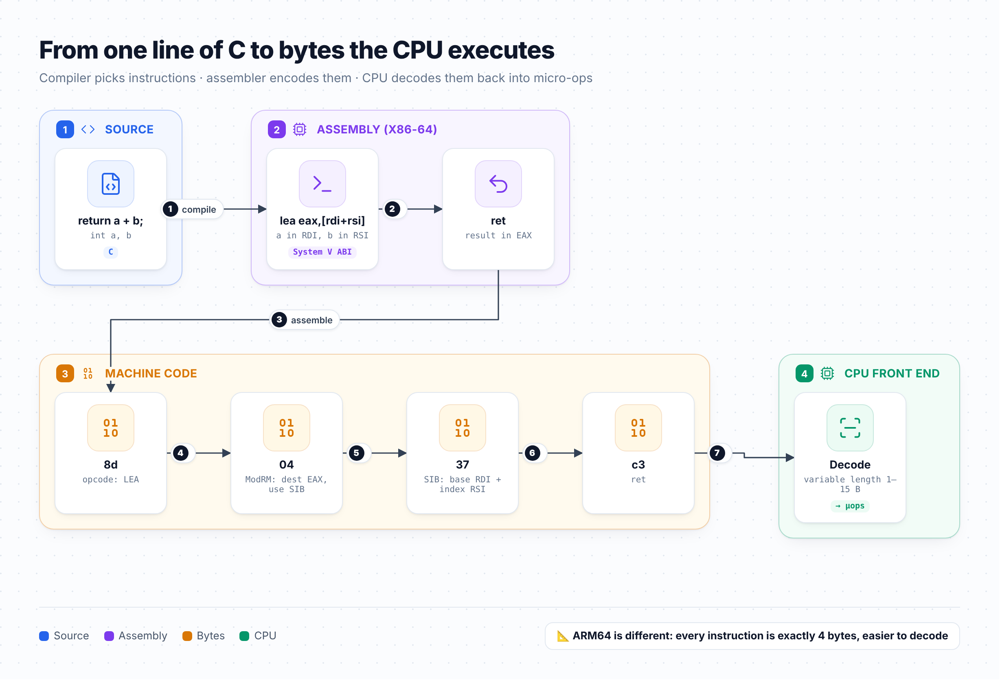
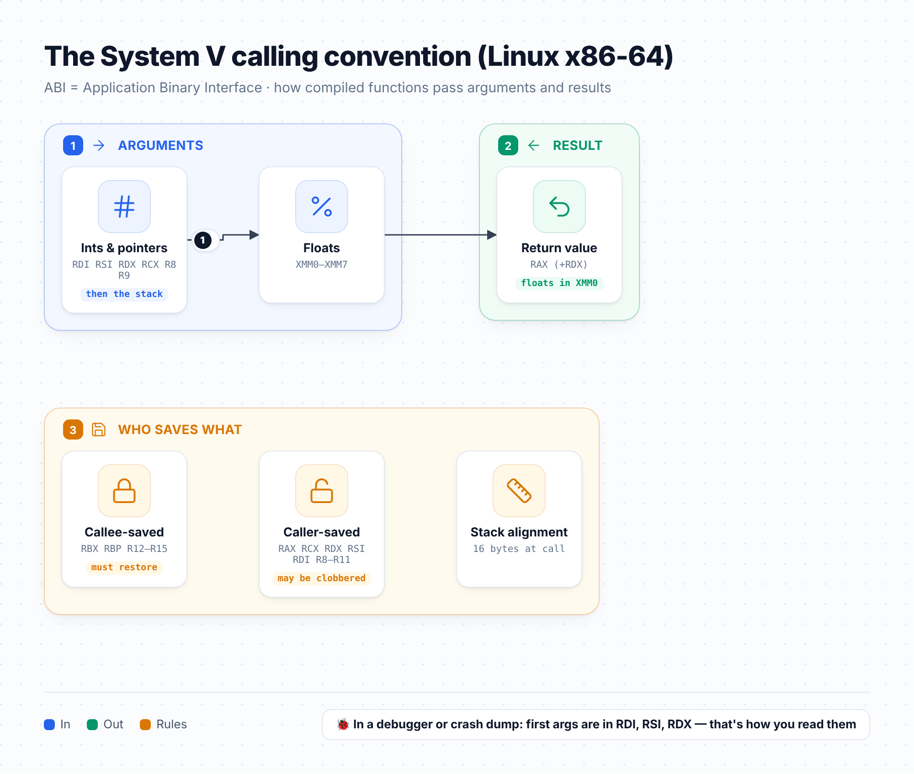

# 2.1 — Komut setleri ve assembly

!!! abstract "Tek cümlede"
    **ISA**, yazılım ile CPU arasındaki sözleşmedir: çipin anlamayı vaat ettiği komutların, register'ların ve kuralların
    listesi. Derleyiciler kodunu bu komutlara çevirir, assembler onları byte'lara **kodlar** ve **çağrı kuralı**
    (**ABI**'nin bir parçası) fonksiyonların argüman ve sonuçları nasıl aktardığını söyler; derleyici çıktısını, `perf`
    profillerini ve crash dump'ları okumak için tam da bu gerekir.

## 📖 Temel terimler ve kısaltmalar

| Terim | Açılımı | Nedir | Nasıl çalışır (tek satır) |
|---|---|---|---|
| **ISA** | Instruction Set Architecture | Bir CPU ailesinin anladığı komutlar + register'lar | x86-64, ARM64 (AArch64), RISC-V |
| **CISC / RISC** | Complex / Reduced Instruction Set Computer | İki tasarım felsefesi | Çok sayıda değişken uzunluklu komut / az sayıda sabit uzunluklu komut |
| **Opcode** | operation code | Hangi komut olduğunu söyleyen byte'lar | `8d` = LEA, `c3` = RET |
| **Operand** | — | Bir komutun üzerinde çalıştığı şey | Register, bellek adresi, sabit değer |
| **Adresleme modu** | Addressing mode | Bir bellek operandının nasıl hesaplandığı | `[taban + indeks*ölçek + kayma]` |
| **ModRM / SIB** | Mod-Reg-R/M / Scale-Index-Base | Operandları kodlayan x86 byte'ları | Register'ları ve adres biçimini seçer |
| **Immediate** | — | Komutun içindeki sabit | `mov eax, 42` |
| **Bayraklar (RFLAGS)** | Flags | Aritmetiğin set ettiği bitler | ZF (sıfır), CF (elde), SF (işaret), OF (taşma) |
| **Atlama / dal** | Jump / branch | RIP'i değiştirir | `jmp`, `cmp` sonrası koşullu `je`, `jne`, `jl` … |
| **SIMD** | Single Instruction, Multiple Data | Çok değer üzerinde tek komut | SSE, AVX2, AVX-512 (x86); NEON, SVE (ARM) |
| **µop** | micro-operation | İçerideki daha basit işlem | x86 komutları µop'lara çözer |
| **ABI** | Application Binary Interface | Derlenmiş kodlar arası ikili düzey kurallar | Çağrı kuralı, struct düzeni, syscall'lar |
| **Çağrı kuralı** | Calling convention | Çağrılarda argüman/dönüş/register'ların nasıl ele alındığı | Linux/macOS'ta System V, Windows'ta Microsoft x64 |
| **Disassembler** | — | Byte'ları assembly'ye geri çevirir | `objdump -d`, `gdb`, Compiler Explorer |

## 🗺️ Büyük resim



---

## 1 · ISA nedir?

### Nedir?

ISA bir CPU'nun **görünen arayüzüdür**: register'lar, komutlar, bellek modeli, yetki seviyeleri. Bunu uygulayan her çip (Intel, AMD, farklı nesiller) içleri tamamen farklı olsa da aynı binary'leri çalıştırır. **`linux/amd64`** ve **`linux/arm64`** için ayrı imajlar üretmenin sebebi bu.

| | x86-64 | ARM64 (AArch64) | RISC-V |
|---|---|---|---|
| Stil | CISC | RISC | RISC (açık standart) |
| Komut uzunluğu | 1–15 byte | her zaman 4 byte | 4 (sıkıştırılmış eklentiyle 2) |
| Genel register | 16 (RAX…R15) | 31 (X0…X30) | 31 (x1…x31) |
| Bellek operandları | Çoğu komut belleği kullanabilir | Belleğe sadece load/store dokunur | Sadece load/store |
| Nerede | Çoğu sunucu, PC | Telefonlar, Apple Silicon, AWS Graviton, Ampere, NVIDIA Grace | Gömülü sistemler, büyüyor |

İçeride modern x86 çekirdekleri komutları RISC benzeri **µop**'lara çözer; bugün fark çoğunlukla çözme maliyeti, ekosistem ve güç verimliliğinde.

## 2 · Komutlar nasıl kodlanır?

### Nasıl çalışır?

`return a + b;` (`-O2` ile) `lea eax, [rdi+rsi]` / `ret`'e derlenir, bu da `8d 04 37 c3` olur:

| Byte | Alan | Anlamı |
|---|---|---|
| `8d` | opcode | LEA (load effective address; burada hızlı toplama için) |
| `04` | ModRM | hedef register EAX; bellek operandı bir SIB byte'ı kullanır |
| `37` | SIB | taban = RDI, indeks = RSI, ölçek = 1 |
| `c3` | opcode | RET |

x86'da CPU bir sonrakini çözmeden önce her komutun nerede **bittiğini** bulmalıdır (uzunluklar değişken); x86 ön uçlarının karmaşık olması ve çözülmüş µop'ları önbelleğe alması bu yüzden. ARM64'ün sabit 4 byte'lık komutları aynı anda çok sayıda komut çözmeyi kolaylaştırır.

## 3 · Assembly okumak: en sık göreceğin 15 komut

| Komut | Ne yapar |
|---|---|
| `mov hedef, kaynak` | Kopyala |
| `lea hedef, [adres]` | Bir adres hesapla (çoğu zaman aritmetik) |
| `add / sub / imul / xor` | Aritmetik (`xor eax, eax` = 0 yap) |
| `cmp a, b` / `test a, b` | Sadece bayrakları set et |
| `je / jne / jl / jg / jmp` | (Koşullu) atla |
| `call f` / `ret` | Dönüş adresini push et ve atla / pop et ve dön |
| `push / pop` | Stack |
| `syscall` | Kernel'e gir |
| `nop` | Hiçbir şey (hizalama) |
| `endbr64` | Dolaylı atlamalar için CET iniş noktası (güvenlik) |

**Intel ve AT&T sözdizimi:** `objdump` varsayılan olarak AT&T kullanır (`lea (%rdi,%rsi),%eax`, önce kaynak); yukarıdaki sıra için `-M intel` ekle.

## 4 · Çağrı kuralı



- Tamsayı/pointer argümanlar: **RDI, RSI, RDX, RCX, R8, R9**, sonra stack. Ondalıklar **XMM0–7**'de.
- Dönüş değeri **RAX**'te (128 bit için RDX de), ondalıklar XMM0'da.
- **Çağrılanın sakladıkları** (RBX, RBP, R12–R15): bunları kullanan fonksiyon geri yüklemeli. **Çağıranın sakladıkları**: herhangi bir çağrıda üzerine yazılabilir.
- Stack her `call`'da **16 byte hizalı** olmalı (SIMD komutları buna güvenir).
- Syscall'lar biraz farklı bir set kullanır: numara **RAX**'te, argümanlar RDI, RSI, RDX, **R10**, R8, R9'da.

ARM64 benzer: argümanlar **X0–X7**'de, dönüş X0'da, dönüş adresi **link register X30**'da.

## 5 · SIMD: tek komut, çok değer

AVX2 register'ları 256 bit = 8 float tutar; AVX-512 16 tutar. Tek bir `vaddps` 8 çifti aynı anda toplar. Derleyiciler `-O2/-O3`'te basit döngüleri **otomatik vektörleştirir**; kütüphaneler (BLAS, simdjson, sıkıştırma, kripto, NumPy) yoğun kullanır. `-march=native` ile derlenmiş container'lar bu eklentilere sahip olmayan eski CPU'larda **"illegal instruction" ile çökebilir**.

## 🔧 DevOps bağlantısı

- **Çok mimarili imajlar:** `docker buildx build --platform linux/amd64,linux/arm64` + bir manifest listesi. ARM node'lar (Graviton vb.) performans başına çoğu zaman %20–40 daha ucuz; yanlış mimarideki bir imaj `exec format error` ile başarısız olur.
- **Yeni ya da eski donanıma geçince `illegal instruction` (SIGILL):** binary, CPU'da olmayan AVX-512/AVX2 kullanıyor. Bir taban seviye için derle (`x86-64-v2/v3`) ya da `/proc/cpuinfo` bayraklarına bak.
- **Crash dump okumak:** bir core dump'ta ya da `gdb` backtrace'inde çöken fonksiyonun ilk argümanları RDI/RSI/RDX'tedir; `info registers` + `disassemble` hangi komutun hata verdiğini söyler.
- **Profil çıkarma:** `perf annotate` hangi komutların sıcak olduğunu gösterir; assembly yazman gerekmez ama `call`, döngüler ve `div`'i tanımak işe yarar.

## 🧪 Kendin dene

```bash
cat > add.c <<'EOF'
int add(int a, int b) { return a + b; }
int sum(int *v, int n) { int s = 0; for (int i = 0; i < n; i++) s += v[i]; return s; }
EOF
gcc -O2 -c add.c && objdump -d -M intel add.o          # lea/ret ve byte'ları gör
gcc -O3 -mavx2 -S -masm=intel -o - add.c | grep -E 'vpadd|ymm' | head   # otomatik vektörleştirilmiş döngü
grep -o -w -E 'avx2|avx512f|sse4_2' /proc/cpuinfo | sort -u           # CPU'nun desteklediği SIMD
/lib64/ld-linux-x86-64.so.2 --help 2>/dev/null | grep supported      # x86-64-v2/v3/v4 seviyeleri
uname -m; docker buildx ls 2>/dev/null | head -3
# Çevrimiçi: https://godbolt.org (Compiler Explorer): C, Go ya da Rust yapıştır, assembly'yi gör
```

## 🃏 Hatırlatma kartı

| İhtiyaç | Hatırla |
|---|---|
| Argümanlar (Linux x86-64) | RDI, RSI, RDX, RCX, R8, R9 |
| Dönüş | RAX |
| Syscall | `syscall`, numara RAX'te, 4. argüman R10'da |
| Argümanlar (ARM64) | X0–X7, dönüş X0, LR = X30 |
| Register'ı sıfırla | `xor eax, eax` |
| Disassemble | `objdump -d -M intel`, `gdb disassemble`, godbolt |

## ❓ Kendini test et

??? question "1. Bir `amd64` imajı neden Graviton node'unda başarısız olur?"
    Graviton ARM64'tür; binary'nin komutları farklı bir ISA'ya aittir. Kernel onu çalıştırmayı reddeder (`exec format error`).

??? question "2. x86'yı çözmek neden ARM64'ten zordur?"
    x86 komutları 1–15 byte uzunluğundadır, CPU önce komut sınırlarını bulmalıdır; ARM64 komutları her zaman 4 byte'tır.

??? question "3. Bir gdb oturumunda bir fonksiyon çöktü. İlk iki argümanını nerede bulursun?"
    RDI ve RSI'da (System V çağrı kuralı), henüz üzerine yazılmadıysa.

??? question "4. Bir program başka bir VM tipine taşındıktan sonra SIGILL ile ölüyor. Muhtemel sebep?"
    Yeni CPU'nun desteklemediği eklentiler (AVX-512, AVX2) için derlenmiş.

??? question "5. `xor eax, eax` ne yapar, derleyiciler neden tercih eder?"
    EAX'i sıfırlar; `mov eax, 0`'dan kısadır ve CPU tarafından bağımlılığı kıran bir sıfırlama deyimi olarak tanınır.

---

## 📚 Kaynaklar

- [Intel 64 and IA-32 Architectures Software Developer Manuals](https://www.intel.com/content/www/us/en/developer/articles/technical/intel-sdm.html)
- [System V AMD64 ABI](https://gitlab.com/x86-psABIs/x86-64-ABI)
- [Arm A64 Instruction Set Architecture](https://developer.arm.com/documentation/ddi0602/latest/)
- [Compiler Explorer](https://godbolt.org/)
- [Docker — Multi-platform builds](https://docs.docker.com/build/building/multi-platform/)

## ✍️ Notlarım

> Kendi kodundan küçük bir fonksiyonu godbolt'a yapıştır. `call`'ları, döngüyü ve sonucun nereye gittiğini bul.

-
