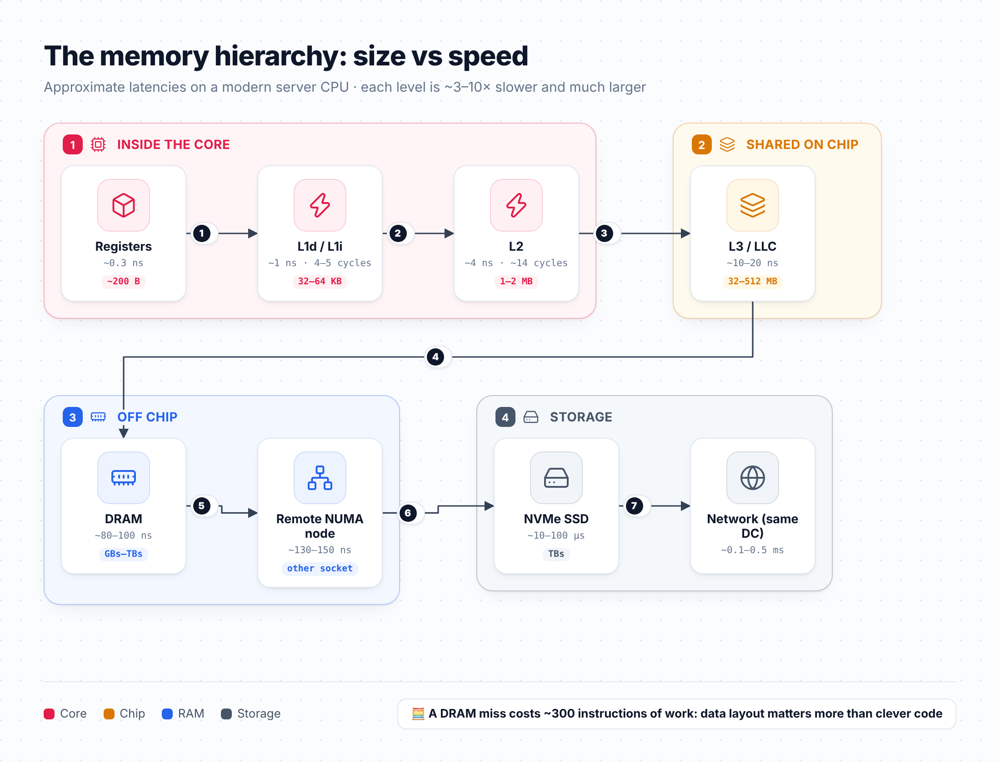
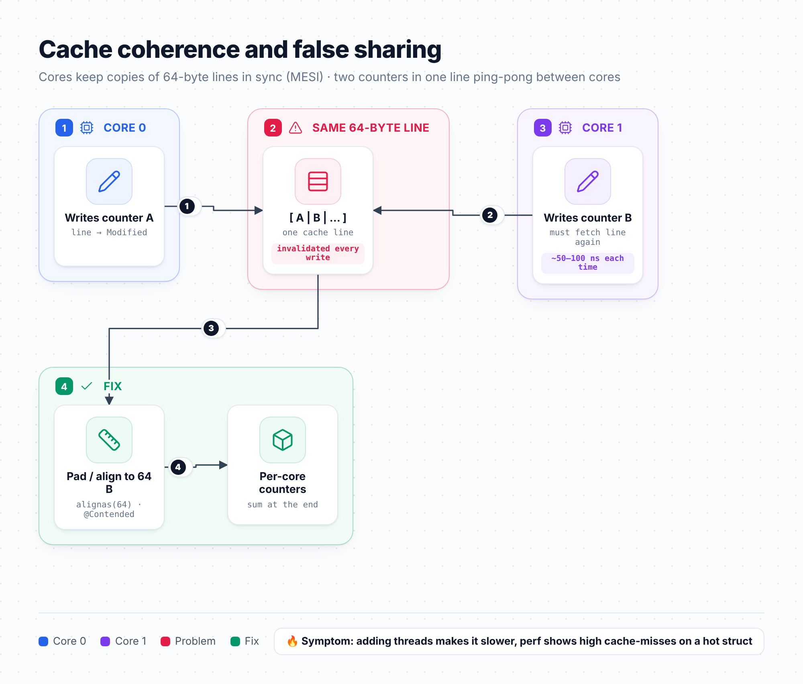

# 2.2 — Caches & the memory hierarchy

!!! abstract "In one sentence"
    A CPU core can do several instructions per nanosecond but RAM takes ~100 ns to answer, so chips put small, fast
    **caches** (L1, L2, L3) between them and move memory in **64-byte cache lines**; programs that access memory
    **sequentially and compactly** stay in cache and run fast, while scattered access, **false sharing** between cores and
    remote **NUMA** memory can make the same algorithm many times slower.

## 📖 Key terms & abbreviations

| Term | Stands for | What it is | How it works (one line) |
|---|---|---|---|
| **Cache** | — | Small fast memory holding recent data | Checked before going to the next, slower level |
| **L1 / L2 / L3 (LLC)** | Level 1/2/3 (Last-Level Cache) | Cache levels | L1/L2 per core, L3 shared by cores |
| **Cache line** | — | Unit of transfer: 64 bytes | Reading 1 byte loads its whole line |
| **Hit / miss** | — | Found / not found in a cache | Miss → ask the next level |
| **Locality** | — | Temporal (reuse soon) + spatial (neighbours) | Caches exploit both |
| **Prefetcher** | — | Hardware that guesses the next lines | Great for sequential/strided access |
| **Associativity** | — | Where a line may live in a cache | 8-way = one of 8 slots in its set |
| **Coherence / MESI** | Modified, Exclusive, Shared, Invalid | Keeping cores' copies consistent | Writing invalidates other cores' copies |
| **False sharing** | — | Different variables in the same line written by different cores | The line ping-pongs between cores |
| **NUMA** | Non-Uniform Memory Access | Each socket has its "own" RAM | Remote memory is slower than local |
| **TLB** | Translation Lookaside Buffer | Cache of virtual→physical translations | Misses cost a page-table walk |
| **Huge pages** | — | 2 MB / 1 GB pages instead of 4 KB | Fewer TLB entries needed |
| **Memory bandwidth** | — | GB/s RAM can deliver | Often the real limit for data-heavy code |
| **Cache-miss / IPC** | Instructions Per Cycle | Key perf counters | `perf stat` shows both |

## 🗺️ Big picture



---

## 1 · Why caches?

### What is the problem?

At 3 GHz one cycle is 0.33 ns. A DRAM access is ~100 ns, so ~300 cycles; a modern core could have executed **1000+ instructions** in that time. Without caches every core would be idle almost all the time.

### How does it work?

1. The core asks for an address. **L1** (32–64 KB, ~4–5 cycles) is checked first.
2. On a miss, **L2** (1–2 MB, ~14 cycles), then the shared **L3** (tens to hundreds of MB, ~40–70 cycles), then **DRAM**.
3. The whole **64-byte line** comes back and is kept in the caches. Something else is **evicted** (roughly least-recently used).
4. The **prefetcher** notices patterns (i, i+1, i+2…) and fetches lines before you ask.

## 2 · Locality: why data layout matters

| Pattern | Cache behaviour | Example |
|---|---|---|
| Sequential array scan | Excellent: every line fully used, prefetcher helps | `for i in range(n): sum += a[i]` |
| Strided access | Wastes most of each line | Column-wise walk of a row-major matrix |
| Pointer chasing | Every step can be a full DRAM miss | Linked lists, trees, hash maps of pointers |
| Small hot working set | Stays in L1/L2 | Lookup tables, small dicts |

That's why arrays beat linked lists, why "struct of arrays" helps analytics, and why columnar formats (Parquet, ClickHouse) are fast: they read only the needed columns, sequentially.

## 3 · Coherence and false sharing



Every core has its own L1/L2, so the hardware keeps copies consistent (MESI): before a core writes a line, all other copies are **invalidated**. If two threads write **different variables that sit in the same 64-byte line**, the line bounces between cores on every write; each bounce costs ~50–100 ns. Adding threads makes the program *slower*. Fixes: pad/align hot per-thread data to 64 bytes, or keep per-thread counters and sum at the end.

## 4 · NUMA, TLBs and bandwidth

- **NUMA:** in a 2-socket server each socket has its own memory controllers. Accessing the other socket's RAM is ~1.3–2× slower. The kernel tries to allocate memory on the node where the thread runs; moving threads across sockets hurts.
- **TLB:** every access needs a virtual→physical translation (chapter 3). The TLB caches a few thousand of them. With 4 KB pages a 100 GB heap needs 25 million entries; **huge pages** (2 MB / 1 GB) cut that drastically. Databases and JVMs often benefit; Transparent Huge Pages can also cause latency spikes, so many DBs tune it.
- **Bandwidth:** a server socket gives ~200–500+ GB/s of DRAM bandwidth. Streaming workloads (analytics, AI inference on CPU) hit this limit long before running out of cores. GPUs use HBM for the same reason (10.2).

## 🔧 DevOps connection

- **Noisy neighbours:** pods on the same node share L3 and memory bandwidth. A batch job can slow a latency-sensitive service without touching its CPU limit. Intel RDT / AMD QoS (cache allocation, memory bandwidth allocation) can partition them.
- **Kubernetes Topology Manager + CPU Manager (`static`)** pin Guaranteed pods to cores on one NUMA node together with their devices (GPU, NIC).
- **`numactl --hardware`, `lscpu`** show the layout; databases often need `numactl --interleave=all` or NUMA-aware settings.
- **CPU limits ≠ cache:** two pods with the same CPU quota can perform very differently depending on what shares their L3.

## 🧪 Try it yourself

```bash
lscpu | grep -iE 'model name|socket|numa|L1d|L2|L3'
numactl --hardware 2>/dev/null | head
getconf -a | grep -i CACHE_LINESIZE

# Row-wise vs column-wise: same work, very different speed
python3 - <<'PYEOF'
import numpy as np, time
a = np.random.rand(4000, 4000)
t = time.perf_counter(); s = sum(a[i, :].sum() for i in range(4000)); r = time.perf_counter() - t
t = time.perf_counter(); s = sum(a[:, j].sum() for j in range(4000)); c = time.perf_counter() - t
print(f"rows {r:.3f}s   columns {c:.3f}s   ({c/r:.1f}x slower)")
PYEOF

perf stat -e cycles,instructions,cache-references,cache-misses,LLC-load-misses -- sleep 1 2>&1 | tail -12
cat /sys/kernel/mm/transparent_hugepage/enabled
```

## 🃏 Cheat sheet

| Level | Latency | Size |
|---|---|---|
| L1 | ~1 ns | 32–64 KB / core |
| L2 | ~4 ns | 1–2 MB / core |
| L3 | ~10–20 ns | 32–512 MB / socket |
| DRAM (local / remote NUMA) | ~80–100 / ~130–150 ns | GB–TB |
| NVMe | ~10–100 µs | TB |

| Smell | Likely cause |
|---|---|
| More threads → slower | False sharing / lock contention |
| High LLC misses, low IPC | Working set > L3, pointer chasing |
| Slower on 2-socket box | Remote NUMA memory |
| Latency spikes on big heaps | TLB misses / THP compaction |

## ❓ Test yourself

??? question "1. Why does reading one byte from RAM cost as much as reading 64?"
    Memory moves in 64-byte cache lines; the whole line is fetched either way.

??? question "2. Why is iterating a linked list much slower than an array of the same length?"
    Each node can be anywhere in memory, so each step can be a cache miss and the prefetcher can't predict the next address.

??? question "3. Two threads increment two different counters and get slower than one thread. Why?"
    The counters share a cache line (false sharing); each write invalidates the other core's copy.

??? question "4. What does NUMA mean for a database on a 2-socket server?"
    Memory attached to the other socket is slower; threads and their data should stay on the same node (or memory interleaved).

??? question "5. Why do huge pages help large heaps?"
    One TLB entry covers 2 MB (or 1 GB) instead of 4 KB, so far fewer TLB misses and page-table walks.

---

## 📚 Sources

- [Ulrich Drepper — What Every Programmer Should Know About Memory](https://people.freebsd.org/~lstewart/articles/cpumemory.pdf)
- [Latency numbers every programmer should know](https://colin-scott.github.io/personal_website/research/interactive_latency.html)
- [Kubernetes — Topology Manager](https://kubernetes.io/docs/tasks/administer-cluster/topology-manager/)
- [Linux kernel docs — Transparent Hugepage](https://docs.kernel.org/admin-guide/mm/transhuge.html)
- [Brendan Gregg — perf examples](https://www.brendangregg.com/perf.html)

## ✍️ My notes

> Run the rows-vs-columns script. How many times slower is the column walk on your machine, and why?

-
