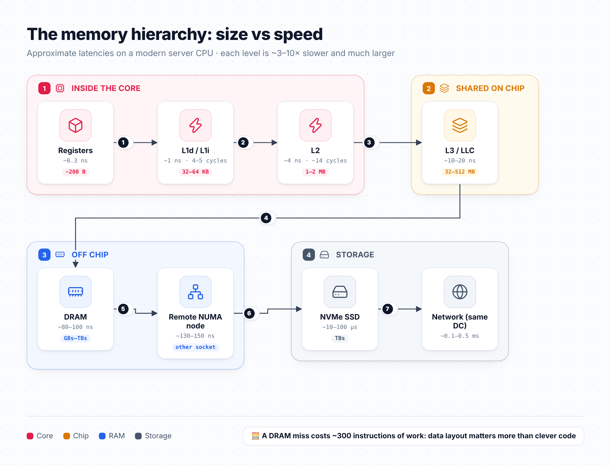
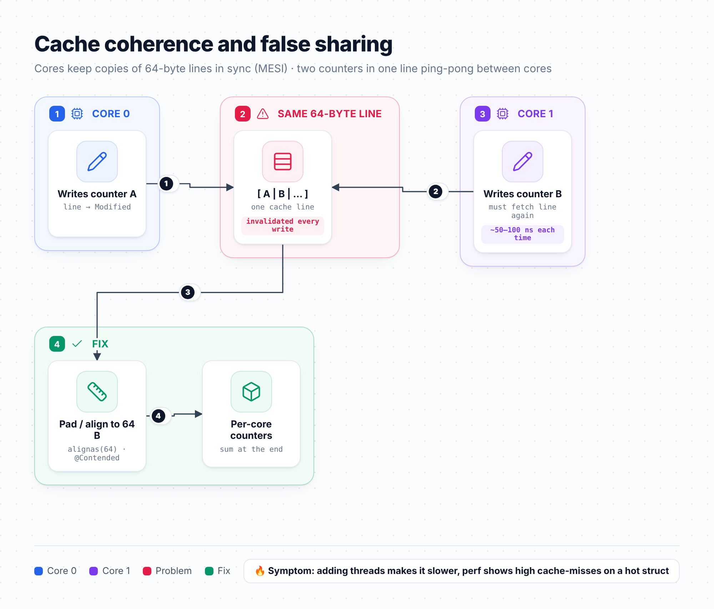

# 2.2 — Önbellekler ve bellek hiyerarşisi

!!! abstract "Kısaca"
    Bir CPU çekirdeği nanosaniyede birkaç komut çalıştırabilir ama RAM ~100 ns'de cevap verir. Bu yüzden çipler araya
    küçük, hızlı **önbellekler** (L1, L2, L3) koyar ve belleği **64 byte'lık cache line**'lar halinde taşır. Belleğe
    **sıralı ve sıkışık** erişen programlar önbellekte kalır ve hızlı çalışır. Dağınık erişim, çekirdekler arasındaki
    **false sharing** ve uzak **NUMA** belleği aynı algoritmayı kat kat yavaşlatabilir.

## 📖 Temel terimler ve kısaltmalar

| Terim | Açılımı | Nedir | Nasıl çalışır (tek satır) |
|---|---|---|---|
| **Önbellek** | Cache | Son kullanılan veriyi tutan küçük hızlı bellek | Bir sonraki, daha yavaş seviyeye gitmeden önce bakılır |
| **L1 / L2 / L3 (LLC)** | Level 1/2/3 (Last-Level Cache) | Önbellek seviyeleri | L1/L2 çekirdek başına, L3 çekirdeklerce paylaşılır |
| **Cache line** | — | Taşıma birimi: 64 byte | 1 byte okumak tüm satırı yükler |
| **İsabet / ıska** | Hit / miss | Önbellekte bulundu / bulunamadı | Iska → bir sonraki seviyeye sor |
| **Yerellik** | Locality | Zamansal (yakında yeniden kullan) + uzamsal (komşular) | Önbellekler ikisinden de yararlanır |
| **Prefetcher** | — | Sıradaki satırları tahmin eden donanım | Sıralı/adımlı erişimde harika |
| **İlişkisellik** | Associativity | Bir satırın önbellekte nerede durabileceği | 8-way = kümesindeki 8 slottan biri |
| **Tutarlılık / MESI** | Modified, Exclusive, Shared, Invalid | Çekirdeklerin kopyalarını tutarlı tutmak | Yazmak diğer çekirdeklerin kopyalarını geçersiz kılar |
| **False sharing** | — | Farklı çekirdeklerin aynı satırdaki farklı değişkenlere yazması | Satır çekirdekler arasında gidip gelir |
| **NUMA** | Non-Uniform Memory Access | Her soketin "kendi" RAM'i var | Uzak bellek yerel bellekten yavaş |
| **TLB** | Translation Lookaside Buffer | Sanal→fiziksel çeviri önbelleği | Iska bir page table yürüyüşüne mal olur |
| **Huge page** | — | 4 KB yerine 2 MB / 1 GB sayfalar | Daha az TLB girdisi gerekir |
| **Bellek bant genişliği** | Memory bandwidth | RAM'in verebildiği GB/s | Veri yoğun kodda çoğu zaman gerçek sınır |
| **Cache-miss / IPC** | Instructions Per Cycle | Temel performans sayaçları | `perf stat` ikisini de gösterir |

## 🗺️ Büyük resim



---

## 1 · Neden önbellekler?

### Sorun ne?

3 GHz'de bir döngü 0,33 ns. Bir DRAM erişimi ~100 ns, yani ~300 döngü; modern bir çekirdek bu sürede **1000+ komut** çalıştırabilirdi. Önbellek olmasa her çekirdek neredeyse hep boşta beklerdi.

### Nasıl çalışır?

1. Çekirdek bir adres ister. Önce **L1**'e (32–64 KB, ~4–5 döngü) bakılır.
2. Iskada **L2** (1–2 MB, ~14 döngü), sonra paylaşımlı **L3** (onlarca-yüzlerce MB, ~40–70 döngü), sonra **DRAM**.
3. Tüm **64 byte'lık satır** geri gelir ve önbelleklerde tutulur. Başka bir şey **tahliye edilir** (kabaca en uzun süredir kullanılmayan).
4. **Prefetcher** desenleri (i, i+1, i+2…) fark eder ve satırları sen istemeden getirir.

## 2 · Yerellik: veri düzeni neden önemli

| Desen | Önbellek davranışı | Örnek |
|---|---|---|
| Sıralı dizi taraması | Mükemmel: her satır tamamen kullanılır, prefetcher yardım eder | `for i in range(n): sum += a[i]` |
| Adımlı erişim | Her satırın çoğu boşa gider | Satır öncelikli bir matrisi sütun sütun gezmek |
| Pointer takibi | Her adım tam bir DRAM ıskası olabilir | Bağlı listeler, ağaçlar, pointer'lı hash map'ler |
| Küçük sıcak çalışma kümesi | L1/L2'de kalır | Arama tabloları, küçük sözlükler |

Dizilerin bağlı listeleri yenmesi, analitikte "struct of arrays"in yardımcı olması ve sütunlu formatların (Parquet, ClickHouse) hızlı olması bu yüzden: sadece gereken sütunları sırayla okurlar.

## 3 · Tutarlılık ve false sharing



Her çekirdeğin kendi L1/L2'si var; donanım kopyaları tutarlı tutar (MESI): bir çekirdek bir satıra yazmadan önce diğer tüm kopyalar **geçersiz kılınır**. İki thread **aynı 64 byte'lık satırda duran farklı değişkenlere** yazarsa satır her yazmada çekirdekler arasında gider gelir; her gidiş-geliş ~50–100 ns'ye mal olur. Thread eklemek programı *yavaşlatır*. Çözümler: thread başına sıcak veriyi 64 byte'a hizala/doldur ya da thread başına sayaç tut ve sonda topla.

## 4 · NUMA, TLB ve bant genişliği

- **NUMA:** 2 soketli bir sunucuda her soketin kendi bellek denetleyicileri var. Diğer soketin RAM'ine erişmek ~1,3–2× yavaş. Kernel belleği thread'in çalıştığı node'da ayırmaya çalışır; thread'leri soketler arasında taşımak zarar verir.
- **TLB:** her erişim bir sanal→fiziksel çeviri ister (3. bölüm). TLB bunlardan birkaç bin tanesini önbellekte tutar. 4 KB sayfalarla 100 GB'lık bir heap 25 milyon girdi ister; **huge page**'ler (2 MB / 1 GB) bunu büyük ölçüde azaltır. Veritabanları ve JVM'ler genelde faydalanır; Transparent Huge Pages gecikme sıçramalarına da yol açabildiği için birçok DB bunu ayarlar.
- **Bant genişliği:** bir sunucu soketi ~200–500+ GB/s DRAM bant genişliği verir. Akış tipi iş yükleri (analitik, CPU'da AI çıkarımı) çekirdekler bitmeden çok önce bu sınıra takılır. GPU'lar aynı sebeple HBM kullanır (10.2).

## 🔧 DevOps bağlantısı

- **Gürültülü komşular:** aynı node'daki pod'lar L3'ü ve bellek bant genişliğini paylaşır. Bir batch işi CPU limitine dokunmadan gecikmeye hassas bir servisi yavaşlatabilir. Intel RDT / AMD QoS (cache allocation, memory bandwidth allocation) bunları bölebilir.
- **Kubernetes Topology Manager + CPU Manager (`static`)** Guaranteed pod'ları cihazlarıyla (GPU, NIC) birlikte tek bir NUMA node'undaki çekirdeklere sabitler.
- **`numactl --hardware`, `lscpu`** düzeni gösterir; veritabanları çoğu zaman `numactl --interleave=all` ya da NUMA farkında ayarlar ister.
- **CPU limiti ≠ önbellek:** aynı CPU kotasına sahip iki pod, L3'lerini neyin paylaştığına göre çok farklı performans gösterebilir.

## 🧪 Kendin dene

```bash
lscpu | grep -iE 'model name|socket|numa|L1d|L2|L3'
numactl --hardware 2>/dev/null | head
getconf -a | grep -i CACHE_LINESIZE

# Satır satır vs sütun sütun: aynı iş, çok farklı hız
python3 - <<'PYEOF'
import numpy as np, time
a = np.random.rand(4000, 4000)
t = time.perf_counter(); s = sum(a[i, :].sum() for i in range(4000)); r = time.perf_counter() - t
t = time.perf_counter(); s = sum(a[:, j].sum() for j in range(4000)); c = time.perf_counter() - t
print(f"satırlar {r:.3f}s   sütunlar {c:.3f}s   ({c/r:.1f}x yavaş)")
PYEOF

perf stat -e cycles,instructions,cache-references,cache-misses,LLC-load-misses -- sleep 1 2>&1 | tail -12
cat /sys/kernel/mm/transparent_hugepage/enabled
```

## 🃏 Hatırlatma kartı

| Seviye | Gecikme | Boyut |
|---|---|---|
| L1 | ~1 ns | 32–64 KB / çekirdek |
| L2 | ~4 ns | 1–2 MB / çekirdek |
| L3 | ~10–20 ns | 32–512 MB / soket |
| DRAM (yerel / uzak NUMA) | ~80–100 / ~130–150 ns | GB–TB |
| NVMe | ~10–100 µs | TB |

| Belirti | Muhtemel sebep |
|---|---|
| Daha çok thread → daha yavaş | False sharing / kilit çekişmesi |
| Yüksek LLC ıskası, düşük IPC | Çalışma kümesi > L3, pointer takibi |
| 2 soketli makinede daha yavaş | Uzak NUMA belleği |
| Büyük heap'lerde gecikme sıçramaları | TLB ıskaları / THP sıkıştırması |

## ❓ Kendini test et

??? question "1. RAM'den bir byte okumak neden 64 byte okumak kadar tutar?"
    Bellek 64 byte'lık cache line'larla taşınır; her durumda tüm satır getirilir.

??? question "2. Bağlı bir listeyi gezmek neden aynı uzunluktaki bir diziden çok daha yavaştır?"
    Her düğüm bellekte herhangi bir yerde olabilir; her adım bir önbellek ıskası olabilir ve prefetcher sıradaki adresi tahmin edemez.

??? question "3. İki thread iki farklı sayacı artırıyor ve tek thread'den yavaş. Neden?"
    Sayaçlar aynı cache line'ı paylaşıyor (false sharing); her yazma diğer çekirdeğin kopyasını geçersiz kılıyor.

??? question "4. 2 soketli bir sunucudaki bir veritabanı için NUMA ne demek?"
    Diğer sokete bağlı bellek daha yavaş; thread'ler ve verileri aynı node'da kalmalı (ya da bellek dağıtılmalı).

??? question "5. Huge page'ler büyük heap'lere neden yardımcı olur?"
    Bir TLB girdisi 4 KB yerine 2 MB'ı (ya da 1 GB'ı) kapsar; çok daha az TLB ıskası ve page table yürüyüşü olur.

---

## 📚 Kaynaklar

- [Ulrich Drepper — What Every Programmer Should Know About Memory](https://people.freebsd.org/~lstewart/articles/cpumemory.pdf)
- [Latency numbers every programmer should know](https://colin-scott.github.io/personal_website/research/interactive_latency.html)
- [Kubernetes — Topology Manager](https://kubernetes.io/docs/tasks/administer-cluster/topology-manager/)
- [Linux kernel docs — Transparent Hugepage](https://docs.kernel.org/admin-guide/mm/transhuge.html)
- [Brendan Gregg — perf examples](https://www.brendangregg.com/perf.html)

## ✍️ Notlarım

> Satır-sütun betiğini çalıştır. Senin makinende sütun gezmesi kaç kat yavaş, neden?
