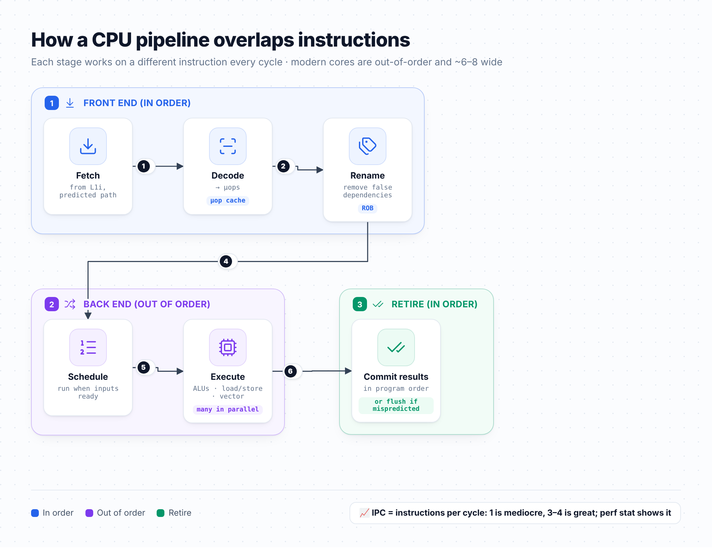
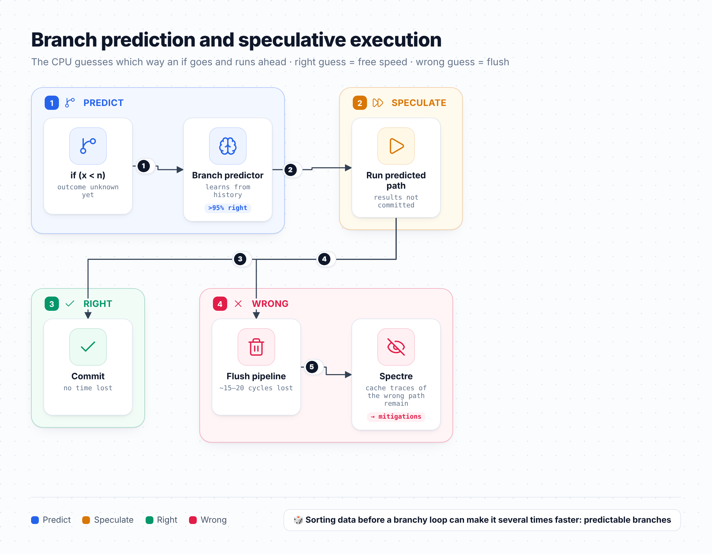

# 2.3 — Pipelines, branch prediction & speculation

!!! abstract "In short"
    A modern core doesn't run one instruction at a time: it **pipelines** them, executes several per cycle **out of
    order** as soon as their inputs are ready, and **guesses** the outcome of branches so it can keep going. Correct
    guesses make code fast, wrong ones throw work away, and the traces left by that speculative work are what
    **Spectre**-style attacks exploit.

## 📖 Key terms & abbreviations

| Term | Stands for | What it is | How it works (one line) |
|---|---|---|---|
| **Pipeline** | — | Splitting execution into stages | Each stage works on a different instruction each cycle |
| **Superscalar** | — | Several instructions per cycle | Multiple decoders and execution units |
| **OoO** | Out-of-Order execution | Run instructions when inputs are ready, not in program order | Results committed in order later |
| **ROB** | ReOrder Buffer | Tracks in-flight instructions | Retires them in program order |
| **Register renaming** | — | Mapping architectural to physical registers | Removes false dependencies |
| **Dependency chain** | — | Instructions that need each other's results | Limits parallelism |
| **IPC / CPI** | Instructions Per Cycle / Cycles Per Instruction | Efficiency measure | `perf stat` reports it |
| **Branch predictor** | — | Hardware that guesses branch direction and target | Learns from history |
| **Misprediction** | — | Wrong guess | Pipeline flush, ~15–20 cycles lost |
| **Speculative execution** | — | Running the predicted path before it's confirmed | Discarded if wrong |
| **Spectre / Meltdown** | — | Side-channel attacks on speculation | Secrets leak through cache timing |
| **SMT / Hyper-Threading** | Simultaneous Multi-Threading | Two hardware threads share one core | Fills idle units; a vCPU is often one of these |
| **Turbo / DVFS** | Dynamic Voltage and Frequency Scaling | Clock speed changes with load and heat | Fewer active cores → higher boost |
| **Top-down analysis** | — | Classify cycles: frontend, bad speculation, backend, retiring | `perf stat --topdown` |

## 🗺️ Big picture



---

## 1 · Pipelining: an assembly line for instructions

### How does it work?

Like a car factory: while one instruction executes, the next is being decoded and the one after is being fetched. A simple 5-stage pipeline (fetch, decode, execute, memory, write-back) can finish **one instruction per cycle** even though each takes 5 cycles.

Modern cores go much further:

- **Wide:** fetch/decode 4–8 instructions per cycle, with many execution units (ALUs, load/store, vector).
- **Out of order:** a scheduler holds hundreds of instructions and runs any whose inputs are ready, hiding cache-miss latency behind other work.
- **In-order retirement:** results become visible in program order, so the program behaves as if executed sequentially.

**What limits it:** dependency chains (each step needs the previous result), cache misses that stall everything, and **branches**.

## 2 · Branch prediction



### Why guess?

A pipeline is 15–20 stages deep. When it fetches an `if`, the condition won't be known for many cycles. Waiting would empty the pipeline on every branch (and code has a branch every ~5 instructions). So the CPU **predicts** the direction (taken/not taken) and the target (for indirect calls, virtual methods, `switch`) using history tables, and is right >95% of the time.

### What does a misprediction cost?

All speculative work after the branch is thrown away: ~15–20 cycles. A branch that's random (50/50) costs a lot in a hot loop. Classic demo: summing values `> 128` in an array is several times faster if the array is **sorted first**, because the branch becomes predictable. Compilers sometimes turn branches into branch-free code (`cmov`), and `likely()/unlikely()` hints help.

## 3 · Speculation and Spectre

The CPU executes predicted paths **before** checks are done, including bounds checks and (in Meltdown's case) permission checks. Results are discarded, **but cache state is not rolled back**. An attacker can train the predictor so the victim speculatively reads a secret and touches a cache line that depends on it, then measure which line is fast to load.

- **Meltdown (2018):** user code could read kernel memory on affected Intel CPUs → fixed with **KPTI** (separate kernel page tables), now mostly fixed in hardware.
- **Spectre variants:** still a class of issues; mitigations include retpolines, IBRS/eIBRS, barriers, and process/VM isolation.
- **Cost:** mitigations make syscalls and context switches more expensive; check `/sys/devices/system/cpu/vulnerabilities/`.

## 4 · SMT, frequency and what a "vCPU" is

- **SMT / Hyper-Threading:** one physical core runs two hardware threads, sharing execution units and caches. It gives maybe +10–30% throughput, not 2×. In most clouds, **1 vCPU = 1 hardware thread**, so 2 vCPUs may be one physical core.
- Security-sensitive environments sometimes **disable SMT** (cross-thread side channels) or schedule only same-tenant workloads on sibling threads.
- **Turbo/boost:** clock speed rises when few cores are busy and drops under all-core load or heat; benchmarks on an idle laptop don't predict a busy server.

## 🔧 DevOps connection

- **CPU limits and throttling:** in Kubernetes a CPU limit is a CFS quota of time per 100 ms period. Multithreaded apps can burn the quota early in the period and then be **throttled** for the rest; that shows up as latency spikes with low average CPU. Watch `container_cpu_cfs_throttled_periods_total`; many teams set requests but no limits for latency-sensitive services.
- **Sizing:** 4 vCPU on SMT hardware = 2 physical cores. For CPU-bound work, compare instance types by real benchmarks, not vCPU count.
- **Kernel mitigations** cost a few % on syscall-heavy workloads; the trade-off is a security decision (`mitigations=` boot parameter), usually keep them on in multi-tenant environments.
- **Profiling:** low IPC (<1) means the CPU is waiting (memory, mispredictions); high IPC (>2–3) means you're compute-bound and need a better algorithm or more cores.

## 🧪 Try it yourself

```bash
lscpu | grep -E 'Thread|Core|Socket|MHz'          # SMT: "Thread(s) per core: 2"
grep -r . /sys/devices/system/cpu/vulnerabilities/ | sed 's#.*/##'

# Branch prediction demo: same data, sorted vs unsorted
cat > branch.c <<'EOF'
#include <stdio.h>
#include <stdlib.h>
#include <time.h>
int cmp(const void*a,const void*b){return *(int*)a-*(int*)b;}
int main(int c,char**v){int n=1<<24,*a=malloc(n*4);srand(1);
 for(int i=0;i<n;i++)a[i]=rand()%256; if(c>1)qsort(a,n,4,cmp);
 clock_t t=clock(); long s=0;
 for(int r=0;r<10;r++)for(int i=0;i<n;i++)if(a[i]>=128)s+=a[i];
 printf("sum=%ld loop=%.2fs\n",s,(double)(clock()-t)/CLOCKS_PER_SEC);}
EOF
gcc -O0 branch.c -o branch   # -O0 keeps the real branch; at -O1+ gcc may emit branch-free cmov
./branch; ./branch sorted    # e.g. loop=0.86s vs loop=0.28s
perf stat -e cycles,instructions,branches,branch-misses ./branch        2>&1 | grep -E 'branch|insn|elapsed'
perf stat -e cycles,instructions,branches,branch-misses ./branch sorted 2>&1 | grep -E 'branch|insn|elapsed'
perf stat --topdown -a sleep 2 2>/dev/null | tail -6    # where cycles go (if supported)
```

## 🃏 Cheat sheet

| Metric | Healthy | Suspicious |
|---|---|---|
| IPC | 2–4 (compute) | < 1 (stalled) |
| Branch-miss rate | < 1–2% | > 5% in hot code |
| Cache-miss rate (LLC) | low | high + low IPC → memory-bound |
| CFS throttled periods | ~0 | rising → CPU limit too low / bursty threads |

## ❓ Test yourself

??? question "1. How can a CPU finish one instruction per cycle if each takes 15+ cycles?"
    Pipelining: many instructions are in different stages at the same time.

??? question "2. Why does sorting an array make a branchy loop over it faster?"
    The `if` becomes predictable (all false, then all true), so mispredictions and pipeline flushes nearly disappear.

??? question "3. What does Spectre exploit?"
    Speculative execution leaves traces in the cache that aren't rolled back; timing cache accesses reveals data read speculatively.

??? question "4. Your cloud VM has 8 vCPUs. How many physical cores is that likely to be?"
    Usually 4 physical cores with SMT (2 hardware threads each), depending on the provider and instance type.

??? question "5. A pod with low average CPU shows latency spikes and rising `cfs_throttled_periods`. What's happening?"
    Its threads use up the CPU limit's quota early in each 100 ms period and are throttled until the next one. Raise or remove the limit, or reduce thread bursts.

---

## 📚 Sources

- [Agner Fog — Microarchitecture of Intel, AMD and VIA CPUs](https://www.agner.org/optimize/microarchitecture.pdf)
- [Stack Overflow — Why is processing a sorted array faster?](https://stackoverflow.com/questions/11227809/)
- [Spectre and Meltdown](https://meltdownattack.com/)
- [Linux kernel docs — Hardware vulnerabilities](https://docs.kernel.org/admin-guide/hw-vuln/index.html)
- [Kubernetes — CPU management and limits](https://kubernetes.io/docs/concepts/configuration/manage-resources-containers/)

## ✍️ My notes

> Run the branch demo. Write down the branch-miss % and run time for sorted vs unsorted, and explain the difference.
