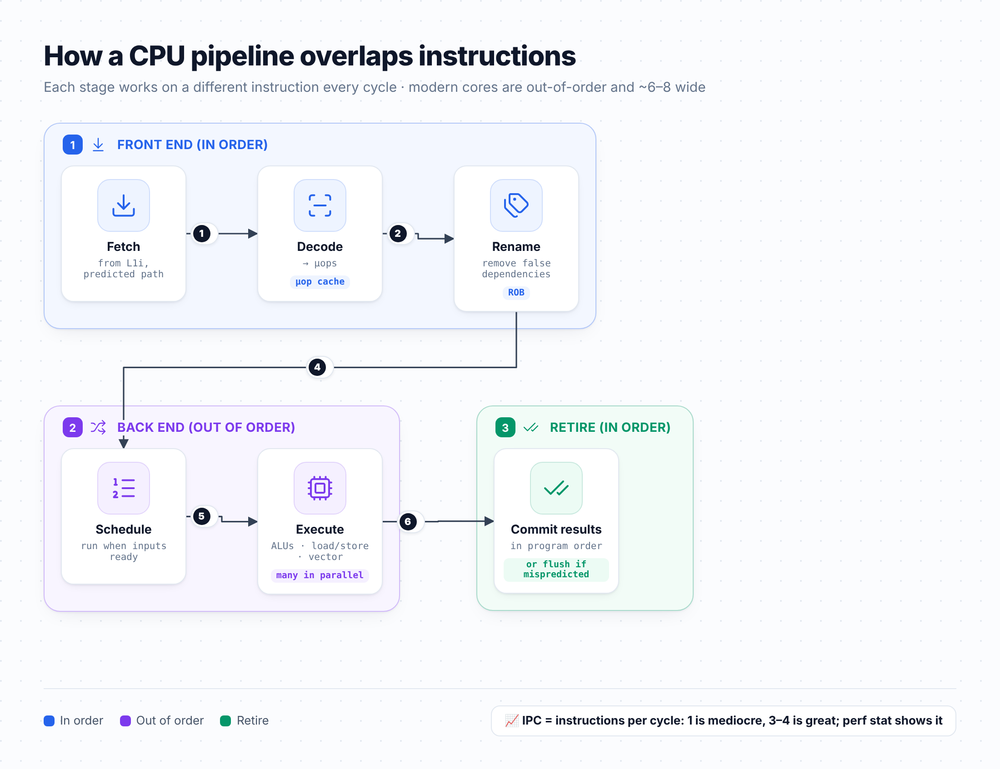
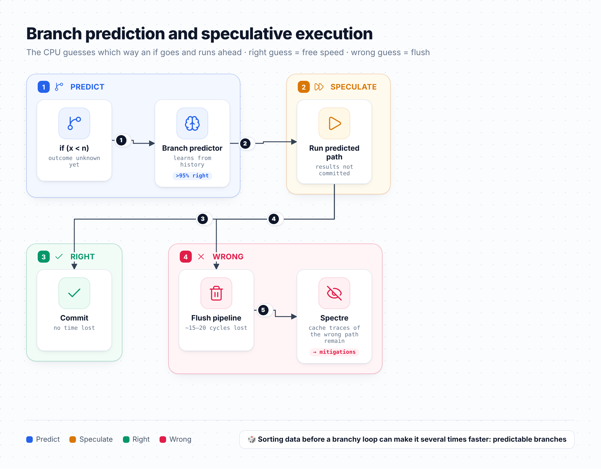

# 2.3 — Boru hatları, dal tahmini ve spekülasyon

!!! abstract "Tek cümlede"
    Modern bir çekirdek komutları teker teker çalıştırmaz: onları **boru hattına** koyar, girdileri hazır olur olmaz döngü
    başına birkaçını **sıra dışı** çalıştırır ve devam edebilmek için dalların sonucunu **tahmin eder**; doğru tahminler
    kodu hızlandırır, yanlışlar işi çöpe atar ve bu spekülatif işin bıraktığı izler **Spectre** tarzı saldırıların
    kullandığı şeydir.

## 📖 Temel terimler ve kısaltmalar

| Terim | Açılımı | Nedir | Nasıl çalışır (tek satır) |
|---|---|---|---|
| **Boru hattı** | Pipeline | Çalıştırmayı aşamalara bölmek | Her aşama her döngüde farklı bir komut üzerinde çalışır |
| **Superscalar** | — | Döngü başına birkaç komut | Birden fazla çözücü ve çalıştırma birimi |
| **OoO** | Out-of-Order execution | Komutları program sırasıyla değil, girdileri hazır olunca çalıştırmak | Sonuçlar sonra sırayla işlenir |
| **ROB** | ReOrder Buffer | Uçuştaki komutları izler | Onları program sırasıyla emekliye ayırır |
| **Register yeniden adlandırma** | Register renaming | Mimari register'ları fiziksel olanlara eşlemek | Sahte bağımlılıkları kaldırır |
| **Bağımlılık zinciri** | Dependency chain | Birbirinin sonucuna ihtiyaç duyan komutlar | Paralelliği sınırlar |
| **IPC / CPI** | Instructions Per Cycle / Cycles Per Instruction | Verimlilik ölçüsü | `perf stat` bildirir |
| **Dal tahmincisi** | Branch predictor | Dal yönünü ve hedefini tahmin eden donanım | Geçmişten öğrenir |
| **Yanlış tahmin** | Misprediction | Yanlış tahmin | Boru hattı boşaltılır, ~15–20 döngü kaybolur |
| **Spekülatif çalıştırma** | Speculative execution | Tahmin edilen yolu doğrulanmadan çalıştırmak | Yanlışsa atılır |
| **Spectre / Meltdown** | — | Spekülasyona yönelik yan kanal saldırıları | Sırlar önbellek zamanlamasıyla sızar |
| **SMT / Hyper-Threading** | Simultaneous Multi-Threading | İki donanım thread'i tek çekirdeği paylaşır | Boş birimleri doldurur; vCPU çoğu zaman bunlardan biri |
| **Turbo / DVFS** | Dynamic Voltage and Frequency Scaling | Saat hızı yük ve ısıyla değişir | Az aktif çekirdek → daha yüksek boost |
| **Top-down analizi** | — | Döngüleri sınıflandırma: ön uç, kötü spekülasyon, arka uç, emeklilik | `perf stat --topdown` |

## 🗺️ Büyük resim



---

## 1 · Boru hattı: komutlar için bir montaj hattı

### Nasıl çalışır?

Bir araba fabrikası gibi: bir komut çalışırken sıradaki çözülüyor, ondan sonraki getiriliyor. Basit 5 aşamalı bir boru hattı (getir, çöz, çalıştır, bellek, geri yaz), her komut 5 döngü sürse bile **döngü başına bir komut** bitirebilir.

Modern çekirdekler çok daha ileri gider:

- **Geniş:** döngü başına 4–8 komut getirir/çözer, çok sayıda çalıştırma birimi (ALU, load/store, vektör) var.
- **Sıra dışı:** bir zamanlayıcı yüzlerce komutu tutar ve girdileri hazır olanı çalıştırır; önbellek ıskası gecikmesini başka işin arkasına saklar.
- **Sıralı emeklilik:** sonuçlar program sırasıyla görünür olur; program sanki sırayla çalışmış gibi davranır.

**Sınırlayan şey:** bağımlılık zincirleri (her adım bir öncekinin sonucuna muhtaç), her şeyi durduran önbellek ıskaları ve **dallar**.

## 2 · Dal tahmini



### Neden tahmin?

Bir boru hattı 15–20 aşama derinliğindedir. Bir `if` getirildiğinde koşul birçok döngü boyunca bilinmez. Beklemek her dalda boru hattını boşaltırdı (ve kodda ~5 komutta bir dal var). Bu yüzden CPU geçmiş tablolarıyla yönü (alındı/alınmadı) ve hedefi (dolaylı çağrılar, sanal metotlar, `switch` için) **tahmin eder** ve zamanın %95'inden fazlasında haklı çıkar.

### Yanlış tahmin neye mal olur?

Daldan sonraki tüm spekülatif iş atılır: ~15–20 döngü. Rastgele (50/50) bir dal sıcak bir döngüde çok pahalıdır. Klasik demo: bir dizide `> 128` olan değerleri toplamak, dizi **önce sıralanırsa** birkaç kat hızlanır, çünkü dal tahmin edilebilir hale gelir. Derleyiciler bazen dalları dalsız koda (`cmov`) çevirir, `likely()/unlikely()` ipuçları da yardımcı olur.

## 3 · Spekülasyon ve Spectre

CPU tahmin edilen yolları kontroller bitmeden **önce** çalıştırır; sınır kontrolleri ve (Meltdown durumunda) izin kontrolleri dahil. Sonuçlar atılır **ama önbellek durumu geri alınmaz**. Saldırgan tahmincisi eğitir; kurban spekülatif olarak bir sırrı okur ve ona bağlı bir cache line'a dokunur, saldırgan sonra hangi satırın hızlı yüklendiğini ölçer.

- **Meltdown (2018):** etkilenen Intel CPU'larda user kodu kernel belleğini okuyabiliyordu → **KPTI** (ayrı kernel page table'ları) ile düzeltildi, artık çoğunlukla donanımda düzeltilmiş.
- **Spectre varyantları:** hâlâ bir sorun sınıfı; önlemler retpoline, IBRS/eIBRS, bariyerler ve process/VM izolasyonu.
- **Maliyet:** önlemler syscall'ları ve bağlam değişimlerini pahalılaştırır; `/sys/devices/system/cpu/vulnerabilities/`'e bak.

## 4 · SMT, frekans ve "vCPU" nedir

- **SMT / Hyper-Threading:** tek fiziksel çekirdek, çalıştırma birimlerini ve önbellekleri paylaşan iki donanım thread'i çalıştırır. 2× değil, belki +%10–30 throughput verir. Çoğu bulutta **1 vCPU = 1 donanım thread'i**; yani 2 vCPU tek fiziksel çekirdek olabilir.
- Güvenliğe hassas ortamlar bazen **SMT'yi kapatır** (thread'ler arası yan kanallar) ya da kardeş thread'lere sadece aynı kiracının iş yüklerini koyar.
- **Turbo/boost:** az çekirdek meşgulken saat hızı artar, tüm çekirdek yükünde ya da ısıda düşer; boştaki bir laptopta yapılan benchmark meşgul bir sunucuyu öngörmez.

## 🔧 DevOps bağlantısı

- **CPU limitleri ve throttling:** Kubernetes'te CPU limiti, 100 ms'lik periyot başına bir CFS zaman kotasıdır. Çok thread'li uygulamalar kotayı periyodun başında yakıp kalanında **throttle** edilebilir; düşük ortalama CPU ile gecikme sıçramaları olarak görünür. `container_cpu_cfs_throttled_periods_total`'a bak; birçok ekip gecikmeye hassas servislerde request koyup limit koymaz.
- **Boyutlandırma:** SMT donanımında 4 vCPU = 2 fiziksel çekirdek. CPU yoğun işler için instance tiplerini vCPU sayısıyla değil gerçek benchmark'larla karşılaştır.
- **Kernel önlemleri** syscall yoğun iş yüklerinde birkaç % maliyetlidir; ödünleşim bir güvenlik kararıdır (`mitigations=` boot parametresi), çok kiracılı ortamlarda genelde açık tutulur.
- **Profil çıkarma:** düşük IPC (<1) CPU'nun beklediğini (bellek, yanlış tahminler) söyler; yüksek IPC (>2–3) hesaplama sınırında olduğunu, daha iyi algoritma ya da daha çok çekirdek gerektiğini söyler.

## 🧪 Kendin dene

```bash
lscpu | grep -E 'Thread|Core|Socket|MHz'          # SMT: "Thread(s) per core: 2"
grep -r . /sys/devices/system/cpu/vulnerabilities/ | sed 's#.*/##'

# Dal tahmini demosu: aynı veri, sıralı ve sırasız
cat > branch.c <<'EOF'
#include <stdio.h>
#include <stdlib.h>
#include <time.h>
int cmp(const void*a,const void*b){return *(int*)a-*(int*)b;}
int main(int c,char**v){int n=1<<24,*a=malloc(n*4);srand(1);
 for(int i=0;i<n;i++)a[i]=rand()%256; if(c>1)qsort(a,n,4,cmp);
 clock_t t=clock(); long s=0;
 for(int r=0;r<10;r++)for(int i=0;i<n;i++)if(a[i]>=128)s+=a[i];
 printf("sum=%ld loop=%.2fs\n",s,(double)(clock()-t)/CLOCKS_PER_SEC);}
EOF
gcc -O0 branch.c -o branch   # -O0 gerçek dalı korur; -O1+ ile gcc dalsız cmov üretebilir
./branch; ./branch sorted    # ör. loop=0.86s / loop=0.28s
perf stat -e cycles,instructions,branches,branch-misses ./branch        2>&1 | grep -E 'branch|insn|elapsed'
perf stat -e cycles,instructions,branches,branch-misses ./branch sorted 2>&1 | grep -E 'branch|insn|elapsed'
perf stat --topdown -a sleep 2 2>/dev/null | tail -6    # döngüler nereye gidiyor (destekleniyorsa)
```

## 🃏 Hatırlatma kartı

| Metrik | Sağlıklı | Şüpheli |
|---|---|---|
| IPC | 2–4 (hesaplama) | < 1 (bekliyor) |
| Dal ıska oranı | < %1–2 | sıcak kodda > %5 |
| Önbellek ıska oranı (LLC) | düşük | yüksek + düşük IPC → bellek sınırlı |
| CFS throttled periyotlar | ~0 | artıyor → CPU limiti düşük / patlamalı thread'ler |

## ❓ Kendini test et

??? question "1. Her komut 15+ döngü sürüyorsa CPU döngü başına bir komutu nasıl bitirebilir?"
    Boru hattı: çok sayıda komut aynı anda farklı aşamalardadır.

??? question "2. Bir diziyi sıralamak, üzerinde dallı bir döngüyü neden hızlandırır?"
    `if` tahmin edilebilir hale gelir (önce hep yanlış, sonra hep doğru); yanlış tahminler ve boru hattı boşaltmaları neredeyse kaybolur.

??? question "3. Spectre neyi istismar eder?"
    Spekülatif çalıştırma önbellekte geri alınmayan izler bırakır; önbellek erişimlerini zamanlamak spekülatif olarak okunan veriyi açığa çıkarır.

??? question "4. Bulut VM'inde 8 vCPU var. Bu muhtemelen kaç fiziksel çekirdek?"
    Sağlayıcıya ve instance tipine göre değişir ama genelde SMT ile 4 fiziksel çekirdek (her biri 2 donanım thread'i).

??? question "5. Ortalama CPU'su düşük bir pod gecikme sıçramaları ve artan `cfs_throttled_periods` gösteriyor. Ne oluyor?"
    Thread'leri her 100 ms'lik periyodun başında CPU limitinin kotasını tüketiyor ve bir sonrakine kadar throttle ediliyor. Limiti artır ya da kaldır, veya thread patlamalarını azalt.

---

## 📚 Kaynaklar

- [Agner Fog — Microarchitecture of Intel, AMD and VIA CPUs](https://www.agner.org/optimize/microarchitecture.pdf)
- [Stack Overflow — Why is processing a sorted array faster?](https://stackoverflow.com/questions/11227809/)
- [Spectre and Meltdown](https://meltdownattack.com/)
- [Linux kernel docs — Hardware vulnerabilities](https://docs.kernel.org/admin-guide/hw-vuln/index.html)
- [Kubernetes — CPU management and limits](https://kubernetes.io/docs/concepts/configuration/manage-resources-containers/)

## ✍️ Notlarım

> Dal demosunu çalıştır. Sıralı ve sırasız için dal ıska yüzdesini ve çalışma süresini yaz, farkı açıkla.

-
