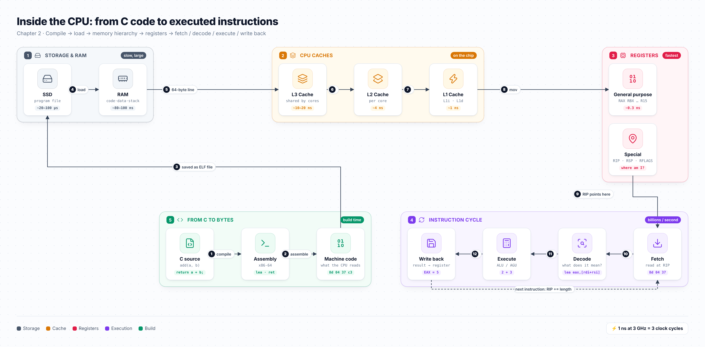
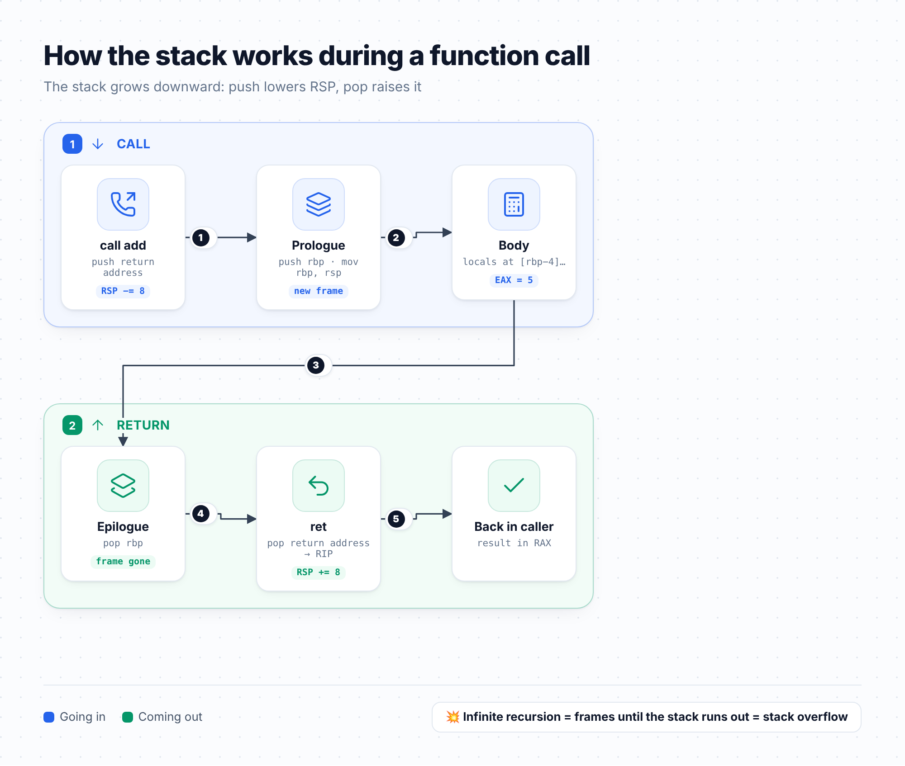

# Chapter 2 — CPU & Assembly

!!! abstract "In one sentence"
    A CPU is a very fast, very simple machine. It **fetches** the instruction that the `RIP` register points to,
    **decodes** it, **executes** it on values held in **registers**, **writes back** the result and moves on to the
    next one, billions of times per second. Everything else (caches, RAM, disk) exists to keep it fed with data.

## 📖 Key terms & abbreviations

| Term | Stands for | What it is | How it works (one line) |
|---|---|---|---|
| **CPU** | Central Processing Unit | The processor running your code | Fetches, decodes and executes instructions |
| **ISA** | Instruction Set Architecture | The instructions a CPU understands (x86-64, ARM64) | Compilers translate code into this instruction set |
| **Register** | — | Tiny storage slots inside the core | The only place math happens directly |
| **RIP / RSP** | Instruction Pointer / Stack Pointer | Next instruction address / top of stack | Updated by every instruction, call, ret and push/pop |
| **ALU** | Arithmetic Logic Unit | The part that does math and logic | Adds, compares, shifts values from registers |
| **Cache line** | — | 64-byte unit moved between RAM and caches | Reading one byte loads its 63 neighbours too |
| **L1 / L2 / L3** | Level 1/2/3 cache | On-chip memories, smaller = faster | Keep recently used data close to the core |
| **Pipeline** | — | Overlapping fetch/decode/execute of several instructions | Keeps every stage busy every cycle |
| **Branch prediction** | — | Guessing which way an if goes | Wrong guess → pipeline flush, wasted cycles |
| **Stack frame** | — | A function's area on the stack | Holds return address, saved registers, locals |
| **ABI** | Application Binary Interface | Binary-level rules between compiled code | Which registers hold args/return values, stack layout |
| **GHz** | gigahertz | Clock frequency | 3 GHz = 3 billion cycles per second |

## 🗺️ Big picture



> Reference: x86-64 (Intel/AMD) on Linux. ARM (Apple M-series, AWS Graviton) has different register names but the same ideas.

---

## 1 · From C to bytes (build time)

The CPU never sees your C, Go or Python. It only sees **machine code**: bytes that encode instructions.

```c
int add(int a, int b) { return a + b; }
```

`gcc -O2 -S -masm=intel add.c` produces:

```nasm
add:
    lea  eax, [rdi + rsi]   ; eax = a + b   (a arrives in RDI, b in RSI)
    ret                     ; return to caller, result is in EAX
```

`objdump -d add.o` shows the actual bytes: **`8d 04 37`** (`lea`) and **`c3`** (`ret`). Four bytes, and that's the whole function.

> On Ubuntu you'll also see `endbr64` (`f3 0f 1e fa`) first. It's a security landing marker (Intel CET) the compiler adds by default; you can ignore it here.

| Step | Tool | Output |
|---|---|---|
| Compile | `gcc -S` | Assembly text (human-readable instructions) |
| Assemble | `as` | Object file (machine code + symbols) |
| Link | `ld` | Executable **ELF** file on disk (Chapter 4 goes deep here) |

!!! tip "Calling convention (System V, Linux x86-64)"
    Arguments go in `RDI, RSI, RDX, RCX, R8, R9`, the return value comes back in `RAX`. This is an **agreement**
    between compilers, so code compiled by GCC can call code compiled by Clang or Rust.

---

## 2 · Registers: the CPU's hands

Registers are a handful of tiny storage slots **inside** the CPU core. They are the only place the CPU can do math on directly.

| Register | Role |
|---|---|
| `RAX, RBX, RCX, RDX, RSI, RDI, R8–R15` | **General purpose**, 64-bit each. `EAX` is the lower 32 bits of `RAX`. |
| `RIP` | **Instruction pointer**: the address of the *next* instruction. "Where am I in the program?" |
| `RSP` | **Stack pointer**: the top of the stack. |
| `RBP` | Frame pointer (optional): the base of the current function's stack frame. |
| `RFLAGS` | Result flags: zero? negative? overflow? Used by `if` (`cmp` + `je/jne`). |

> Chapter 1 link: when an interrupt arrives, the CPU saves exactly these (`RIP`, `RFLAGS`, `RSP`, …) so it can resume later.

---

## 3 · The memory hierarchy

The CPU is much faster than memory. To hide that gap, data moves through layers that get **smaller but faster** closer to the core.

| Level | Typical size | Typical latency | In CPU cycles (3 GHz) |
|---|---|---|---|
| Register | ~16 × 8 bytes | ~0.3 ns | 1 |
| L1 cache (per core, split L1i/L1d) | 32–64 KB | ~1 ns | ~4 |
| L2 cache (per core) | 1–2 MB | ~4 ns | ~12 |
| L3 cache (shared) | 16–100+ MB | ~10–20 ns | ~40 |
| RAM | GBs | ~80–100 ns | ~300 |
| NVMe SSD | TBs | ~20–100 µs | ~100,000 |

- Data moves between RAM and caches in **cache lines** of **64 bytes**. Reading one byte brings its 63 neighbours along.
- That's why **arrays are fast** (neighbours are already in cache) and **linked lists are slow** (every node is a new trip to RAM).

!!! tip "Remember this"
    If L1 were 1 second, RAM would be ~1.5 minutes and an SSD read would be ~1 day. Most "performance work" is really
    **"stop waiting for memory"** work.

---

## 4 · The instruction cycle

| # | Stage | What happens |
|---|---|---|
| 9 | — | `RIP` points at the next instruction in memory (via L1i cache). |
| 10 | **Fetch** | Read the instruction bytes at `RIP`: `8d 04 37`. |
| 11 | **Decode** | Work out what they mean: `lea eax, [rdi+rsi]`. Modern x86 cores translate this into simpler internal **micro-ops**. |
| 12 | **Execute** | The **ALU** (arithmetic logic unit) computes `2 + 3`. |
| — | **Write back** | Store the result in a register: `EAX = 5`. Advance `RIP` by the instruction's length and start again. |

Real cores do this as a **pipeline**: while one instruction executes, the next is decoding and the one after is
being fetched. They also execute **out of order** and **predict branches** to stay busy. When a prediction is wrong,
the pipeline is flushed and work is wasted. That's why unpredictable `if`s in hot loops cost performance.

---

## 5 · The stack: how functions call each other

Unoptimized (`-O0`), the same `add` shows the **stack** at work:

```nasm
add:
    push rbp                    ; save caller's frame pointer on the stack
    mov  rbp, rsp               ; my frame starts here
    mov  DWORD PTR [rbp-4], edi ; store a in my frame
    mov  DWORD PTR [rbp-8], esi ; store b in my frame
    mov  edx, DWORD PTR [rbp-4]
    mov  eax, DWORD PTR [rbp-8]
    add  eax, edx               ; eax = a + b
    pop  rbp                    ; restore caller's frame pointer
    ret                         ; pop return address into RIP → jump back
```

- `call add` **pushes the return address** (the instruction after the call) onto the stack and jumps to `add`.
- The stack **grows downward** in memory: `push` decreases `RSP`, `pop` increases it.
- `ret` pops that address back into `RIP`, and execution continues in the caller.
- Every function call gets its own **stack frame**. Infinite recursion keeps adding frames until it runs out of space: a **stack overflow**.

### How does the stack work during a call?

`call` pushes the return address and jumps. The **prologue** saves the old frame pointer and reserves space for locals. The **epilogue** undoes that, and `ret` pops the return address into RIP. Every call grows the stack downward; every return shrinks it back.



---

## 🚨 Incident story: the service that only crashes on new nodes

!!! failure "The alarm"
    The platform team adds a new node pool with a cheaper instance type. Pods scheduled there die instantly with **exit code 132**; the same image runs fine on the old nodes.

Try to diagnose it yourself first, then open the clues one by one.

??? info "🔍 Clue 1"
    132 = 128 + 4 → **SIGILL**, *illegal instruction*. `dmesg` on the node: `traps: app[...] trap invalid opcode`.

??? info "🔍 Clue 2"
    The Dockerfile builds with `-march=native` on a CI runner with AVX-512. `grep -o avx512f /proc/cpuinfo` on the new nodes → nothing.

??? success "🎯 Root cause"
    The compiler emitted AVX-512 instructions because the *build* machine had them. The new CPUs don't implement those instructions, so the first one executed traps.

??? tip "🛠️ Fix and lesson"
    Build for a baseline (`-march=x86-64-v3`, or v2), or ship variants and select at runtime; use node affinity if you truly need AVX-512. **Lesson:** the ISA is a contract: binaries must target the oldest CPU they may run on.

## 🧭 Go deeper

| Page | What's inside |
|---|---|
| **[2.1 — Instruction sets & assembly](01-isa-assembly.md)** | What an ISA is, x86-64 vs ARM64 (and RISC-V), CISC vs RISC, how instructions are encoded into bytes, addressing modes, flags and jumps, SIMD, the System V calling convention, and how to read compiler output and crash dumps. |
| **[2.2 — Caches & the memory hierarchy](02-caches-memory.md)** | Why caches exist, latency numbers, cache lines and locality, associativity and eviction, cache coherence (MESI) and false sharing, NUMA, TLBs and huge pages, memory bandwidth, and what it means for performance work and Kubernetes. |
| **[2.3 — Pipelines, branch prediction & speculation](03-pipeline-speculation.md)** | How CPUs overlap instructions in a pipeline, superscalar and out-of-order execution, branch prediction and mispredictions, speculative execution and Spectre/Meltdown, SMT (Hyper-Threading), frequency and power, and reading IPC with perf. |

## 🧪 Try it yourself (Linux)

!!! example "🧪 Ready-made lab"
    Run this chapter's experiments with one command: `./labs/run.sh 02-cpu` ([scripts](https://github.com/gaskinimbuspro/silicon-to-cloud/tree/main/labs/02-cpu/)). No setup? [Open in Codespaces](https://codespaces.new/gaskinimbuspro/silicon-to-cloud). <!-- s2c-lab -->


```bash
# 1) See your CPU: cores, cache sizes, flags
lscpu
lscpu -C                          # cache sizes per level

# 2) C → assembly → bytes
echo 'int add(int a,int b){return a+b;}' > add.c
gcc -O2 -S -masm=intel add.c && cat add.s
gcc -O0 -S -masm=intel add.c -o add-O0.s && cat add-O0.s   # with the stack frame
gcc -O2 -c add.c && objdump -d -M intel add.o              # the real bytes

# 3) Count instructions and cache misses of a command
perf stat -e cycles,instructions,cache-misses ls -R /usr > /dev/null

# 4) Step through instructions and watch registers change
gcc -g -O0 -o add add.c -x c - <<< 'int add(int,int);int main(){return add(2,3);}'
gdb -q ./add -ex 'break add' -ex 'run' -ex 'layout asm' -ex 'info registers rip rsp rdi rsi'
```

**Exercise:** in `gdb`, run `stepi` a few times inside `add` and watch `RSP` decrease after `push rbp` and `RIP` jump back after `ret`.

---

## 🃏 Cheat sheet

```text
C → compiler → assembly → assembler → machine code (bytes) → ELF file on disk
   → loaded into RAM → cache lines (64 B) → L3 → L2 → L1 → registers
   → FETCH (at RIP) → DECODE → EXECUTE (ALU) → WRITE BACK → RIP += len → repeat
```

- The CPU only understands **bytes**. Assembly is a human-readable spelling of them.
- **Registers** are where work happens. `RIP` = where am I, `RSP` = top of stack.
- Memory is a **hierarchy**: smaller = faster. Locality (nearby data) is king.
- **call / ret** use the stack to remember where to return.
- Args in `RDI, RSI, …`, return value in `RAX` (System V calling convention).

---

## ❓ Test yourself

??? question "1. Why is iterating over an array faster than over a linked list with the same number of elements?"
    The array's elements sit next to each other, so one 64-byte cache line brings several of them at once and the
    prefetcher can guess what comes next. Linked-list nodes are scattered, so each one may need a ~100 ns trip to RAM.

??? question "2. What does the `RIP` register hold, and who changes it?"
    The address of the next instruction. It normally advances by the instruction's length. Jumps, `call`, `ret`
    and interrupts change it directly.

??? question "3. What does `ret` actually do?"
    It pops the return address that `call` pushed onto the stack and puts it into `RIP`, so execution continues right after the call.

??? question "4. Why can a program compiled with GCC call a library compiled with Clang?"
    Both follow the same **calling convention** (System V ABI): which registers carry arguments and return values, and which registers each side must preserve.

??? question "5. Roughly how many CPU cycles does one RAM access cost at 3 GHz?"
    About 300 cycles (~100 ns × 3 cycles/ns). During that time the core could have executed hundreds of instructions.

---

## 📚 Sources

- [Compiler Explorer (godbolt.org)](https://godbolt.org/): type C, see the assembly live
- [System V AMD64 ABI](https://gitlab.com/x86-psABIs/x86-64-ABI)
- [Intel® 64 and IA-32 Architectures Software Developer Manuals](https://www.intel.com/content/www/us/en/developer/articles/technical/intel-sdm.html)
- [What Every Programmer Should Know About Memory, Ulrich Drepper](https://people.freebsd.org/~lstewart/articles/cpumemory.pdf)
- [Latency numbers every programmer should know](https://colin-scott.github.io/personal_website/research/interactive_latency.html)

## ✍️ My notes

> Explain the fetch-decode-execute cycle and the stack in your own words in 5 lines.

-
