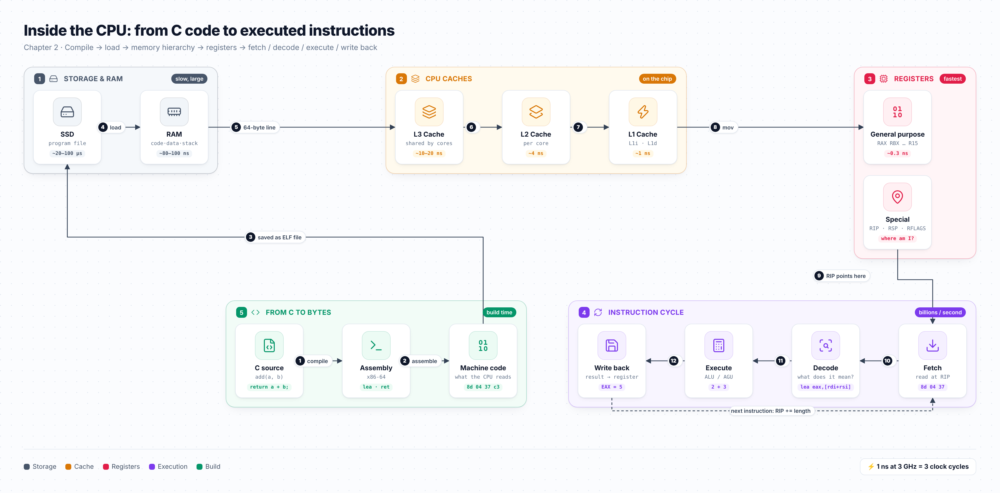
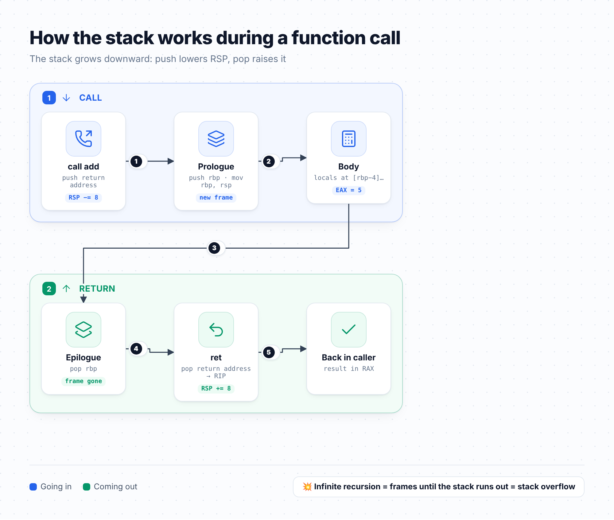

# Bölüm 2 — CPU & Assembly

!!! abstract "Kısaca"
    CPU çok hızlı ama çok basit bir makinedir. `RIP` register'ının gösterdiği komutu **okur (fetch)**, ne olduğunu
    **çözer (decode)**, **register**'lardaki değerlerle **çalıştırır (execute)**, sonucu **geri yazar (write back)** ve
    bir sonrakine geçer. Bunu saniyede milyarlarca kez yapar. Önbellekler, RAM ve disk sadece onu veriyle beslemek için
    vardır.

## 📖 Temel terimler ve kısaltmalar

| Terim | Açılımı | Nedir | Nasıl çalışır (tek satır) |
|---|---|---|---|
| **CPU** | Central Processing Unit | Kodunu çalıştıran işlemci | Komutları okur, çözer ve çalıştırır |
| **ISA** | Instruction Set Architecture | CPU'nun anladığı komutlar (x86-64, ARM64) | Derleyiciler kodu bu komut setine çevirir |
| **Register** | — | Çekirdeğin içindeki minik depolama hücreleri | Hesabın doğrudan yapıldığı tek yer |
| **RIP / RSP** | Instruction Pointer / Stack Pointer | Sıradaki komut adresi / stack'in tepesi | Her komut, call, ret ve push/pop ile güncellenir |
| **ALU** | Arithmetic Logic Unit | Hesap ve mantık işlemlerini yapan kısım | Register'lardaki değerleri toplar, karşılaştırır, kaydırır |
| **Cache line** | — | RAM ile önbellekler arasında taşınan 64 byte'lık birim | Bir byte okumak 63 komşusunu da getirir |
| **L1 / L2 / L3** | Level 1/2/3 cache | Çip üstü bellekler, küçük olan hızlı | Son kullanılan veriyi çekirdeğe yakın tutar |
| **Pipeline** | — | Birkaç komutun fetch/decode/execute'unu üst üste bindirmek | Her döngüde her aşamayı meşgul tutar |
| **Branch prediction** | — | Bir if'in hangi yöne gideceğini tahmin etmek | Yanlış tahmin → boru hattı boşaltılır, döngüler boşa gider |
| **Stack frame** | — | Bir fonksiyonun stack üzerindeki alanı | Dönüş adresi, kaydedilmiş register'lar ve yerelleri tutar |
| **ABI** | Application Binary Interface | Derlenmiş kodlar arası ikili düzey kurallar | Argüman/dönüş register'ları, stack düzeni |
| **GHz** | gigahertz | Saat frekansı | 3 GHz = saniyede 3 milyar döngü |

## 🗺️ Büyük resim



> Örnek ortam: Linux üzerinde x86-64 (Intel/AMD). ARM'da (Apple M serisi, AWS Graviton) register isimleri farklıdır ama fikirler aynıdır.

---

## 1 · C'den byte'lara (derleme anı)

CPU senin C, Go ya da Python kodunu hiç görmez. Sadece **makine kodunu**, yani komutları temsil eden byte'ları görür.

```c
int add(int a, int b) { return a + b; }
```

`gcc -O2 -S -masm=intel add.c` şunu üretir:

```nasm
add:
    lea  eax, [rdi + rsi]   ; eax = a + b   (a RDI'da, b RSI'da gelir)
    ret                     ; çağırana dön, sonuç EAX'te
```

`objdump -d add.o` gerçek byte'ları gösterir: **`8d 04 37`** (`lea`) ve **`c3`** (`ret`). Fonksiyonun tamamı dört byte.

> Ubuntu'da başta bir de `endbr64` (`f3 0f 1e fa`) görürsün. Derleyicinin varsayılan olarak eklediği bir güvenlik işaretidir (Intel CET); burada görmezden gelebilirsin.

| Adım | Araç | Çıktı |
|---|---|---|
| Derle (compile) | `gcc -S` | Assembly metni (insanın okuyabildiği komutlar) |
| Çevir (assemble) | `as` | Object dosyası (makine kodu + semboller) |
| Bağla (link) | `ld` | Diskte çalıştırılabilir **ELF** dosyası (Bölüm 4'te derinlemesine) |

!!! tip "Çağırma kuralı (System V, Linux x86-64)"
    Argümanlar `RDI, RSI, RDX, RCX, R8, R9` register'larına konur, dönüş değeri `RAX`'te gelir. Bu, derleyiciler
    arasında bir **anlaşmadır**. Bu sayede GCC ile derlenmiş kod, Clang ya da Rust ile derlenmiş kodu çağırabilir.

---

## 2 · Register'lar: CPU'nun elleri

Register'lar, CPU çekirdeğinin **içinde** duran birkaç küçük depolama hücresidir. CPU'nun doğrudan hesap yapabildiği tek yer burasıdır.

| Register | Görevi |
|---|---|
| `RAX, RBX, RCX, RDX, RSI, RDI, R8–R15` | **Genel amaçlı**, her biri 64 bit. `EAX`, `RAX`'in alt 32 bitidir. |
| `RIP` | **Komut işaretçisi** (instruction pointer): *sıradaki* komutun adresi. "Programın neresindeyim?" |
| `RSP` | **Stack işaretçisi**: stack'in tepesi. |
| `RBP` | Çerçeve işaretçisi (opsiyonel): o anki fonksiyonun stack çerçevesinin tabanı. |
| `RFLAGS` | Sonuç bayrakları: sıfır mı? negatif mi? taşma var mı? `if` bunları kullanır (`cmp` + `je/jne`). |

> Bölüm 1 bağlantısı: kesme geldiğinde CPU tam olarak bunları (`RIP`, `RFLAGS`, `RSP`, …) kaydeder ki sonra kaldığı yerden devam edebilsin.

---

## 3 · Bellek hiyerarşisi

CPU, bellekten çok daha hızlıdır. Bu farkı gizlemek için veri, çekirdeğe yaklaştıkça **küçülen ama hızlanan** katmanlardan geçer.

| Seviye | Tipik boyut | Tipik gecikme | CPU döngüsü (3 GHz) |
|---|---|---|---|
| Register | ~16 × 8 byte | ~0,3 ns | 1 |
| L1 önbellek (çekirdek başına, L1i/L1d ayrı) | 32–64 KB | ~1 ns | ~4 |
| L2 önbellek (çekirdek başına) | 1–2 MB | ~4 ns | ~12 |
| L3 önbellek (ortak) | 16–100+ MB | ~10–20 ns | ~40 |
| RAM | GB'lar | ~80–100 ns | ~300 |
| NVMe SSD | TB'lar | ~20–100 µs | ~100.000 |

- Veri RAM ile önbellek arasında **64 byte**'lık **cache line**'lar halinde taşınır. Tek bir byte okusan bile yanındaki 63 byte da gelir.
- Bu yüzden **diziler hızlıdır** (komşular zaten önbellekte), **bağlı listeler yavaştır** (her düğüm RAM'e yeni bir yolculuk).

!!! tip "Bunu hatırla"
    L1 erişimi 1 saniye olsaydı, RAM ~1,5 dakika, SSD okuması ~1 gün sürerdi. "Performans işi" denen şeyin çoğu
    aslında **"belleği beklemeyi bırak"** işidir.

---

## 4 · Komut döngüsü

| # | Aşama | Ne oluyor |
|---|---|---|
| 9 | — | `RIP`, bellekteki (L1i önbelleği üzerinden) sıradaki komutu gösterir. |
| 10 | **Fetch** | `RIP` adresindeki komut byte'larını oku: `8d 04 37`. |
| 11 | **Decode** | Ne anlama geldiklerini çöz: `lea eax, [rdi+rsi]`. Modern x86 çekirdekleri bunu daha basit dahili **mikro-op**'lara çevirir. |
| 12 | **Execute** | **ALU** (aritmetik mantık birimi) `2 + 3`'ü hesaplar. |
| — | **Write back** | Sonucu register'a yaz: `EAX = 5`. `RIP`'i komutun uzunluğu kadar ilerlet ve baştan başla. |

Gerçek çekirdekler bunu bir **boru hattı (pipeline)** olarak yapar: bir komut çalışırken sonraki çözülür, ondan sonraki
okunur. Boş kalmamak için komutları **sırasız (out-of-order)** çalıştırır ve **dallanmaları tahmin eder (branch prediction)**.
Tahmin yanlışsa boru hattı boşaltılır ve iş çöpe gider. Bu yüzden sık çalışan döngülerdeki tahmin edilemeyen `if`'ler performansa mal olur.

---

## 5 · Stack: fonksiyonlar birbirini nasıl çağırır

Optimizasyonsuz (`-O0`) derlendiğinde aynı `add` fonksiyonu **stack**'i iş başında gösterir:

```nasm
add:
    push rbp                    ; çağıranın çerçeve işaretçisini stack'e kaydet
    mov  rbp, rsp               ; benim çerçevem burada başlıyor
    mov  DWORD PTR [rbp-4], edi ; a'yı çerçeveme yaz
    mov  DWORD PTR [rbp-8], esi ; b'yi çerçeveme yaz
    mov  edx, DWORD PTR [rbp-4]
    mov  eax, DWORD PTR [rbp-8]
    add  eax, edx               ; eax = a + b
    pop  rbp                    ; çağıranın çerçeve işaretçisini geri yükle
    ret                         ; dönüş adresini RIP'e al → geri atla
```

- `call add` **dönüş adresini** (çağrıdan sonraki komutu) stack'e koyar (push) ve `add`'e atlar.
- Stack bellekte **aşağı doğru büyür**: `push` `RSP`'yi azaltır, `pop` artırır.
- `ret` o adresi stack'ten alıp `RIP`'e koyar ve çalışma çağıran fonksiyonda devam eder.
- Her fonksiyon çağrısı kendi **stack çerçevesini (stack frame)** alır. Sonsuz özyineleme yer bitene kadar çerçeve ekler: **stack overflow**.

### Çağrı sırasında stack nasıl çalışır?

`call` dönüş adresini push eder ve atlar. **Prologue** eski frame pointer'ı kaydeder ve yereller için yer ayırır. **Epilogue** bunu geri alır, `ret` dönüş adresini RIP'e pop eder. Her çağrı stack'i aşağı doğru büyütür, her dönüş geri küçültür.



---

## 🚨 Olay hikâyesi: sadece yeni node'larda çöken servis

!!! failure "Alarm"
    Platform ekibi daha ucuz bir instance tipiyle yeni bir node havuzu ekliyor. Oraya zamanlanan pod'lar anında **çıkış kodu 132** ile ölüyor; aynı imaj eski node'larda sorunsuz çalışıyor.

Önce kendin teşhis etmeye çalış, sonra ipuçlarını tek tek aç.

??? info "🔍 İpucu 1"
    132 = 128 + 4 → **SIGILL**, *illegal instruction*. Node'da `dmesg`: `traps: app[...] trap invalid opcode`.

??? info "🔍 İpucu 2"
    Dockerfile, AVX-512'li bir CI runner'ında `-march=native` ile derliyor. Yeni node'larda `grep -o avx512f /proc/cpuinfo` → hiçbir şey.

??? success "🎯 Kök neden"
    *Build* makinesinde AVX-512 olduğu için derleyici AVX-512 komutları üretti. Yeni CPU'lar bu komutları uygulamıyor; çalıştırılan ilki trap ediyor.

??? tip "🛠️ Çözüm ve ders"
    Bir taban seviye için derle (`-march=x86-64-v3` ya da v2) veya varyantlar gönderip çalışma anında seç; gerçekten AVX-512 gerekiyorsa node affinity kullan. **Ders:** ISA bir sözleşmedir; binary'ler çalışabilecekleri en eski CPU'yu hedeflemeli.

## 🧭 Daha derine in

| Sayfa | Neler var |
|---|---|
| **[2.1 — Komut setleri ve assembly](01-isa-assembly.md)** | ISA nedir, x86-64 ve ARM64 (ve RISC-V), CISC ve RISC, komutların byte'lara nasıl kodlandığı, adresleme modları, bayraklar ve atlamalar, SIMD, System V çağrı kuralı, derleyici çıktısı ve crash dump okumak. |
| **[2.2 — Önbellekler ve bellek hiyerarşisi](02-caches-memory.md)** | Önbellekler neden var, gecikme rakamları, cache line ve yerellik, ilişkisellik ve tahliye, önbellek tutarlılığı (MESI) ve false sharing, NUMA, TLB ve huge page, bellek bant genişliği ve bunların performans çalışmaları ve Kubernetes için anlamı. |
| **[2.3 — Boru hatları, dal tahmini ve spekülasyon](03-pipeline-speculation.md)** | CPU'ların komutları boru hattında nasıl üst üste bindirdiği, superscalar ve sıra dışı çalıştırma, dal tahmini ve yanlış tahminler, spekülatif çalıştırma ve Spectre/Meltdown, SMT (Hyper-Threading), frekans ve güç, perf ile IPC okumak. |

## 🧪 Kendin dene (Linux)

!!! example "🧪 Hazır lab"
    Bu bölümün deneyleri tek komutla: `./labs/run.sh 02-cpu` ([script'ler](https://github.com/gaskinimbuspro/silicon-to-cloud/tree/main/labs/02-cpu/)). Kurulum istemiyorsan [Codespaces'te aç](https://codespaces.new/gaskinimbuspro/silicon-to-cloud). <!-- s2c-lab -->


```bash
# 1) CPU'nu tanı: çekirdekler, önbellek boyutları, özellikler
lscpu
lscpu -C                          # seviye başına önbellek boyutları

# 2) C → assembly → byte'lar
echo 'int add(int a,int b){return a+b;}' > add.c
gcc -O2 -S -masm=intel add.c && cat add.s
gcc -O0 -S -masm=intel add.c -o add-O0.s && cat add-O0.s   # stack çerçeveli hali
gcc -O2 -c add.c && objdump -d -M intel add.o              # gerçek byte'lar

# 3) Bir komutun çalıştırdığı komut sayısı ve önbellek ıskaları
perf stat -e cycles,instructions,cache-misses ls -R /usr > /dev/null

# 4) Komut komut ilerle ve register'ların değişimini izle
gcc -g -O0 -o add add.c -x c - <<< 'int add(int,int);int main(){return add(2,3);}'
gdb -q ./add -ex 'break add' -ex 'run' -ex 'layout asm' -ex 'info registers rip rsp rdi rsi'
```

**Görev:** `gdb` içinde `add` fonksiyonundayken birkaç kez `stepi` çalıştır. `push rbp`'den sonra `RSP`'nin azaldığını, `ret`'ten sonra `RIP`'in geri atladığını izle.

---

## 🃏 Hatırlatma kartı

```text
C → derleyici → assembly → assembler → makine kodu (byte'lar) → diskte ELF dosyası
   → RAM'e yüklenir → cache line'lar (64 B) → L3 → L2 → L1 → register'lar
   → FETCH (RIP'te) → DECODE → EXECUTE (ALU) → WRITE BACK → RIP += uzunluk → tekrar
```

- CPU sadece **byte** anlar. Assembly, o byte'ların insanın okuyabildiği yazımıdır.
- İş **register**'larda yapılır. `RIP` = neredeyim, `RSP` = stack'in tepesi.
- Bellek bir **hiyerarşidir**: küçük olan hızlıdır. Yakınlık (locality) her şeydir.
- **call / ret**, nereye döneceğini hatırlamak için stack'i kullanır.
- Argümanlar `RDI, RSI, …`'de, dönüş değeri `RAX`'te (System V çağırma kuralı).

---

## ❓ Kendini test et

??? question "1. Aynı sayıda elemanı olan bir diziyi gezmek neden bağlı listeyi gezmekten hızlıdır?"
    Dizinin elemanları yan yana durur. Tek bir 64 byte'lık cache line birkaçını birden getirir ve önceden getirici
    (prefetcher) sıradakini tahmin edebilir. Bağlı listenin düğümleri dağınıktır, her biri ~100 ns'lik bir RAM yolculuğu gerektirebilir.

??? question "2. `RIP` register'ı ne tutar ve onu kim değiştirir?"
    Sıradaki komutun adresini tutar. Normalde komutun uzunluğu kadar ilerler. Atlama (jump), `call`, `ret` ve kesmeler onu doğrudan değiştirir.

??? question "3. `ret` aslında ne yapar?"
    `call`'un stack'e koyduğu dönüş adresini alır ve `RIP`'e yazar. Böylece çalışma çağrının hemen sonrasından devam eder.

??? question "4. GCC ile derlenmiş bir program, Clang ile derlenmiş bir kütüphaneyi neden çağırabilir?"
    İkisi de aynı **çağırma kuralına** (System V ABI) uyar: argümanlar ve dönüş değeri hangi register'larda taşınır, hangi register'ları hangi taraf korumak zorundadır.

??? question "5. 3 GHz'de bir RAM erişimi kabaca kaç CPU döngüsüne mal olur?"
    Yaklaşık 300 döngü (~100 ns × 3 döngü/ns). Bu sürede çekirdek yüzlerce komut çalıştırabilirdi.

---

## 📚 Kaynaklar

- [Compiler Explorer (godbolt.org)](https://godbolt.org/): C yaz, assembly'yi canlı gör
- [System V AMD64 ABI](https://gitlab.com/x86-psABIs/x86-64-ABI)
- [Intel® 64 and IA-32 Architectures Software Developer Manuals](https://www.intel.com/content/www/us/en/developer/articles/technical/intel-sdm.html)
- [What Every Programmer Should Know About Memory, Ulrich Drepper](https://people.freebsd.org/~lstewart/articles/cpumemory.pdf)
- [Latency numbers every programmer should know](https://colin-scott.github.io/personal_website/research/interactive_latency.html)

## ✍️ Kendi notlarım

> Fetch-decode-execute döngüsünü ve stack'i kendi cümlelerinle 5 satırda anlat.
