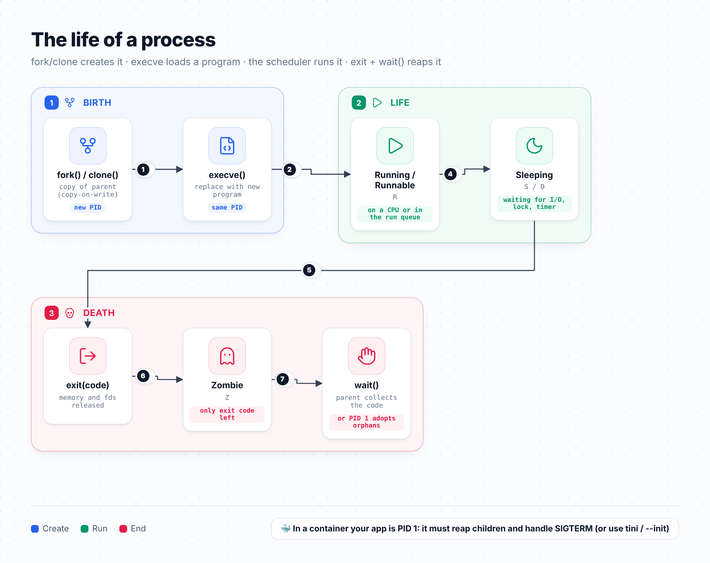
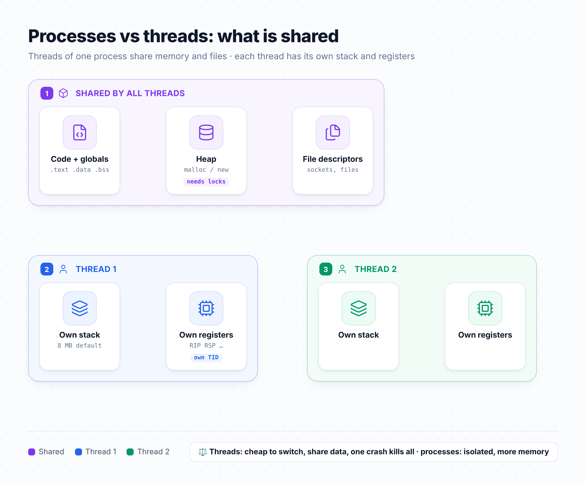

# 3.1 — Processes & threads

!!! abstract "In short"
    A **process** is a running program with its own memory, file descriptors and identity (PID). A **thread** is a
    worker inside a process that shares that memory but has its own stack and registers. Processes are born with
    **fork/clone + execve**, move between **running** and **sleeping**, and end with **exit**, after which the parent
    must **wait()** for them. In a container your app is usually **PID 1**, which gives it special duties.

## 📖 Key terms & abbreviations

| Term | Stands for | What it is | How it works (one line) |
|---|---|---|---|
| **Process** | — | A program in execution | Own address space, fds, credentials |
| **PID / PPID / TID** | Process ID / Parent PID / Thread ID | Numeric identities | Every thread has a TID; the main thread's TID = PID |
| **Thread** | — | Execution context inside a process | Shares memory, own stack + registers |
| **fork() / clone()** | — | Create a new process/thread | clone flags decide what is shared |
| **COW** | Copy-On-Write | Lazy copying after fork | Pages are shared until one side writes |
| **execve()** | — | Replace the program in a process | Same PID, new code and memory |
| **wait() / waitpid()** | — | Parent collects a child's exit status | Removes the zombie |
| **Zombie** | — | Exited process whose status isn't collected | Holds only a PID and exit code |
| **Orphan** | — | Process whose parent died | Re-parented to PID 1 (or a subreaper) |
| **PID 1 / init** | — | First process in a PID namespace | Must reap orphans; default signal handling differs |
| **Signal** | — | Asynchronous notification | SIGTERM, SIGKILL, SIGINT, SIGCHLD, SIGHUP |
| **Exit code** | — | Number returned at exit | 0 = OK; 128+N = killed by signal N (137 = SIGKILL) |
| **State codes** | — | R, S, D, Z, T in `ps` | Running, Sleeping, Uninterruptible, Zombie, Stopped |

## 🗺️ Big picture



---

## 1 · How is a process created?

### How does it work?

1. **`fork()`** (actually `clone()` on Linux) creates a child that is a copy of the parent. Thanks to **copy-on-write**, memory isn't copied: both share the pages read-only, and a page is copied only when one side writes to it. That's why forking a 10 GB process is fast (and why Redis can snapshot with fork).
2. The child usually calls **`execve()`**: the kernel throws away its memory and loads a new program (chapter 4). PID stays the same; open fds stay too unless marked close-on-exec.
3. The parent continues, and later calls **`wait()`** to collect the child's exit code.

A shell running `ls` is exactly this: fork, exec `ls` in the child, wait in the parent.

## 2 · Processes vs threads



| | Process | Thread |
|---|---|---|
| Memory | Separate (isolated) | Shared with other threads |
| Create / switch cost | Higher | Lower |
| Communication | Pipes, sockets, shared memory | Just read/write shared variables (with locks) |
| One crashes | Others survive | The whole process dies |
| Examples | nginx/Postgres workers, Python multiprocessing | JVM, Go runtime, Chrome renderer threads |

On Linux both are "tasks" created by `clone()`; the flags (`CLONE_VM`, `CLONE_FILES` …) decide how much is shared. `ps -eLf` or `top -H` show threads.

## 3 · States, zombies and orphans

- **R** running or runnable · **S** sleeping (interruptible, e.g. waiting on a socket) · **D** uninterruptible sleep (usually disk/NFS I/O; can't be killed until the I/O returns) · **Z** zombie · **T** stopped.
- A **zombie** has exited but its parent hasn't called `wait()`. It uses no memory, only a PID slot. Thousands of zombies mean a parent with a bug, and you can run out of PIDs (`pids.max`).
- An **orphan** (parent died first) is adopted by PID 1, which is expected to reap it.

## 4 · Signals and graceful shutdown

| Signal | Default | Typical use |
|---|---|---|
| `SIGTERM` (15) | terminate | "Please shut down" (Kubernetes, systemd, `docker stop`) |
| `SIGKILL` (9) | kill, can't be caught | Last resort; no cleanup |
| `SIGINT` (2) | terminate | Ctrl+C |
| `SIGHUP` (1) | terminate | Terminal closed; many daemons reload config |
| `SIGCHLD` | ignore | A child changed state (parent should `wait()`) |
| `SIGSEGV` (11) | core dump | Invalid memory access |

**Graceful shutdown** = on SIGTERM: stop accepting new work, finish in-flight requests, flush, close connections, exit 0.

## 🔧 DevOps connection

- **PID 1 in containers:** the kernel doesn't apply default signal actions to PID 1, so an app that doesn't install a SIGTERM handler **ignores** `docker stop` / pod deletion and gets SIGKILLed after the grace period (30 s by default). It also must reap zombies. Use `tini` / `docker run --init` / `shareProcessNamespace`, or make the app handle it.
- **Shell form vs exec form:** `CMD python app.py` runs `/bin/sh -c …` as PID 1; sh may not forward SIGTERM. Use exec form `CMD ["python","app.py"]` or `exec` in entrypoint scripts.
- **Kubernetes termination:** pod marked terminating → removed from Endpoints (asynchronously!) → `preStop` hook → SIGTERM → `terminationGracePeriodSeconds` → SIGKILL. A short `preStop` sleep avoids dropping requests that still arrive.
- **Exit codes in pod status:** `137` = SIGKILL (often OOMKilled), `143` = SIGTERM, `139` = SIGSEGV, `1` = app error.

## 🧪 Try it yourself

```bash
ps -eo pid,ppid,stat,nlwp,cmd --forest | head -30     # tree with state and thread count
ps -eLf | head; top -H                                # threads
cat /proc/self/status | grep -E 'Pid|PPid|Threads|State'

# Make a zombie for 30 s and look at it
python3 -c 'import os,time; os.fork() or os._exit(0); time.sleep(30)' &
sleep 1; ps -o pid,ppid,stat,cmd --ppid $!

# Does PID 1 ignore SIGTERM? Compare:
docker run --rm -d --name noinit alpine sleep 300 && time docker stop noinit      # ~10 s (SIGKILL after timeout)
docker run --rm -d --name withinit --init alpine sleep 300 && time docker stop withinit   # instant
```

## 🃏 Cheat sheet

| Symptom | Meaning |
|---|---|
| `docker stop` / pod delete takes exactly the grace period | PID 1 ignores SIGTERM |
| Exit code 137 | SIGKILL (OOM or timeout after SIGTERM) |
| Many `Z` processes | Parent doesn't `wait()` / no init in container |
| Processes in `D` state, load avg high | Stuck I/O (disk, NFS) |
| `fork: Resource temporarily unavailable` | PID / thread limit (`pids.max`, `ulimit -u`) |

## ❓ Test yourself

??? question "1. Why is fork() fast even for a process with gigabytes of memory?"
    Copy-on-write: parent and child share pages until one of them writes; only page tables are copied up front.

??? question "2. What's the difference between a zombie and an orphan?"
    A zombie has exited but hasn't been reaped by its parent. An orphan is still running but its parent died; it gets adopted by PID 1.

??? question "3. Your pod always takes 30 s to stop. Why?"
    The app (PID 1) doesn't handle SIGTERM, so nothing happens until the kubelet sends SIGKILL after the grace period.

??? question "4. What does exit code 137 mean?"
    128 + 9: the process was killed by SIGKILL, commonly by the OOM killer or after the termination grace period.

??? question "5. When would you use processes instead of threads?"
    When you need isolation (a crash or memory leak shouldn't take everything down) or to avoid a lock like Python's GIL.

---

## 📚 Sources

- [man 2 fork](https://man7.org/linux/man-pages/man2/fork.2.html) · [man 2 clone](https://man7.org/linux/man-pages/man2/clone.2.html) · [man 7 signal](https://man7.org/linux/man-pages/man7/signal.7.html)
- [tini — A tiny but valid init for containers](https://github.com/krallin/tini)
- [Kubernetes — Pod termination](https://kubernetes.io/docs/concepts/workloads/pods/pod-lifecycle/#pod-termination)

## ✍️ My notes

> Check one of your Dockerfiles: is the CMD in exec form, and does the app handle SIGTERM?
