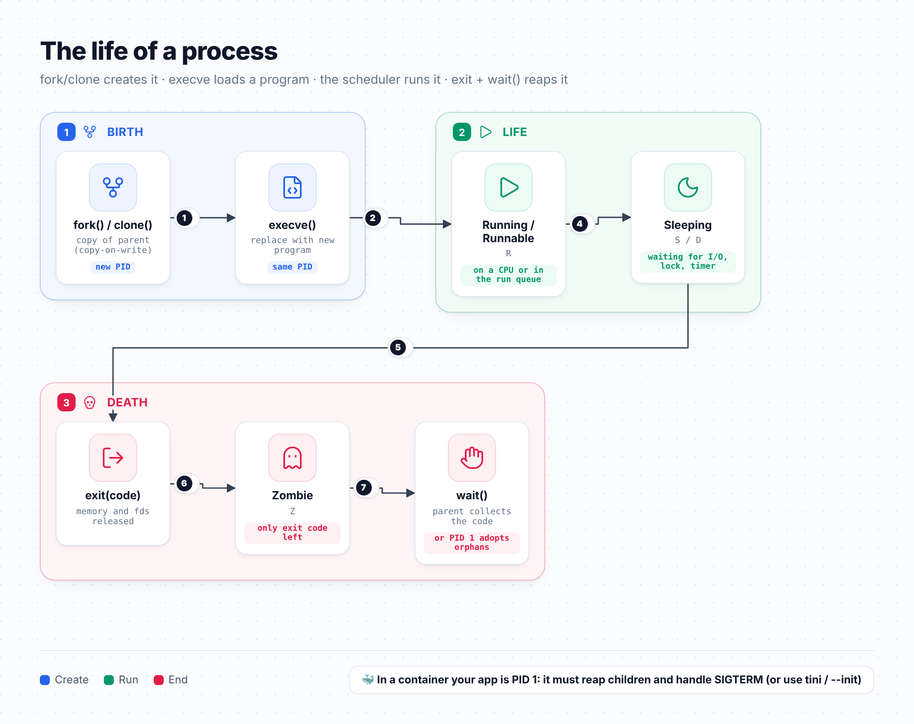
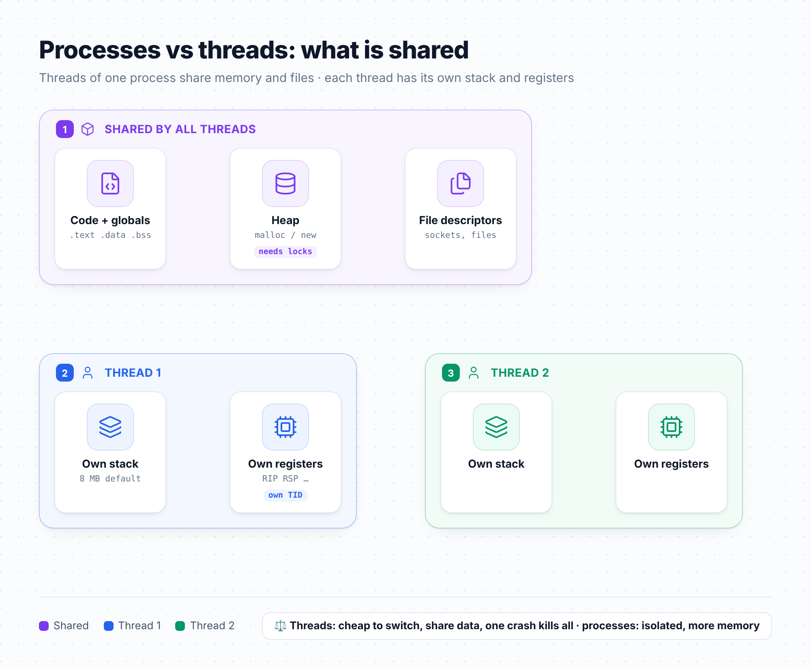

# 3.1 — Process'ler ve thread'ler

!!! abstract "Tek cümlede"
    **Process**, kendi belleği, dosya tanımlayıcıları ve kimliği (PID) olan çalışan bir programdır; **thread** ise bir
    process'in içinde o belleği paylaşan ama kendi stack'i ve register'ları olan bir işçidir. Process'ler
    **fork/clone + execve** ile doğar, **çalışıyor** ve **uyuyor** arasında gidip gelir, **exit** ile biter; sonra ebeveyn
    onu **wait()** ile toplamalıdır. Container'da uygulaman genelde **PID 1**'dir ve bu ona özel görevler yükler.

## 📖 Temel terimler ve kısaltmalar

| Terim | Açılımı | Nedir | Nasıl çalışır (tek satır) |
|---|---|---|---|
| **Process** | — | Çalışmakta olan bir program | Kendi adres alanı, fd'leri, kimlik bilgileri |
| **PID / PPID / TID** | Process ID / Parent PID / Thread ID | Sayısal kimlikler | Her thread'in TID'i var; ana thread'in TID'i = PID |
| **Thread** | — | Process içinde çalıştırma bağlamı | Belleği paylaşır, kendi stack'i + register'ları |
| **fork() / clone()** | — | Yeni process/thread oluştur | clone bayrakları neyin paylaşılacağına karar verir |
| **COW** | Copy-On-Write | fork sonrası tembel kopyalama | Bir taraf yazana kadar sayfalar paylaşılır |
| **execve()** | — | Bir process'teki programı değiştir | Aynı PID, yeni kod ve bellek |
| **wait() / waitpid()** | — | Ebeveynin çocuğun çıkış durumunu toplaması | Zombiyi kaldırır |
| **Zombi** | Zombie | Çıkış durumu toplanmamış bitmiş process | Sadece bir PID ve çıkış kodu tutar |
| **Yetim** | Orphan | Ebeveyni ölmüş process | PID 1'e (ya da bir subreaper'a) bağlanır |
| **PID 1 / init** | — | Bir PID namespace'indeki ilk process | Yetimleri toplamalı; varsayılan sinyal davranışı farklı |
| **Sinyal** | Signal | Asenkron bildirim | SIGTERM, SIGKILL, SIGINT, SIGCHLD, SIGHUP |
| **Çıkış kodu** | Exit code | Çıkışta dönen sayı | 0 = tamam; 128+N = N sinyaliyle öldürüldü (137 = SIGKILL) |
| **Durum kodları** | — | `ps`'te R, S, D, Z, T | Çalışıyor, Uyuyor, Kesilemez, Zombi, Durdurulmuş |

## 🗺️ Büyük resim



---

## 1 · Bir process nasıl oluşturulur?

### Nasıl çalışır?

1. **`fork()`** (Linux'ta aslında `clone()`) ebeveynin kopyası olan bir çocuk oluşturur. **Copy-on-write** sayesinde bellek kopyalanmaz: ikisi sayfaları salt okunur paylaşır ve bir sayfa ancak bir taraf ona yazınca kopyalanır. 10 GB'lık bir process'i fork etmenin hızlı olmasının (ve Redis'in fork ile snapshot alabilmesinin) sebebi bu.
2. Çocuk genelde **`execve()`** çağırır: kernel belleğini atar ve yeni bir program yükler (4. bölüm). PID aynı kalır; close-on-exec işaretli değilse açık fd'ler de kalır.
3. Ebeveyn devam eder ve daha sonra çocuğun çıkış kodunu toplamak için **`wait()`** çağırır.

`ls` çalıştıran bir shell tam olarak bunu yapar: fork, çocukta `ls`'i exec et, ebeveynde bekle.

## 2 · Process ve thread



| | Process | Thread |
|---|---|---|
| Bellek | Ayrı (izole) | Diğer thread'lerle paylaşılır |
| Oluşturma / değişim maliyeti | Daha yüksek | Daha düşük |
| İletişim | Pipe, soket, paylaşımlı bellek | Paylaşılan değişkenleri okuyup yazmak (kilitlerle) |
| Biri çökerse | Diğerleri yaşar | Tüm process ölür |
| Örnekler | nginx/Postgres worker'ları, Python multiprocessing | JVM, Go runtime, Chrome renderer thread'leri |

Linux'ta ikisi de `clone()` ile oluşturulan "task"lardır; bayraklar (`CLONE_VM`, `CLONE_FILES` …) ne kadarının paylaşılacağına karar verir. `ps -eLf` ya da `top -H` thread'leri gösterir.

## 3 · Durumlar, zombiler ve yetimler

- **R** çalışıyor ya da çalışabilir · **S** uyuyor (kesilebilir, ör. bir soketi bekliyor) · **D** kesilemez uyku (genelde disk/NFS I/O; I/O dönene kadar öldürülemez) · **Z** zombi · **T** durdurulmuş.
- Bir **zombi** bitmiştir ama ebeveyni `wait()` çağırmamıştır. Bellek kullanmaz, sadece bir PID slotu. Binlerce zombi hatalı bir ebeveyn demektir ve PID'ler tükenebilir (`pids.max`).
- Bir **yetim** (önce ebeveyni öldü) onu toplaması beklenen PID 1 tarafından sahiplenilir.

## 4 · Sinyaller ve düzgün kapanış

| Sinyal | Varsayılan | Tipik kullanım |
|---|---|---|
| `SIGTERM` (15) | sonlandır | "Lütfen kapan" (Kubernetes, systemd, `docker stop`) |
| `SIGKILL` (9) | öldür, yakalanamaz | Son çare; temizlik yok |
| `SIGINT` (2) | sonlandır | Ctrl+C |
| `SIGHUP` (1) | sonlandır | Terminal kapandı; birçok daemon config'i yeniden yükler |
| `SIGCHLD` | yok say | Bir çocuğun durumu değişti (ebeveyn `wait()` çağırmalı) |
| `SIGSEGV` (11) | core dump | Geçersiz bellek erişimi |

**Düzgün kapanış** = SIGTERM gelince: yeni iş kabul etmeyi bırak, devam eden istekleri bitir, flush et, bağlantıları kapat, 0 ile çık.

## 🔧 DevOps bağlantısı

- **Container'da PID 1:** kernel PID 1'e varsayılan sinyal eylemlerini uygulamaz; SIGTERM handler'ı kurmayan bir uygulama `docker stop` / pod silmeyi **yok sayar** ve bekleme süresinden (varsayılan 30 sn) sonra SIGKILL yer. Zombileri de toplamalıdır. `tini` / `docker run --init` / `shareProcessNamespace` kullan ya da uygulamanın bunu yapmasını sağla.
- **Shell form ve exec form:** `CMD python app.py` PID 1 olarak `/bin/sh -c …` çalıştırır; sh SIGTERM'i iletmeyebilir. Exec form `CMD ["python","app.py"]` ya da entrypoint script'lerinde `exec` kullan.
- **Kubernetes'te sonlanma:** pod terminating olarak işaretlenir → Endpoints'ten çıkarılır (asenkron!) → `preStop` hook → SIGTERM → `terminationGracePeriodSeconds` → SIGKILL. Kısa bir `preStop` sleep'i hâlâ gelen istekleri düşürmeyi önler.
- **Pod durumundaki çıkış kodları:** `137` = SIGKILL (çoğu zaman OOMKilled), `143` = SIGTERM, `139` = SIGSEGV, `1` = uygulama hatası.

## 🧪 Kendin dene

```bash
ps -eo pid,ppid,stat,nlwp,cmd --forest | head -30     # durum ve thread sayısıyla ağaç
ps -eLf | head; top -H                                # thread'ler
cat /proc/self/status | grep -E 'Pid|PPid|Threads|State'

# 30 sn'lik bir zombi oluştur ve ona bak
python3 -c 'import os,time; os.fork() or os._exit(0); time.sleep(30)' &
sleep 1; ps -o pid,ppid,stat,cmd --ppid $!

# PID 1 SIGTERM'i yok sayıyor mu? Karşılaştır:
docker run --rm -d --name noinit alpine sleep 300 && time docker stop noinit      # ~10 sn (zaman aşımından sonra SIGKILL)
docker run --rm -d --name withinit --init alpine sleep 300 && time docker stop withinit   # anında
```

## 🃏 Hatırlatma kartı

| Belirti | Anlamı |
|---|---|
| `docker stop` / pod silme tam bekleme süresi kadar sürüyor | PID 1 SIGTERM'i yok sayıyor |
| Çıkış kodu 137 | SIGKILL (OOM ya da SIGTERM sonrası zaman aşımı) |
| Çok sayıda `Z` process | Ebeveyn `wait()` çağırmıyor / container'da init yok |
| `D` durumunda process'ler, yüksek load avg | Takılmış I/O (disk, NFS) |
| `fork: Resource temporarily unavailable` | PID / thread limiti (`pids.max`, `ulimit -u`) |

## ❓ Kendini test et

??? question "1. fork() gigabaytlarca belleği olan bir process için bile neden hızlıdır?"
    Copy-on-write: ebeveyn ve çocuk biri yazana kadar sayfaları paylaşır; başta sadece page table'lar kopyalanır.

??? question "2. Zombi ile yetim arasındaki fark ne?"
    Zombi bitmiştir ama ebeveyni tarafından toplanmamıştır. Yetim hâlâ çalışıyordur ama ebeveyni ölmüştür; PID 1 onu sahiplenir.

??? question "3. Pod'un durması hep 30 sn sürüyor. Neden?"
    Uygulama (PID 1) SIGTERM'i işlemiyor; kubelet bekleme süresinden sonra SIGKILL gönderene kadar hiçbir şey olmuyor.

??? question "4. Çıkış kodu 137 ne demek?"
    128 + 9: process SIGKILL ile öldürüldü; genelde OOM killer ya da sonlanma bekleme süresinden sonra.

??? question "5. Thread yerine ne zaman process kullanırsın?"
    İzolasyon gerektiğinde (bir çökme ya da bellek sızıntısı her şeyi düşürmesin) ya da Python'un GIL'i gibi bir kilitten kaçınmak için.

---

## 📚 Kaynaklar

- [man 2 fork](https://man7.org/linux/man-pages/man2/fork.2.html) · [man 2 clone](https://man7.org/linux/man-pages/man2/clone.2.html) · [man 7 signal](https://man7.org/linux/man-pages/man7/signal.7.html)
- [tini — A tiny but valid init for containers](https://github.com/krallin/tini)
- [Kubernetes — Pod termination](https://kubernetes.io/docs/concepts/workloads/pods/pod-lifecycle/#pod-termination)

## ✍️ Notlarım

> Dockerfile'larından birine bak: CMD exec formunda mı, uygulama SIGTERM'i işliyor mu?

-
