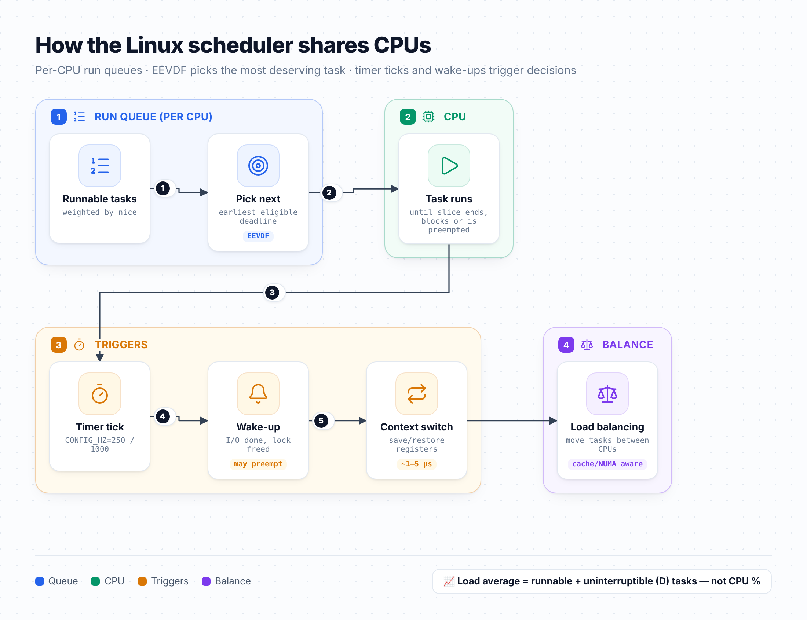
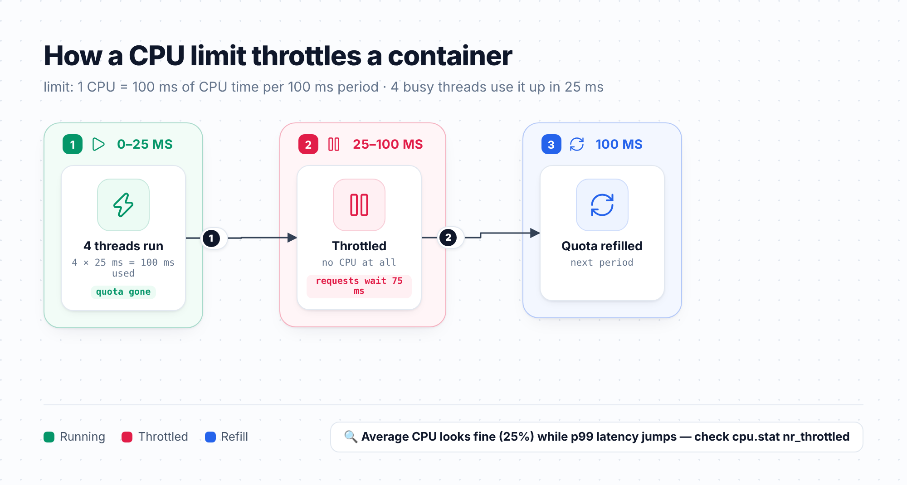

# 3.2 — The scheduler & CPU time

!!! abstract "In short"
    The **scheduler** decides, many times per second on every core, which task gets the CPU next. Linux keeps a **run
    queue per CPU** and uses **EEVDF** to give each task a fair, weighted share. It **preempts** tasks on timer ticks
    and wake-ups and balances load between cores. Containers add **cgroup weights and quotas** on top, which is exactly
    how Kubernetes CPU **requests** and **limits** work.

## 📖 Key terms & abbreviations

| Term | Stands for | What it is | How it works (one line) |
|---|---|---|---|
| **Scheduler** | — | Kernel code choosing the next task | Runs on tick, wake-up, block, yield |
| **Run queue** | — | Per-CPU list of runnable tasks | Tasks waiting for that CPU |
| **EEVDF** | Earliest Eligible Virtual Deadline First | Linux's default fair scheduler since 6.6 | Picks the eligible task with the earliest virtual deadline |
| **CFS** | Completely Fair Scheduler | The previous default (2007–2023) | Picked the task with the least virtual runtime |
| **Time slice** | — | How long a task may run before re-evaluation | A few ms, depends on load |
| **Preemption** | — | Taking the CPU away from a running task | On tick or when a more deserving task wakes |
| **Context switch** | — | Switching the CPU from one task to another | Save/restore registers, maybe change page tables |
| **nice** | — | User priority −20…19 | Changes the task's weight (~1.25× per step) |
| **RT policies** | Real-Time (SCHED_FIFO, SCHED_RR, SCHED_DEADLINE) | Strict priority classes | Always run before normal tasks |
| **Load average** | — | Average number of runnable + D-state tasks | 1, 5, 15-minute values |
| **Affinity** | — | Which CPUs a task may run on | `taskset`, cpusets |
| **cpu.weight / cpu.max** | — | cgroup v2 CPU share / hard quota | Weight under contention / quota per period |
| **Throttling** | — | Pausing a cgroup that used its quota | Until the next period (default 100 ms) |
| **PSI** | Pressure Stall Information | How long tasks waited for CPU/memory/IO | `/proc/pressure/cpu` |

## 🗺️ Big picture



---

## 1 · What does the scheduler do?

### How does it work?

1. Each CPU has a **run queue** of tasks that are ready to run. Sleeping tasks (waiting on I/O, locks, timers) aren't in it.
2. **EEVDF** gives each task a weighted fair share. Tasks that received less than their share are **eligible**; among them, the one with the **earliest virtual deadline** runs next. Short-sleeping, latency-sensitive tasks get to run quickly after waking.
3. The current task runs until its slice ends, it **blocks** (e.g. `read()` on a socket), or a **wake-up** of a more deserving task **preempts** it.
4. Every switch is a **context switch**: save registers, load the next task's, and if it's another process, switch page tables (TLB impact). A few microseconds each; tens of thousands per second per core is normal.
5. Periodically and when a CPU goes idle, **load balancing** moves tasks between CPUs, considering cache and NUMA topology.

## 2 · Priorities

- **nice** −20 (most) to 19 (least): each step changes CPU share by about 10%. Background jobs: `nice -n 19`.
- **Real-time** (`SCHED_FIFO`, `SCHED_RR`, `SCHED_DEADLINE`) always beat normal tasks. Powerful and dangerous: a busy RT task can starve the system.
- **I/O priority** is separate: `ionice`.

## 3 · Load average is not CPU %

Load average = runnable tasks **+ tasks in uninterruptible sleep (D)**, averaged over 1/5/15 minutes. On an 8-core box, a load of 8 means "fully busy". A high load with low CPU% usually means tasks stuck in **D state** (slow disk, hung NFS). For a better signal use **PSI**: `/proc/pressure/cpu` says what percentage of time tasks were waiting for a CPU.

## 4 · cgroups: weights and quotas



| Kubernetes | cgroup v2 file | What it does |
|---|---|---|
| `resources.requests.cpu: 500m` | `cpu.weight` | **Share under contention**: when the node is busy, you get CPU in proportion to your request. When it's idle, you can use more |
| `resources.limits.cpu: 1` | `cpu.max = 100000 100000` | **Hard cap**: 100 ms of CPU per 100 ms period, across all your threads. Exceeding it → **throttled** until the next period |
| Guaranteed QoS + static CPU manager | cpuset | Exclusive whole cores (pinning) |

The trap: a service with 8 threads and `limit: 1` can use its 100 ms of quota in the first 12.5 ms of each period and then **freeze for 87.5 ms**. Average CPU looks low, p99 latency is terrible. Watch `nr_throttled` in `cpu.stat` / `container_cpu_cfs_throttled_periods_total`.

## 🔧 DevOps connection

- **Requests drive scheduling and fairness; limits drive throttling.** Many teams set CPU requests on everything and avoid CPU limits on latency-sensitive services (memory limits stay).
- **Runtimes must know their CPU budget:** JVM (container-aware since JDK 10, sizes GC/JIT threads from the quota), Go (since 1.25 `GOMAXPROCS` follows the cgroup CPU limit), Node/Python worker counts, nginx `worker_processes auto` (sees host cores!).
- **Noisy neighbours** without limits are handled by weights; high `kube_pod_container_resource_requests` accuracy matters more than limits.
- **High context-switch rate** (`vmstat` `cs`) or run-queue length (`r`) > cores = CPU saturation.

## 🧪 Try it yourself

```bash
nproc; uptime                                   # cores and load average
vmstat 1 5                                      # r = run queue, cs = context switches/s
cat /proc/pressure/cpu                          # PSI: % time waiting for CPU
pidstat -w 1 3 2>/dev/null | head -15           # context switches per process (sysstat)
chrt -p $$; nice -n 19 sleep 1                  # scheduling policy, niceness
cat /sys/kernel/debug/sched/features 2>/dev/null | tr ' ' '\n' | head -3  # (root) scheduler features

# Throttling inside a container
docker run --rm --cpus=0.5 alpine sh -c 'yes > /dev/null & sleep 3; cat /sys/fs/cgroup/cpu.max /sys/fs/cgroup/cpu.stat'
```

## 🃏 Cheat sheet

| Question | Look at |
|---|---|
| Is the CPU saturated? | `vmstat` r > cores, PSI cpu `some` |
| Is my container throttled? | `cpu.stat` nr_throttled / throttled_usec |
| High load, low CPU% | Tasks in D state (`ps -eo stat,cmd | grep ^D`) |
| Make a job polite | `nice -n 19`, `ionice -c3` |
| Pin to cores | `taskset -c 2,3`, Kubernetes static CPU manager |

## ❓ Test yourself

??? question "1. What happens to a task that calls `read()` on a socket with no data?"
    It blocks: leaves the run queue and sleeps until data arrives; the scheduler runs something else.

??? question "2. Load average is 16 on a 16-core server but CPU is 20%. What's going on?"
    Load includes D-state tasks; many tasks are probably stuck in uninterruptible I/O (disk, NFS).

??? question "3. What's the difference between a CPU request and a CPU limit in Kubernetes?"
    Request sets cpu.weight (share under contention, used for scheduling); limit sets cpu.max (hard quota, causes throttling).

??? question "4. Why can a CPU limit hurt latency even when average CPU usage is well below it?"
    Multiple threads can burn the whole period's quota early, then the container is throttled for the rest of the period.

??? question "5. Why should runtimes like the JVM or Go know the container's CPU limit?"
    They size thread pools and GC workers from the number of CPUs; seeing 64 host cores with a 2-CPU limit causes heavy throttling.

---

## 📚 Sources

- [Linux kernel docs — EEVDF scheduler](https://docs.kernel.org/scheduler/sched-eevdf.html)
- [Linux kernel docs — cgroup v2 (cpu controller)](https://docs.kernel.org/admin-guide/cgroup-v2.html)
- [Linux kernel docs — PSI](https://docs.kernel.org/accounting/psi.html)
- [Kubernetes — Resource management for pods and containers](https://kubernetes.io/docs/concepts/configuration/manage-resources-containers/)
- [Go 1.25 release notes — container-aware GOMAXPROCS](https://go.dev/doc/go1.25)

## ✍️ My notes

> Pick a service with a CPU limit. Check its throttled periods over the last day. Is the limit helping or hurting?
