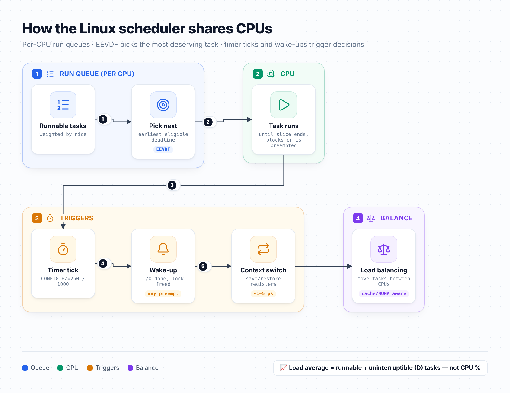
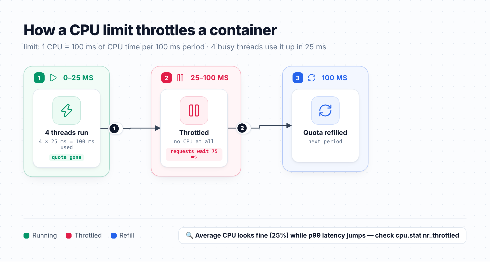

# 3.2 — Zamanlayıcı ve CPU zamanı

!!! abstract "Tek cümlede"
    **Zamanlayıcı** (scheduler), her çekirdekte saniyede defalarca, sıradaki CPU'yu hangi çalışabilir task'ın alacağına
    karar verir: Linux **CPU başına bir çalışma kuyruğu** tutar, her task'a adil ve ağırlıklı bir pay vermek için **EEVDF**
    kullanır, timer tick'lerinde ve uyanmalarda task'ları **keser** (preempt) ve yükü çekirdekler arasında dengeler;
    container'lar üstüne **cgroup ağırlıkları ve kotaları** ekler, Kubernetes CPU **request** ve **limit**'leri de tam olarak böyle uygulanır.

## 📖 Temel terimler ve kısaltmalar

| Terim | Açılımı | Nedir | Nasıl çalışır (tek satır) |
|---|---|---|---|
| **Zamanlayıcı** | Scheduler | Sıradaki task'ı seçen kernel kodu | Tick, uyanma, bloklanma, yield'da çalışır |
| **Çalışma kuyruğu** | Run queue | CPU başına çalışabilir task listesi | O CPU'yu bekleyen task'lar |
| **EEVDF** | Earliest Eligible Virtual Deadline First | 6.6'dan beri Linux'un varsayılan adil zamanlayıcısı | En erken sanal deadline'a sahip uygun task'ı seçer |
| **CFS** | Completely Fair Scheduler | Önceki varsayılan (2007–2023) | En az sanal çalışma süresine sahip task'ı seçerdi |
| **Zaman dilimi** | Time slice | Bir task'ın yeniden değerlendirilmeden önce çalışabileceği süre | Birkaç ms, yüke bağlı |
| **Preemption** | — | Çalışan bir task'tan CPU'yu almak | Tick'te ya da daha hak eden bir task uyanınca |
| **Bağlam değişimi** | Context switch | CPU'yu bir task'tan diğerine geçirmek | Register'ları kaydet/yükle, gerekirse page table değiştir |
| **nice** | — | Kullanıcı önceliği −20…19 | Task'ın ağırlığını değiştirir (adım başına ~1,25×) |
| **RT politikaları** | Real-Time (SCHED_FIFO, SCHED_RR, SCHED_DEADLINE) | Katı öncelik sınıfları | Normal task'lardan önce her zaman çalışır |
| **Load average** | — | Çalışabilir + D durumundaki task'ların ortalaması | 1, 5, 15 dakikalık değerler |
| **Affinity** | — | Bir task'ın hangi CPU'larda çalışabileceği | `taskset`, cpuset'ler |
| **cpu.weight / cpu.max** | — | cgroup v2 CPU payı / sert kota | Çekişmede ağırlık / periyot başına kota |
| **Throttling** | — | Kotasını kullanmış bir cgroup'u durdurmak | Bir sonraki periyoda kadar (varsayılan 100 ms) |
| **PSI** | Pressure Stall Information | Task'ların CPU/bellek/IO için ne kadar beklediği | `/proc/pressure/cpu` |

## 🗺️ Büyük resim



---

## 1 · Zamanlayıcı ne yapar?

### Nasıl çalışır?

1. Her CPU'nun çalışmaya hazır task'lardan oluşan bir **çalışma kuyruğu** var. Uyuyan task'lar (I/O, kilit, zamanlayıcı bekleyen) içinde değildir.
2. **EEVDF** her task'a ağırlıklı adil bir pay verir. Payından az almış task'lar **uygundur**; aralarında **en erken sanal deadline**'a sahip olan çalışır. Kısa uyuyan, gecikmeye hassas task'lar uyandıktan sonra hızla çalışma fırsatı bulur.
3. Mevcut task dilimi bitene, **bloklanana** (ör. bir sokette `read()`) ya da daha hak eden bir task'ın **uyanması** onu **kesene** kadar çalışır.
4. Her değişim bir **bağlam değişimidir**: register'ları kaydet, sıradakininkini yükle; başka bir process ise page table'ları değiştir (TLB etkisi). Her biri birkaç mikrosaniye; çekirdek başına saniyede on binlerce normaldir.
5. Periyodik olarak ve bir CPU boşta kalınca **yük dengeleme**, önbellek ve NUMA topolojisini gözeterek task'ları CPU'lar arasında taşır.

## 2 · Öncelikler

- **nice** −20 (en çok) ile 19 (en az): her adım CPU payını yaklaşık %10 değiştirir. Arka plan işleri: `nice -n 19`.
- **Gerçek zamanlı** (`SCHED_FIFO`, `SCHED_RR`, `SCHED_DEADLINE`) her zaman normal task'ları yener. Güçlü ve tehlikeli: meşgul bir RT task sistemi aç bırakabilir.
- **I/O önceliği** ayrıdır: `ionice`.

## 3 · Load average CPU % değildir

Load average = çalışabilir task'lar **+ kesilemez uykudaki (D) task'lar**, 1/5/15 dakikalık ortalama. 8 çekirdekli bir makinede 8 yük "tamamen meşgul" demektir. Düşük CPU% ile yüksek yük genelde **D durumunda** takılmış task'lar demektir (yavaş disk, takılmış NFS). Daha iyi bir sinyal için **PSI** kullan: `/proc/pressure/cpu`, task'ların zamanın yüzde kaçında CPU beklediğini söyler.

## 4 · cgroup'lar: ağırlıklar ve kotalar



| Kubernetes | cgroup v2 dosyası | Ne yapar |
|---|---|---|
| `resources.requests.cpu: 500m` | `cpu.weight` | **Çekişmede pay**: node meşgulken request'ine orantılı CPU alırsın. Boştayken daha fazlasını kullanabilirsin |
| `resources.limits.cpu: 1` | `cpu.max = 100000 100000` | **Sert tavan**: tüm thread'lerin toplamında 100 ms'lik periyotta 100 ms CPU. Aşarsan bir sonraki periyoda kadar **throttle** |
| Guaranteed QoS + static CPU manager | cpuset | Özel tam çekirdekler (pinning) |

Tuzak: 8 thread'li ve `limit: 1` olan bir servis 100 ms'lik kotasını her periyodun ilk 12,5 ms'sinde kullanıp sonra **87,5 ms donabilir**. Ortalama CPU düşük görünür, p99 gecikme berbattır. `cpu.stat`'taki `nr_throttled` / `container_cpu_cfs_throttled_periods_total`'u izle.

## 🔧 DevOps bağlantısı

- **Request'ler zamanlamayı ve adaleti, limit'ler throttling'i belirler.** Birçok ekip her şeye CPU request koyar, gecikmeye hassas servislerde CPU limitinden kaçınır (bellek limitleri kalır).
- **Runtime'lar CPU bütçesini bilmeli:** JVM (JDK 10'dan beri container farkında, GC/JIT thread'lerini kotaya göre boyutlar), Go (1.25'ten beri `GOMAXPROCS` cgroup CPU limitini takip eder), Node/Python worker sayıları, nginx `worker_processes auto` (host çekirdeklerini görür!).
- **Limitsiz gürültülü komşular** ağırlıklarla yönetilir; doğru request değerleri limitlerden daha önemli.
- **Yüksek bağlam değişimi oranı** (`vmstat` `cs`) ya da çekirdek sayısından uzun çalışma kuyruğu (`r`) = CPU doygunluğu.

## 🧪 Kendin dene

```bash
nproc; uptime                                   # çekirdekler ve load average
vmstat 1 5                                      # r = çalışma kuyruğu, cs = saniyede bağlam değişimi
cat /proc/pressure/cpu                          # PSI: CPU beklemede geçen zaman %
pidstat -w 1 3 2>/dev/null | head -15           # process başına bağlam değişimi (sysstat)
chrt -p $$; nice -n 19 sleep 1                  # zamanlama politikası, nice değeri
cat /sys/kernel/debug/sched/features 2>/dev/null | tr ' ' '\n' | head -3  # (root) zamanlayıcı özellikleri

# Container içinde throttling
docker run --rm --cpus=0.5 alpine sh -c 'yes > /dev/null & sleep 3; cat /sys/fs/cgroup/cpu.max /sys/fs/cgroup/cpu.stat'
```

## 🃏 Hatırlatma kartı

| Soru | Nereye bak |
|---|---|
| CPU doygun mu? | `vmstat` r > çekirdek, PSI cpu `some` |
| Container'ım throttle ediliyor mu? | `cpu.stat` nr_throttled / throttled_usec |
| Yüksek yük, düşük CPU% | D durumunda task'lar (`ps -eo stat,cmd | grep ^D`) |
| Bir işi kibar yap | `nice -n 19`, `ionice -c3` |
| Çekirdeklere sabitle | `taskset -c 2,3`, Kubernetes static CPU manager |

## ❓ Kendini test et

??? question "1. Verisi olmayan bir sokette `read()` çağıran task'a ne olur?"
    Bloklanır: çalışma kuyruğundan çıkar ve veri gelene kadar uyur; zamanlayıcı başka bir şey çalıştırır.

??? question "2. 16 çekirdekli bir sunucuda load average 16 ama CPU %20. Ne oluyor?"
    Yük D durumundaki task'ları da sayar; muhtemelen çok sayıda task kesilemez I/O'da (disk, NFS) takılı.

??? question "3. Kubernetes'te CPU request ile CPU limit arasındaki fark ne?"
    Request cpu.weight'i ayarlar (çekişmede pay, zamanlamada kullanılır); limit cpu.max'i ayarlar (sert kota, throttling'e yol açar).

??? question "4. Ortalama CPU kullanımı limitin çok altındayken bile CPU limiti gecikmeye neden zarar verebilir?"
    Birden fazla thread periyodun tüm kotasını erken yakabilir, sonra container periyodun geri kalanında throttle edilir.

??? question "5. JVM ya da Go gibi runtime'lar container'ın CPU limitini neden bilmeli?"
    Thread havuzlarını ve GC worker'larını CPU sayısına göre boyutlarlar; 2 CPU limitiyle 64 host çekirdeği görmek ağır throttling'e yol açar.

---

## 📚 Kaynaklar

- [Linux kernel docs — EEVDF scheduler](https://docs.kernel.org/scheduler/sched-eevdf.html)
- [Linux kernel docs — cgroup v2 (cpu controller)](https://docs.kernel.org/admin-guide/cgroup-v2.html)
- [Linux kernel docs — PSI](https://docs.kernel.org/accounting/psi.html)
- [Kubernetes — Resource management for pods and containers](https://kubernetes.io/docs/concepts/configuration/manage-resources-containers/)
- [Go 1.25 release notes — container-aware GOMAXPROCS](https://go.dev/doc/go1.25)

## ✍️ Notlarım

> CPU limiti olan bir servis seç. Son bir gündeki throttle edilen periyotlarına bak. Limit yardım mı ediyor, zarar mı veriyor?

-
