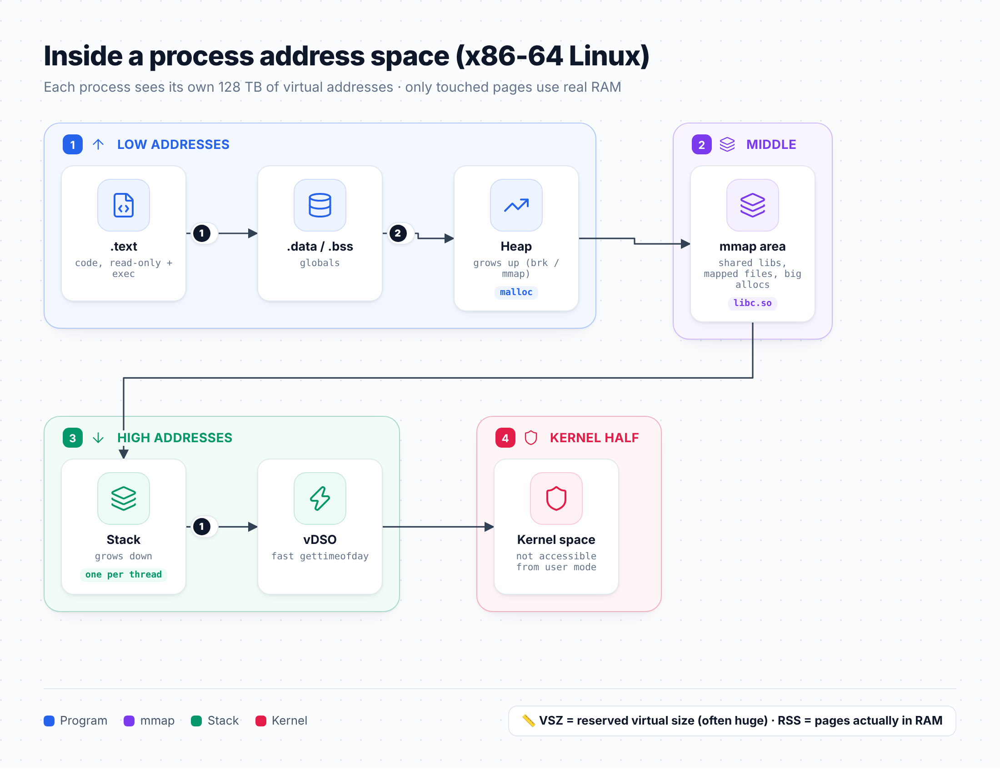
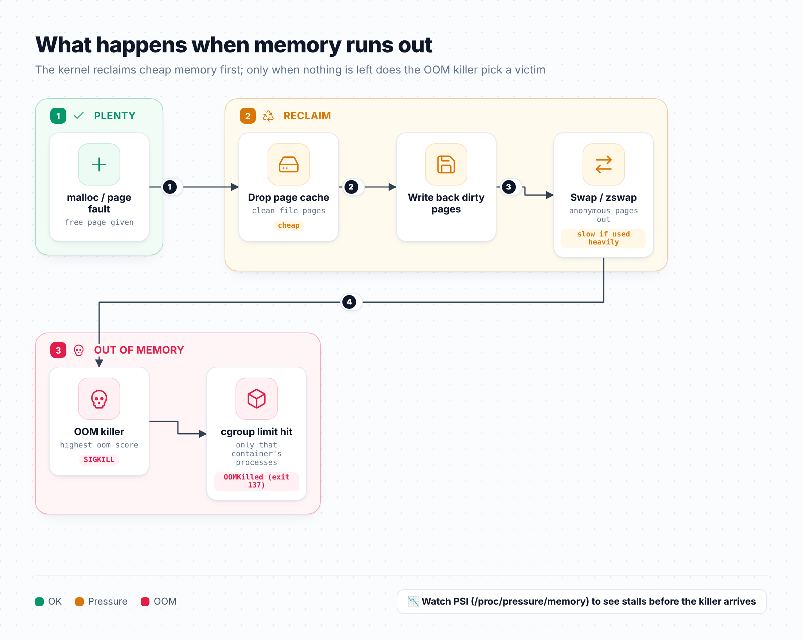

# 3.3 — Virtual memory & memory management

!!! abstract "In one sentence"
    Every process sees its own huge, private **virtual address space**; the kernel maps it page by page (4 KB) to
    physical RAM only when touched (**demand paging**), fills free RAM with **page cache**, and when memory runs short it
    **reclaims** cache, **swaps** if allowed, and as a last resort the **OOM killer** kills a process, which in a container
    means hitting its **cgroup memory limit** and the famous `OOMKilled`.

## 📖 Key terms & abbreviations

| Term | Stands for | What it is | How it works (one line) |
|---|---|---|---|
| **Virtual address** | — | Address a program uses | Translated by the MMU on every access |
| **Page / frame** | — | 4 KB unit of virtual / physical memory | Page tables map pages to frames |
| **Page table** | — | Per-process mapping tree (4–5 levels) | Walked by the MMU on a TLB miss |
| **Page fault** | — | Access to a page that isn't mapped (yet) | Kernel maps it (minor) or reads it from disk (major) |
| **Demand paging** | — | RAM assigned on first touch | `malloc(1 GB)` uses ~0 RSS until written |
| **VSZ / RSS** | Virtual Size / Resident Set Size | Reserved address space / pages in RAM | RSS is what costs memory |
| **PSS / USS** | Proportional / Unique Set Size | RSS with shared pages divided / only private pages | Fairer per-process accounting |
| **Anonymous memory** | — | Heap, stacks: not backed by a file | Can only go to swap |
| **Page cache** | — | File data cached in RAM | Reclaimable; "buff/cache" in `free` |
| **mmap** | memory map | Map a file or anonymous memory into the address space | Lazy loading, shared libraries, databases |
| **Swap / zswap** | — | Disk (or compressed RAM) for anonymous pages | Slows things down but avoids OOM |
| **Reclaim** | — | Freeing memory under pressure | Drop clean cache, write dirty pages, swap |
| **OOM killer** | Out Of Memory | Kernel kills a process to free memory | Chooses highest `oom_score` |
| **memory.max / memory.high** | — | cgroup v2 hard limit / throttle point | Kubernetes memory limit → memory.max |

## 🗺️ Big picture



---

## 1 · Pages, page tables and page faults

### How does it work?

The address space is cut into **4 KB pages**. A **page table** (a 4- or 5-level tree per process) maps virtual pages to physical frames, with permission bits (read/write/execute, user/kernel). The MMU walks it on every TLB miss (diagram in chapter 3).

When a program touches a page with no mapping, the CPU raises a **page fault**:

- **Minor fault:** the data is already in RAM (fresh zero page, shared library already cached) → just add the mapping. Microseconds.
- **Major fault:** data must be read from disk (a file mapped with mmap, or swapped-out memory). Milliseconds.
- **Invalid access** (no mapping allowed, wrong permission) → **SIGSEGV** ("segmentation fault").

That's why `malloc(1 GB)` returns instantly and RSS only grows as you write to the memory.

## 2 · Reading memory numbers correctly

```text
$ free -h
               total   used   free   shared  buff/cache  available
Mem:            62Gi   18Gi   2.1Gi   1.0Gi       42Gi       43Gi
```

- **"free" is small and that's fine**: Linux uses spare RAM as **page cache**. Look at **available** (free + reclaimable cache).
- **VSZ** can be huge (Go and JVM reserve lots of address space); it costs nothing. **RSS** is real usage, but shared libraries are counted in every process; **PSS** splits them fairly.
- **Container memory** (`memory.current`) includes page cache from files the container read/wrote. Kubernetes uses the **working set** (usage minus inactive file cache) for eviction decisions.

## 3 · When memory runs out



1. **Reclaim:** kswapd drops clean page cache (cheap, just re-read later), writes back dirty pages, and swaps anonymous pages if swap exists.
2. **Thrashing:** if the working set doesn't fit, the system spends its time paging; everything is slow but alive. **PSI memory** shows it.
3. **OOM:** if reclaim can't free enough, the kernel's **OOM killer** picks the process with the highest `oom_score` (mostly by memory usage, adjusted by `oom_score_adj`) and sends SIGKILL.
4. **In a cgroup** the same happens *inside the limit*: when a container exceeds `memory.max`, only processes in that cgroup are candidates. Kubernetes reports **`OOMKilled`, exit code 137**.

## 4 · mmap and the page cache

- `read()` copies from the page cache into your buffer; **`mmap()`** maps the cached pages directly into your address space, no copy. Databases (LMDB, older MongoDB), search engines and model loaders (llama.cpp loads weights with mmap) use it.
- Writes go to the page cache first (**dirty pages**) and are flushed later; `fsync()` forces them to disk. Losing power before that loses data, which is why databases call `fsync`.

## 🔧 DevOps connection

- **Kubernetes memory:** requests are used for scheduling; the **limit is a hard wall** (`memory.max`) → OOMKilled. Unlike CPU, memory can't be throttled, only reclaimed or killed. Set limit ≈ request for predictable services.
- **Runtime heap vs limit:** JVM `-XX:MaxRAMPercentage=75`, Go `GOMEMLIMIT`, Node `--max-old-space-size`. Leave headroom for off-heap memory, thread stacks, page cache, native libs.
- **Node-pressure eviction:** the kubelet evicts pods (BestEffort first, then Burstable over their request) when node `memory.available` drops below a threshold; that's different from the cgroup OOM kill.
- **Swap in Kubernetes:** supported (`NodeSwap`, LimitedSwap for Burstable pods) but off by default on most clusters.
- **Memory leaks vs cache:** a growing `memory.current` might just be page cache from log files; check `memory.stat` (anon vs file).

## 🧪 Try it yourself

```bash
free -h; cat /proc/meminfo | head -20
cat /proc/self/maps | head -20                 # this shell's address space
pmap -x $$ | tail -3                           # mapped size vs RSS
grep -E 'VmSize|VmRSS' /proc/$$/status
cat /proc/pressure/memory                      # memory PSI

# Demand paging: reserve 1 GB, watch RSS grow only when written
python3 -c "
import mmap, os, time
m = mmap.mmap(-1, 1<<30)
print('after reserve:', open('/proc/self/status').read().split('VmRSS:')[1].split()[0], 'kB')
for i in range(0, 1<<30, 4096): m[i] = 1
print('after touching:', open('/proc/self/status').read().split('VmRSS:')[1].split()[0], 'kB')"

# OOM in a container
docker run --rm -m 64m python:3.12-alpine python -c "x = bytearray(200*1024*1024)"; echo "exit=$?"   # 137
```

## 🃏 Cheat sheet

| Metric | Meaning |
|---|---|
| `available` (free) | What you can still use without swapping |
| VSZ | Reserved address space (ignore) |
| RSS / PSS | Real memory (PSS shares counted fairly) |
| `memory.current` / `memory.stat` | Container usage, split into anon and file |
| major faults | Disk reads due to paging (bad if high) |
| `OOMKilled` / 137 | Hit memory limit or node OOM |

## ❓ Test yourself

??? question "1. A process allocates 4 GB but RSS is only 50 MB. Is something wrong?"
    No. Pages are only backed by RAM when touched (demand paging); untouched allocations cost nothing.

??? question "2. `free` shows 1 GB free on a 64 GB server. Should you worry?"
    Look at `available`. Most RAM is probably page cache, which the kernel drops when applications need memory.

??? question "3. What's the difference between a minor and a major page fault?"
    Minor: the data is already in RAM, only a mapping is added. Major: the data must be read from disk.

??? question "4. Why did my JVM pod get OOMKilled even though -Xmx is below the limit?"
    The JVM uses memory outside the heap (metaspace, thread stacks, direct buffers, JIT code, native libs); heap + all that exceeded memory.max.

??? question "5. Why can't Kubernetes throttle memory the way it throttles CPU?"
    CPU time can be delayed; memory already in use can't be taken back without reclaiming (cache/swap) or killing the process.

---

## 📚 Sources

- [Linux kernel docs — Memory management concepts](https://docs.kernel.org/admin-guide/mm/concepts.html)
- [Linux kernel docs — cgroup v2 memory controller](https://docs.kernel.org/admin-guide/cgroup-v2.html#memory)
- [Kubernetes — Node-pressure eviction](https://kubernetes.io/docs/concepts/scheduling-eviction/node-pressure-eviction/)
- [linuxatemyram.com](https://www.linuxatemyram.com/)

## ✍️ My notes

> For one pod: compare `memory.current`, the anon and file lines in `memory.stat`, and the limit. How close is it to OOM really?

-
