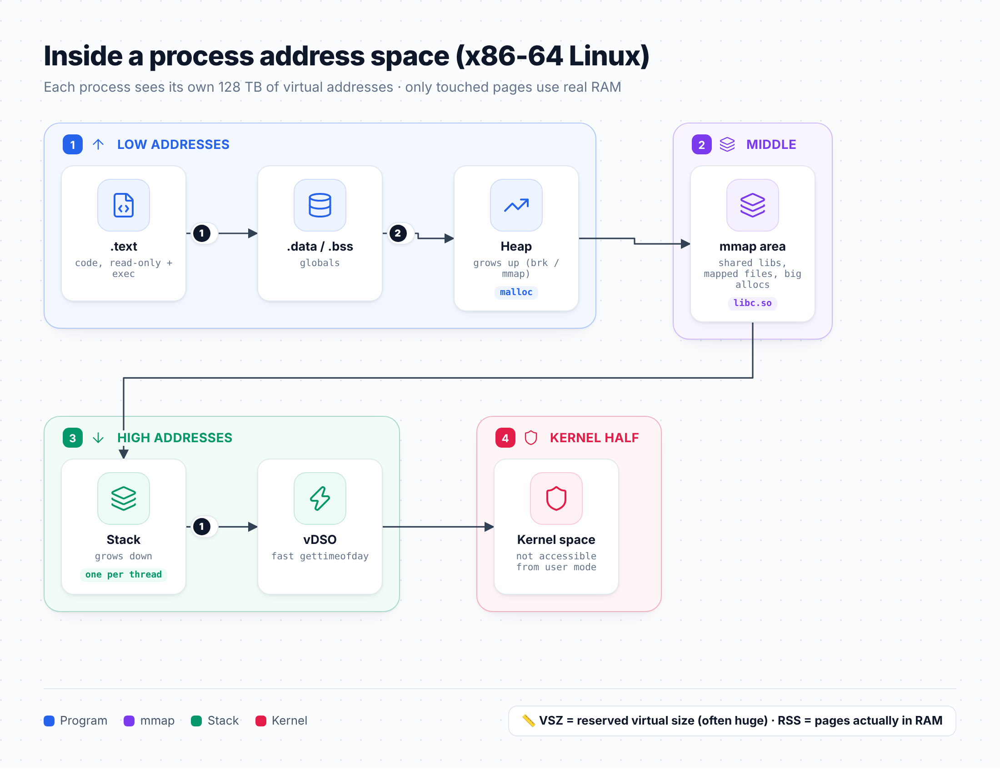
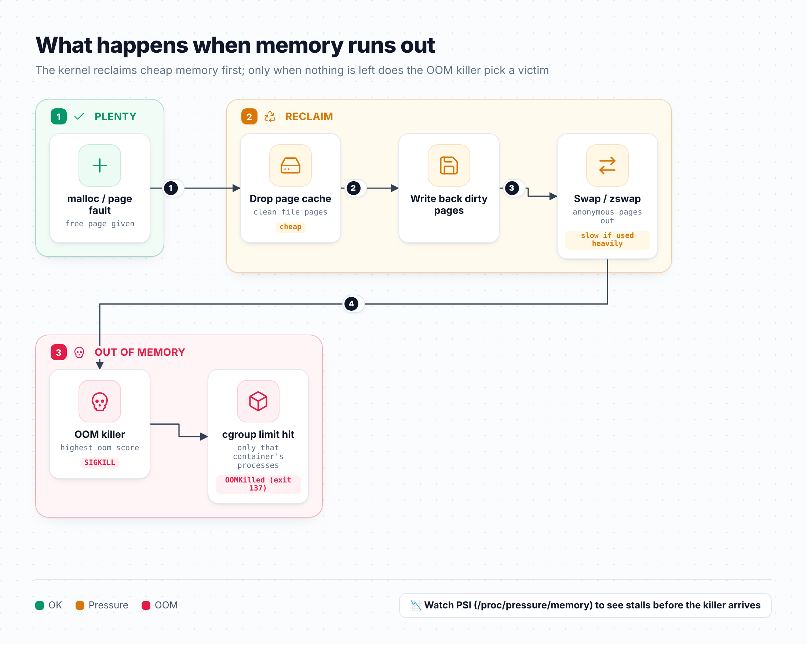

# 3.3 — Sanal bellek ve bellek yönetimi

!!! abstract "Tek cümlede"
    Her process kendi dev ve özel **sanal adres alanını** görür; kernel onu sayfa sayfa (4 KB) fiziksel RAM'e ancak
    dokunulduğunda eşler (**talep üzerine sayfalama**), boş RAM'i **page cache** ile doldurur ve bellek azalınca önce cache'i
    **geri alır**, izin varsa **swap** yapar, son çare olarak **OOM killer** bir process'i öldürür; container'da bu
    **cgroup bellek limitine** takılmak ve meşhur `OOMKilled` demektir.

## 📖 Temel terimler ve kısaltmalar

| Terim | Açılımı | Nedir | Nasıl çalışır (tek satır) |
|---|---|---|---|
| **Sanal adres** | Virtual address | Programın kullandığı adres | Her erişimde MMU tarafından çevrilir |
| **Sayfa / çerçeve** | Page / frame | Sanal / fiziksel belleğin 4 KB'lık birimi | Page table'lar sayfaları çerçevelere eşler |
| **Page table** | — | Process başına eşleme ağacı (4–5 seviye) | TLB ıskasında MMU yürür |
| **Page fault** | — | (Henüz) eşlenmemiş bir sayfaya erişim | Kernel eşler (minor) ya da diskten okur (major) |
| **Talep üzerine sayfalama** | Demand paging | RAM ilk dokunuşta atanır | `malloc(1 GB)` yazılana kadar ~0 RSS kullanır |
| **VSZ / RSS** | Virtual Size / Resident Set Size | Ayrılmış adres alanı / RAM'deki sayfalar | Belleğe mal olan RSS'tir |
| **PSS / USS** | Proportional / Unique Set Size | Paylaşılan sayfalar bölünmüş RSS / sadece özel sayfalar | Process başına daha adil hesap |
| **Anonim bellek** | Anonymous memory | Heap, stack'ler: bir dosyaya dayanmaz | Sadece swap'e gidebilir |
| **Page cache** | — | RAM'de önbelleğe alınmış dosya verisi | Geri alınabilir; `free`'de "buff/cache" |
| **mmap** | memory map | Bir dosyayı ya da anonim belleği adres alanına eşle | Tembel yükleme, paylaşımlı kütüphaneler, veritabanları |
| **Swap / zswap** | — | Anonim sayfalar için disk (ya da sıkıştırılmış RAM) | Yavaşlatır ama OOM'u önler |
| **Geri alma** | Reclaim | Baskı altında bellek boşaltmak | Temiz cache'i bırak, kirli sayfaları yaz, swap |
| **OOM killer** | Out Of Memory | Bellek boşaltmak için kernel bir process'i öldürür | En yüksek `oom_score`'u seçer |
| **memory.max / memory.high** | — | cgroup v2 sert limit / yavaşlatma noktası | Kubernetes bellek limiti → memory.max |

## 🗺️ Büyük resim



---

## 1 · Sayfalar, page table'lar ve page fault'lar

### Nasıl çalışır?

Adres alanı **4 KB'lık sayfalara** bölünür. Bir **page table** (process başına 4 ya da 5 seviyeli bir ağaç) sanal sayfaları izin bitleriyle (okuma/yazma/çalıştırma, user/kernel) fiziksel çerçevelere eşler. MMU her TLB ıskasında onu yürür (3. bölüm diagramı).

Bir program eşlemesi olmayan bir sayfaya dokununca CPU bir **page fault** üretir:

- **Minor fault:** veri zaten RAM'de (yeni sıfır sayfa, önbellekteki paylaşımlı kütüphane) → sadece eşlemeyi ekle. Mikrosaniyeler.
- **Major fault:** veri diskten okunmalı (mmap ile eşlenmiş bir dosya ya da swap'e gitmiş bellek). Milisaniyeler.
- **Geçersiz erişim** (eşlemeye izin yok, yanlış izin) → **SIGSEGV** ("segmentation fault").

`malloc(1 GB)`'ın anında dönmesinin ve RSS'in ancak belleğe yazdıkça büyümesinin sebebi bu.

## 2 · Bellek rakamlarını doğru okumak

```text
$ free -h
               total   used   free   shared  buff/cache  available
Mem:            62Gi   18Gi   2.1Gi   1.0Gi       42Gi       43Gi
```

- **"free" küçük ve bu normal**: Linux boş RAM'i **page cache** olarak kullanır. **available**'a bak (boş + geri alınabilir cache).
- **VSZ** dev olabilir (Go ve JVM çok adres alanı ayırır); maliyeti yoktur. **RSS** gerçek kullanımdır ama paylaşımlı kütüphaneler her process'te sayılır; **PSS** onları adil böler.
- **Container belleği** (`memory.current`) container'ın okuduğu/yazdığı dosyaların page cache'ini de içerir. Kubernetes tahliye kararları için **working set**'i (kullanım eksi etkin olmayan dosya cache'i) kullanır.

## 3 · Bellek bitince



1. **Geri alma:** kswapd temiz page cache'i bırakır (ucuz, sonra yeniden okunur), kirli sayfaları geri yazar ve swap varsa anonim sayfaları swap'e atar.
2. **Thrashing:** çalışma kümesi sığmıyorsa sistem zamanını sayfalamayla geçirir; her şey yavaştır ama yaşar. **PSI memory** bunu gösterir.
3. **OOM:** geri alma yeterince boşaltamazsa kernel'in **OOM killer**'ı en yüksek `oom_score`'a sahip process'i (çoğunlukla bellek kullanımına göre, `oom_score_adj` ile ayarlanır) seçer ve SIGKILL gönderir.
4. **Bir cgroup'ta** aynısı *limitin içinde* olur: container `memory.max`'i aşınca sadece o cgroup'taki process'ler adaydır. Kubernetes **`OOMKilled`, çıkış kodu 137** bildirir.

## 4 · mmap ve page cache

- `read()` page cache'ten senin tamponuna kopyalar; **`mmap()`** önbellekteki sayfaları kopyasız doğrudan adres alanına eşler. Veritabanları (LMDB, eski MongoDB), arama motorları ve model yükleyiciler (llama.cpp ağırlıkları mmap ile yükler) bunu kullanır.
- Yazmalar önce page cache'e gider (**kirli sayfalar**) ve sonra flush edilir; `fsync()` onları diske zorlar. Ondan önce elektrik giderse veri kaybolur; veritabanlarının `fsync` çağırmasının sebebi bu.

## 🔧 DevOps bağlantısı

- **Kubernetes belleği:** request'ler zamanlama için kullanılır; **limit sert bir duvardır** (`memory.max`) → OOMKilled. CPU'nun aksine bellek throttle edilemez, sadece geri alınır ya da öldürülür. Öngörülebilir servislerde limit ≈ request yap.
- **Runtime heap'i ve limit:** JVM `-XX:MaxRAMPercentage=75`, Go `GOMEMLIMIT`, Node `--max-old-space-size`. Heap dışı bellek, thread stack'leri, page cache ve native kütüphaneler için pay bırak.
- **Node baskısıyla tahliye:** node'un `memory.available`'ı bir eşiğin altına düşünce kubelet pod'ları tahliye eder (önce BestEffort, sonra request'ini aşan Burstable); bu cgroup OOM kill'inden farklıdır.
- **Kubernetes'te swap:** destekleniyor (`NodeSwap`, Burstable pod'lar için LimitedSwap) ama çoğu cluster'da varsayılan olarak kapalı.
- **Bellek sızıntısı ve cache:** büyüyen bir `memory.current` sadece log dosyalarının page cache'i olabilir; `memory.stat`'a bak (anon ve file).

## 🧪 Kendin dene

```bash
free -h; cat /proc/meminfo | head -20
cat /proc/self/maps | head -20                 # bu shell'in adres alanı
pmap -x $$ | tail -3                           # eşlenen boyut ve RSS
grep -E 'VmSize|VmRSS' /proc/$$/status
cat /proc/pressure/memory                      # bellek PSI

# Talep üzerine sayfalama: 1 GB ayır, RSS'in ancak yazınca büyüdüğünü izle
python3 -c "
import mmap, os, time
m = mmap.mmap(-1, 1<<30)
print('ayırdıktan sonra:', open('/proc/self/status').read().split('VmRSS:')[1].split()[0], 'kB')
for i in range(0, 1<<30, 4096): m[i] = 1
print('dokunduktan sonra:', open('/proc/self/status').read().split('VmRSS:')[1].split()[0], 'kB')"

# Container'da OOM
docker run --rm -m 64m python:3.12-alpine python -c "x = bytearray(200*1024*1024)"; echo "exit=$?"   # 137
```

## 🃏 Hatırlatma kartı

| Metrik | Anlamı |
|---|---|
| `available` (free) | Swap yapmadan hâlâ kullanabileceğin |
| VSZ | Ayrılmış adres alanı (önemseme) |
| RSS / PSS | Gerçek bellek (PSS paylaşımları adil sayar) |
| `memory.current` / `memory.stat` | Container kullanımı, anon ve file olarak ayrılmış |
| major fault'lar | Sayfalama yüzünden disk okumaları (yüksekse kötü) |
| `OOMKilled` / 137 | Bellek limitine ya da node OOM'una takıldı |

## ❓ Kendini test et

??? question "1. Bir process 4 GB ayırıyor ama RSS sadece 50 MB. Bir sorun mu var?"
    Hayır. Sayfalar ancak dokunulunca RAM ile desteklenir (talep üzerine sayfalama); dokunulmamış ayırmalar bir şeye mal olmaz.

??? question "2. 64 GB'lık bir sunucuda `free` 1 GB boş gösteriyor. Endişelenmeli misin?"
    `available`'a bak. RAM'in çoğu muhtemelen page cache; uygulamalar bellek isteyince kernel onu bırakır.

??? question "3. Minor ve major page fault arasındaki fark ne?"
    Minor: veri zaten RAM'de, sadece eşleme eklenir. Major: veri diskten okunmalı.

??? question "4. -Xmx limitin altında olduğu halde JVM pod'um neden OOMKilled oldu?"
    JVM heap dışında da bellek kullanır (metaspace, thread stack'leri, direct buffer'lar, JIT kodu, native kütüphaneler); heap + bunların hepsi memory.max'i aştı.

??? question "5. Kubernetes belleği neden CPU gibi throttle edemez?"
    CPU zamanı geciktirilebilir; kullanımdaki bellek ise geri alma (cache/swap) ya da process'i öldürmeden geri alınamaz.

---

## 📚 Kaynaklar

- [Linux kernel docs — Memory management concepts](https://docs.kernel.org/admin-guide/mm/concepts.html)
- [Linux kernel docs — cgroup v2 memory controller](https://docs.kernel.org/admin-guide/cgroup-v2.html#memory)
- [Kubernetes — Node-pressure eviction](https://kubernetes.io/docs/concepts/scheduling-eviction/node-pressure-eviction/)
- [linuxatemyram.com](https://www.linuxatemyram.com/)

## ✍️ Notlarım

> Bir pod için: `memory.current`, `memory.stat`'taki anon ve file satırlarını ve limiti karşılaştır. OOM'a gerçekte ne kadar yakın?

-
