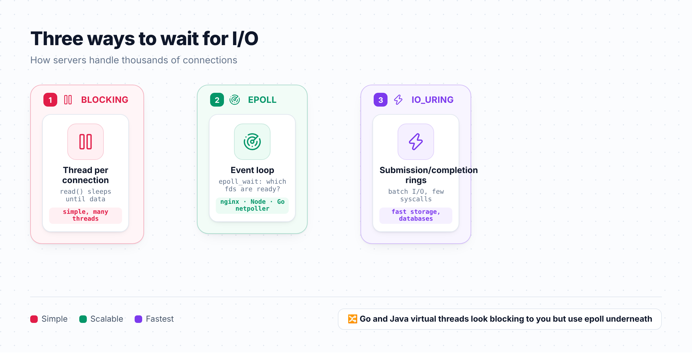

# 3.4 — Syscalls, I/O & filesystems

!!! abstract "In short"
    Programs can only touch files, sockets and devices by asking the kernel through **system calls**. The kernel gives
    them **file descriptors** and routes each `read()`/`write()` through the **VFS**, the **page cache**, the
    **filesystem** and the **block layer**. It also offers different ways to wait: **blocking**, **epoll** and
    **io_uring**. That choice separates a server handling 100 connections from one handling 100,000.

## 📖 Key terms & abbreviations

| Term | Stands for | What it is | How it works (one line) |
|---|---|---|---|
| **Syscall** | system call | Request from user space to the kernel | `syscall` instruction, number in RAX |
| **vDSO** | virtual Dynamic Shared Object | Kernel code mapped into user space | `gettimeofday` without a real syscall |
| **fd** | file descriptor | Small integer for an open file/socket/pipe | Index into the process's fd table |
| **VFS** | Virtual File System | Common layer for all filesystems | Same API for ext4, xfs, NFS, procfs, sockets |
| **Inode** | index node | A file's metadata (size, owner, blocks) | Names (dentries) point to inodes |
| **Dentry** | directory entry | Name → inode link, cached | Path lookup cache |
| **Page cache** | — | File data cached in RAM | Reads hit it; writes go there first |
| **fsync** | — | Force a file's data to stable storage | Durability; slow on purpose |
| **Block layer (blk-mq)** | multi-queue block layer | Queues and merges I/O requests | One queue per CPU to the device |
| **Journal** | — | Filesystem's write-ahead log | Consistency after a crash |
| **IOPS / throughput / latency** | I/O operations per second | Storage performance numbers | Small random vs big sequential I/O |
| **epoll** | — | Wait for many fds at once | Kernel tells you which are ready |
| **io_uring** | — | Shared-ring async I/O interface | Submit and complete I/O with few syscalls |
| **OverlayFS** | — | Union filesystem used by container images | Read-only layers + one writable layer |

## 🗺️ Big picture


---

## 1 · System calls

### How does it work?

1. libc's `read(fd, buf, n)` puts the syscall number (0 for `read` on x86-64) in **RAX** and arguments in RDI, RSI, RDX, then executes the **`syscall`** instruction.
2. The CPU switches to ring 0 and jumps to the kernel's entry point, which looks up the handler in the syscall table.
3. The kernel checks the arguments (is `buf` really in your memory?), does the work, puts the result (or `-errno`) in RAX and returns with `sysret`.

A syscall costs ~0.1–1 µs (more with Spectre mitigations), so hot paths batch work (`readv`, `sendmmsg`, io_uring) and some calls avoid the kernel entirely via the **vDSO** (`clock_gettime`).

## 2 · File descriptors: "everything is a file"

`open()`, `socket()`, `pipe()`, `epoll_create()`, `eventfd()`, `memfd_create()` all return an **fd**, and you `read()`/`write()`/`close()` them the same way. 0/1/2 are stdin/stdout/stderr. `/proc/<pid>/fd` shows them all.

**Limits:** each process has a max (`ulimit -n`, often 1024 soft by default); servers with many connections need it raised (`LimitNOFILE` in systemd). "**Too many open files**" = hit the limit or leaking fds.

## 3 · The read and write path

- **Read:** VFS resolves the fd to an inode → page cache lookup. **Hit** = copy from RAM (µs). **Miss** = filesystem maps the file offset to disk blocks → block layer queues a request → NVMe driver → DMA + interrupt → page cached → copy (~100 µs on NVMe, ms on network disks).
- **Write:** data is copied into the page cache and marked **dirty**; `write()` returns immediately. Background writeback flushes it later. **`fsync()`** waits until it's on stable storage. Databases call it on every commit; that's why disk **fsync latency** often decides database performance.
- **Direct I/O** (`O_DIRECT`) skips the page cache; databases with their own cache (Postgres doesn't, MySQL InnoDB can) use it.

## 4 · Waiting for I/O at scale



| Model | How | Used by |
|---|---|---|
| **Blocking + thread per connection** | Each thread sleeps in `read()` | Classic Apache, JDBC, simple servers |
| **Non-blocking + epoll** | One thread asks "which of my 10,000 sockets are ready?" | nginx, Node.js (libuv), Redis, Go netpoller, Netty |
| **io_uring** | Submit many operations into a ring, collect completions | High-performance storage, newer databases and proxies |

Go goroutines and Java virtual threads let you write blocking-style code while the runtime uses epoll underneath.

## 5 · Filesystems you'll meet

| Filesystem | Where | Note |
|---|---|---|
| **ext4 / xfs** | Linux root and data disks | xfs common for large files/DBs |
| **overlayfs** | Container images | Copy-up on first write to a lower-layer file |
| **tmpfs** | `/dev/shm`, `emptyDir: {medium: Memory}` | Lives in RAM, counts toward memory limit |
| **procfs / sysfs / cgroupfs** | `/proc`, `/sys` | Kernel state as files |
| **NFS / EFS / CephFS** | Shared network storage | Higher latency, D-state hangs if server disappears |
| **Block volumes (EBS, PD)** | PersistentVolumes | IOPS/throughput limits by volume type and size |

## 🔧 DevOps connection

- **"Disk full" but `df` says space is left** → out of **inodes** (`df -i`), often millions of tiny files. **Space not freed after deleting a log** → a process still holds it open (`lsof +L1`).
- **Container writes** to the overlay layer are slow and vanish with the container: use volumes for data, stdout for logs.
- **Cloud disks have IOPS/throughput caps**; a database "randomly slow" may be throttled at the volume level. Check `iostat -x` (`await`, `%util`) and the provider's metrics.
- **`emptyDir` on memory** and `/dev/shm` count against the pod's memory limit (e.g. PyTorch DataLoader workers need a larger `/dev/shm`).
- **Too many open files** in high-connection services → raise `LimitNOFILE` / container ulimits.

## 🧪 Try it yourself

```bash
strace -c ls > /dev/null                        # syscall summary of a command
strace -e trace=openat,read,write -f cat /etc/hostname
ls -l /proc/$$/fd; ulimit -n                    # fds and the limit
df -h; df -i                                    # space and inodes
iostat -x 1 3 2>/dev/null                       # per-device latency and utilization (sysstat)
cat /proc/pressure/io

# Page cache in action: second read is from RAM
dd if=/dev/urandom of=/tmp/big bs=1M count=512 status=none
sync; echo 3 | sudo tee /proc/sys/vm/drop_caches > /dev/null
time cat /tmp/big > /dev/null; time cat /tmp/big > /dev/null

# fsync cost
dd if=/dev/zero of=/tmp/f bs=4k count=1000 oflag=dsync 2>&1 | tail -1
```

## 🃏 Cheat sheet

| Symptom | Check |
|---|---|
| `Too many open files` | `ulimit -n`, `/proc/PID/fd` count, leaks |
| Disk full, df shows space | `df -i` (inodes) |
| Deleted file still uses space | `lsof +L1` |
| Slow DB commits | fsync latency, volume IOPS caps, `iostat -x` await |
| Process stuck in D state | Storage/NFS hang |
| Syscall-heavy CPU | `strace -c`, `perf top` (sys %) |

## ❓ Test yourself

??? question "1. What happens between calling `read()` and the kernel running its code?"
    libc sets the syscall number and args in registers and executes `syscall`; the CPU switches to ring 0 and jumps to the kernel entry, which dispatches to the read handler.

??? question "2. `write()` returned success. Is the data on disk?"
    Not necessarily: it's in the page cache as a dirty page. Only after `fsync()` (or writeback) is it on stable storage.

??? question "3. How does nginx handle 50,000 connections with a few worker processes?"
    Non-blocking sockets + epoll: each worker waits for readiness on all its sockets and only handles the ready ones.

??? question "4. You deleted a 20 GB log but the disk is still full. Why?"
    A process still has the file open; the inode isn't freed until the last fd is closed. Restart/reload the process or truncate via /proc/PID/fd.

??? question "5. Why can `/dev/shm` usage cause an OOMKill in a pod?"
    It's tmpfs, i.e. RAM, and counts against the container's memory cgroup.

---

## 📚 Sources

- [man 2 syscalls](https://man7.org/linux/man-pages/man2/syscalls.2.html) · [man 7 epoll](https://man7.org/linux/man-pages/man7/epoll.7.html)
- [Linux kernel docs — Overview of the VFS](https://docs.kernel.org/filesystems/vfs.html)
- [Lord of the io_uring](https://unixism.net/loti/)
- [Kubernetes — Volumes](https://kubernetes.io/docs/concepts/storage/volumes/)

## ✍️ My notes

> Run `strace -c` on one of your own commands or services for a few seconds. Which syscalls dominate?
