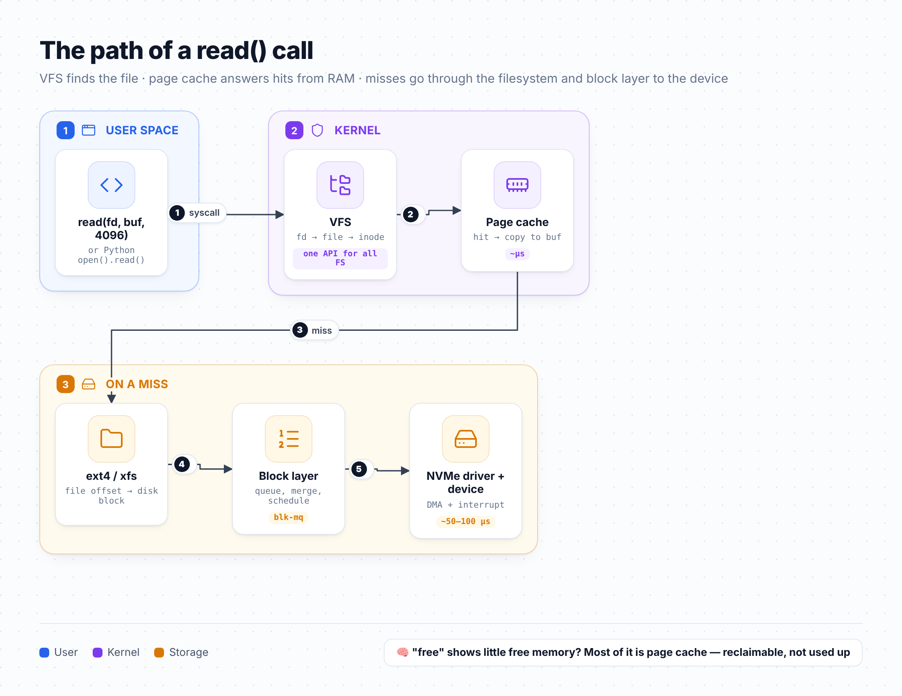
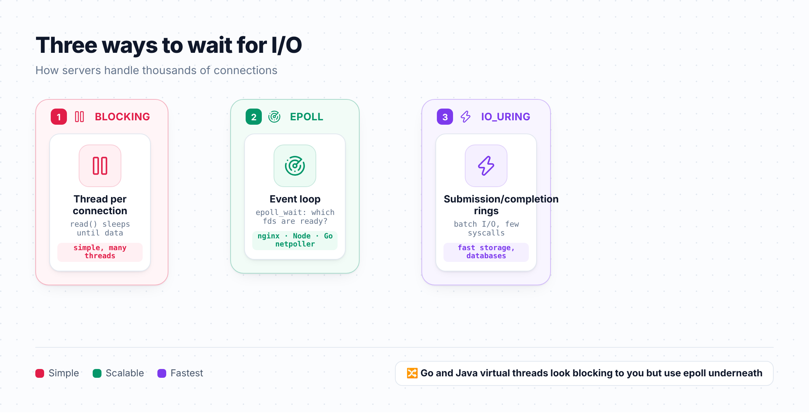

# 3.4 — Syscall'lar, I/O ve dosya sistemleri

!!! abstract "Kısaca"
    Programlar dosyalara, soketlere ve cihazlara ancak **sistem çağrılarıyla** kernel'e sorarak dokunabilir. Kernel
    onlara **dosya tanımlayıcıları** verir, her `read()`/`write()`'ı **VFS** üzerinden **page cache**'e, **dosya
    sistemine** ve **blok katmanına** yönlendirir ve farklı bekleme yolları sunar (**bloklayan**, **epoll**,
    **io_uring**); 100 bağlantı yöneten bir sunucuyu 100.000 yönetenden ayıran şey de budur.

## 📖 Temel terimler ve kısaltmalar

| Terim | Açılımı | Nedir | Nasıl çalışır (tek satır) |
|---|---|---|---|
| **Syscall** | system call | User space'ten kernel'e istek | `syscall` komutu, numara RAX'te |
| **vDSO** | virtual Dynamic Shared Object | User space'e eşlenmiş kernel kodu | Gerçek syscall olmadan `gettimeofday` |
| **fd** | file descriptor | Açık dosya/soket/pipe için küçük tamsayı | Process'in fd tablosunda indeks |
| **VFS** | Virtual File System | Tüm dosya sistemleri için ortak katman | ext4, xfs, NFS, procfs, soketler için aynı API |
| **Inode** | index node | Bir dosyanın üst verisi (boyut, sahip, bloklar) | İsimler (dentry) inode'lara işaret eder |
| **Dentry** | directory entry | İsim → inode bağlantısı, önbellekli | Yol arama önbelleği |
| **Page cache** | — | RAM'de önbellekteki dosya verisi | Okumalar ona isabet eder; yazmalar önce oraya gider |
| **fsync** | — | Bir dosyanın verisini kalıcı depolamaya zorla | Kalıcılık; bilerek yavaş |
| **Blok katmanı (blk-mq)** | multi-queue block layer | I/O isteklerini kuyruğa alır ve birleştirir | Cihaza CPU başına bir kuyruk |
| **Journal** | — | Dosya sisteminin ön yazma logu | Çökme sonrası tutarlılık |
| **IOPS / throughput / gecikme** | I/O operations per second | Depolama performans rakamları | Küçük rastgele ve büyük sıralı I/O |
| **epoll** | — | Çok sayıda fd'yi aynı anda bekle | Kernel hangilerinin hazır olduğunu söyler |
| **io_uring** | — | Paylaşımlı ring'li asenkron I/O arayüzü | Az syscall ile I/O gönder ve tamamla |
| **OverlayFS** | — | Container imajlarının kullandığı birleşim dosya sistemi | Salt okunur katmanlar + tek yazılabilir katman |

## 🗺️ Büyük resim



---

## 1 · Sistem çağrıları

### Nasıl çalışır?

1. libc'nin `read(fd, buf, n)`'i syscall numarasını (x86-64'te `read` için 0) **RAX**'e, argümanları RDI, RSI, RDX'e koyar, sonra **`syscall`** komutunu çalıştırır.
2. CPU ring 0'a geçer ve kernel'in giriş noktasına atlar; o da syscall tablosunda handler'ı bulur.
3. Kernel argümanları kontrol eder (`buf` gerçekten senin belleğinde mi?), işi yapar, sonucu (ya da `-errno`) RAX'e koyar ve `sysret` ile döner.

Bir syscall ~0,1–1 µs tutar (Spectre önlemleriyle daha fazla); sıcak yollar işi gruplar (`readv`, `sendmmsg`, io_uring) ve bazı çağrılar kernel'e hiç girmeden **vDSO** ile yapılır (`clock_gettime`).

## 2 · Dosya tanımlayıcıları: "her şey bir dosyadır"

`open()`, `socket()`, `pipe()`, `epoll_create()`, `eventfd()`, `memfd_create()` hepsi bir **fd** döner ve hepsini aynı şekilde `read()`/`write()`/`close()` edersin. 0/1/2 stdin/stdout/stderr'dir. `/proc/<pid>/fd` hepsini gösterir.

**Limitler:** her process'in bir üst sınırı var (`ulimit -n`, varsayılan soft genelde 1024); çok bağlantılı sunucularda artırılması gerekir (systemd'de `LimitNOFILE`). "**Too many open files**" = limite takıldı ya da fd sızıyor.

## 3 · Okuma ve yazma yolu

- **Okuma:** VFS fd'yi bir inode'a çözer → page cache'e bakılır. **İsabet** = RAM'den kopyala (µs). **Iska** = dosya sistemi dosya konumunu disk bloklarına eşler → blok katmanı bir istek kuyruklar → NVMe sürücüsü → DMA + kesme → sayfa önbelleğe alınır → kopyala (NVMe'de ~100 µs, ağ disklerinde ms).
- **Yazma:** veri page cache'e kopyalanır ve **kirli** işaretlenir; `write()` hemen döner. Arka plandaki writeback onu sonra flush eder. **`fsync()`** kalıcı depolamaya ulaşana kadar bekler. Veritabanları her commit'te çağırır; veritabanı performansına çoğu zaman disk **fsync gecikmesinin** karar vermesi bu yüzden.
- **Direct I/O** (`O_DIRECT`) page cache'i atlar; kendi önbelleği olan veritabanları (Postgres kullanmaz, MySQL InnoDB kullanabilir) bunu kullanır.

## 4 · Ölçekte I/O beklemek



| Model | Nasıl | Kim kullanır |
|---|---|---|
| **Bloklayan + bağlantı başına thread** | Her thread `read()`'de uyur | Klasik Apache, JDBC, basit sunucular |
| **Bloklamayan + epoll** | Tek thread "10.000 soketimden hangileri hazır?" diye sorar | nginx, Node.js (libuv), Redis, Go netpoller, Netty |
| **io_uring** | Bir ring'e çok işlem gönder, tamamlananları topla | Yüksek performanslı depolama, yeni veritabanları ve proxy'ler |

Go goroutine'leri ve Java sanal thread'leri bloklayan tarzda kod yazmanı sağlarken runtime altta epoll kullanır.

## 5 · Karşılaşacağın dosya sistemleri

| Dosya sistemi | Nerede | Not |
|---|---|---|
| **ext4 / xfs** | Linux kök ve veri diskleri | Büyük dosyalar/DB'ler için xfs yaygın |
| **overlayfs** | Container imajları | Alt katmandaki bir dosyaya ilk yazmada copy-up |
| **tmpfs** | `/dev/shm`, `emptyDir: {medium: Memory}` | RAM'de yaşar, bellek limitine sayılır |
| **procfs / sysfs / cgroupfs** | `/proc`, `/sys` | Kernel durumu dosya olarak |
| **NFS / EFS / CephFS** | Paylaşımlı ağ depolaması | Daha yüksek gecikme; sunucu kaybolursa D durumunda takılmalar |
| **Blok volume'lar (EBS, PD)** | PersistentVolume'lar | Volume tipine ve boyutuna göre IOPS/throughput limitleri |

## 🔧 DevOps bağlantısı

- **"Disk dolu" ama `df` yer var diyor** → **inode**'lar bitmiş (`df -i`), çoğu zaman milyonlarca küçük dosya. **Bir log silindikten sonra yer açılmıyor** → bir process hâlâ açık tutuyor (`lsof +L1`).
- **Container'ın overlay katmanına yazmak** yavaştır ve container'la birlikte kaybolur: veri için volume, log için stdout kullan.
- **Bulut disklerinin IOPS/throughput tavanları var**; "rastgele yavaşlayan" bir veritabanı volume düzeyinde throttle ediliyor olabilir. `iostat -x`'e (`await`, `%util`) ve sağlayıcının metriklerine bak.
- **Bellekteki `emptyDir`** ve `/dev/shm` pod'un bellek limitine sayılır (ör. PyTorch DataLoader worker'ları daha büyük bir `/dev/shm` ister).
- **Çok bağlantılı servislerde too many open files** → `LimitNOFILE` / container ulimit'lerini artır.

## 🧪 Kendin dene

```bash
strace -c ls > /dev/null                        # bir komutun syscall özeti
strace -e trace=openat,read,write -f cat /etc/hostname
ls -l /proc/$$/fd; ulimit -n                    # fd'ler ve limit
df -h; df -i                                    # alan ve inode'lar
iostat -x 1 3 2>/dev/null                       # cihaz başına gecikme ve kullanım (sysstat)
cat /proc/pressure/io

# Page cache iş başında: ikinci okuma RAM'den
dd if=/dev/urandom of=/tmp/big bs=1M count=512 status=none
sync; echo 3 | sudo tee /proc/sys/vm/drop_caches > /dev/null
time cat /tmp/big > /dev/null; time cat /tmp/big > /dev/null

# fsync maliyeti
dd if=/dev/zero of=/tmp/f bs=4k count=1000 oflag=dsync 2>&1 | tail -1
```

## 🃏 Hatırlatma kartı

| Belirti | Kontrol |
|---|---|
| `Too many open files` | `ulimit -n`, `/proc/PID/fd` sayısı, sızıntılar |
| Disk dolu, df yer gösteriyor | `df -i` (inode'lar) |
| Silinen dosya hâlâ yer kaplıyor | `lsof +L1` |
| Yavaş DB commit'leri | fsync gecikmesi, volume IOPS tavanları, `iostat -x` await |
| D durumunda takılı process | Depolama/NFS takılması |
| Syscall yoğun CPU | `strace -c`, `perf top` (sys %) |

## ❓ Kendini test et

??? question "1. `read()` çağırmak ile kernel'in kodunu çalıştırması arasında ne olur?"
    libc syscall numarasını ve argümanları register'lara koyup `syscall` çalıştırır; CPU ring 0'a geçer ve kernel girişine atlar, o da read handler'ına yönlendirir.

??? question "2. `write()` başarılı döndü. Veri diskte mi?"
    Şart değil: page cache'te kirli sayfa olarak duruyor. Ancak `fsync()`'ten (ya da writeback'ten) sonra kalıcı depolamada olur.

??? question "3. nginx birkaç worker process'le 50.000 bağlantıyı nasıl yönetir?"
    Bloklamayan soketler + epoll: her worker tüm soketlerinde hazır olmayı bekler ve sadece hazır olanları işler.

??? question "4. 20 GB'lık bir log'u sildin ama disk hâlâ dolu. Neden?"
    Bir process dosyayı hâlâ açık tutuyor; son fd kapanana kadar inode serbest kalmaz. Process'i yeniden başlat/reload et ya da /proc/PID/fd üzerinden truncate et.

??? question "5. `/dev/shm` kullanımı bir pod'da neden OOMKill'e yol açabilir?"
    tmpfs'tir, yani RAM'dir ve container'ın bellek cgroup'una sayılır.

---

## 📚 Kaynaklar

- [man 2 syscalls](https://man7.org/linux/man-pages/man2/syscalls.2.html) · [man 7 epoll](https://man7.org/linux/man-pages/man7/epoll.7.html)
- [Linux kernel docs — Overview of the VFS](https://docs.kernel.org/filesystems/vfs.html)
- [Lord of the io_uring](https://unixism.net/loti/)
- [Kubernetes — Volumes](https://kubernetes.io/docs/concepts/storage/volumes/)

## ✍️ Notlarım

> Kendi komutlarından ya da servislerinden birinde birkaç saniye `strace -c` çalıştır. Hangi syscall'lar baskın?
