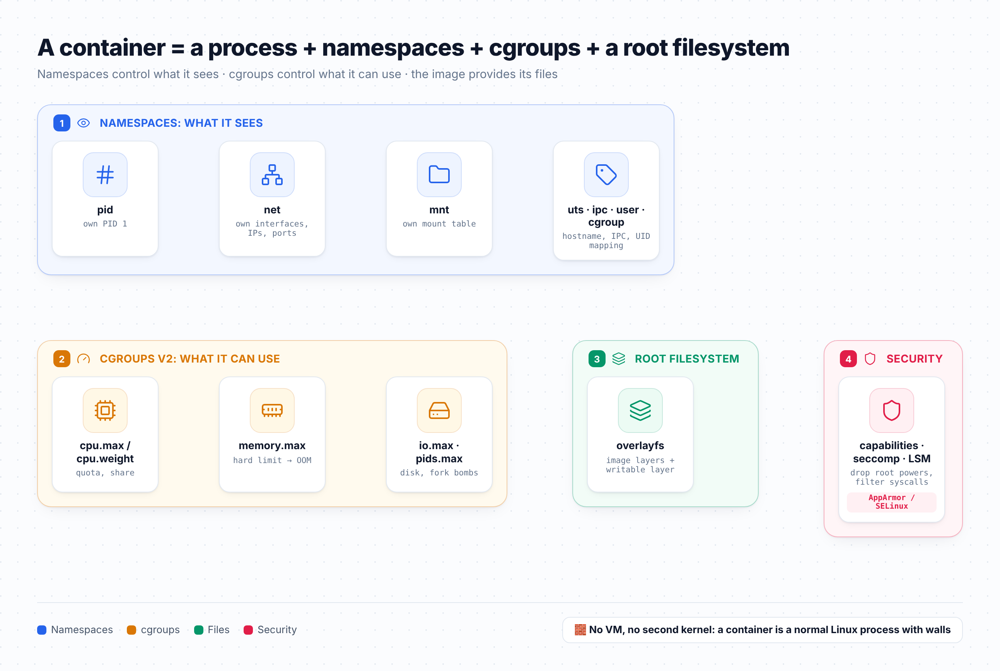

# 3.5 — Namespaces, cgroups & container isolation

!!! abstract "In short"
    A container is not something the kernel knows about. It's an ordinary process that a runtime (runc, crun) starts in
    its own **namespaces**, which limit what it can *see*: PIDs, network, mounts, hostname. A **cgroup** limits what it
    can *use*: CPU, memory, I/O. Its **root filesystem** comes from the image, and reduced **capabilities**, a
    **seccomp** filter and an **LSM** profile limit what it can *do*.

## 📖 Key terms & abbreviations

| Term | Stands for | What it is | How it works (one line) |
|---|---|---|---|
| **Namespace** | — | A private view of one kernel resource | Created with `clone()`/`unshare()` flags |
| **pid ns** | — | Own PID numbering | Container's first process is PID 1 |
| **net ns** | — | Own interfaces, routes, iptables, ports | Connected via veth pairs / CNI |
| **mnt ns** | — | Own mount table | `pivot_root` into the image filesystem |
| **uts / ipc ns** | UNIX Time-Sharing / Inter-Process Communication | Own hostname / own SysV IPC & POSIX queues | `hostname` inside ≠ host |
| **user ns** | — | Own UID/GID mapping | Root inside = unprivileged user outside |
| **cgroup** | control group | Group of processes with resource limits | Files under `/sys/fs/cgroup` |
| **cgroup v2** | — | Unified hierarchy (modern default) | `cpu.max`, `memory.max`, `io.max`, `pids.max` |
| **Capabilities** | — | Root's powers split into ~40 pieces | `CAP_NET_ADMIN`, `CAP_SYS_ADMIN`… dropped by default |
| **seccomp** | secure computing mode | Syscall filter (BPF) | Blocks dangerous syscalls (`kexec_load`, `mount`…) |
| **LSM** | Linux Security Module | Mandatory access control | AppArmor profiles, SELinux labels |
| **OCI runtime** | Open Container Initiative | Program that creates the container | runc, crun, gVisor (runsc), Kata |
| **Rootless** | — | Containers run entirely as a normal user | User namespaces + slirp4netns/pasta |
| **Privileged** | — | Container with nearly all protections off | Effectively root on the host |

## 🗺️ Big picture



---

## 1 · Namespaces: what a process can see

### How does it work?

`clone()` and `unshare()` accept flags like `CLONE_NEWPID`, `CLONE_NEWNET`, `CLONE_NEWNS`. Each creates a fresh instance of that resource for the new process:

| Namespace | Isolates | Inside the container you see… |
|---|---|---|
| `pid` | Process IDs | Your app as PID 1, no host processes |
| `net` | Network stack | Only `lo` and `eth0` (one end of a veth pair) |
| `mnt` | Mount points | The image's `/`, your volumes |
| `uts` | Hostname | The pod name |
| `ipc` | Shared memory, semaphores | Only your own |
| `user` | UID/GID mappings | "root", mapped to an unprivileged host UID |
| `cgroup` | cgroup tree view | Your cgroup as the root |
| `time` | Some clocks | (rarely used) |

In Kubernetes all containers in a **pod share the net (and ipc, uts) namespace**, which is why they can talk over `localhost`; the pause container holds the namespaces.

## 2 · cgroups v2: what a process can use

Each container (and each pod) gets a directory under `/sys/fs/cgroup/`. Writing to files there sets limits; reading gives usage:

| File | Meaning | From Kubernetes |
|---|---|---|
| `cpu.weight` | Share under contention | CPU request |
| `cpu.max` | Hard CPU quota | CPU limit |
| `memory.max` | Hard memory limit → OOM | Memory limit |
| `memory.high` | Soft limit, throttles reclaim | (MemoryQoS feature) |
| `io.max` / `io.weight` | Disk bandwidth / IOPS | (rarely set) |
| `pids.max` | Max processes/threads | `podPidsLimit` |
| `cpu.stat`, `memory.stat`, `memory.events` | Usage, throttling, OOM events | Read by cAdvisor/kubelet metrics |

## 3 · Hardening: capabilities, seccomp, LSMs

- **Capabilities:** containers start with a small default set (no `CAP_SYS_ADMIN`, `CAP_NET_ADMIN`…). Best practice: `drop: ["ALL"]` and add back only what's needed (e.g. `NET_BIND_SERVICE`).
- **seccomp:** the `RuntimeDefault` profile blocks ~50 dangerous syscalls. Kubernetes: `securityContext.seccompProfile.type: RuntimeDefault`.
- **AppArmor / SELinux:** restrict file and network access by policy, even for root inside.
- **User namespaces:** root inside maps to an unprivileged UID on the host, so an escape isn't host root. Kubernetes supports it with `hostUsers: false`.
- **`privileged: true`** disables almost all of this; with it (or `CAP_SYS_ADMIN`, host mounts of `/`, or the Docker socket) a container can usually take over the node.

## 4 · How runc builds a container

1. containerd unpacks the image layers and prepares an **overlayfs** rootfs, writes an OCI `config.json`.
2. runc `clone()`s with the namespace flags, creates and joins the **cgroup**, sets limits.
3. Inside: mounts `/proc`, `/sys`, `/dev`, volumes; `pivot_root` into the rootfs; sets hostname.
4. Drops capabilities, applies **seccomp** and **AppArmor/SELinux**, switches to the configured user.
5. `execve()` your entrypoint. From here it's a normal process on the host: visible in `ps` on the node.

**Stronger isolation** when tenants don't trust each other: **gVisor** (user-space kernel), **Kata Containers / Firecracker** (lightweight VMs per pod).

## 🔧 DevOps connection

- **Pod Security Standards** (`restricted` profile) enforce: non-root, no privilege escalation, drop ALL capabilities, seccomp RuntimeDefault.
- **Debugging from the node:** `nsenter -t <pid> -n ip addr` enters a container's network namespace with host tools; `crictl inspect` gives the PID.
- **Container sees host resources** in `/proc/cpuinfo` and `/proc/meminfo` (not namespaced!) → apps must read cgroup files (or use LXCFS) to know their limits.
- **Breakouts** almost always come from privileged containers, host mounts, the Docker socket, or kernel bugs, not from namespaces themselves being "weak".

## 🧪 Try it yourself

```bash
ls -l /proc/$$/ns                                 # namespaces of this shell
sudo unshare --pid --fork --mount-proc bash -c 'ps aux; echo "I am PID $$"'   # new PID namespace
sudo unshare --net bash -c 'ip addr'              # empty network namespace (just lo, down)
sudo unshare --uts bash -c 'hostname inside; hostname'; hostname              # host unchanged
unshare --user --map-root-user bash -c 'id'       # "root" without real root (user namespace)

cat /proc/self/cgroup; ls /sys/fs/cgroup | head
docker run --rm --memory 100m --cpus 0.5 --pids-limit 50 alpine \
  cat /sys/fs/cgroup/memory.max /sys/fs/cgroup/cpu.max /sys/fs/cgroup/pids.max
docker run --rm alpine sh -c 'grep Cap /proc/self/status'     # capability bitmasks
capsh --decode=00000000a80425fb 2>/dev/null                   # decode the default set
```

## 🃏 Cheat sheet

| Want | Use |
|---|---|
| Hide host processes | pid namespace |
| Own IP/ports | net namespace (+ CNI) |
| Limit RAM / CPU / PIDs | cgroup `memory.max` / `cpu.max` / `pids.max` |
| Root inside ≠ root outside | user namespace (`hostUsers: false`) |
| Block dangerous syscalls | seccomp RuntimeDefault |
| Least privilege | `capabilities: drop: [ALL]`, `runAsNonRoot`, `readOnlyRootFilesystem` |
| Enter a container's network | `nsenter -t PID -n` |

## ❓ Test yourself

??? question "1. Is a container a lightweight VM?"
    No. It's a regular process on the host kernel, isolated with namespaces and limited with cgroups. A VM runs its own kernel.

??? question "2. Why can two containers in the same pod reach each other on localhost?"
    They share one network namespace (held by the pause container).

??? question "3. Which kernel feature enforces a memory limit, and what happens when it's exceeded?"
    The memory cgroup (`memory.max`); the OOM killer kills a process inside that cgroup.

??? question "4. Why is `privileged: true` dangerous?"
    It gives all capabilities, disables seccomp/AppArmor confinement and exposes host devices; the container can usually control the host.

??? question "5. An app inside a container reads `/proc/meminfo` and sees 256 GB on a 2 GB limit. Why?"
    `/proc/meminfo` isn't namespaced; the app must read the cgroup files (memory.max) to learn its real limit.

---

## 📚 Sources

- [man 7 namespaces](https://man7.org/linux/man-pages/man7/namespaces.7.html) · [man 7 cgroups](https://man7.org/linux/man-pages/man7/cgroups.7.html) · [man 7 capabilities](https://man7.org/linux/man-pages/man7/capabilities.7.html)
- [Linux kernel docs — Control Group v2](https://docs.kernel.org/admin-guide/cgroup-v2.html)
- [OCI Runtime Specification](https://github.com/opencontainers/runtime-spec)
- [Kubernetes — Pod Security Standards](https://kubernetes.io/docs/concepts/security/pod-security-standards/) · [User namespaces](https://kubernetes.io/docs/concepts/workloads/pods/user-namespaces/)

## ✍️ My notes

> Build a "container" by hand: `unshare` with pid, net, mnt and uts namespaces, then run `ps`, `ip a` and `hostname`. What's missing compared to Docker?
