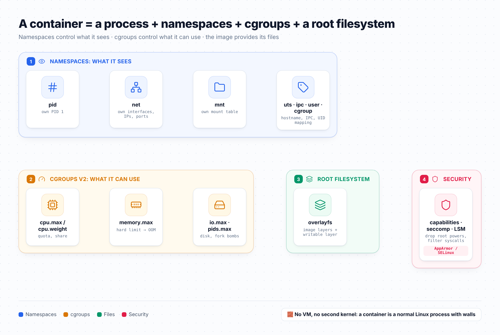

# 3.5 — Namespace'ler, cgroup'lar ve container izolasyonu

!!! abstract "Tek cümlede"
    Container kernel'in bildiği bir şey değildir: bir runtime'ın (runc, crun) kendi **namespace**'leriyle (neyi
    *gördüğü*: PID'ler, ağ, mount'lar, hostname…), bir **cgroup**'un içinde (neyi *kullanabildiği*: CPU, bellek, I/O, PID),
    imajdan gelen bir **kök dosya sistemi** üzerinde, azaltılmış **capability**'ler, bir **seccomp** syscall filtresi ve
    ne *yapabileceğini* sınırlayan bir **LSM** profiliyle (AppArmor/SELinux) başlattığı sıradan bir process'tir.

## 📖 Temel terimler ve kısaltmalar

| Terim | Açılımı | Nedir | Nasıl çalışır (tek satır) |
|---|---|---|---|
| **Namespace** | — | Bir kernel kaynağının özel görünümü | `clone()`/`unshare()` bayraklarıyla oluşturulur |
| **pid ns** | — | Kendi PID numaralandırması | Container'ın ilk process'i PID 1'dir |
| **net ns** | — | Kendi arayüzleri, rotaları, iptables'ı, portları | veth çiftleri / CNI ile bağlanır |
| **mnt ns** | — | Kendi mount tablosu | İmaj dosya sistemine `pivot_root` |
| **uts / ipc ns** | UNIX Time-Sharing / Inter-Process Communication | Kendi hostname'i / kendi SysV IPC ve POSIX kuyrukları | İçerideki `hostname` ≠ host |
| **user ns** | — | Kendi UID/GID eşlemesi | İçerideki root = dışarıda yetkisiz kullanıcı |
| **cgroup** | control group | Kaynak limitleri olan process grubu | `/sys/fs/cgroup` altındaki dosyalar |
| **cgroup v2** | — | Birleşik hiyerarşi (modern varsayılan) | `cpu.max`, `memory.max`, `io.max`, `pids.max` |
| **Capability'ler** | Capabilities | Root'un güçlerinin ~40 parçaya bölünmüş hali | `CAP_NET_ADMIN`, `CAP_SYS_ADMIN`… varsayılan olarak düşürülür |
| **seccomp** | secure computing mode | Syscall filtresi (BPF) | Tehlikeli syscall'ları engeller (`kexec_load`, `mount`…) |
| **LSM** | Linux Security Module | Zorunlu erişim kontrolü | AppArmor profilleri, SELinux etiketleri |
| **OCI runtime** | Open Container Initiative | Container'ı oluşturan program | runc, crun, gVisor (runsc), Kata |
| **Rootless** | — | Tamamen normal kullanıcıyla çalışan container'lar | User namespace'ler + slirp4netns/pasta |
| **Privileged** | — | Korumaların neredeyse tamamı kapalı container | Host'ta fiilen root |

## 🗺️ Büyük resim



---

## 1 · Namespace'ler: bir process neyi görebilir

### Nasıl çalışır?

`clone()` ve `unshare()`, `CLONE_NEWPID`, `CLONE_NEWNET`, `CLONE_NEWNS` gibi bayraklar alır. Her biri yeni process için o kaynağın yeni bir örneğini oluşturur:

| Namespace | İzole ettiği | Container içinde gördüğün… |
|---|---|---|
| `pid` | Process kimlikleri | PID 1 olarak uygulaman, host process'leri yok |
| `net` | Ağ yığını | Sadece `lo` ve `eth0` (bir veth çiftinin bir ucu) |
| `mnt` | Mount noktaları | İmajın `/`'si, volume'ların |
| `uts` | Hostname | Pod adı |
| `ipc` | Paylaşımlı bellek, semaforlar | Sadece kendininkiler |
| `user` | UID/GID eşlemeleri | Yetkisiz bir host UID'sine eşlenmiş "root" |
| `cgroup` | cgroup ağacı görünümü | Kök olarak kendi cgroup'un |
| `time` | Bazı saatler | (nadiren kullanılır) |

Kubernetes'te bir **pod'daki tüm container'lar net (ve ipc, uts) namespace'ini paylaşır**; `localhost` üzerinden konuşabilmelerinin sebebi bu; namespace'leri pause container'ı tutar.

## 2 · cgroup v2: bir process neyi kullanabilir

Her container (ve her pod) `/sys/fs/cgroup/` altında bir dizin alır. Oradaki dosyalara yazmak limit koyar; okumak kullanımı verir:

| Dosya | Anlamı | Kubernetes'ten |
|---|---|---|
| `cpu.weight` | Çekişmede pay | CPU request |
| `cpu.max` | Sert CPU kotası | CPU limit |
| `memory.max` | Sert bellek limiti → OOM | Bellek limiti |
| `memory.high` | Yumuşak limit, geri almayı zorlar | (MemoryQoS özelliği) |
| `io.max` / `io.weight` | Disk bant genişliği / IOPS | (nadiren ayarlanır) |
| `pids.max` | Azami process/thread | `podPidsLimit` |
| `cpu.stat`, `memory.stat`, `memory.events` | Kullanım, throttling, OOM olayları | cAdvisor/kubelet metrikleri okur |

## 3 · Sıkılaştırma: capability'ler, seccomp, LSM'ler

- **Capability'ler:** container'lar küçük bir varsayılan setle başlar (`CAP_SYS_ADMIN`, `CAP_NET_ADMIN`… yok). En iyi pratik: `drop: ["ALL"]` ve sadece gerekeni geri ekle (ör. `NET_BIND_SERVICE`).
- **seccomp:** `RuntimeDefault` profili ~50 tehlikeli syscall'ı engeller. Kubernetes: `securityContext.seccompProfile.type: RuntimeDefault`.
- **AppArmor / SELinux:** içerideki root için bile dosya ve ağ erişimini politikayla kısıtlar.
- **User namespace'ler:** içerideki root host'ta yetkisiz bir UID'ye eşlenir; bir kaçış host root'u demek değildir. Kubernetes `hostUsers: false` ile destekler.
- **`privileged: true`** bunların neredeyse hepsini kapatır; onunla (ya da `CAP_SYS_ADMIN`, `/`'nin host mount'u ya da Docker soketiyle) bir container genelde node'u ele geçirebilir.

## 4 · runc bir container'ı nasıl kurar

1. containerd imaj katmanlarını açar ve bir **overlayfs** kök dosya sistemi hazırlar, bir OCI `config.json` yazar.
2. runc namespace bayraklarıyla `clone()` yapar, **cgroup**'u oluşturup katılır, limitleri koyar.
3. İçeride: `/proc`, `/sys`, `/dev`, volume'ları mount eder; kök dosya sistemine `pivot_root` yapar; hostname'i ayarlar.
4. Capability'leri düşürür, **seccomp** ve **AppArmor/SELinux** uygular, ayarlanan kullanıcıya geçer.
5. Entrypoint'ini `execve()` eder. Bundan sonra host'ta normal bir process'tir: node'da `ps`'te görünür.

Kiracılar birbirine güvenmiyorsa **daha güçlü izolasyon**: **gVisor** (user-space kernel), **Kata Containers / Firecracker** (pod başına hafif VM'ler).

## 🔧 DevOps bağlantısı

- **Pod Security Standards** (`restricted` profili) şunları zorunlu kılar: root olmayan kullanıcı, yetki yükseltme yok, tüm capability'leri düşür, seccomp RuntimeDefault.
- **Node'dan hata ayıklama:** `nsenter -t <pid> -n ip addr` host araçlarıyla bir container'ın ağ namespace'ine girer; PID'yi `crictl inspect` verir.
- **Container `/proc/cpuinfo` ve `/proc/meminfo`'da host kaynaklarını görür** (namespace'lenmemiş!) → uygulamalar limitlerini öğrenmek için cgroup dosyalarını okumalı (ya da LXCFS kullanmalı).
- **Kaçışlar** neredeyse her zaman privileged container'lardan, host mount'larından, Docker soketinden ya da kernel hatalarından gelir; namespace'lerin kendilerinin "zayıf" olmasından değil.

## 🧪 Kendin dene

```bash
ls -l /proc/$$/ns                                 # bu shell'in namespace'leri
sudo unshare --pid --fork --mount-proc bash -c 'ps aux; echo "Ben PID $$"'   # yeni PID namespace'i
sudo unshare --net bash -c 'ip addr'              # boş ağ namespace'i (sadece kapalı lo)
sudo unshare --uts bash -c 'hostname inside; hostname'; hostname              # host değişmedi
unshare --user --map-root-user bash -c 'id'       # gerçek root olmadan "root" (user namespace)

cat /proc/self/cgroup; ls /sys/fs/cgroup | head
docker run --rm --memory 100m --cpus 0.5 --pids-limit 50 alpine \
  cat /sys/fs/cgroup/memory.max /sys/fs/cgroup/cpu.max /sys/fs/cgroup/pids.max
docker run --rm alpine sh -c 'grep Cap /proc/self/status'     # capability bit maskeleri
capsh --decode=00000000a80425fb 2>/dev/null                   # varsayılan seti çöz
```

## 🃏 Hatırlatma kartı

| İstek | Kullan |
|---|---|
| Host process'lerini gizle | pid namespace |
| Kendi IP/portları | net namespace (+ CNI) |
| RAM / CPU / PID sınırla | cgroup `memory.max` / `cpu.max` / `pids.max` |
| İçerideki root ≠ dışarıdaki root | user namespace (`hostUsers: false`) |
| Tehlikeli syscall'ları engelle | seccomp RuntimeDefault |
| En az yetki | `capabilities: drop: [ALL]`, `runAsNonRoot`, `readOnlyRootFilesystem` |
| Bir container'ın ağına gir | `nsenter -t PID -n` |

## ❓ Kendini test et

??? question "1. Container hafif bir VM mi?"
    Hayır. Host kernel'inde namespace'lerle izole edilmiş ve cgroup'larla sınırlandırılmış normal bir process'tir. VM kendi kernel'ini çalıştırır.

??? question "2. Aynı pod'daki iki container neden localhost üzerinden birbirine ulaşabilir?"
    Tek bir ağ namespace'ini (pause container'ının tuttuğu) paylaşırlar.

??? question "3. Bellek limitini hangi kernel özelliği uygular, aşılınca ne olur?"
    Bellek cgroup'u (`memory.max`); OOM killer o cgroup içindeki bir process'i öldürür.

??? question "4. `privileged: true` neden tehlikeli?"
    Tüm capability'leri verir, seccomp/AppArmor kısıtlamasını kapatır ve host cihazlarını açar; container genelde host'u kontrol edebilir.

??? question "5. Container içindeki bir uygulama `/proc/meminfo`'yu okuyup 2 GB limitle 256 GB görüyor. Neden?"
    `/proc/meminfo` namespace'lenmemiştir; uygulama gerçek limitini öğrenmek için cgroup dosyalarını (memory.max) okumalı.

---

## 📚 Kaynaklar

- [man 7 namespaces](https://man7.org/linux/man-pages/man7/namespaces.7.html) · [man 7 cgroups](https://man7.org/linux/man-pages/man7/cgroups.7.html) · [man 7 capabilities](https://man7.org/linux/man-pages/man7/capabilities.7.html)
- [Linux kernel docs — Control Group v2](https://docs.kernel.org/admin-guide/cgroup-v2.html)
- [OCI Runtime Specification](https://github.com/opencontainers/runtime-spec)
- [Kubernetes — Pod Security Standards](https://kubernetes.io/docs/concepts/security/pod-security-standards/) · [User namespaces](https://kubernetes.io/docs/concepts/workloads/pods/user-namespaces/)

## ✍️ Notlarım

> Elle bir "container" kur: pid, net, mnt ve uts namespace'leriyle `unshare` yap, sonra `ps`, `ip a` ve `hostname` çalıştır. Docker'a göre ne eksik?

-
