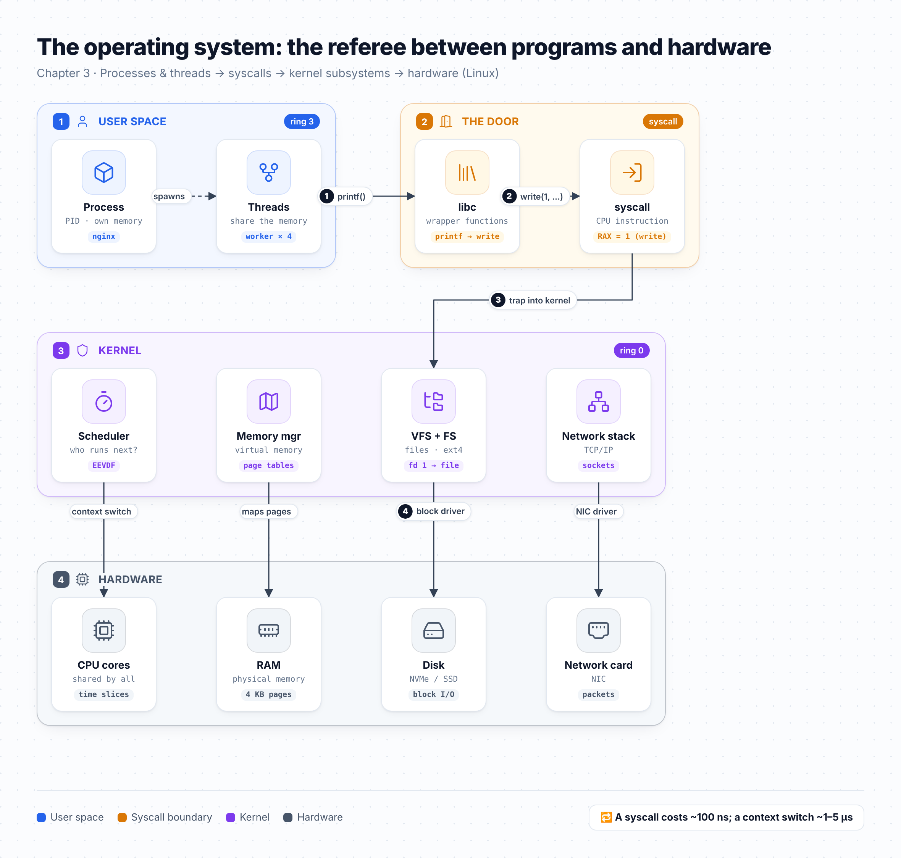

# Chapter 3 — The operating system

!!! abstract "In one sentence"
    The operating system kernel is the **referee**: it gives every program the illusion of having its own CPU
    (**scheduler**), its own memory (**virtual memory**) and simple access to devices (**files, sockets**),
    while making sure no program can touch what isn't its own. Programs ask it for anything they need through **syscalls**.



---

## 1 · Process: a running program

A **process** is a program loaded into memory and running, with everything the kernel tracks about it:

| Part | What it is |
|---|---|
| **PID** | Process ID, a number. PID 1 is the first process (`systemd`, or your app inside a container). |
| **Address space** | Its own private view of memory (see virtual memory below). |
| **File descriptor table** | Open files and sockets: `0` = stdin, `1` = stdout, `2` = stderr, then `3, 4, …` |
| **Registers + state** | Saved `RIP`, `RSP`, … when it's not running. State: running, sleeping, stopped, zombie. |
| **Credentials** | User/group it runs as, capabilities. |
| **Parent** | Every process has a parent. New processes are created with `fork()` (copy me) + `execve()` (become another program). |

Memory layout of a process (low → high addresses):

```text
[ text: machine code ][ data/bss: globals ][ heap → grows up ]  …  [ mmap: libraries ]  …  [ ← stack grows down ]
```

## 2 · Thread: a second worker inside the same process

- Threads of one process **share** its memory and open files, but each has **its own stack and registers**.
- That's why threads are cheap to communicate between (shared memory) but need **locks** to avoid stepping on each other.
- On Linux, process and thread are both a **task** to the kernel. A thread is a task that shares memory with others.

## 3 · The scheduler: sharing the CPU

There are more runnable tasks than cores. The scheduler decides **who runs next and for how long**.

- Each task gets a **time slice** of a few milliseconds. A timer interrupt (Chapter 1 again!) lets the kernel take the CPU back.
- **Context switch:** save the current task's registers, load the next one's, and switch page tables if it's a different process. Cost: ~1–5 µs plus the caches going cold.
- Linux's scheduler is **EEVDF** (since kernel 6.6, replacing CFS). It tries to give each task its fair share, adjusted by priority (`nice`).
- **Load average** = how many tasks are running or waiting to run, on average.

> DevOps connection: a Kubernetes **CPU limit** is enforced by the scheduler through cgroups. When a container uses its quota early in the period it is **throttled** until the next period, even if the node has idle cores.

## 4 · Virtual memory: everyone gets their own address space

Every process thinks it has a huge, private memory starting near address 0. The kernel and the CPU's **MMU** make this true:

| Concept | Meaning |
|---|---|
| **Page** | Memory is handled in **4 KB** chunks. |
| **Page table** | Per-process map: *virtual page → physical frame in RAM*. The kernel builds it, the MMU reads it on every memory access. |
| **TLB** | A cache of recent translations inside the CPU, so lookups stay fast. |
| **Page fault** | Access to a page that isn't mapped yet. The kernel maps it (minor fault) or reads it from disk (major fault), then the instruction is retried. |
| **Copy-on-write** | After `fork()`, parent and child share pages until one of them writes. Only then is a copy made. |
| **OOM killer** | When memory runs out, the kernel kills a process to survive. |

Why this matters: process A **cannot even name** process B's memory. Isolation comes for free from the page tables.

> DevOps connection: `OOMKilled` in Kubernetes means the container hit its **memory cgroup limit** and the kernel's OOM killer stopped it.

## 5 · Syscalls: the only door into the kernel

A program in ring 3 can't touch hardware. It **asks** the kernel with a system call:

| # | Step |
|---|---|
| 1 | Your code calls `printf("hi\n")`. |
| 2 | **libc** formats the text and calls `write(1, "hi\n", 3)`. |
| 3 | The `write` wrapper puts the syscall number in `RAX` (**1** = write on x86-64) and arguments in `RDI, RSI, RDX`, then runs the **`syscall`** instruction. The CPU switches to ring 0 and jumps to the kernel's entry point. |
| 4 | The kernel looks up fd `1` → it's a terminal, a file or a pipe. **VFS** routes the call to the right driver. The result (bytes written, or a negative error) returns in `RAX`, and the CPU goes back to ring 3. |

Common syscalls: `read`, `write`, `openat`, `close`, `mmap`, `clone` (fork/threads), `execve`, `socket`, `connect`, `accept`, `epoll_wait`, `exit_group`.

## 6 · "Everything is a file"

Files, terminals, pipes, sockets and devices (`/dev/input/event3` from Chapter 1) are all accessed through **file descriptors** with the same `read`/`write` calls. `/proc` is a fake filesystem where the kernel shows its internal state as files.

## 7 · Signals: the kernel taps a process on the shoulder

| Signal | Meaning |
|---|---|
| `SIGINT` (2) | Ctrl+C |
| `SIGTERM` (15) | "Please shut down." Can be caught for a graceful shutdown. |
| `SIGKILL` (9) | "You're dead now." Cannot be caught. |
| `SIGCHLD` | A child process exited. |

> DevOps connection: on pod deletion Kubernetes sends **SIGTERM** to PID 1 of each container, waits `terminationGracePeriodSeconds` (default 30 s), then sends **SIGKILL**. If PID 1 is a shell script that doesn't forward signals, your app never gets the SIGTERM.

---

## 🧪 Try it yourself (Linux)

```bash
# 1) Processes and threads
ps -eo pid,ppid,nlwp,stat,cmd | head      # nlwp = number of threads
cat /proc/$$/status | grep -E "Pid|PPid|Threads|VmRSS"

# 2) The memory map of your shell (text, heap, libraries, stack)
cat /proc/$$/maps

# 3) Watch syscalls happen
strace -e trace=write echo hi             # write(1, "hi\n", 3) = 3
strace -c ls / > /dev/null                # syscall summary table

# 4) Context switches and the scheduler
vmstat 1 5                                # cs = context switches per second
perf stat -e context-switches,page-faults sleep 1

# 5) Signals
sleep 300 &  kill -TERM $!                # polite
kill -l                                   # list all signals
```

**Exercise:** run `strace -f -e trace=clone,execve bash -c 'ls'` and find the `fork` (`clone`) and `execve` that turn your shell into `ls`.

---

## 🃏 Cheat sheet

```text
Process = PID + own address space + fd table + saved registers
Thread  = shares the process's memory, own stack + registers
Scheduler: time slices → timer interrupt → context switch (save/restore registers)
Virtual memory: virtual page --(page table, MMU, TLB)--> physical frame (4 KB)
Syscall: libc → RAX = nr, args in RDI/RSI/RDX → `syscall` → ring 0 → result in RAX
Everything is a file: fd 0/1/2, sockets, pipes, devices, /proc
Signals: SIGTERM (polite, catchable) → SIGKILL (final)
```

---

## ❓ Test yourself

??? question "1. Two threads of the same process and two separate processes both run in parallel. What is the key difference?"
    Threads share one address space (memory, open files) and can read each other's data directly. Separate processes have separate page tables and cannot see each other's memory without explicit sharing (pipes, sockets, shared memory).

??? question "2. Why can't a buggy process overwrite another process's memory?"
    Each process has its own page table. Its virtual addresses can only map to the physical frames the kernel gave it, and the MMU enforces this on every access.

??? question "3. What happens, step by step, when your program calls `write()`?"
    libc puts the syscall number in RAX and arguments in RDI/RSI/RDX, executes `syscall`, the CPU switches to ring 0, the kernel's VFS finds what fd refers to and calls the right driver, the result comes back in RAX, and the CPU returns to ring 3.

??? question "4. A container keeps getting killed with `OOMKilled`. Which kernel mechanism is doing it?"
    The memory cgroup limit plus the kernel's OOM killer. The container used more memory than its limit, so the kernel killed a process inside it.

??? question "5. Why should your container's PID 1 handle SIGTERM?"
    Kubernetes sends SIGTERM first to allow a graceful shutdown (finish requests, close connections). If PID 1 ignores it, the pod waits out the grace period and is then killed with SIGKILL, dropping in-flight work.

---

## 📚 Sources

- [Operating Systems: Three Easy Pieces (free book)](https://pages.cs.wisc.edu/~remzi/OSTEP/)
- [Linux man-pages: syscalls(2)](https://man7.org/linux/man-pages/man2/syscalls.2.html)
- [Linux kernel docs: scheduler](https://docs.kernel.org/scheduler/index.html)
- [Linux kernel docs: memory management concepts](https://docs.kernel.org/admin-guide/mm/concepts.html)
- [Kubernetes: pod termination](https://kubernetes.io/docs/concepts/workloads/pods/pod-lifecycle/#pod-termination)

## ✍️ My notes

> Explain the difference between a process and a thread, and what a syscall is, in your own words in 5 lines.

-
