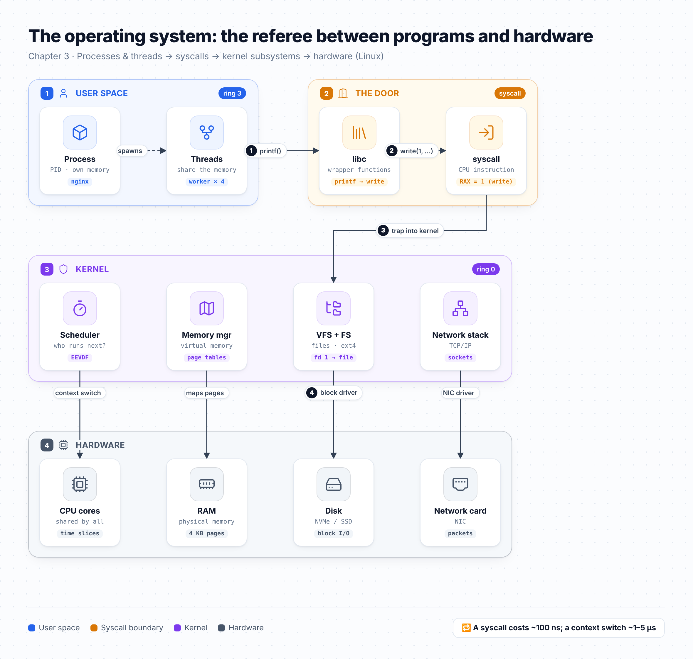

# Bölüm 3 — İşletim sistemi

!!! abstract "Tek cümlede"
    İşletim sistemi çekirdeği (kernel) bir **hakemdir**. Her programa kendi CPU'su varmış gibi bir yanılsama verir
    (**zamanlayıcı**), kendi belleği varmış gibi bir yanılsama verir (**sanal bellek**) ve cihazlara basit bir erişim sağlar
    (**dosyalar, soketler**). Bunu yaparken hiçbir programın kendine ait olmayan şeye dokunamamasını garanti eder.
    Programlar ihtiyaç duydukları her şeyi ondan **syscall** ile ister.



---

## 1 · Process: çalışan bir program

**Process**, belleğe yüklenmiş ve çalışan bir programdır. Kernel'in onun hakkında tuttuğu her şeyi de içerir:

| Parça | Ne |
|---|---|
| **PID** | Process kimliği, bir sayı. PID 1 ilk process'tir (`systemd`, ya da container içindeki uygulaman). |
| **Adres alanı** | Belleğin ona özel görünümü (aşağıda sanal bellek kısmına bak). |
| **Dosya tanımlayıcı tablosu** | Açık dosyalar ve soketler: `0` = stdin, `1` = stdout, `2` = stderr, sonra `3, 4, …` |
| **Register'lar + durum** | Çalışmıyorken kaydedilmiş `RIP`, `RSP`, … Durumu: çalışıyor, uyuyor, durdurulmuş, zombi. |
| **Kimlik** | Hangi kullanıcı/grup olarak çalıştığı, yetkileri (capabilities). |
| **Ebeveyn** | Her process'in bir ebeveyni vardır. Yeni process'ler `fork()` (beni kopyala) + `execve()` (başka bir program ol) ile oluşturulur. |

Bir process'in bellek düzeni (düşük → yüksek adres):

```text
[ text: makine kodu ][ data/bss: global değişkenler ][ heap → yukarı büyür ]  …  [ mmap: kütüphaneler ]  …  [ ← stack aşağı büyür ]
```

## 2 · Thread: aynı process içinde ikinci bir işçi

- Aynı process'in thread'leri onun belleğini ve açık dosyalarını **paylaşır**, ama her birinin **kendi stack'i ve register'ları** vardır.
- Bu yüzden thread'ler arası iletişim ucuzdur (ortak bellek), ama birbirinin işini bozmamak için **kilit (lock)** gerekir.
- Linux'ta process de thread de kernel için birer **task**'tır. Thread, belleği başkalarıyla paylaşan bir task'tır.

## 3 · Zamanlayıcı (scheduler): CPU'yu paylaştırmak

Çalışmaya hazır task sayısı çekirdek sayısından fazladır. Zamanlayıcı **sırada kimin ne kadar süre çalışacağına** karar verir.

- Her task birkaç milisaniyelik bir **zaman dilimi** alır. Bir zamanlayıcı kesmesi (yine Bölüm 1!) kernel'in CPU'yu geri almasını sağlar.
- **Bağlam değişimi (context switch):** mevcut task'ın register'larını kaydet, sıradakinin register'larını yükle, farklı bir process ise page table'ları değiştir. Maliyeti: ~1–5 µs, artı soğuyan önbellekler.
- Linux'un zamanlayıcısı **EEVDF**'tir (kernel 6.6'dan beri, CFS'in yerine geldi). Her task'a önceliğine (`nice`) göre ayarlanmış adil payını vermeye çalışır.
- **Load average** = ortalama olarak kaç task'ın çalıştığı ya da çalışmak için beklediği.

> DevOps bağlantısı: Kubernetes'teki **CPU limit**'i, zamanlayıcı cgroup'lar üzerinden uygular. Bir container kotasını periyodun başında bitirirse, node'da boş çekirdek olsa bile bir sonraki periyoda kadar **kısılır (throttle)**.

## 4 · Sanal bellek: herkese kendi adres alanı

Her process, 0 adresine yakın başlayan devasa ve özel bir belleği olduğunu düşünür. Kernel ve CPU'nun **MMU**'su bunu gerçeğe çevirir:

| Kavram | Anlamı |
|---|---|
| **Sayfa (page)** | Bellek **4 KB**'lık parçalar halinde yönetilir. |
| **Page table** | Process başına bir harita: *sanal sayfa → RAM'deki fiziksel çerçeve*. Kernel bu haritayı kurar, MMU her bellek erişiminde onu okur. |
| **TLB** | CPU içinde son çevirilerin önbelleği. Aramalar böylece hızlı kalır. |
| **Page fault** | Henüz eşlenmemiş bir sayfaya erişim. Kernel sayfayı eşler (minor fault) ya da diskten okur (major fault), sonra komut tekrar denenir. |
| **Copy-on-write** | `fork()`'tan sonra ebeveyn ve çocuk, biri yazana kadar aynı sayfaları paylaşır. Kopya ancak o zaman çıkarılır. |
| **OOM killer** | Bellek bittiğinde kernel, hayatta kalmak için bir process'i öldürür. |

Bu neden önemli: A process'i, B process'inin belleğinin **adını bile koyamaz**. İzolasyon page table'lardan bedavaya gelir.

> DevOps bağlantısı: Kubernetes'teki `OOMKilled`, container'ın **bellek cgroup limitine** dayandığı ve kernel'in OOM killer'ının onu durdurduğu anlamına gelir.

## 5 · Syscall: kernel'e açılan tek kapı

Ring 3'teki bir program donanıma dokunamaz. Kernel'den bir sistem çağrısıyla **ister**:

| # | Adım |
|---|---|
| 1 | Kodun `printf("hi\n")` çağırır. |
| 2 | **libc** metni biçimlendirir ve `write(1, "hi\n", 3)` çağırır. |
| 3 | `write` sarmalayıcısı syscall numarasını `RAX`'e (x86-64'te **1** = write), argümanları `RDI, RSI, RDX`'e koyar ve **`syscall`** komutunu çalıştırır. CPU ring 0'a geçer ve kernel'in giriş noktasına atlar. |
| 4 | Kernel fd `1`'in ne olduğuna bakar: terminal mi, dosya mı, pipe mı? **VFS** çağrıyı doğru sürücüye yönlendirir. Sonuç (yazılan byte sayısı ya da negatif bir hata) `RAX`'te döner ve CPU ring 3'e geri geçer. |

Sık kullanılan syscall'lar: `read`, `write`, `openat`, `close`, `mmap`, `clone` (fork/thread), `execve`, `socket`, `connect`, `accept`, `epoll_wait`, `exit_group`.

## 6 · "Her şey bir dosyadır"

Dosyalar, terminaller, pipe'lar, soketler ve cihazlar (Bölüm 1'deki `/dev/input/event3`) aynı `read`/`write` çağrılarıyla, **dosya tanımlayıcıları (file descriptor)** üzerinden kullanılır. `/proc`, kernel'in iç durumunu dosya olarak gösterdiği sahte bir dosya sistemidir.

## 7 · Sinyaller: kernel process'in omzuna dokunur

| Sinyal | Anlamı |
|---|---|
| `SIGINT` (2) | Ctrl+C |
| `SIGTERM` (15) | "Lütfen kapan." Yakalanabilir, düzgün kapanış (graceful shutdown) için kullanılır. |
| `SIGKILL` (9) | "Artık öldün." Yakalanamaz. |
| `SIGCHLD` | Bir çocuk process sonlandı. |

> DevOps bağlantısı: pod silinirken Kubernetes her container'ın PID 1'ine **SIGTERM** gönderir, `terminationGracePeriodSeconds` kadar (varsayılan 30 sn) bekler, sonra **SIGKILL** gönderir. PID 1 sinyalleri iletmeyen bir shell script ise uygulaman SIGTERM'i hiç almaz.

---

## 🧪 Kendin dene (Linux)

```bash
# 1) Process'ler ve thread'ler
ps -eo pid,ppid,nlwp,stat,cmd | head      # nlwp = thread sayısı
cat /proc/$$/status | grep -E "Pid|PPid|Threads|VmRSS"

# 2) Shell'inin bellek haritası (text, heap, kütüphaneler, stack)
cat /proc/$$/maps

# 3) Syscall'ları canlı izle
strace -e trace=write echo hi             # write(1, "hi\n", 3) = 3
strace -c ls / > /dev/null                # syscall özet tablosu

# 4) Bağlam değişimleri ve zamanlayıcı
vmstat 1 5                                # cs = saniyedeki bağlam değişimi
perf stat -e context-switches,page-faults sleep 1

# 5) Sinyaller
sleep 300 &  kill -TERM $!                # kibar yol
kill -l                                   # tüm sinyalleri listele
```

**Görev:** `strace -f -e trace=clone,execve bash -c 'ls'` çalıştır ve shell'ini `ls`'e dönüştüren `fork` (`clone`) ile `execve` çağrılarını bul.

---

## 🃏 Hatırlatma kartı

```text
Process = PID + kendi adres alanı + fd tablosu + kaydedilmiş register'lar
Thread  = process'in belleğini paylaşır, kendi stack'i + register'ları var
Zamanlayıcı: zaman dilimi → timer kesmesi → bağlam değişimi (register kaydet/yükle)
Sanal bellek: sanal sayfa --(page table, MMU, TLB)--> fiziksel çerçeve (4 KB)
Syscall: libc → RAX = numara, argümanlar RDI/RSI/RDX → `syscall` → ring 0 → sonuç RAX'te
Her şey dosyadır: fd 0/1/2, soketler, pipe'lar, cihazlar, /proc
Sinyaller: SIGTERM (kibar, yakalanabilir) → SIGKILL (son)
```

---

## ❓ Kendini test et

??? question "1. Aynı process'in iki thread'i de iki ayrı process de paralel çalışır. Temel fark ne?"
    Thread'ler tek bir adres alanını (bellek, açık dosyalar) paylaşır ve birbirinin verisini doğrudan okuyabilir. Ayrı process'lerin page table'ları ayrıdır, açık bir paylaşım (pipe, soket, shared memory) olmadan birbirlerinin belleğini göremezler.

??? question "2. Hatalı bir process neden başka bir process'in belleğinin üstüne yazamaz?"
    Her process'in kendi page table'ı vardır. Sanal adresleri sadece kernel'in ona verdiği fiziksel çerçevelere eşlenebilir ve MMU bunu her erişimde denetler.

??? question "3. Programın `write()` çağırdığında adım adım ne olur?"
    libc syscall numarasını RAX'e, argümanları RDI/RSI/RDX'e koyar ve `syscall` çalıştırır. CPU ring 0'a geçer, kernel'in VFS'i fd'nin neyi gösterdiğini bulup doğru sürücüyü çağırır. Sonuç RAX'te döner ve CPU ring 3'e geri geçer.

??? question "4. Bir container sürekli `OOMKilled` ile öldürülüyor. Bunu hangi kernel mekanizması yapıyor?"
    Bellek cgroup limiti ve kernel'in OOM killer'ı. Container limitinden fazla bellek kullandı, kernel de içindeki bir process'i öldürdü.

??? question "5. Container'ındaki PID 1 neden SIGTERM'i işlemeli?"
    Kubernetes düzgün kapanışa izin vermek için önce SIGTERM gönderir: istekleri bitir, bağlantıları kapat. PID 1 bunu yok sayarsa pod grace period sonuna kadar bekler, sonra SIGKILL ile öldürülür ve yarım kalan işler kaybolur.

---

## 📚 Kaynaklar

- [Operating Systems: Three Easy Pieces (ücretsiz kitap)](https://pages.cs.wisc.edu/~remzi/OSTEP/)
- [Linux man-pages: syscalls(2)](https://man7.org/linux/man-pages/man2/syscalls.2.html)
- [Linux kernel dokümanları: zamanlayıcı](https://docs.kernel.org/scheduler/index.html)
- [Linux kernel dokümanları: bellek yönetimi kavramları](https://docs.kernel.org/admin-guide/mm/concepts.html)
- [Kubernetes: pod sonlandırma](https://kubernetes.io/docs/concepts/workloads/pods/pod-lifecycle/#pod-termination)

## ✍️ Kendi notlarım

> Process ile thread arasındaki farkı ve syscall'un ne olduğunu kendi cümlelerinle 5 satırda anlat.

-
