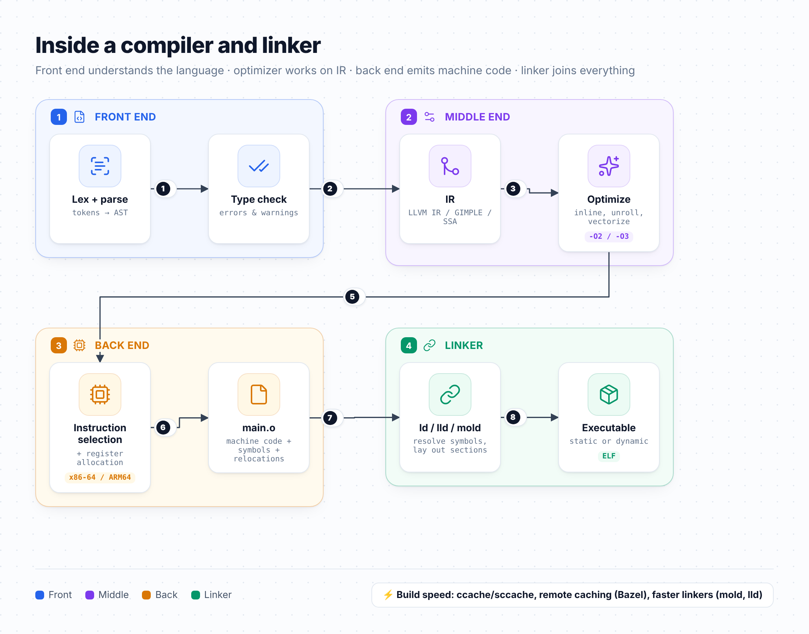

# 4.1 — Compiling & linking

!!! abstract "In one sentence"
    A **compiler** reads source code, checks it, turns it into an **intermediate representation (IR)**, **optimizes** it
    and emits machine code for one target into **object files**; the **linker** then resolves the **symbols** between
    those files and libraries and lays everything out into one executable, either copying libraries in (**static**) or
    leaving them to be loaded at run time (**dynamic**).

## 📖 Key terms & abbreviations

| Term | Stands for | What it is | How it works (one line) |
|---|---|---|---|
| **Compiler** | — | Translates source to machine code | gcc, clang/LLVM, rustc, go build, javac (to bytecode) |
| **AST** | Abstract Syntax Tree | Tree form of the parsed code | Built by the parser, type-checked |
| **IR** | Intermediate Representation | Language- and CPU-neutral code | LLVM IR, GCC GIMPLE, Go SSA |
| **SSA** | Static Single Assignment | IR form where each variable is assigned once | Makes optimizations simpler |
| **Optimization level** | — | How hard the compiler optimizes | `-O0` debug … `-O2` default … `-O3`, `-Os` size |
| **Object file (.o)** | — | Machine code + symbols + relocations | One per source file |
| **Symbol** | — | Named function or variable | Defined (`T`) or undefined (`U`) |
| **Relocation** | — | "Patch this address later" note | Filled in by the linker or loader |
| **Linker** | — | Combines objects into an executable | ld (bfd), gold, lld, mold |
| **Static library (.a)** | archive | Bundle of .o files copied in at link time | Bigger binary, no runtime dependency |
| **Shared library (.so)** | shared object | Loaded at run time, shared in memory | Smaller binaries, update libs separately |
| **LTO / PGO** | Link-Time Optimization / Profile-Guided Optimization | Whole-program / data-driven optimization | Faster binaries, slower builds |
| **Cross-compiling** | — | Building for another OS/CPU | `GOOS=linux GOARCH=arm64`, `--target` |
| **Reproducible build** | — | Same source → bit-identical output | Needed for verifying supply chains |

## 🗺️ Big picture



---

## 1 · Inside the compiler

### How does it work?

1. **Front end:** the lexer splits text into tokens, the parser builds an **AST**, semantic analysis resolves names and checks types. Your compile errors come from here.
2. **Middle end:** the AST is lowered to **IR** (often SSA). Dozens of passes optimize it: constant folding, dead-code elimination, **inlining**, loop unrolling, **vectorization**, escape analysis (Go: does this value need the heap?).
3. **Back end:** instruction selection for the target ISA, **register allocation**, instruction scheduling, then emitting machine code into an object file.

Because front ends and back ends are separate, **LLVM** compiles C, C++, Rust, Swift, Zig and more to x86, ARM, RISC-V, WebAssembly and GPUs with one optimizer.

## 2 · Object files, symbols and the linker

```bash
$ nm hello.o
                 U puts        # undefined: needed from somewhere else
0000000000000000 T main        # defined here, in .text
```

The linker:

1. Collects all `.o` files and libraries (`-lssl`, `.a`, `.so`).
2. **Resolves symbols:** every `U` must match exactly one definition. "**undefined reference to …**" = missing library or wrong order; "**multiple definition**" = defined twice.
3. **Lays out sections** (`.text`, `.rodata`, `.data`, `.bss`) into segments and applies **relocations**.
4. Writes an **ELF** executable (4.2).

## 3 · Static vs dynamic linking

| | Static | Dynamic |
|---|---|---|
| Libraries | Copied into the binary | Loaded by `ld.so` at start |
| Binary size | Larger | Smaller |
| Runtime deps | None (just the kernel) | Matching `.so` versions must exist |
| Security patches | Rebuild every binary | Update the library once |
| Containers | Perfect for `FROM scratch` / distroless | Needs a base image with libc |
| Examples | Go (`CGO_ENABLED=0`), Rust with musl | Most C/C++ programs, Python, Node |

**glibc vs musl:** Alpine uses musl; binaries built against glibc won't run there ("not found" for an existing file = missing loader). Go with cgo disabled sidesteps it entirely.

## 4 · Making builds fast and trustworthy

- **Incremental + cached builds:** `ccache`/`sccache` for C/C++/Rust, Go's build cache, Bazel/Buck2 remote caches, Docker layer caching in CI.
- **Faster linkers:** `mold` or `lld` can cut link time from minutes to seconds on big C++/Rust projects.
- **LTO / PGO:** optimize across files and with real profiles; Go supports PGO from `default.pgo` (often 2–14% faster).
- **Reproducible builds:** pin toolchains, strip timestamps/paths (`-trimpath`, `SOURCE_DATE_EPOCH`), so anyone can verify that a binary matches its source. A foundation of **SLSA** supply-chain levels.

## 🔧 DevOps connection

- **Multi-stage Dockerfiles:** compile in a big builder image, copy just the static binary into `scratch`/distroless → tiny images with no shell and few CVEs.
- **Cross-compiling in CI** (`GOARCH=arm64`, `cargo build --target`, `docker buildx`) is much faster than emulating ARM with QEMU.
- **Debug symbols:** strip them from release images (`-ldflags="-s -w"`, `strip`) but keep them (separate debuginfo) to symbolize crash dumps and profiles.
- **SBOMs** (`syft`, `go version -m`) list what got linked in: essential for answering "are we affected by CVE-X?".

## 🧪 Try it yourself

```bash
cat > hello.c <<'EOF'
#include <stdio.h>
int main(void) { puts("hello"); return 0; }
EOF
gcc -E hello.c | tail -3                         # after the preprocessor
gcc -O2 -S hello.c -o - | head -20               # assembly
gcc -c hello.c && nm hello.o                     # symbols: U puts, T main
gcc hello.o -o hello-dyn && ldd hello-dyn        # dynamic: needs libc.so.6
gcc -static hello.o -o hello-static 2>/dev/null && ls -lh hello-dyn hello-static && ldd hello-static
clang -O2 -S -emit-llvm hello.c -o - 2>/dev/null | head -20   # LLVM IR (if clang is installed)

# Go: static, cross-compiled, stripped, with embedded build info
# CGO_ENABLED=0 GOOS=linux GOARCH=arm64 go build -trimpath -ldflags="-s -w" -o app-arm64 .
# go version -m app-arm64
```

## 🃏 Cheat sheet

| Error / need | Meaning / fix |
|---|---|
| `undefined reference to X` | Missing library or link order |
| `multiple definition of X` | Symbol defined twice (e.g. in a header) |
| `cannot find -lfoo` | Install `libfoo-dev`, check `-L` |
| Binary "not found" on Alpine | glibc binary on musl → build static or use glibc base |
| Smaller image | Static binary + `FROM scratch`/distroless |
| Faster C++/Rust links | mold / lld |

## ❓ Test yourself

??? question "1. What does the compiler's IR make possible?"
    One optimizer for many languages and many targets; front ends and back ends can be mixed (LLVM).

??? question "2. What does `U puts` in `nm` output mean?"
    The object file uses `puts` but doesn't define it; the linker (or loader) must find it, here in libc.

??? question "3. Why are Go binaries popular for `FROM scratch` images?"
    With `CGO_ENABLED=0` they're statically linked: no libc or loader needed, only the kernel.

??? question "4. A security fix lands in OpenSSL. What's the difference for statically vs dynamically linked apps?"
    Dynamic: update the shared library (base image) once. Static: every binary must be rebuilt and redeployed.

??? question "5. Why do reproducible builds matter for supply-chain security?"
    Anyone can rebuild from source and check the binary is bit-identical, proving nothing was injected during the build.

---

## 📚 Sources

- [LLVM — Getting started / architecture](https://llvm.org/docs/GettingStarted.html)
- [Ian Lance Taylor — Linkers (20-part series)](https://www.airs.com/blog/archives/38)
- [Go — Profile-guided optimization](https://go.dev/doc/pgo)
- [reproducible-builds.org](https://reproducible-builds.org/) · [SLSA](https://slsa.dev/)
- [mold linker](https://github.com/rui314/mold)

## ✍️ My notes

> Take one of your services: is it statically or dynamically linked? Run `ldd` (or `go version -m`) on the binary in the image.

-
