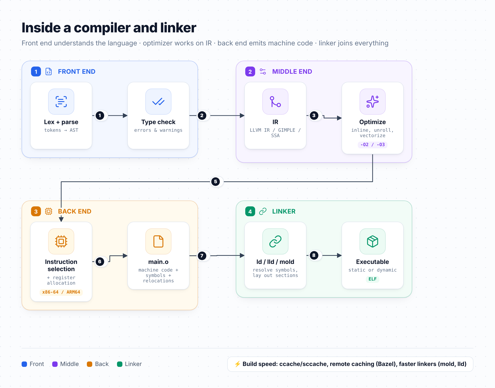

# 4.1 — Derleme ve linkleme

!!! abstract "Tek cümlede"
    Bir **derleyici** kaynak kodu okur, kontrol eder, bir **ara gösterime (IR)** çevirir, **optimize eder** ve tek bir
    hedef için makine kodunu **object dosyalarına** yazar; **linker** ise bu dosyalar ve kütüphaneler arasındaki
    **sembolleri** çözer ve her şeyi tek bir çalıştırılabilir dosyaya yerleştirir; kütüphaneleri ya içine kopyalar
    (**statik**) ya da çalışma anında yüklenmeye bırakır (**dinamik**).

## 📖 Temel terimler ve kısaltmalar

| Terim | Açılımı | Nedir | Nasıl çalışır (tek satır) |
|---|---|---|---|
| **Derleyici** | Compiler | Kaynağı makine koduna çevirir | gcc, clang/LLVM, rustc, go build, javac (bytecode'a) |
| **AST** | Abstract Syntax Tree | Ayrıştırılmış kodun ağaç hali | Parser kurar, tip kontrolünden geçer |
| **IR** | Intermediate Representation | Dilden ve CPU'dan bağımsız kod | LLVM IR, GCC GIMPLE, Go SSA |
| **SSA** | Static Single Assignment | Her değişkenin bir kez atandığı IR biçimi | Optimizasyonları basitleştirir |
| **Optimizasyon seviyesi** | — | Derleyicinin ne kadar optimize ettiği | `-O0` debug … `-O2` varsayılan … `-O3`, `-Os` boyut |
| **Object dosyası (.o)** | — | Makine kodu + semboller + relocation'lar | Kaynak dosya başına bir tane |
| **Sembol** | Symbol | İsimli fonksiyon ya da değişken | Tanımlı (`T`) ya da tanımsız (`U`) |
| **Relocation** | — | "Bu adresi sonra düzelt" notu | Linker ya da yükleyici doldurur |
| **Linker** | — | Object'leri bir çalıştırılabilire birleştirir | ld (bfd), gold, lld, mold |
| **Statik kütüphane (.a)** | archive | Link sırasında içine kopyalanan .o paketi | Daha büyük binary, çalışma anı bağımlılığı yok |
| **Paylaşımlı kütüphane (.so)** | shared object | Çalışma anında yüklenir, bellekte paylaşılır | Daha küçük binary'ler, kütüphaneleri ayrı güncelle |
| **LTO / PGO** | Link-Time Optimization / Profile-Guided Optimization | Tüm program / veriye dayalı optimizasyon | Daha hızlı binary'ler, daha yavaş build'ler |
| **Çapraz derleme** | Cross-compiling | Başka bir OS/CPU için build | `GOOS=linux GOARCH=arm64`, `--target` |
| **Tekrarlanabilir build** | Reproducible build | Aynı kaynak → bit bit aynı çıktı | Tedarik zincirini doğrulamak için gerekli |

## 🗺️ Büyük resim



---

## 1 · Derleyicinin içi

### Nasıl çalışır?

1. **Ön uç:** lexer metni token'lara böler, parser bir **AST** kurar, anlamsal analiz isimleri çözer ve tipleri kontrol eder. Derleme hataların buradan gelir.
2. **Orta uç:** AST **IR**'a (çoğu zaman SSA) indirgenir. Onlarca geçiş onu optimize eder: sabit katlama, ölü kod eleme, **inline**, döngü açma, **vektörleştirme**, escape analizi (Go: bu değer heap'e mi gitmeli?).
3. **Arka uç:** hedef ISA için komut seçimi, **register ayırma**, komut zamanlama, sonra makine kodunu bir object dosyasına yazma.

Ön ve arka uçlar ayrı olduğu için **LLVM** C, C++, Rust, Swift, Zig ve daha fazlasını tek bir optimizer ile x86, ARM, RISC-V, WebAssembly ve GPU'lara derler.

## 2 · Object dosyaları, semboller ve linker

```bash
$ nm hello.o
                 U puts        # tanımsız: başka bir yerden lazım
0000000000000000 T main        # burada, .text içinde tanımlı
```

Linker:

1. Tüm `.o` dosyalarını ve kütüphaneleri (`-lssl`, `.a`, `.so`) toplar.
2. **Sembolleri çözer:** her `U` tam olarak bir tanımla eşleşmeli. "**undefined reference to …**" = eksik kütüphane ya da yanlış sıra; "**multiple definition**" = iki kez tanımlı.
3. **Bölümleri** (`.text`, `.rodata`, `.data`, `.bss`) segmentlere **yerleştirir** ve **relocation**'ları uygular.
4. Bir **ELF** çalıştırılabilir dosyası yazar (4.2).

## 3 · Statik ve dinamik linkleme

| | Statik | Dinamik |
|---|---|---|
| Kütüphaneler | Binary'nin içine kopyalanır | Başlangıçta `ld.so` yükler |
| Binary boyutu | Daha büyük | Daha küçük |
| Çalışma anı bağımlılıkları | Yok (sadece kernel) | Uyumlu `.so` sürümleri bulunmalı |
| Güvenlik yamaları | Her binary'yi yeniden derle | Kütüphaneyi bir kez güncelle |
| Container'lar | `FROM scratch` / distroless için mükemmel | libc'li bir taban imaj ister |
| Örnekler | Go (`CGO_ENABLED=0`), musl ile Rust | Çoğu C/C++ programı, Python, Node |

**glibc ve musl:** Alpine musl kullanır; glibc'ye karşı derlenmiş binary'ler orada çalışmaz (var olan bir dosya için "not found" = eksik yükleyici). cgo kapalı Go bu sorunu tamamen atlar.

## 4 · Build'leri hızlı ve güvenilir yapmak

- **Artımlı + önbellekli build'ler:** C/C++/Rust için `ccache`/`sccache`, Go'nun build önbelleği, Bazel/Buck2 uzak önbellekleri, CI'da Docker katman önbelleği.
- **Hızlı linker'lar:** `mold` ya da `lld` büyük C++/Rust projelerinde link süresini dakikalardan saniyelere indirebilir.
- **LTO / PGO:** dosyalar arası ve gerçek profillerle optimize et; Go `default.pgo`'dan PGO destekler (çoğu zaman %2–14 daha hızlı).
- **Tekrarlanabilir build'ler:** araç zincirlerini sabitle, zaman damgalarını/yolları çıkar (`-trimpath`, `SOURCE_DATE_EPOCH`); herkes bir binary'nin kaynağıyla eşleştiğini doğrulayabilsin. **SLSA** tedarik zinciri seviyelerinin temeli.

## 🔧 DevOps bağlantısı

- **Çok aşamalı Dockerfile'lar:** büyük bir builder imajında derle, sadece statik binary'yi `scratch`/distroless'e kopyala → shell'i olmayan, az CVE'li minik imajlar.
- **CI'da çapraz derleme** (`GOARCH=arm64`, `cargo build --target`, `docker buildx`), ARM'ı QEMU ile taklit etmekten çok daha hızlı.
- **Debug sembolleri:** release imajlarından çıkar (`-ldflags="-s -w"`, `strip`) ama crash dump'ları ve profilleri sembolize etmek için sakla (ayrı debuginfo).
- **SBOM'lar** (`syft`, `go version -m`) içine neyin linklendiğini listeler: "CVE-X'ten etkileniyor muyuz?" sorusunu cevaplamak için şart.

## 🧪 Kendin dene

```bash
cat > hello.c <<'EOF'
#include <stdio.h>
int main(void) { puts("hello"); return 0; }
EOF
gcc -E hello.c | tail -3                         # preprocessor sonrası
gcc -O2 -S hello.c -o - | head -20               # assembly
gcc -c hello.c && nm hello.o                     # semboller: U puts, T main
gcc hello.o -o hello-dyn && ldd hello-dyn        # dinamik: libc.so.6 ister
gcc -static hello.o -o hello-static 2>/dev/null && ls -lh hello-dyn hello-static && ldd hello-static
clang -O2 -S -emit-llvm hello.c -o - 2>/dev/null | head -20   # LLVM IR (clang kuruluysa)

# Go: statik, çapraz derlenmiş, strip edilmiş, gömülü build bilgisiyle
# CGO_ENABLED=0 GOOS=linux GOARCH=arm64 go build -trimpath -ldflags="-s -w" -o app-arm64 .
# go version -m app-arm64
```

## 🃏 Hatırlatma kartı

| Hata / ihtiyaç | Anlamı / çözümü |
|---|---|
| `undefined reference to X` | Eksik kütüphane ya da link sırası |
| `multiple definition of X` | Sembol iki kez tanımlı (ör. bir header'da) |
| `cannot find -lfoo` | `libfoo-dev` kur, `-L`'yi kontrol et |
| Alpine'de binary "not found" | musl üzerinde glibc binary'si → statik derle ya da glibc taban kullan |
| Daha küçük imaj | Statik binary + `FROM scratch`/distroless |
| Daha hızlı C++/Rust link | mold / lld |

## ❓ Kendini test et

??? question "1. Derleyicinin IR'ı neyi mümkün kılar?"
    Birçok dil ve birçok hedef için tek bir optimizer; ön ve arka uçlar karıştırılabilir (LLVM).

??? question "2. `nm` çıktısındaki `U puts` ne demek?"
    Object dosyası `puts`'u kullanıyor ama tanımlamıyor; linker (ya da yükleyici) onu bulmalı, burada libc'de.

??? question "3. Go binary'leri neden `FROM scratch` imajları için popüler?"
    `CGO_ENABLED=0` ile statik linklenirler: libc ya da yükleyici gerekmez, sadece kernel.

??? question "4. OpenSSL'e bir güvenlik düzeltmesi geldi. Statik ve dinamik linklenmiş uygulamalar için fark ne?"
    Dinamik: paylaşımlı kütüphaneyi (taban imajı) bir kez güncelle. Statik: her binary yeniden derlenip deploy edilmeli.

??? question "5. Tekrarlanabilir build'ler tedarik zinciri güvenliği için neden önemli?"
    Herkes kaynaktan yeniden derleyip binary'nin bit bit aynı olduğunu kontrol edebilir; build sırasında hiçbir şeyin enjekte edilmediğini kanıtlar.

---

## 📚 Kaynaklar

- [LLVM — Getting started / architecture](https://llvm.org/docs/GettingStarted.html)
- [Ian Lance Taylor — Linkers (20 bölümlük seri)](https://www.airs.com/blog/archives/38)
- [Go — Profile-guided optimization](https://go.dev/doc/pgo)
- [reproducible-builds.org](https://reproducible-builds.org/) · [SLSA](https://slsa.dev/)
- [mold linker](https://github.com/rui314/mold)

## ✍️ Notlarım

> Servislerinden birini al: statik mi dinamik mi linklenmiş? İmajdaki binary'de `ldd` (ya da `go version -m`) çalıştır.

-
