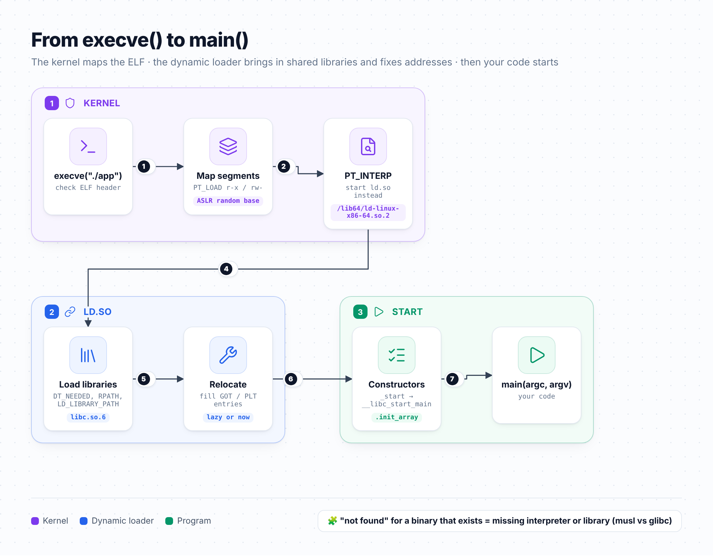

# 4.2 — ELF & the program loader

!!! abstract "In short"
    An executable on Linux is an **ELF** file: a header, **segments** that say what to map into memory with which
    permissions, and **sections** for tools. `execve()` makes the kernel map those segments at a randomized address
    (**ASLR**) and start the **dynamic loader** `ld.so`. The loader finds the shared libraries, fixes up addresses
    through the **GOT/PLT**, runs constructors and finally calls `main()`.

## 📖 Key terms & abbreviations

| Term | Stands for | What it is | How it works (one line) |
|---|---|---|---|
| **ELF** | Executable and Linkable Format | Linux/BSD format for executables, .o and .so | Magic bytes `7f 45 4c 46` ("\x7fELF") |
| **ELF header** | — | First bytes: class, ISA, entry point, table offsets | `readelf -h` |
| **Segment (program header)** | — | What the loader maps (PT_LOAD, PT_INTERP, PT_DYNAMIC…) | `readelf -l` |
| **Section** | — | What tools/linker use (.text, .data, .symtab, .debug_*) | `readelf -S` |
| **Entry point** | — | First instruction executed (`_start`) | Not `main` |
| **PT_INTERP** | program interpreter | Path to the dynamic loader | `/lib64/ld-linux-x86-64.so.2` |
| **ld.so** | dynamic linker/loader | Loads shared libraries at start | Configured by RPATH, LD_LIBRARY_PATH, ld.so.cache |
| **DT_NEEDED** | — | List of required libraries | `readelf -d` |
| **GOT / PLT** | Global Offset Table / Procedure Linkage Table | Indirection tables for library addresses | Filled lazily or at start |
| **ASLR** | Address Space Layout Randomization | Random base addresses each run | Makes exploits harder |
| **PIE** | Position-Independent Executable | Executable that can load anywhere | Needed for full ASLR |
| **RELRO / NX / stack canary** | RELocation Read-Only / No-eXecute | Hardening features | Protect GOT, stack, data pages |
| **soname** | shared object name | Library ABI identity (`libssl.so.3`) | Major version in the file name |
| **LD_PRELOAD** | — | Force-load a library first | Override functions (tracing, mocks, also attacks) |

## 🗺️ Big picture



---

## 1 · What's inside an ELF file?

### How does it work?

```text
$ readelf -l /usr/bin/ls   (simplified)
Type     Offset    VirtAddr  Flags  Meaning
PHDR     ...                 R      the program headers themselves
INTERP   ...                 R      "/lib64/ld-linux-x86-64.so.2"
LOAD     0x000000  0x000000  R      headers, read-only data
LOAD     0x004000  0x004000  R E    code (.text)
LOAD     0x01b000  0x01b000  R      constants (.rodata)
LOAD     0x022000  0x023000  RW     globals (.data, .bss), GOT
DYNAMIC  ...                 RW     list of needed libraries, symbol tables
GNU_STACK                    RW     stack is NOT executable
```

- **Segments** are what the kernel maps: each `LOAD` becomes a memory region with exactly those permissions (code is never writable, data is never executable).
- **Sections** (`.text`, `.rodata`, `.symtab`, `.debug_info`) are for the linker, debuggers and profilers. You can strip them without breaking the program.

## 2 · `execve()`: the kernel's part

1. Open the file, check the magic (`\x7fELF`) or a `#!` line (then run the interpreter it names instead).
2. Throw away the old address space, create a new one.
3. Map each `PT_LOAD` segment at a **random base** (ASLR, if the binary is **PIE**), set up the stack with `argc`, `argv`, `envp` and the **auxiliary vector** (page size, entry point, random bytes…).
4. If there's a `PT_INTERP`, map **ld.so** too and jump to *its* entry point; otherwise (static binary) jump straight to `_start`.

## 3 · `ld.so`: the dynamic loader's part

1. Read `DT_NEEDED` (e.g. `libssl.so.3`, `libc.so.6`) and search for each: **RPATH/RUNPATH** in the binary → `LD_LIBRARY_PATH` → `/etc/ld.so.cache` → `/lib`, `/usr/lib`.
2. Map each library (each with its own random base) and recursively load *their* dependencies.
3. **Relocate:** fill the **GOT** with real addresses of external functions and variables. With **lazy binding**, calls go through the **PLT** stub and are resolved on first call; with `-z now` (full **RELRO**) everything is resolved up front and the GOT is made read-only.
4. Run constructors (`.init_array`, C++ static constructors), then `_start` → `__libc_start_main` → **`main(argc, argv, envp)`**.

`LD_DEBUG=libs ./app` prints this whole search.

## 4 · Hardening flags you can check

| Feature | Protects against | Check |
|---|---|---|
| **PIE + ASLR** | Hard-coded addresses in exploits | `file` says "pie executable" |
| **NX** (non-executable stack/data) | Injected shellcode | `GNU_STACK` without `E` |
| **Stack canary** | Stack buffer overflows | `__stack_chk_fail` symbol |
| **Full RELRO** | GOT overwrites | `BIND_NOW` + `GNU_RELRO` |
| **CET (IBT/SHSTK)** | ROP/JOP gadget chains | `endbr64` instructions |
| **FORTIFY_SOURCE** | Unsafe libc calls | `__*_chk` symbols |

Distro and most language toolchains enable these by default; hand-written Makefiles sometimes don't.

## 🔧 DevOps connection

- **`exec /app: no such file or directory`** for a file that exists = the **interpreter** in PT_INTERP doesn't exist in the image (glibc binary on Alpine, or wrong arch). Check with `readelf -l` / `file`.
- **`error while loading shared libraries: libX.so.N`** = a DT_NEEDED library is missing in the runtime image (forgotten in a multi-stage copy).
- **`GLIBC_2.38 not found`** = built on a newer distro than the runtime image. Build on the oldest base you support (or link statically).
- **Distroless images** contain only the loader, libc and certificates: no shell, smaller attack surface; debug with `kubectl debug` ephemeral containers.
- **`LD_PRELOAD`** is used by profilers/allocators (jemalloc, tcmalloc) and by attackers; it's ignored for setuid binaries.

## 🧪 Try it yourself

```bash
file /usr/bin/ls
readelf -h /usr/bin/ls | grep -E 'Class|Machine|Type|Entry'
readelf -lW /usr/bin/ls | grep -E 'INTERP|LOAD|GNU_STACK|GNU_RELRO' -A1 | head -20
readelf -d /usr/bin/ls | grep NEEDED
ldd /usr/bin/ls
LD_DEBUG=libs /usr/bin/true 2>&1 | head -15      # watch the loader search
cat /proc/self/maps | grep -E 'ls|cat|libc|ld-'  # where things got mapped (run twice: ASLR)
hexdump -C /usr/bin/ls | head -2                 # 7f 45 4c 46 = \x7fELF
# checksec --file=/usr/bin/ls                    # hardening summary (checksec package)
```

## 🃏 Cheat sheet

| Tool | Shows |
|---|---|
| `file` | Arch, PIE, static/dynamic, stripped |
| `readelf -h / -l / -S / -d` | Header / segments / sections / dynamic deps |
| `ldd` | Resolved libraries (don't run on untrusted binaries) |
| `LD_DEBUG=libs` | Loader search path in action |
| `nm -D` | Dynamic symbols a library exports/needs |
| `objdump -d` | Disassembly |

## ❓ Test yourself

??? question "1. What's the difference between ELF segments and sections?"
    Segments describe what the loader maps into memory and with which permissions; sections are for the linker, debuggers and tools and can be stripped.

??? question "2. Is `main` the first code that runs in a C program?"
    No. ld.so runs first (for dynamic binaries), then `_start` → `__libc_start_main` and constructors, then `main`.

??? question "3. A container fails with `exec /app: no such file or directory` but `/app` exists. Why?"
    Its interpreter (PT_INTERP, e.g. glibc's ld-linux) isn't in the image, or it's built for another architecture.

??? question "4. What is ASLR and why does it need PIE?"
    Randomizing where code, heap, stack and libraries load each run; the executable itself can only move if it's position-independent.

??? question "5. What does full RELRO protect?"
    It resolves all symbols at start and makes the GOT read-only, so an attacker can't overwrite function pointers in it.

---

## 📚 Sources

- [man 5 elf](https://man7.org/linux/man-pages/man5/elf.5.html) · [man 8 ld.so](https://man7.org/linux/man-pages/man8/ld.so.8.html) · [man 2 execve](https://man7.org/linux/man-pages/man2/execve.2.html)
- [LWN — How programs get run: ELF binaries](https://lwn.net/Articles/631631/)
- [Ulrich Drepper — How to Write Shared Libraries](https://akkadia.org/drepper/dsohowto.pdf)
- [Google distroless images](https://github.com/GoogleContainerTools/distroless)

## ✍️ My notes

> Run `readelf -l` and `ldd` on the main binary of one of your images. Which interpreter and libraries does it need?
