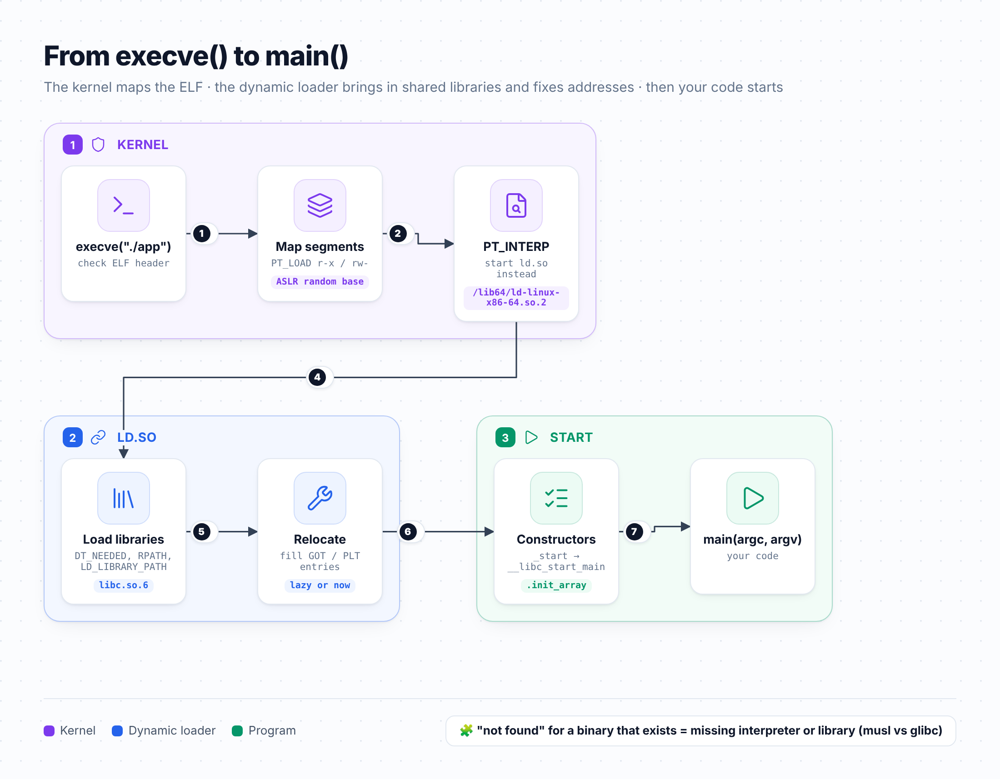

# 4.2 — ELF ve program yükleyici

!!! abstract "Kısaca"
    Linux'ta bir çalıştırılabilir dosya bir **ELF** dosyasıdır: bir başlık, belleğe neyin hangi izinlerle eşleneceğini
    söyleyen **segmentler** ve araçlar için **bölümler**; `execve()` kernel'in bu segmentleri rastgele bir adrese
    (**ASLR**) eşlemesini ve **dinamik yükleyici** `ld.so`'yu başlatmasını sağlar. O da paylaşımlı kütüphaneleri bulur,
    adresleri **GOT/PLT** üzerinden düzeltir, constructor'ları çalıştırır ve sonunda `main()`'i çağırır.

## 📖 Temel terimler ve kısaltmalar

| Terim | Açılımı | Nedir | Nasıl çalışır (tek satır) |
|---|---|---|---|
| **ELF** | Executable and Linkable Format | Çalıştırılabilirler, .o ve .so için Linux/BSD formatı | Sihirli byte'lar `7f 45 4c 46` ("\x7fELF") |
| **ELF başlığı** | ELF header | İlk byte'lar: sınıf, ISA, giriş noktası, tablo konumları | `readelf -h` |
| **Segment (program başlığı)** | — | Yükleyicinin eşlediği şey (PT_LOAD, PT_INTERP, PT_DYNAMIC…) | `readelf -l` |
| **Bölüm** | Section | Araçların/linker'ın kullandığı (.text, .data, .symtab, .debug_*) | `readelf -S` |
| **Giriş noktası** | Entry point | Çalışan ilk komut (`_start`) | `main` değil |
| **PT_INTERP** | program interpreter | Dinamik yükleyicinin yolu | `/lib64/ld-linux-x86-64.so.2` |
| **ld.so** | dynamic linker/loader | Başlangıçta paylaşımlı kütüphaneleri yükler | RPATH, LD_LIBRARY_PATH, ld.so.cache ile ayarlanır |
| **DT_NEEDED** | — | Gerekli kütüphaneler listesi | `readelf -d` |
| **GOT / PLT** | Global Offset Table / Procedure Linkage Table | Kütüphane adresleri için dolaylama tabloları | Tembel ya da başlangıçta doldurulur |
| **ASLR** | Address Space Layout Randomization | Her çalışmada rastgele taban adresler | Exploit'leri zorlaştırır |
| **PIE** | Position-Independent Executable | Her yere yüklenebilen çalıştırılabilir | Tam ASLR için gerekli |
| **RELRO / NX / stack canary** | RELocation Read-Only / No-eXecute | Sıkılaştırma özellikleri | GOT'u, stack'i, veri sayfalarını korur |
| **soname** | shared object name | Kütüphane ABI kimliği (`libssl.so.3`) | Dosya adındaki ana sürüm |
| **LD_PRELOAD** | — | Bir kütüphaneyi önce yüklemeye zorla | Fonksiyonları ez (izleme, mock'lar, saldırılar da) |

## 🗺️ Büyük resim



---

## 1 · Bir ELF dosyasının içinde ne var?

### Nasıl çalışır?

```text
$ readelf -l /usr/bin/ls   (sadeleştirilmiş)
Type     Offset    VirtAddr  Flags  Anlamı
PHDR     ...                 R      program başlıklarının kendisi
INTERP   ...                 R      "/lib64/ld-linux-x86-64.so.2"
LOAD     0x000000  0x000000  R      başlıklar, salt okunur veri
LOAD     0x004000  0x004000  R E    kod (.text)
LOAD     0x01b000  0x01b000  R      sabitler (.rodata)
LOAD     0x022000  0x023000  RW     global'ler (.data, .bss), GOT
DYNAMIC  ...                 RW     gerekli kütüphaneler listesi, sembol tabloları
GNU_STACK                    RW     stack çalıştırılabilir DEĞİL
```

- **Segmentler** kernel'in eşlediği şeylerdir: her `LOAD` tam o izinlerle bir bellek bölgesi olur (kod asla yazılabilir değildir, veri asla çalıştırılabilir değildir).
- **Bölümler** (`.text`, `.rodata`, `.symtab`, `.debug_info`) linker, debugger'lar ve profiler'lar içindir. Programı bozmadan strip edilebilirler.

## 2 · `execve()`: kernel'in kısmı

1. Dosyayı aç, sihirli byte'ları (`\x7fELF`) ya da bir `#!` satırını kontrol et (o zaman onun yerine adı geçen yorumlayıcıyı çalıştır).
2. Eski adres alanını at, yenisini oluştur.
3. Her `PT_LOAD` segmentini **rastgele bir tabana** eşle (binary **PIE** ise ASLR), stack'i `argc`, `argv`, `envp` ve **yardımcı vektörle** (sayfa boyutu, giriş noktası, rastgele byte'lar…) hazırla.
4. Bir `PT_INTERP` varsa **ld.so**'yu da eşle ve *onun* giriş noktasına atla; yoksa (statik binary) doğrudan `_start`'a atla.

## 3 · `ld.so`: dinamik yükleyicinin kısmı

1. `DT_NEEDED`'i oku (ör. `libssl.so.3`, `libc.so.6`) ve her birini ara: binary'deki **RPATH/RUNPATH** → `LD_LIBRARY_PATH` → `/etc/ld.so.cache` → `/lib`, `/usr/lib`.
2. Her kütüphaneyi eşle (her birinin kendi rastgele tabanı var) ve *onların* bağımlılıklarını özyinelemeli yükle.
3. **Relocation:** **GOT**'u dış fonksiyon ve değişkenlerin gerçek adresleriyle doldur. **Tembel bağlamada** çağrılar **PLT** stub'ından geçer ve ilk çağrıda çözülür; `-z now` (tam **RELRO**) ile her şey baştan çözülür ve GOT salt okunur yapılır.
4. Constructor'ları çalıştır (`.init_array`, C++ statik constructor'ları), sonra `_start` → `__libc_start_main` → **`main(argc, argv, envp)`**.

`LD_DEBUG=libs ./app` bu aramanın tamamını yazdırır.

## 4 · Kontrol edebileceğin sıkılaştırma bayrakları

| Özellik | Neye karşı korur | Kontrol |
|---|---|---|
| **PIE + ASLR** | Exploit'lerde sabit kodlanmış adresler | `file` "pie executable" der |
| **NX** (çalıştırılamaz stack/veri) | Enjekte edilmiş shellcode | `E`'siz `GNU_STACK` |
| **Stack canary** | Stack tampon taşmaları | `__stack_chk_fail` sembolü |
| **Tam RELRO** | GOT üzerine yazma | `BIND_NOW` + `GNU_RELRO` |
| **CET (IBT/SHSTK)** | ROP/JOP gadget zincirleri | `endbr64` komutları |
| **FORTIFY_SOURCE** | Güvensiz libc çağrıları | `__*_chk` sembolleri |

Dağıtımlar ve çoğu dil araç zinciri bunları varsayılan olarak açar; elle yazılmış Makefile'lar bazen açmaz.

## 🔧 DevOps bağlantısı

- Var olan bir dosya için **`exec /app: no such file or directory`** = PT_INTERP'teki **yorumlayıcı** imajda yok (Alpine'de glibc binary'si ya da yanlış mimari). `readelf -l` / `file` ile kontrol et.
- **`error while loading shared libraries: libX.so.N`** = bir DT_NEEDED kütüphanesi çalışma imajında eksik (çok aşamalı kopyalamada unutulmuş).
- **`GLIBC_2.38 not found`** = çalışma imajından daha yeni bir dağıtımda derlenmiş. Desteklediğin en eski tabanda derle (ya da statik linkle).
- **Distroless imajlar** sadece yükleyiciyi, libc'yi ve sertifikaları içerir: shell yok, daha küçük saldırı yüzeyi; `kubectl debug` geçici container'larıyla hata ayıkla.
- **`LD_PRELOAD`** profiler'lar/ayırıcılar (jemalloc, tcmalloc) ve saldırganlar tarafından kullanılır; setuid binary'lerde yok sayılır.

## 🧪 Kendin dene

```bash
file /usr/bin/ls
readelf -h /usr/bin/ls | grep -E 'Class|Machine|Type|Entry'
readelf -lW /usr/bin/ls | grep -E 'INTERP|LOAD|GNU_STACK|GNU_RELRO' -A1 | head -20
readelf -d /usr/bin/ls | grep NEEDED
ldd /usr/bin/ls
LD_DEBUG=libs /usr/bin/true 2>&1 | head -15      # yükleyicinin aramasını izle
cat /proc/self/maps | grep -E 'ls|cat|libc|ld-'  # nereye eşlendikleri (iki kez çalıştır: ASLR)
hexdump -C /usr/bin/ls | head -2                 # 7f 45 4c 46 = \x7fELF
# checksec --file=/usr/bin/ls                    # sıkılaştırma özeti (checksec paketi)
```

## 🃏 Hatırlatma kartı

| Araç | Gösterdiği |
|---|---|
| `file` | Mimari, PIE, statik/dinamik, strip edilmiş mi |
| `readelf -h / -l / -S / -d` | Başlık / segmentler / bölümler / dinamik bağımlılıklar |
| `ldd` | Çözülmüş kütüphaneler (güvenilmeyen binary'lerde çalıştırma) |
| `LD_DEBUG=libs` | Yükleyici arama yolu iş başında |
| `nm -D` | Bir kütüphanenin dışa verdiği/ihtiyaç duyduğu dinamik semboller |
| `objdump -d` | Disassembly |

## ❓ Kendini test et

??? question "1. ELF segmentleri ile bölümleri arasındaki fark ne?"
    Segmentler yükleyicinin belleğe neyi hangi izinlerle eşleyeceğini tarif eder; bölümler linker, debugger ve araçlar içindir ve strip edilebilir.

??? question "2. Bir C programında ilk çalışan kod `main` mi?"
    Hayır. Önce ld.so çalışır (dinamik binary'lerde), sonra `_start` → `__libc_start_main` ve constructor'lar, sonra `main`.

??? question "3. Bir container `exec /app: no such file or directory` ile başarısız oluyor ama `/app` var. Neden?"
    Yorumlayıcısı (PT_INTERP, ör. glibc'nin ld-linux'u) imajda yok ya da başka bir mimari için derlenmiş.

??? question "4. ASLR nedir ve neden PIE gerektirir?"
    Kodun, heap'in, stack'in ve kütüphanelerin her çalışmada nereye yükleneceğini rastgele yapmak; çalıştırılabilirin kendisi ancak konumdan bağımsızsa taşınabilir.

??? question "5. Tam RELRO neyi korur?"
    Tüm sembolleri başlangıçta çözer ve GOT'u salt okunur yapar; saldırgan içindeki fonksiyon pointer'larının üzerine yazamaz.

---

## 📚 Kaynaklar

- [man 5 elf](https://man7.org/linux/man-pages/man5/elf.5.html) · [man 8 ld.so](https://man7.org/linux/man-pages/man8/ld.so.8.html) · [man 2 execve](https://man7.org/linux/man-pages/man2/execve.2.html)
- [LWN — How programs get run: ELF binaries](https://lwn.net/Articles/631631/)
- [Ulrich Drepper — How to Write Shared Libraries](https://akkadia.org/drepper/dsohowto.pdf)
- [Google distroless images](https://github.com/GoogleContainerTools/distroless)

## ✍️ Notlarım

> İmajlarından birinin ana binary'sinde `readelf -l` ve `ldd` çalıştır. Hangi yorumlayıcı ve kütüphanelere ihtiyaç duyuyor?
