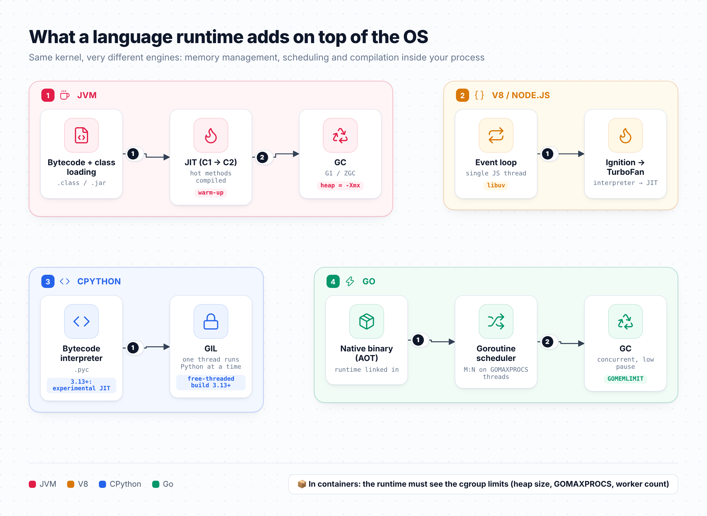
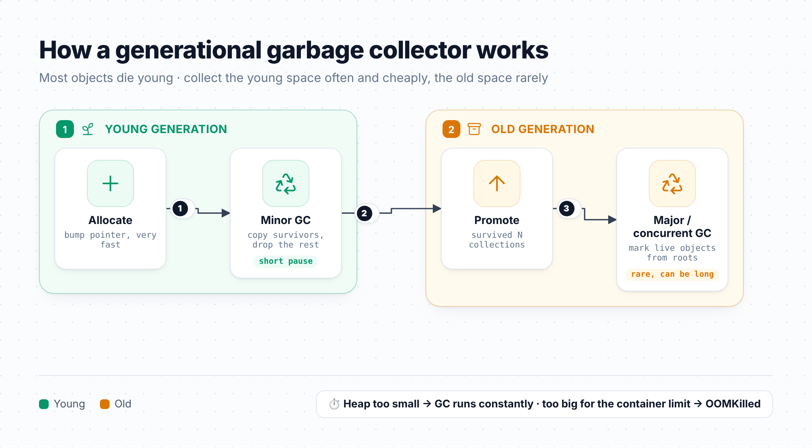

# 4.3 — Language runtimes: JVM, V8, Python, Go

!!! abstract "In one sentence"
    Except for C/C++/Rust, your program doesn't run "alone": a **runtime** lives inside the process and decides how code
    is executed (**interpreter** or **JIT**), how memory is freed (**garbage collector**) and how work is scheduled
    (**threads, event loop, goroutines**); knowing those three choices for the JVM, V8/Node.js, CPython and Go explains
    most of their performance, memory and container-sizing behaviour.

## 📖 Key terms & abbreviations

| Term | Stands for | What it is | How it works (one line) |
|---|---|---|---|
| **Runtime** | — | Code that runs alongside your program | Memory, threads, compilation, standard library |
| **Bytecode** | — | Portable instruction format for a VM | `.class`, `.pyc`, V8 Ignition bytecode |
| **Interpreter** | — | Executes bytecode instruction by instruction | Simple, slower |
| **JIT** | Just-In-Time compiler | Compiles hot code to machine code at run time | Needs warm-up; uses profiling data |
| **AOT** | Ahead-Of-Time | Compile to native before running | Go, Rust, GraalVM native-image |
| **GC** | Garbage Collector | Frees memory no longer reachable | Mark live objects from roots, reclaim the rest |
| **Stop-the-world pause** | — | All app threads paused for GC | Shows up as latency spikes |
| **Generational GC** | — | Separate young and old objects | Most objects die young |
| **GIL** | Global Interpreter Lock | CPython lock: one thread runs Python at a time | Free-threaded builds since 3.13 remove it |
| **Event loop** | — | One thread running callbacks | Node.js (libuv), Python asyncio |
| **Goroutine** | — | Go's lightweight thread (~2 KB stack) | M:N scheduled on OS threads |
| **Virtual threads** | — | JVM lightweight threads (Java 21+) | Blocking code without OS-thread cost |
| **Heap limit** | — | Max managed memory | `-Xmx`, `--max-old-space-size`, `GOMEMLIMIT` |
| **Warm-up** | — | Slow period before JIT optimizes | Affects autoscaling and cold starts |

## 🗺️ Big picture



---

## 1 · Executing code: interpret, JIT or AOT

| Runtime | How code runs | Consequence |
|---|---|---|
| **JVM (HotSpot)** | Interpreter → C1 (quick JIT) → C2 (optimizing JIT) for hot methods | Slow first minute, then very fast; CDS/AOT cache and CRaC reduce warm-up |
| **V8 (Node, Chrome)** | Ignition interpreter → Sparkplug/Maglev → TurboFan optimizing JIT | Deoptimizes if types change ("monomorphic" code is faster) |
| **CPython** | Bytecode interpreter (3.13+ has an experimental JIT) | Pure-Python loops are slow; heavy work goes to C extensions (NumPy, PyTorch) |
| **Go** | AOT-compiled native binary with the runtime linked in | Fast start, no warm-up, predictable |

## 2 · Memory: garbage collection



- **JVM:** G1 (default, balanced), **ZGC** (sub-millisecond pauses, large heaps), Parallel (throughput). Heap = `-Xmx` or `-XX:MaxRAMPercentage`. Plus off-heap: metaspace, thread stacks, direct buffers, code cache.
- **V8:** generational (Scavenger for young, Mark-Compact for old), `--max-old-space-size` (MB). Exceeding it → "JavaScript heap out of memory".
- **CPython:** **reference counting** (objects freed immediately when the count hits 0) + a cycle collector. Memory often isn't returned to the OS (fragmentation).
- **Go:** concurrent, non-generational mark-and-sweep, very short pauses. Tunables: `GOGC` (how much growth before the next GC) and **`GOMEMLIMIT`** (soft memory limit, set it ~90% of the container limit).

## 3 · Concurrency models

| Runtime | Model | Parallel CPU use? |
|---|---|---|
| **JVM** | OS threads + **virtual threads** (Java 21+) | Yes, all cores |
| **Node.js** | One JS thread + event loop; libuv thread pool for fs/DNS/crypto | Only via worker threads or multiple processes (cluster/pods) |
| **CPython** | OS threads but the **GIL** lets one run Python at a time; asyncio for I/O | Multiprocessing, C extensions, or the free-threaded 3.13+ build |
| **Go** | **Goroutines** on `GOMAXPROCS` OS threads, netpoller for I/O | Yes, all `GOMAXPROCS` |

A blocking call (sync file read, CPU-heavy JSON parse) on Node's event loop freezes **every** request on that process.

## 4 · Runtimes in containers

The runtime must see the **cgroup limits**, not the host:

| Runtime | CPU | Memory |
|---|---|---|
| **JVM** (≥ 11) | Container-aware: derives CPU count from cgroup (override `-XX:ActiveProcessorCount`) | `-XX:MaxRAMPercentage=75` (default is only 25%) |
| **Go** (≥ 1.25) | `GOMAXPROCS` follows the cgroup CPU limit by default | `GOMEMLIMIT` ≈ 90% of the limit |
| **Node.js** | One thread anyway; scale with replicas | `--max-old-space-size` ≈ 75% of the limit |
| **Python** | Worker count (gunicorn/uvicorn) from limit, not `os.cpu_count()` | Watch RSS growth; restart workers (`max_requests`) |

## 🔧 DevOps connection

- **Warm-up vs autoscaling:** new JVM pods are slow for a minute; use readiness probes that pass only when warm, startup probes, gradual traffic shifting, or AOT/CDS/CRaC.
- **OOMKilled with "plenty" of heap left** → off-heap memory (JVM metaspace/threads, native libs, Python C extensions) exceeded the container limit.
- **GC pauses as p99 spikes** → GC logs (`-Xlog:gc`, `GODEBUG=gctrace=1`, `--trace-gc`), right-size heap, choose a low-pause GC.
- **Node.js CPU at 100% on one core of a 4-core pod** → it can only use one; run more, smaller pods.
- **Python web servers:** process-based workers (gunicorn), async (uvicorn), and careful worker counts per pod.

## 🧪 Try it yourself

```bash
# JVM: what does it think its limits are inside a container?
docker run --rm -m 512m --cpus 2 eclipse-temurin:21-jre \
  java -XX:+PrintFlagsFinal -version 2>/dev/null | grep -E 'MaxHeapSize|ActiveProcessorCount|UseG1GC'

# Node: heap limit
docker run --rm -m 512m node:22-alpine node -e "console.log(require('v8').getHeapStatistics().heap_size_limit/1048576,'MB')"

# Python: the GIL in action (threads don't speed up CPU work)
python3 - <<'PYEOF'
import time, threading
def work(): sum(i*i for i in range(5_000_000))
t=time.time(); work(); work(); print("sequential", round(time.time()-t,2))
t=time.time(); a=[threading.Thread(target=work) for _ in range(2)]; [x.start() for x in a]; [x.join() for x in a]
print("2 threads ", round(time.time()-t,2))
PYEOF

# Go: GC trace
# GODEBUG=gctrace=1 ./your-go-app
```

## 🃏 Cheat sheet

| | JVM | Node.js | CPython | Go |
|---|---|---|---|---|
| Execution | JIT | JIT | Interpreter | AOT |
| GC | G1 / ZGC | Generational | Refcount + cycles | Concurrent M&S |
| Uses all cores | ✅ | ❌ (1 JS thread) | ❌ (GIL) / ✅ processes | ✅ |
| Memory knob | `MaxRAMPercentage` | `--max-old-space-size` | worker count | `GOMEMLIMIT` |
| Warm-up | Yes | Some | No | No |

## ❓ Test yourself

??? question "1. Why are JVM services slow for the first minute after a deploy?"
    Code starts interpreted; the JIT compiles hot methods only after profiling them (warm-up).

??? question "2. Why doesn't adding threads speed up CPU-bound pure-Python code?"
    The GIL lets only one thread execute Python bytecode at a time (except in the free-threaded build).

??? question "3. A Node.js pod has a 4-CPU limit but never goes above 1 CPU. Why?"
    JavaScript runs on one thread; use worker threads or more, smaller replicas.

??? question "4. What should GOMEMLIMIT be set to in a container with a 1 GiB limit, and why?"
    Around 900 MiB: the GC then works harder before reaching the limit, avoiding OOMKills, while leaving headroom for non-heap memory.

??? question "5. The JVM's default max heap is 25% of the container memory. What do you change?"
    Set `-XX:MaxRAMPercentage` (e.g. 70–75%), leaving room for off-heap memory.

---

## 📚 Sources

- [OpenJDK — HotSpot GC tuning guide](https://docs.oracle.com/en/java/javase/21/gctuning/)
- [V8 blog](https://v8.dev/blog) · [Node.js — Don't block the event loop](https://nodejs.org/en/learn/asynchronous-work/dont-block-the-event-loop)
- [Python — Free-threaded CPython (PEP 703)](https://peps.python.org/pep-0703/)
- [Go — A Guide to the Go Garbage Collector](https://go.dev/doc/gc-guide)

## ✍️ My notes

> For your main service: which runtime, which GC, what heap limit vs container limit, and how many cores can it really use?

-
