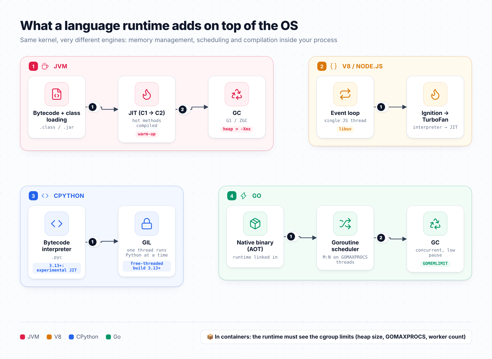
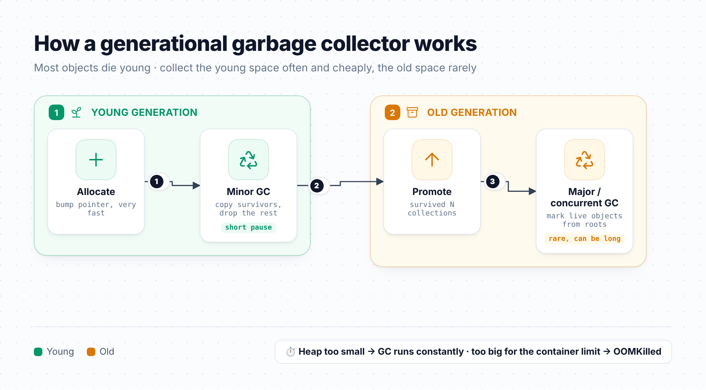

# 4.3 — Dil runtime'ları: JVM, V8, Python, Go

!!! abstract "Kısaca"
    C/C++/Rust dışında programın "tek başına" çalışmaz: process'in içinde bir **runtime** yaşar. Runtime kodun nasıl
    çalışacağına (**yorumlayıcı** ya da **JIT**), belleğin nasıl boşaltılacağına (**çöp toplayıcı**) ve işin nasıl
    zamanlanacağına (**thread'ler, event loop, goroutine'ler**) karar verir. JVM, V8/Node.js, CPython ve Go için bu üç
    seçimi bilmek, performanslarını, bellek kullanımlarını ve container boyutlarını büyük ölçüde açıklar.

## 📖 Temel terimler ve kısaltmalar

| Terim | Açılımı | Nedir | Nasıl çalışır (tek satır) |
|---|---|---|---|
| **Runtime** | — | Programınla birlikte çalışan kod | Bellek, thread'ler, derleme, standart kütüphane |
| **Bytecode** | — | Bir VM için taşınabilir komut formatı | `.class`, `.pyc`, V8 Ignition bytecode'u |
| **Yorumlayıcı** | Interpreter | Bytecode'u komut komut çalıştırır | Basit, daha yavaş |
| **JIT** | Just-In-Time compiler | Sıcak kodu çalışma anında makine koduna derler | Isınma ister; profil verisi kullanır |
| **AOT** | Ahead-Of-Time | Çalıştırmadan önce native'e derle | Go, Rust, GraalVM native-image |
| **GC** | Garbage Collector | Artık erişilemeyen belleği boşaltır | Köklerden canlı nesneleri işaretle, gerisini geri al |
| **Stop-the-world duraklaması** | — | GC için tüm uygulama thread'leri durur | Gecikme sıçramaları olarak görünür |
| **Nesilsel GC** | Generational GC | Genç ve yaşlı nesneleri ayır | Çoğu nesne genç ölür |
| **GIL** | Global Interpreter Lock | CPython kilidi: aynı anda tek thread Python çalıştırır | 3.13'ten beri free-threaded build'ler kaldırır |
| **Event loop** | — | Callback'leri çalıştıran tek thread | Node.js (libuv), Python asyncio |
| **Goroutine** | — | Go'nun hafif thread'i (~2 KB stack) | OS thread'leri üzerinde M:N zamanlanır |
| **Sanal thread'ler** | Virtual threads | JVM hafif thread'leri (Java 21+) | OS thread maliyeti olmadan bloklayan kod |
| **Heap limiti** | — | Azami yönetilen bellek | `-Xmx`, `--max-old-space-size`, `GOMEMLIMIT` |
| **Isınma** | Warm-up | JIT optimize edene kadarki yavaş dönem | Otomatik ölçeklemeyi ve soğuk başlangıçları etkiler |

## 🗺️ Büyük resim



---

## 1 · Kodu çalıştırmak: yorumla, JIT ya da AOT

| Runtime | Kod nasıl çalışır | Sonucu |
|---|---|---|
| **JVM (HotSpot)** | Yorumlayıcı → C1 (hızlı JIT) → sıcak metotlar için C2 (optimize eden JIT) | İlk dakika yavaş, sonra çok hızlı; CDS/AOT önbelleği ve CRaC ısınmayı azaltır |
| **V8 (Node, Chrome)** | Ignition yorumlayıcı → Sparkplug/Maglev → TurboFan optimize eden JIT | Tipler değişirse deoptimize eder ("monomorfik" kod daha hızlı) |
| **CPython** | Bytecode yorumlayıcı (3.13+'ta deneysel JIT var) | Saf Python döngüleri yavaş; ağır iş C eklentilerine gider (NumPy, PyTorch) |
| **Go** | Runtime'ı içine linklenmiş AOT derlenmiş native binary | Hızlı başlangıç, ısınma yok, öngörülebilir |

## 2 · Bellek: çöp toplama



- **JVM:** G1 (varsayılan, dengeli), **ZGC** (milisaniye altı duraklamalar, büyük heap'ler), Parallel (throughput). Heap = `-Xmx` ya da `-XX:MaxRAMPercentage`. Artı heap dışı: metaspace, thread stack'leri, direct buffer'lar, kod önbelleği.
- **V8:** nesilsel (genç için Scavenger, yaşlı için Mark-Compact), `--max-old-space-size` (MB). Aşınca → "JavaScript heap out of memory".
- **CPython:** **referans sayma** (sayı 0'a inince nesneler hemen boşaltılır) + bir döngü toplayıcı. Bellek çoğu zaman işletim sistemine geri verilmez (parçalanma).
- **Go:** eşzamanlı, nesilsel olmayan mark-and-sweep, çok kısa duraklamalar. Ayarlar: `GOGC` (bir sonraki GC'den önce ne kadar büyüme) ve **`GOMEMLIMIT`** (yumuşak bellek limiti; container limitinin ~%90'ına ayarla).

## 3 · Eşzamanlılık modelleri

| Runtime | Model | Paralel CPU kullanımı? |
|---|---|---|
| **JVM** | OS thread'leri + **sanal thread'ler** (Java 21+) | Evet, tüm çekirdekler |
| **Node.js** | Tek JS thread'i + event loop; fs/DNS/kripto için libuv thread havuzu | Sadece worker thread'ler ya da çoklu process'lerle (cluster/pod'lar) |
| **CPython** | OS thread'leri ama **GIL** aynı anda birinin Python çalıştırmasına izin verir; I/O için asyncio | Multiprocessing, C eklentileri ya da free-threaded 3.13+ build |
| **Go** | `GOMAXPROCS` OS thread'i üzerinde **goroutine'ler**, I/O için netpoller | Evet, tüm `GOMAXPROCS` |

Node'un event loop'undaki bloklayan bir çağrı (senkron dosya okuma, CPU yoğun JSON ayrıştırma) o process'teki **her** isteği dondurur.

## 4 · Container'larda runtime'lar

Runtime host'u değil **cgroup limitlerini** görmeli:

| Runtime | CPU | Bellek |
|---|---|---|
| **JVM** (≥ 11) | Container farkında: CPU sayısını cgroup'tan türetir (`-XX:ActiveProcessorCount` ile ez) | `-XX:MaxRAMPercentage=75` (varsayılan sadece %25) |
| **Go** (≥ 1.25) | `GOMAXPROCS` varsayılan olarak cgroup CPU limitini takip eder | `GOMEMLIMIT` ≈ limitin %90'ı |
| **Node.js** | Zaten tek thread; replica'larla ölçekle | `--max-old-space-size` ≈ limitin %75'i |
| **Python** | Worker sayısı (gunicorn/uvicorn) `os.cpu_count()`'tan değil limitten | RSS büyümesini izle; worker'ları yeniden başlat (`max_requests`) |

## 🔧 DevOps bağlantısı

- **Isınma ve otomatik ölçekleme:** yeni JVM pod'ları bir dakika yavaştır; sadece ısınınca geçen readiness probe'ları, startup probe'ları, kademeli trafik kaydırma ya da AOT/CDS/CRaC kullan.
- **Heap'te "bolca" yer varken OOMKilled** → heap dışı bellek (JVM metaspace/thread'ler, native kütüphaneler, Python C eklentileri) container limitini aştı.
- **p99 sıçramaları olarak GC duraklamaları** → GC logları (`-Xlog:gc`, `GODEBUG=gctrace=1`, `--trace-gc`), heap'i doğru boyutla, düşük duraklamalı bir GC seç.
- **4 çekirdekli bir pod'un tek çekirdeğinde %100 CPU'da Node.js** → sadece birini kullanabilir; daha çok, daha küçük pod çalıştır.
- **Python web sunucuları:** process tabanlı worker'lar (gunicorn), async (uvicorn) ve pod başına dikkatli worker sayıları.

## 🧪 Kendin dene

```bash
# JVM: container içinde limitlerini ne sanıyor?
docker run --rm -m 512m --cpus 2 eclipse-temurin:21-jre \
  java -XX:+PrintFlagsFinal -version 2>/dev/null | grep -E 'MaxHeapSize|ActiveProcessorCount|UseG1GC'

# Node: heap limiti
docker run --rm -m 512m node:22-alpine node -e "console.log(require('v8').getHeapStatistics().heap_size_limit/1048576,'MB')"

# Python: GIL iş başında (thread'ler CPU işini hızlandırmaz)
python3 - <<'PYEOF'
import time, threading
def work(): sum(i*i for i in range(5_000_000))
t=time.time(); work(); work(); print("sıralı   ", round(time.time()-t,2))
t=time.time(); a=[threading.Thread(target=work) for _ in range(2)]; [x.start() for x in a]; [x.join() for x in a]
print("2 thread ", round(time.time()-t,2))
PYEOF

# Go: GC izi
# GODEBUG=gctrace=1 ./go-uygulaman
```

## 🃏 Hatırlatma kartı

| | JVM | Node.js | CPython | Go |
|---|---|---|---|---|
| Çalıştırma | JIT | JIT | Yorumlayıcı | AOT |
| GC | G1 / ZGC | Nesilsel | Refcount + döngüler | Eşzamanlı M&S |
| Tüm çekirdekleri kullanır | ✅ | ❌ (1 JS thread) | ❌ (GIL) / ✅ process'ler | ✅ |
| Bellek ayarı | `MaxRAMPercentage` | `--max-old-space-size` | worker sayısı | `GOMEMLIMIT` |
| Isınma | Var | Biraz | Yok | Yok |

## ❓ Kendini test et

??? question "1. JVM servisleri deploy'dan sonraki ilk dakika neden yavaştır?"
    Kod yorumlanarak başlar; JIT sıcak metotları ancak onları profilledikten sonra derler (ısınma).

??? question "2. Thread eklemek CPU yoğun saf Python kodunu neden hızlandırmaz?"
    GIL aynı anda sadece bir thread'in Python bytecode'u çalıştırmasına izin verir (free-threaded build hariç).

??? question "3. Bir Node.js pod'unun 4 CPU limiti var ama hiç 1 CPU'nun üstüne çıkmıyor. Neden?"
    JavaScript tek thread'de çalışır; worker thread'ler ya da daha çok, daha küçük replica kullan.

??? question "4. 1 GiB limitli bir container'da GOMEMLIMIT ne olmalı, neden?"
    900 MiB civarı: GC limite ulaşmadan önce daha çok çalışır, OOMKill'den kaçınır ve heap dışı bellek için pay bırakır.

??? question "5. JVM'in varsayılan azami heap'i container belleğinin %25'i. Neyi değiştirirsin?"
    `-XX:MaxRAMPercentage`'ı ayarla (ör. %70–75), heap dışı bellek için yer bırak.

---

## 📚 Kaynaklar

- [OpenJDK — HotSpot GC tuning guide](https://docs.oracle.com/en/java/javase/21/gctuning/)
- [V8 blog](https://v8.dev/blog) · [Node.js — Don't block the event loop](https://nodejs.org/en/learn/asynchronous-work/dont-block-the-event-loop)
- [Python — Free-threaded CPython (PEP 703)](https://peps.python.org/pep-0703/)
- [Go — A Guide to the Go Garbage Collector](https://go.dev/doc/gc-guide)

## ✍️ Notlarım

> Ana servisin için: hangi runtime, hangi GC, container limitine karşı heap limiti ne ve gerçekte kaç çekirdek kullanabiliyor?
