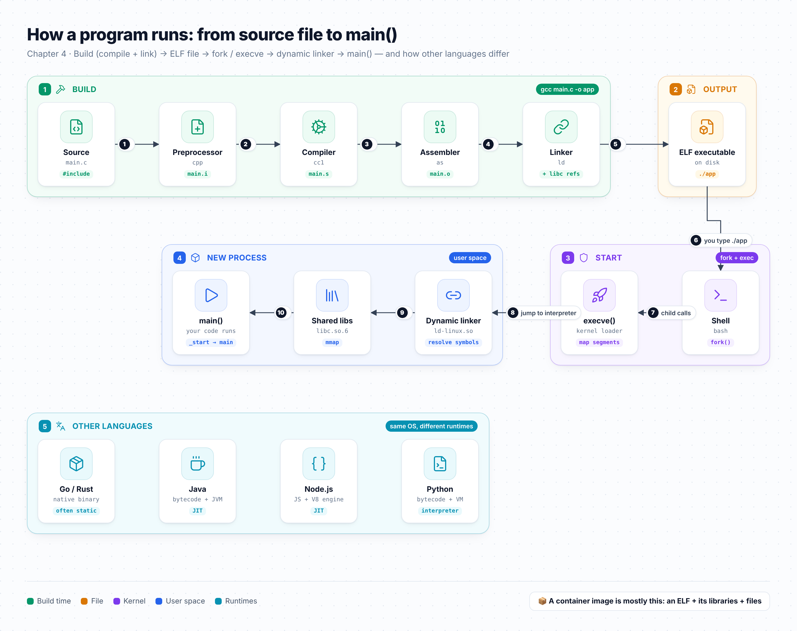
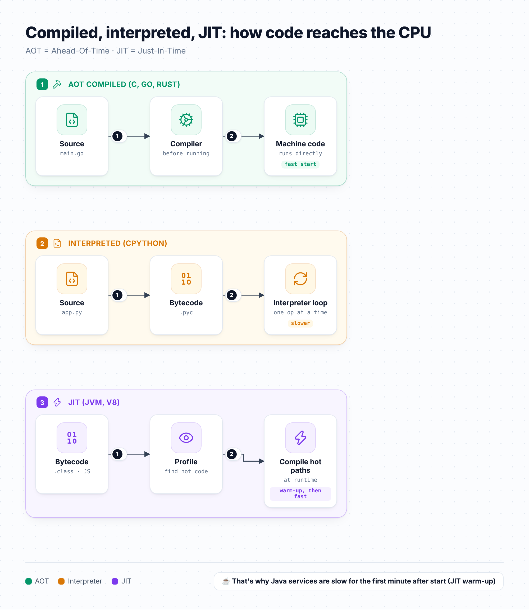

# Chapter 4 — How a program runs

!!! abstract "In one sentence"
    A toolchain turns your source code into an **ELF** file on disk. When you type `./app`, the shell **forks**,
    the child calls **`execve`**, the kernel **maps** the file into a fresh address space, the **dynamic linker**
    pulls in shared libraries, and finally your **`main()`** runs. Java, Python and Node.js add a **runtime/VM** in between.

## 📖 Key terms & abbreviations

| Term | Stands for | What it is | How it works (one line) |
|---|---|---|---|
| **Compiler** | — | Translates source code to assembly/machine code | Parses, type-checks, optimizes, emits code |
| **Preprocessor** | — | Text-level step before compiling (C/C++) | Expands #include and #define |
| **Assembler** | — | Assembly → object file | Encodes instructions into bytes, records symbols |
| **Linker** | — | Combines object files and libraries | Resolves symbols, writes the executable |
| **ELF** | Executable and Linkable Format | Linux's binary file format | Header + segments to load + sections |
| **Static / dynamic linking** | — | Copy libraries in / load them at start | Dynamic: ld.so maps .so files and fixes addresses |
| **ld.so** | dynamic linker/loader | Program that loads shared libraries | Named in PT_INTERP, runs before main() |
| **fork / execve** | — | Copy the process / replace its program | Shell forks a child, child execs the new program |
| **libc** | C standard library | Wrappers for syscalls + standard functions | printf, malloc, open → syscalls underneath |
| **Bytecode** | — | Portable intermediate code for a VM | Run by an interpreter or JIT (JVM, CPython, V8) |
| **JIT / AOT** | Just-In-Time / Ahead-Of-Time | Compile while running / before running | JIT compiles hot code at runtime; AOT produces native binaries |
| **VM** | Virtual Machine (language runtime) | Runtime executing bytecode | JVM, CPython VM, V8 engine |

## 🗺️ Big picture



---

## 1 · Build: from `main.c` to an executable

```bash
gcc main.c -o app        # one command, four stages:
```

| # | Stage | Tool | Input → output | What it does |
|---|---|---|---|---|
| 1 | Preprocess | `cpp` | `main.c` → `main.i` | Pastes `#include` files in, expands `#define` macros. Still C. |
| 2 | Compile | `cc1` | `main.i` → `main.s` | C → assembly. Type checks, **optimizations** (`-O2`) happen here. |
| 3 | Assemble | `as` | `main.s` → `main.o` | Assembly → machine code. Calls to `printf` are left as **unresolved symbols** ("fill this address in later"). |
| 4 | Link | `ld` | `main.o` + libs → `app` | Combines object files, **resolves symbols**, writes the final ELF. |

**Static vs dynamic linking**

| | Static | Dynamic (default for C on Linux) |
|---|---|---|
| Library code | Copied **into** the binary | Loaded at start from `libc.so.6` |
| Binary size | Larger | Smaller |
| Security updates | Rebuild everything | Update the `.so`, all programs benefit |
| Runs on a minimal system | Yes, even `FROM scratch` | Needs the right libraries present |

> DevOps connection: Go builds static binaries by default (with `CGO_ENABLED=0`), which is why Go apps fit in tiny `scratch` or `distroless` images.

## 2 · The ELF file

**ELF** (Executable and Linkable Format) is the file format for programs on Linux. It starts with the magic bytes `7f 45 4c 46` (`.ELF`).

| Part | Contains |
|---|---|
| **ELF header** | Architecture (x86-64, arm64), **entry point** address |
| **Program headers (segments)** | What to load where: code (`R-X`), data (`RW-`), plus `PT_INTERP` = path of the dynamic linker |
| **Sections** | `.text` (code), `.rodata` (constants, strings), `.data` (initialized globals), `.bss` (zeroed globals), `.dynamic` (needed libraries) |

## 3 · Start: `./app`

| # | Step |
|---|---|
| 6 | You type `./app`. The shell calls **`fork()`**: a copy of the shell process is created (cheaply, with copy-on-write, Chapter 3). |
| 7 | The child calls **`execve("./app", argv, envp)`**. The kernel checks permissions, reads the ELF header, throws away the shell's memory, **maps the segments** into a new address space and builds the initial **stack** (`argc`, `argv`, environment variables, auxiliary vector). |
| 8 | Because the ELF has a `PT_INTERP` entry, the kernel first jumps to the **dynamic linker** `/lib64/ld-linux-x86-64.so.2`, not to your code. |

## 4 · Inside the new process

| # | Step |
|---|---|
| 9 | The dynamic linker reads the `NEEDED` list (`libc.so.6`, …), finds the libraries, **`mmap`s** them in, and fixes up addresses (relocations, GOT/PLT). |
| 10 | It jumps to the program's entry point `_start`, which calls `__libc_start_main`, which calls **`main(argc, argv)`**. |
| — | When `main` returns, `exit()` flushes buffers and calls the **`exit_group`** syscall. The parent shell receives `SIGCHLD`, collects the exit code with `wait()`, and you see it as `$?`. |

!!! tip "Remember this"
    A running program = **kernel loader (`execve`) + dynamic linker (`ld.so`) + libraries + your code**.
    Two classic container errors come from this chain:
    `exec format error` = the binary is for a different CPU architecture (arm64 vs amd64), and
    `no such file or directory` for a file that clearly exists = its **dynamic linker** is missing (e.g. a glibc binary on Alpine, which uses musl).

## 5 · Other languages: same OS, different runtimes

| Language | What you ship | What runs | Speed trick |
|---|---|---|---|
| **C / C++ / Rust / Go** | Native ELF binary | The CPU directly | Ahead-of-time (AOT) compilation |
| **Java / Kotlin** | `.class`/`.jar` bytecode | The **JVM** (itself an ELF) interprets bytecode | **JIT**: hot methods are compiled to machine code at runtime (HotSpot) |
| **JavaScript (Node.js)** | `.js` source | **V8** parses to bytecode (Ignition) | **JIT**: hot functions are optimized to machine code (TurboFan) |
| **Python** | `.py` source | **CPython** compiles to bytecode (`.pyc`) and runs it in an interpreter loop | Mostly interpreted, so CPU-heavy work goes to C extensions (NumPy, PyTorch) |

> In every case, what the kernel actually starts with `execve` is an ELF: your binary, or `java`, `node`, `python3`.

### How do AOT, interpreters and JIT differ?

**AOT** compilers (C, Go, Rust) produce machine code before you run it: fast start, nothing to warm up. **Interpreters** (CPython) execute bytecode one instruction at a time: flexible but slower. **JIT** runtimes (JVM, V8) start interpreting, profile which code is hot, then compile just that to machine code while running.



---

## 🚨 Incident story: “no such file or directory” for a file that exists

!!! failure "The alarm"
    To shrink images, a team switches the runtime stage from `debian:bookworm-slim` to `alpine`. The new pods crash-loop with `exec /app/server: no such file or directory`, yet `ls -l /app/server` inside the image shows the file.

Try to diagnose it yourself first, then open the clues one by one.

??? info "🔍 Clue 1"
    `file /app/server` → *dynamically linked, interpreter /lib64/ld-linux-x86-64.so.2*.

??? info "🔍 Clue 2"
    `ls /lib64/ld-linux-x86-64.so.2` in the Alpine image → missing. Alpine uses musl and its loader is `/lib/ld-musl-x86_64.so.1`.

??? success "🎯 Root cause"
    `execve` succeeds in finding the file, but the kernel must start the ELF's **interpreter** (PT_INTERP) first, and that path doesn't exist. The error refers to the missing loader, not to your binary.

??? tip "🛠️ Fix and lesson"
    Build statically (`CGO_ENABLED=0` for Go, musl targets for Rust), or use a glibc-based slim/distroless base. **Lesson:** a dynamic binary drags its loader and libc ABI with it; check with `readelf -l` and `ldd`.

## 🧭 Go deeper

| Page | What's inside |
|---|---|
| **[4.1 — Compiling & linking](01-compile-link.md)** | What compilers do inside (front end, IR, optimizer, back end), optimization levels, object files and symbols, static vs dynamic linking, LTO, cross-compilation, reproducible builds and build caching, with Go, Rust and C examples. |
| **[4.2 — ELF & the program loader](02-elf-loader.md)** | The ELF file format (header, segments, sections), what execve does, ASLR and PIE, the dynamic loader ld.so, library search paths, PLT/GOT and lazy binding, LD_PRELOAD, security hardening flags, and the classic "not found" and "symbol not found" errors. |
| **[4.3 — Language runtimes: JVM, V8, Python, Go](03-runtimes.md)** | What a language runtime adds to a process - interpreters and JIT compilers, garbage collection, threading models (GIL, event loop, goroutines, virtual threads) - and how to size and tune JVM, Node.js, Python and Go services in containers. |

## 🧪 Try it yourself (Linux)

!!! example "🧪 Ready-made lab"
    Run this chapter's experiments with one command: `./labs/run.sh 04-program` ([scripts](https://github.com/gaskinimbuspro/silicon-to-cloud/tree/main/labs/04-program/)). No setup? [Open in Codespaces](https://codespaces.new/gaskinimbuspro/silicon-to-cloud). <!-- s2c-lab -->


```bash
cat > main.c <<'EOF'
#include <stdio.h>
int main(void) { printf("hello\n"); return 0; }
EOF

# 1) The four stages, one at a time
gcc -E main.c -o main.i && wc -l main.i     # preprocessed: hundreds of lines
gcc -S main.c && cat main.s                 # assembly
gcc -c main.c && nm main.o                  # 'U puts' = undefined symbol
gcc main.o -o app && ./app

# 2) Look inside the ELF
file app
readelf -h app | grep -E "Class|Machine|Entry"
readelf -l app | grep -A1 INTERP            # the dynamic linker path
ldd app                                     # shared libraries it needs

# 3) Watch the start-up
strace -f -e trace=execve,openat,mmap ./app
LD_DEBUG=libs ./app 2>&1 | head

# 4) Other runtimes
file $(which python3) $(which node) 2>/dev/null   # interpreters are ELF too
python3 -c "import dis; dis.dis(lambda a, b: a + b)"
```

**Exercise:** build once with `gcc main.c -o app` and once with `gcc -static main.c -o app-static`. Compare `ls -lh`, `ldd` and `readelf -l | grep INTERP` for both.

---

## 🃏 Cheat sheet

```text
main.c → cpp (main.i) → cc1 (main.s) → as (main.o) → ld (+libc) → ELF ./app
./app → shell fork() → child execve() → kernel maps ELF segments + builds stack
      → PT_INTERP: ld-linux.so → mmap libc.so → relocations → _start → main()
      → return → exit_group → parent wait() → $?
JVM / V8 / CPython = an ELF that runs bytecode, often with a JIT
```

---

## ❓ Test yourself

??? question "1. At which stage does `printf` get its real address?"
    Not in the compiler or assembler. Those leave an undefined symbol. With static linking the linker fills it in; with dynamic linking the **dynamic linker** resolves it at start-up (or lazily on first call).

??? question "2. What's the difference between `fork()` and `execve()`?"
    `fork()` creates a new process that is a copy of the current one. `execve()` replaces the current process's program with a new one (same PID, new memory). Starting a program = fork + execve.

??? question "3. Your image runs fine on your laptop but fails on the cluster with `exec format error`. Why?"
    The binary was built for a different CPU architecture, e.g. arm64 (Apple Silicon) vs amd64 nodes. Build multi-arch images (`docker buildx --platform linux/amd64,linux/arm64`).

??? question "4. Why can a Go binary run in a `FROM scratch` image but a typical C program can't?"
    A static Go binary contains everything it needs and has no `PT_INTERP`. A dynamically linked C program needs `ld-linux.so` and `libc.so.6`, which a `scratch` image doesn't have.

??? question "5. What does a JIT compiler do?"
    It watches which code runs often ("hot") and compiles that bytecode into native machine code while the program is running, so those parts run at near-native speed.

---

## 📚 Sources

- [Computer Systems: A Programmer's Perspective (CS:APP), Chapter 7: Linking](https://csapp.cs.cmu.edu/)
- [man7.org: execve(2)](https://man7.org/linux/man-pages/man2/execve.2.html) · [ld.so(8)](https://man7.org/linux/man-pages/man8/ld.so.8.html) · [elf(5)](https://man7.org/linux/man-pages/man5/elf.5.html)
- [How programs get run: ELF binaries (LWN.net)](https://lwn.net/Articles/631631/)
- [V8 blog](https://v8.dev/blog) · [Python `dis` module](https://docs.python.org/3/library/dis.html)

## ✍️ My notes

> Explain what happens between typing `./app` and `main()` running, in your own words in 5 lines.

-
