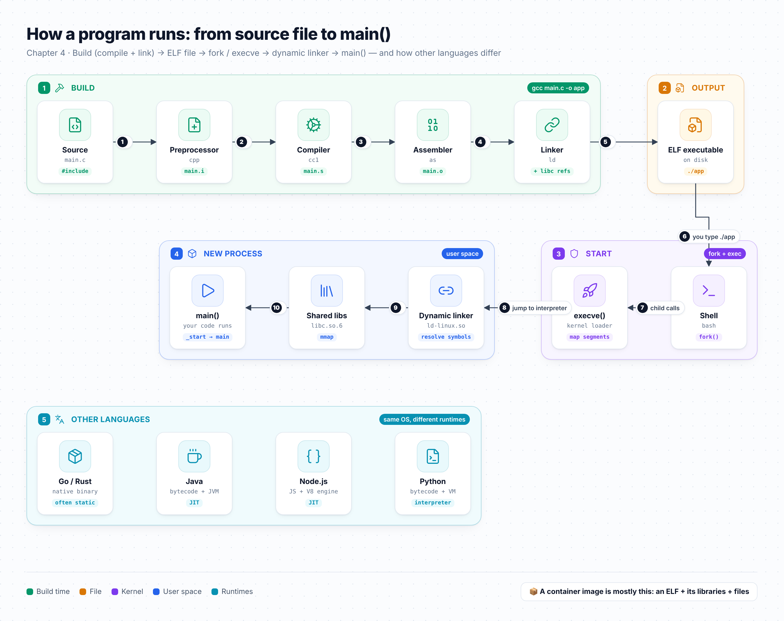
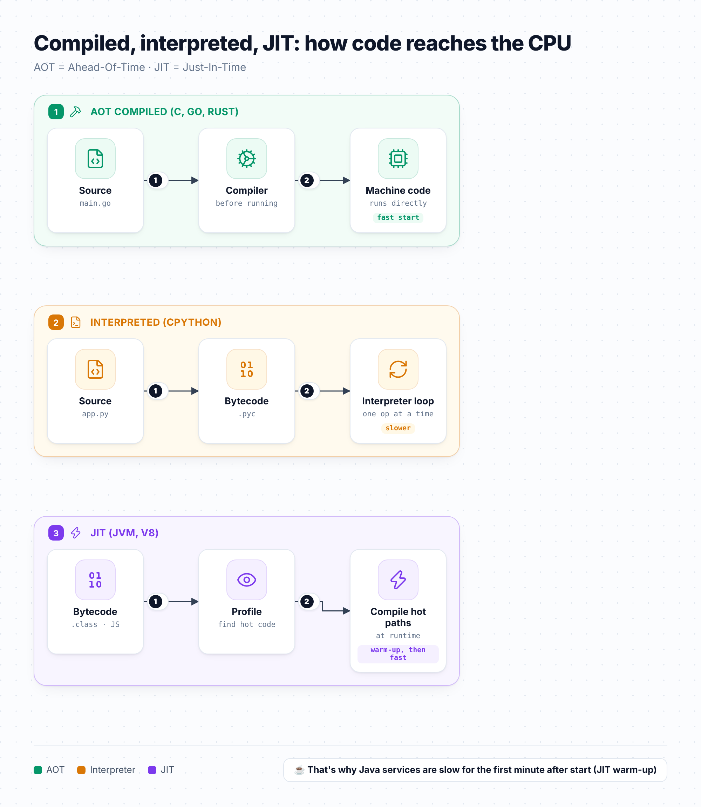

# Bölüm 4 — Bir program nasıl çalışır

!!! abstract "Tek cümlede"
    Bir derleme zinciri (toolchain) kaynak kodunu diskte bir **ELF** dosyasına çevirir. `./app` yazdığında shell **fork** eder,
    çocuk process **`execve`** çağırır, kernel dosyayı yepyeni bir adres alanına **eşler (map)**, **dinamik bağlayıcı**
    paylaşımlı kütüphaneleri yükler ve sonunda senin **`main()`** fonksiyonun çalışır. Java, Python ve Node.js araya bir **runtime/VM** ekler.

## 📖 Temel terimler ve kısaltmalar

| Terim | Açılımı | Nedir | Nasıl çalışır (tek satır) |
|---|---|---|---|
| **Compiler** | — | Kaynak kodu assembly/makine koduna çevirir | Ayrıştırır, tip kontrol eder, optimize eder, kod üretir |
| **Preprocessor** | — | Derlemeden önceki metin düzeyi adım (C/C++) | #include ve #define'ı açar |
| **Assembler** | — | Assembly → object dosyası | Komutları byte'lara kodlar, sembolleri kaydeder |
| **Linker** | — | Object dosyalarını ve kütüphaneleri birleştirir | Sembolleri çözer, çalıştırılabilir dosyayı yazar |
| **ELF** | Executable and Linkable Format | Linux'un binary dosya formatı | Başlık + yüklenecek segmentler + bölümler |
| **Static / dynamic linking** | — | Kütüphaneleri içine kopyala / başlangıçta yükle | Dinamik: ld.so .so dosyalarını eşler ve adresleri düzeltir |
| **ld.so** | dynamic linker/loader | Paylaşımlı kütüphaneleri yükleyen program | PT_INTERP'te adı geçer, main()'den önce çalışır |
| **fork / execve** | — | Process'i kopyala / programını değiştir | Shell bir çocuk fork eder, çocuk yeni programı exec eder |
| **libc** | C standard library | Syscall sarmalayıcıları + standart fonksiyonlar | printf, malloc, open → altta syscall'lar |
| **Bytecode** | — | Bir VM için taşınabilir ara kod | Bir yorumlayıcı ya da JIT çalıştırır (JVM, CPython, V8) |
| **JIT / AOT** | Just-In-Time / Ahead-Of-Time | Çalışırken / çalışmadan önce derlemek | JIT sıcak kodu çalışma anında, AOT native binary üretir |
| **VM** | Virtual Machine (language runtime) | Bytecode çalıştıran runtime | JVM, CPython VM, V8 motoru |

## 🗺️ Büyük resim



---

## 1 · Derleme: `main.c`'den çalıştırılabilir dosyaya

```bash
gcc main.c -o app        # tek komut, dört aşama:
```

| # | Aşama | Araç | Girdi → çıktı | Ne yapar |
|---|---|---|---|---|
| 1 | Önişleme | `cpp` | `main.c` → `main.i` | `#include` dosyalarını içeri yapıştırır, `#define` makrolarını açar. Hâlâ C'dir. |
| 2 | Derleme | `cc1` | `main.i` → `main.s` | C → assembly. Tip kontrolleri ve **optimizasyonlar** (`-O2`) burada olur. |
| 3 | Assemble | `as` | `main.s` → `main.o` | Assembly → makine kodu. `printf` çağrıları **çözülmemiş sembol** olarak bırakılır ("bu adresi sonra doldur"). |
| 4 | Bağlama (link) | `ld` | `main.o` + kütüphaneler → `app` | Object dosyalarını birleştirir, **sembolleri çözer**, son ELF dosyasını yazar. |

**Statik ve dinamik bağlama**

| | Statik | Dinamik (Linux'ta C için varsayılan) |
|---|---|---|
| Kütüphane kodu | Binary'nin **içine** kopyalanır | Başlangıçta `libc.so.6`'dan yüklenir |
| Binary boyutu | Daha büyük | Daha küçük |
| Güvenlik güncellemeleri | Her şeyi yeniden derle | `.so`'yu güncelle, tüm programlar faydalanır |
| Minimal sistemde çalışır mı | Evet, `FROM scratch` içinde bile | Doğru kütüphanelerin mevcut olması gerekir |

> DevOps bağlantısı: Go varsayılan olarak (`CGO_ENABLED=0` ile) statik binary üretir. Go uygulamalarının minicik `scratch` ya da `distroless` imajlara sığmasının sebebi budur.

## 2 · ELF dosyası

**ELF** (Executable and Linkable Format), Linux'ta programların dosya formatıdır. `7f 45 4c 46` (`.ELF`) sihirli byte'larıyla başlar.

| Parça | İçerir |
|---|---|
| **ELF başlığı** | Mimari (x86-64, arm64), **giriş noktası (entry point)** adresi |
| **Program başlıkları (segmentler)** | Neyin nereye yükleneceği: kod (`R-X`), veri (`RW-`), artı `PT_INTERP` = dinamik bağlayıcının yolu |
| **Bölümler (sections)** | `.text` (kod), `.rodata` (sabitler, string'ler), `.data` (ilk değerli global'ler), `.bss` (sıfırlanmış global'ler), `.dynamic` (gereken kütüphaneler) |

## 3 · Başlatma: `./app`

| # | Adım |
|---|---|
| 6 | `./app` yazarsın. Shell **`fork()`** çağırır ve shell process'inin bir kopyası oluşur (copy-on-write sayesinde ucuz, Bölüm 3). |
| 7 | Çocuk **`execve("./app", argv, envp)`** çağırır. Kernel izinleri kontrol eder, ELF başlığını okur, shell'in belleğini atar, **segmentleri** yeni bir adres alanına **eşler** ve başlangıç **stack**'ini kurar (`argc`, `argv`, ortam değişkenleri, yardımcı vektör). |
| 8 | ELF'te `PT_INTERP` girdisi olduğu için kernel önce senin koduna değil, **dinamik bağlayıcıya** (`/lib64/ld-linux-x86-64.so.2`) atlar. |

## 4 · Yeni process'in içinde

| # | Adım |
|---|---|
| 9 | Dinamik bağlayıcı `NEEDED` listesini (`libc.so.6`, …) okur, kütüphaneleri bulur, onları **`mmap`** ile belleğe yükler ve adresleri düzeltir (relocation, GOT/PLT). |
| 10 | Programın giriş noktası `_start`'a atlar. `_start`, `__libc_start_main`'i çağırır, o da **`main(argc, argv)`**'yi çağırır. |
| — | `main` dönünce `exit()` tamponları boşaltır ve **`exit_group`** syscall'unu çağırır. Ebeveyn shell `SIGCHLD` alır, `wait()` ile çıkış kodunu toplar ve sen onu `$?` olarak görürsün. |

!!! tip "Bunu hatırla"
    Çalışan bir program = **kernel yükleyici (`execve`) + dinamik bağlayıcı (`ld.so`) + kütüphaneler + senin kodun**.
    İki klasik container hatası bu zincirden gelir:
    `exec format error` = binary başka bir CPU mimarisi için derlenmiş (arm64 ve amd64 gibi).
    Var olduğu belli bir dosya için `no such file or directory` = **dinamik bağlayıcısı** eksik (ör. musl kullanan Alpine üzerinde glibc binary'si).

## 5 · Diğer diller: aynı OS, farklı runtime'lar

| Dil | Ne gönderirsin | Ne çalışır | Hız hilesi |
|---|---|---|---|
| **C / C++ / Rust / Go** | Native ELF binary | Doğrudan CPU | Önceden derleme (AOT) |
| **Java / Kotlin** | `.class`/`.jar` bytecode | **JVM** (kendisi de bir ELF) bytecode'u yorumlar | **JIT**: sık çalışan metotlar çalışma anında makine koduna derlenir (HotSpot) |
| **JavaScript (Node.js)** | `.js` kaynak | **V8** kodu bytecode'a çevirir (Ignition) | **JIT**: sık çalışan fonksiyonlar makine koduna optimize edilir (TurboFan) |
| **Python** | `.py` kaynak | **CPython** kodu bytecode'a (`.pyc`) derler ve bir yorumlayıcı döngüsünde çalıştırır | Çoğunlukla yorumlanır. Bu yüzden CPU'yu yoran işler C eklentilerine (NumPy, PyTorch) gider |

> Her durumda kernel'in `execve` ile başlattığı şey bir ELF'tir: ya senin binary'n, ya da `java`, `node`, `python3`.

### AOT, yorumlayıcı ve JIT nasıl farklıdır?

**AOT** derleyiciler (C, Go, Rust) çalıştırmadan önce makine kodu üretir: hızlı başlangıç, ısınma yok. **Yorumlayıcılar** (CPython) bytecode'u komut komut çalıştırır: esnek ama yavaş. **JIT** runtime'lar (JVM, V8) yorumlayarak başlar, hangi kodun sıcak olduğunu ölçer, sonra çalışırken sadece onu makine koduna derler.



---

## 🧭 Daha derine in

| Sayfa | Neler var |
|---|---|
| **[4.1 — Derleme ve linkleme](01-compile-link.md)** | Derleyicilerin içinde ne olur (ön uç, IR, optimizer, arka uç), optimizasyon seviyeleri, object dosyaları ve semboller, statik ve dinamik linkleme, LTO, çapraz derleme, tekrarlanabilir build'ler ve build önbelleği; Go, Rust ve C örnekleriyle. |
| **[4.2 — ELF ve program yükleyici](02-elf-loader.md)** | ELF dosya formatı (başlık, segmentler, bölümler), execve'nin yaptıkları, ASLR ve PIE, dinamik yükleyici ld.so, kütüphane arama yolları, PLT/GOT ve tembel bağlama, LD_PRELOAD, güvenlik sıkılaştırma bayrakları ve klasik "not found" ve "symbol not found" hataları. |
| **[4.3 — Dil runtime'ları: JVM, V8, Python, Go](03-runtimes.md)** | Bir dil runtime'ının process'e ne eklediği (yorumlayıcılar ve JIT derleyiciler, çöp toplama, thread modelleri: GIL, event loop, goroutine'ler, sanal thread'ler) ve JVM, Node.js, Python ve Go servislerinin container'larda nasıl boyutlandırılıp ayarlanacağı. |

## 🧪 Kendin dene (Linux)

!!! example "🧪 Hazır lab"
    Bu bölümün deneyleri tek komutla: `./labs/run.sh 04-program` ([script'ler](https://github.com/gaskinimbuspro/silicon-to-cloud/tree/main/labs/04-program/)). Kurulum istemiyorsan [Codespaces'te aç](https://codespaces.new/gaskinimbuspro/silicon-to-cloud). <!-- s2c-lab -->


```bash
cat > main.c <<'EOF'
#include <stdio.h>
int main(void) { printf("hello\n"); return 0; }
EOF

# 1) Dört aşamayı tek tek çalıştır
gcc -E main.c -o main.i && wc -l main.i     # önişlenmiş hali: yüzlerce satır
gcc -S main.c && cat main.s                 # assembly
gcc -c main.c && nm main.o                  # 'U puts' = tanımsız sembol
gcc main.o -o app && ./app

# 2) ELF'in içine bak
file app
readelf -h app | grep -E "Class|Machine|Entry"
readelf -l app | grep -A1 INTERP            # dinamik bağlayıcının yolu
ldd app                                     # ihtiyaç duyduğu paylaşımlı kütüphaneler

# 3) Başlangıcı izle
strace -f -e trace=execve,openat,mmap ./app
LD_DEBUG=libs ./app 2>&1 | head

# 4) Diğer runtime'lar
file $(which python3) $(which node) 2>/dev/null   # yorumlayıcılar da ELF
python3 -c "import dis; dis.dis(lambda a, b: a + b)"
```

**Görev:** bir kez `gcc main.c -o app`, bir kez de `gcc -static main.c -o app-static` ile derle. İkisi için `ls -lh`, `ldd` ve `readelf -l | grep INTERP` çıktılarını karşılaştır.

---

## 🃏 Hatırlatma kartı

```text
main.c → cpp (main.i) → cc1 (main.s) → as (main.o) → ld (+libc) → ELF ./app
./app → shell fork() → çocuk execve() → kernel ELF segmentlerini eşler + stack'i kurar
      → PT_INTERP: ld-linux.so → libc.so'yu mmap'ler → relocation → _start → main()
      → return → exit_group → ebeveyn wait() → $?
JVM / V8 / CPython = bytecode çalıştıran bir ELF, çoğu zaman JIT ile
```

---

## ❓ Kendini test et

??? question "1. `printf` gerçek adresini hangi aşamada alır?"
    Derleyicide ya da assembler'da değil. Onlar tanımsız bir sembol bırakır. Statik bağlamada linker doldurur. Dinamik bağlamada **dinamik bağlayıcı** başlangıçta (ya da ilk çağrıda, tembel olarak) çözer.

??? question "2. `fork()` ile `execve()` arasındaki fark ne?"
    `fork()`, mevcut process'in kopyası olan yeni bir process oluşturur. `execve()`, mevcut process'in programını yenisiyle değiştirir: PID aynı, bellek yeni. Bir program başlatmak = fork + execve.

??? question "3. İmajın laptopunda çalışıyor ama cluster'da `exec format error` veriyor. Neden?"
    Binary başka bir CPU mimarisi için derlenmiş, örneğin arm64 (Apple Silicon) ile amd64 node'lar. Çözüm: çok mimarili imaj üret (`docker buildx --platform linux/amd64,linux/arm64`).

??? question "4. Bir Go binary'si neden `FROM scratch` imajında çalışabiliyor da tipik bir C programı çalışamıyor?"
    Statik bir Go binary'si ihtiyacı olan her şeyi içerir ve `PT_INTERP`'i yoktur. Dinamik bağlanmış bir C programının `ld-linux.so` ve `libc.so.6`'ya ihtiyacı vardır, `scratch` imajında bunlar yoktur.

??? question "5. Bir JIT derleyicisi ne yapar?"
    Hangi kodun sık çalıştığını ("sıcak" kod) izler ve program çalışırken o bytecode'u native makine koduna derler. Böylece o kısımlar native'e yakın hızda çalışır.

---

## 📚 Kaynaklar

- [Computer Systems: A Programmer's Perspective (CS:APP), Bölüm 7: Linking](https://csapp.cs.cmu.edu/)
- [man7.org: execve(2)](https://man7.org/linux/man-pages/man2/execve.2.html) · [ld.so(8)](https://man7.org/linux/man-pages/man8/ld.so.8.html) · [elf(5)](https://man7.org/linux/man-pages/man5/elf.5.html)
- [How programs get run: ELF binaries (LWN.net)](https://lwn.net/Articles/631631/)
- [V8 blog](https://v8.dev/blog) · [Python `dis` modülü](https://docs.python.org/3/library/dis.html)

## ✍️ Kendi notlarım

> `./app` yazmakla `main()`'in çalışması arasında ne olduğunu kendi cümlelerinle 5 satırda anlat.

-
