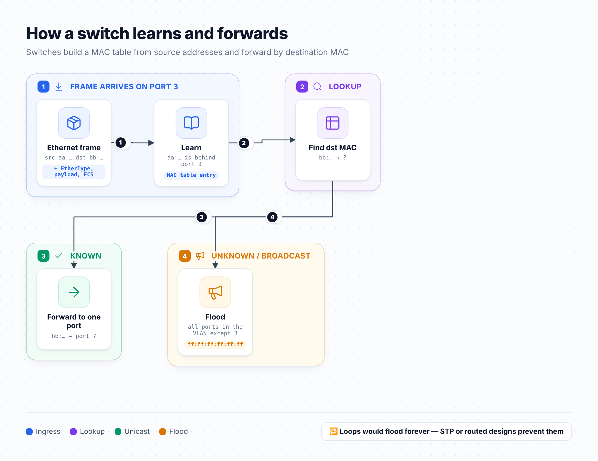

# 5.1 — Ethernet, ARP & VLANs (Layer 2)

!!! abstract "In short"
    Inside one local network, data moves as **Ethernet frames** addressed by **MAC** addresses. **Switches** learn which
    MAC sits behind which port and forward frames only there, or **flood** them when unsure. **ARP** finds the MAC for
    an IP on the same subnet, and **VLANs** split one physical network into separate broadcast domains. The same ideas
    reappear as Linux bridges, veth pairs and CNI plugins on every Kubernetes node.

## 📖 Key terms & abbreviations

| Term | Stands for | What it is | How it works (one line) |
|---|---|---|---|
| **L2** | Layer 2 (data link) | Delivery within one local network | Frames addressed by MAC |
| **Frame** | — | L2 packet: dst MAC, src MAC, EtherType, payload, FCS | FCS = checksum; bad frames are dropped |
| **MAC address** | Media Access Control | 48-bit NIC address | `aa:bb:cc:dd:ee:ff`, first half = vendor (OUI) |
| **EtherType** | — | Which protocol is inside | `0x0800` IPv4, `0x86DD` IPv6, `0x0806` ARP |
| **Switch** | — | Device that forwards frames by MAC | Learns source MACs into a MAC table |
| **Flooding** | — | Sending a frame out all ports | For broadcast and unknown destinations |
| **Broadcast domain** | — | Set of hosts that receive each other's broadcasts | One VLAN / one subnet |
| **ARP** | Address Resolution Protocol | IPv4 → MAC lookup on the LAN | Broadcast question, unicast answer, cached |
| **NDP** | Neighbor Discovery Protocol | IPv6's replacement for ARP | Uses ICMPv6 multicast |
| **GARP** | Gratuitous ARP | Unasked ARP announcing "this IP is at my MAC" | Used for failover (VIP moves) |
| **VLAN / 802.1Q** | Virtual LAN | Logical L2 network on shared hardware | 4-byte tag with a 12-bit VLAN ID |
| **Trunk / access port** | — | Carries many tagged VLANs / one untagged VLAN | Switch-to-switch vs switch-to-host |
| **MTU** | Maximum Transmission Unit | Largest payload per frame | 1500 standard, 9000 "jumbo" |
| **STP** | Spanning Tree Protocol | Blocks redundant links to prevent loops | Elects a root, disables loop ports |

## 🗺️ Big picture



---

## 1 · Ethernet frames and MAC addresses

```text
| dst MAC (6) | src MAC (6) | [802.1Q tag (4)] | EtherType (2) | payload (46–1500) | FCS (4) |
```

- Every NIC has a **MAC address** (virtual NICs get generated ones). It only matters **on the local link**: routers rewrite both MACs at every hop (chapter 5 diagram).
- **Broadcast** = `ff:ff:ff:ff:ff:ff`, delivered to everyone in the broadcast domain.
- **MTU** is the max payload (1500 bytes). Bigger IP packets must be fragmented or (normally) the sender lowers its segment size via **Path MTU discovery**.

## 2 · How a switch works

### How does it work?

1. A frame arrives on port 3 with source `aa:…`. The switch **learns**: "aa:… is behind port 3" (entries age out after ~5 minutes).
2. It looks up the **destination** MAC. **Known** → send it out only that port. **Unknown or broadcast** → **flood** to all other ports in the same VLAN.
3. Replies teach it the other direction, so after the first exchange traffic is unicast.

Unlike an old **hub**, a switch doesn't send everything everywhere, so hosts only see their own traffic plus broadcasts.

## 3 · ARP: from IP to MAC

1. Host A wants to send to `192.168.1.20` (same subnet). Its ARP cache has no entry.
2. It broadcasts **"Who has 192.168.1.20? Tell 192.168.1.10"**.
3. Only `.20` answers (unicast) with its MAC. A caches it (`ip neigh`) for minutes.
4. For an IP **outside** the subnet, A ARPs for the **default gateway** instead (5.2).

**Gratuitous ARP** ("192.168.1.100 is now at my MAC") is how keepalived/VRRP and MetalLB L2 mode move a virtual IP between machines. ARP has no authentication, so on a shared L2 network **ARP spoofing** lets an attacker intercept traffic.

## 4 · VLANs

A VLAN makes one physical switch behave like several separate ones. Frames between switches carry an **802.1Q tag** with the VLAN ID (1–4094) on **trunk** links; hosts on **access** ports never see tags. Different VLANs can only talk **through a router** (or L3 switch), which is where firewalls and policies sit.

Data centres moved from big stretched VLANs to **routed (L3) fabrics** with overlays like **VXLAN** (L2 frames inside UDP, 24-bit IDs → 16 million segments), which is also what many CNIs and cloud networks use under the hood.

## 5 · Loops and STP

Two links between the same switches create a loop: a broadcast circulates forever (frames have no TTL), multiplying until the network melts (**broadcast storm**). **STP** detects loops and blocks redundant ports; modern designs prefer link aggregation (LACP) and routed fabrics instead.

## 🔧 DevOps connection

- **Linux is a switch too:** `docker0` / `cni0` are **Linux bridges**; each container gets a **veth pair** (one end in its network namespace as `eth0`, the other on the bridge). Flannel/Calico/Cilium use bridges, routes, VXLAN/Geneve or eBPF.
- **MTU mismatches** with overlays: VXLAN adds 50 bytes, so pod MTU must be ~1450 on a 1500 network. Symptom: small requests work, big responses hang (TLS handshakes, large JSON).
- **MetalLB L2 mode / keepalived** use gratuitous ARP; failover takes as long as clients' ARP caches to update.
- **Cloud VPCs are not real L2:** no broadcast, ARP is answered by the hypervisor, so "layer 2 tricks" (GARP failover, multicast) usually don't work; use cloud load balancers or route-based failover.

## 🧪 Try it yourself

```bash
ip -br link                                   # interfaces with MACs and state
ip neigh                                      # ARP / NDP cache
sudo tcpdump -eni any arp -c 6                # -e shows MACs; ping a neighbour meanwhile
ping -c1 $(ip route | awk '/default/{print $3}'); ip neigh | head -3
bridge link 2>/dev/null; ip -d link show type bridge 2>/dev/null | head   # Linux bridges (docker0, cni0)
ip -d link show | grep -E 'vxlan|mtu' | head  # overlay devices and MTUs
ping -M do -s 1472 -c1 1.1.1.1               # 1472+28 = 1500: does a full-size packet pass without fragmenting?
```

## 🃏 Cheat sheet

| Symptom | Likely cause |
|---|---|
| Large transfers hang, small ones work | MTU mismatch (overlay, VPN) |
| Duplicate IP warnings / flapping | Two hosts claim the same IP (ARP conflict) |
| Network meltdown, LEDs solid | L2 loop / broadcast storm |
| VIP failover slow | Stale ARP caches |
| Pods on same node can talk, not across nodes | Overlay/routing (VXLAN port, routes) |

## ❓ Test yourself

??? question "1. What does a switch do with a frame whose destination MAC it hasn't learned?"
    It floods it to all ports in that VLAN except the one it came in on.

??? question "2. You ping 8.8.8.8. Whose MAC address does your laptop ARP for?"
    The default gateway's; MACs only matter on the local link.

??? question "3. Why do VXLAN overlays usually need a smaller MTU?"
    VXLAN encapsulation adds ~50 bytes of headers; inner packets must shrink so the outer packet still fits in 1500.

??? question "4. Why doesn't gratuitous-ARP failover usually work in AWS/GCP VPCs?"
    The cloud network isn't a real L2 segment; the SDN controls which IP belongs to which interface and ignores GARP.

??? question "5. What problem does STP solve?"
    It blocks redundant links so broadcasts can't loop forever and cause a broadcast storm.

---

## 📚 Sources

- [IEEE 802.1Q (overview)](https://en.wikipedia.org/wiki/IEEE_802.1Q)
- [RFC 826 — ARP](https://www.rfc-editor.org/rfc/rfc826) · [RFC 7348 — VXLAN](https://www.rfc-editor.org/rfc/rfc7348)
- [Kubernetes — Cluster networking](https://kubernetes.io/docs/concepts/cluster-administration/networking/)
- [MetalLB — L2 mode concepts](https://metallb.universe.tf/concepts/layer2/)

## ✍️ My notes

> On a Kubernetes node: find a pod's veth pair (`ip link`), the bridge or route it uses, and the MTU at each step.
