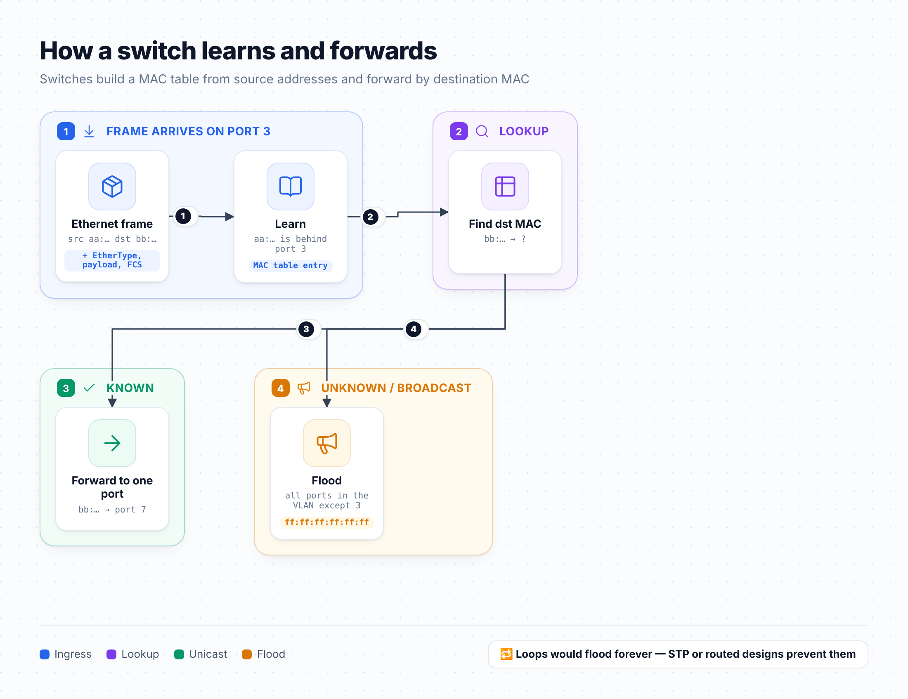

# 5.1 — Ethernet, ARP ve VLAN'lar (Katman 2)

!!! abstract "Kısaca"
    Tek bir yerel ağın içinde veri **MAC** adresleriyle adreslenmiş **Ethernet çerçeveleri** olarak taşınır.
    **Switch**'ler hangi MAC'in hangi portun arkasında olduğunu öğrenir ve çerçeveleri sadece oraya iletir (emin değilse
    **taşırır**), **ARP** aynı subnet'teki bir IP'nin MAC'ini bulur ve **VLAN**'lar tek bir fiziksel ağı ayrı yayın
    alanlarına böler. Aynı fikirler her Kubernetes node'unda Linux bridge'leri, veth çiftleri ve CNI eklentileri olarak
    yeniden karşına çıkar.

## 📖 Temel terimler ve kısaltmalar

| Terim | Açılımı | Nedir | Nasıl çalışır (tek satır) |
|---|---|---|---|
| **L2** | Layer 2 (veri bağlantı katmanı) | Tek bir yerel ağ içinde teslimat | MAC ile adreslenen çerçeveler |
| **Çerçeve** | Frame | L2 paketi: hedef MAC, kaynak MAC, EtherType, yük, FCS | FCS = sağlama toplamı; bozuk çerçeveler atılır |
| **MAC adresi** | Media Access Control | 48 bitlik NIC adresi | `aa:bb:cc:dd:ee:ff`, ilk yarısı = üretici (OUI) |
| **EtherType** | — | İçinde hangi protokol olduğu | `0x0800` IPv4, `0x86DD` IPv6, `0x0806` ARP |
| **Switch** | — | Çerçeveleri MAC'e göre ileten cihaz | Kaynak MAC'leri bir MAC tablosuna öğrenir |
| **Taşırma** | Flooding | Bir çerçeveyi tüm portlardan göndermek | Yayın ve bilinmeyen hedefler için |
| **Yayın alanı** | Broadcast domain | Birbirinin yayınlarını alan makineler kümesi | Bir VLAN / bir subnet |
| **ARP** | Address Resolution Protocol | LAN'da IPv4 → MAC araması | Yayınla soru, tek alıcılı cevap, önbellekte |
| **NDP** | Neighbor Discovery Protocol | IPv6'da ARP'nin yerini alan | ICMPv6 multicast kullanır |
| **GARP** | Gratuitous ARP | "Bu IP benim MAC'imde" diyen istenmemiş ARP | Failover için (VIP taşınır) |
| **VLAN / 802.1Q** | Virtual LAN | Paylaşımlı donanımda mantıksal L2 ağı | 12 bitlik VLAN ID'li 4 byte'lık etiket |
| **Trunk / access port** | — | Çok sayıda etiketli VLAN / tek etiketsiz VLAN taşır | Switch-switch ve switch-makine |
| **MTU** | Maximum Transmission Unit | Çerçeve başına en büyük yük | Standart 1500, "jumbo" 9000 |
| **STP** | Spanning Tree Protocol | Döngüleri önlemek için yedek bağlantıları kapatır | Kök seçer, döngü portlarını devre dışı bırakır |

## 🗺️ Büyük resim



---

## 1 · Ethernet çerçeveleri ve MAC adresleri

```text
| hedef MAC (6) | kaynak MAC (6) | [802.1Q etiketi (4)] | EtherType (2) | yük (46–1500) | FCS (4) |
```

- Her NIC'in bir **MAC adresi** vardır (sanal NIC'ler üretilmiş adres alır). Sadece **yerel bağlantıda** önemlidir: router'lar her durakta iki MAC'i de yeniden yazar (5. bölüm diagramı).
- **Yayın** = `ff:ff:ff:ff:ff:ff`, yayın alanındaki herkese teslim edilir.
- **MTU** azami yüktür (1500 byte). Daha büyük IP paketleri parçalanmalı ya da (normalde) gönderen **Path MTU discovery** ile segment boyutunu düşürür.

## 2 · Bir switch nasıl çalışır

### Nasıl çalışır?

1. 3. porttan kaynağı `aa:…` olan bir çerçeve gelir. Switch **öğrenir**: "aa:… 3. portun arkasında" (girdiler ~5 dakika sonra eskir).
2. **Hedef** MAC'e bakar. **Biliniyor** → sadece o porttan gönder. **Bilinmiyor ya da yayın** → aynı VLAN'daki diğer tüm portlara **taşır**.
3. Cevaplar ona diğer yönü öğretir; ilk alışverişten sonra trafik tek alıcılı olur.

Eski bir **hub**'ın aksine switch her şeyi her yere göndermez; makineler sadece kendi trafiklerini ve yayınları görür.

## 3 · ARP: IP'den MAC'e

1. A makinesi `192.168.1.20`'ye (aynı subnet) göndermek istiyor. ARP önbelleğinde girdi yok.
2. **"192.168.1.20 kimde? 192.168.1.10'a söyle"** diye yayın yapar.
3. Sadece `.20` MAC'iyle (tek alıcılı) cevap verir. A bunu dakikalarca önbellekte tutar (`ip neigh`).
4. Subnet **dışındaki** bir IP için A bunun yerine **default gateway** için ARP yapar (5.2).

**Gratuitous ARP** ("192.168.1.100 artık benim MAC'imde"), keepalived/VRRP ve MetalLB L2 modunun sanal bir IP'yi makineler arasında taşıma yoludur. ARP'de kimlik doğrulama yoktur; paylaşımlı bir L2 ağında **ARP spoofing** saldırganın trafiği yakalamasına izin verir.

## 4 · VLAN'lar

Bir VLAN tek bir fiziksel switch'i birkaç ayrı switch gibi davrandırır. Switch'ler arasındaki çerçeveler **trunk** bağlantılarında VLAN ID'li (1–4094) bir **802.1Q etiketi** taşır; **access** portlarındaki makineler etiketleri hiç görmez. Farklı VLAN'lar ancak **bir router** (ya da L3 switch) **üzerinden** konuşabilir; firewall'lar ve politikalar da orada durur.

Veri merkezleri büyük, gerilmiş VLAN'lardan **VXLAN** (UDP içinde L2 çerçeveleri, 24 bitlik kimlikler → 16 milyon segment) gibi overlay'li **routed (L3) yapılara** geçti; birçok CNI ve bulut ağı da altta bunu kullanır.

## 5 · Döngüler ve STP

Aynı switch'ler arasında iki bağlantı bir döngü oluşturur: bir yayın sonsuza dek döner (çerçevelerin TTL'i yok), ağ eriyene kadar çoğalır (**yayın fırtınası**). **STP** döngüleri tespit eder ve yedek portları kapatır; modern tasarımlar bunun yerine bağlantı birleştirme (LACP) ve routed yapıları tercih eder.

## 🔧 DevOps bağlantısı

- **Linux da bir switch'tir:** `docker0` / `cni0` **Linux bridge**'leridir; her container bir **veth çifti** alır (bir ucu network namespace'inde `eth0`, diğeri bridge'de). Flannel/Calico/Cilium bridge'ler, rotalar, VXLAN/Geneve ya da eBPF kullanır.
- **Overlay'lerle MTU uyumsuzlukları:** VXLAN 50 byte ekler; 1500'lük bir ağda pod MTU'su ~1450 olmalı. Belirti: küçük istekler çalışır, büyük cevaplar takılır (TLS el sıkışmaları, büyük JSON).
- **MetalLB L2 modu / keepalived** gratuitous ARP kullanır; failover, istemcilerin ARP önbelleklerinin güncellenmesi kadar sürer.
- **Bulut VPC'leri gerçek L2 değildir:** yayın yok, ARP'yi hypervisor cevaplar; "katman 2 hileleri" (GARP failover, multicast) genelde çalışmaz; bulut load balancer'ları ya da rota tabanlı failover kullan.

## 🧪 Kendin dene

```bash
ip -br link                                   # MAC'leri ve durumlarıyla arayüzler
ip neigh                                      # ARP / NDP önbelleği
sudo tcpdump -eni any arp -c 6                # -e MAC'leri gösterir; bu sırada bir komşuya ping at
ping -c1 $(ip route | awk '/default/{print $3}'); ip neigh | head -3
bridge link 2>/dev/null; ip -d link show type bridge 2>/dev/null | head   # Linux bridge'leri (docker0, cni0)
ip -d link show | grep -E 'vxlan|mtu' | head  # overlay cihazları ve MTU'lar
ping -M do -s 1472 -c1 1.1.1.1               # 1472+28 = 1500: tam boy paket parçalanmadan geçiyor mu?
```

## 🃏 Hatırlatma kartı

| Belirti | Muhtemel sebep |
|---|---|
| Büyük aktarımlar takılıyor, küçükler çalışıyor | MTU uyumsuzluğu (overlay, VPN) |
| Çift IP uyarıları / gidip gelme | İki makine aynı IP'yi sahipleniyor (ARP çakışması) |
| Ağ eriyor, LED'ler sürekli yanık | L2 döngüsü / yayın fırtınası |
| VIP failover yavaş | Eski ARP önbellekleri |
| Aynı node'daki pod'lar konuşuyor, node'lar arası konuşmuyor | Overlay/routing (VXLAN portu, rotalar) |

## ❓ Kendini test et

??? question "1. Switch hedef MAC'ini öğrenmediği bir çerçeveyle ne yapar?"
    Geldiği port hariç o VLAN'daki tüm portlara taşır.

??? question "2. 8.8.8.8'e ping atıyorsun. Laptopun kimin MAC adresi için ARP yapar?"
    Default gateway'in; MAC'ler sadece yerel bağlantıda önemlidir.

??? question "3. VXLAN overlay'leri neden genelde daha küçük bir MTU ister?"
    VXLAN kapsüllemesi ~50 byte başlık ekler; dış paket hâlâ 1500'e sığsın diye iç paketler küçülmeli.

??? question "4. Gratuitous ARP ile failover AWS/GCP VPC'lerinde neden genelde çalışmaz?"
    Bulut ağı gerçek bir L2 segmenti değildir; hangi IP'nin hangi arayüze ait olduğunu SDN kontrol eder ve GARP'ı yok sayar.

??? question "5. STP hangi sorunu çözer?"
    Yedek bağlantıları kapatır; yayınlar sonsuza dek dönüp yayın fırtınasına yol açamaz.

---

## 📚 Kaynaklar

- [IEEE 802.1Q (genel bakış)](https://en.wikipedia.org/wiki/IEEE_802.1Q)
- [RFC 826 — ARP](https://www.rfc-editor.org/rfc/rfc826) · [RFC 7348 — VXLAN](https://www.rfc-editor.org/rfc/rfc7348)
- [Kubernetes — Cluster networking](https://kubernetes.io/docs/concepts/cluster-administration/networking/)
- [MetalLB — L2 mode concepts](https://metallb.universe.tf/concepts/layer2/)

## ✍️ Notlarım

> Bir Kubernetes node'unda: bir pod'un veth çiftini (`ip link`), kullandığı bridge'i ya da rotayı ve her adımdaki MTU'yu bul.
