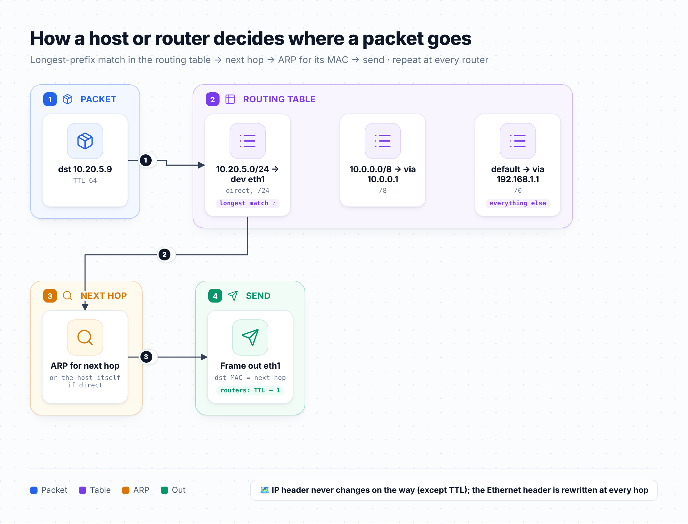

# 5.2 — IP addressing, subnets & routing

!!! abstract "In one sentence"
    **IP** gives every host an address that's meaningful across networks; a **CIDR prefix** like `/24` says which part
    is the network, every host and router keeps a **routing table**, picks the **longest matching prefix** for each
    destination, and forwards the packet to the next hop, decrementing the **TTL** — the same few rules run your
    laptop, the internet core and the pod network in your cluster.

## 📖 Key terms & abbreviations

| Term | Stands for | What it is | How it works (one line) |
|---|---|---|---|
| **IP** | Internet Protocol | L3: addressing and forwarding between networks | Best-effort, no delivery guarantee |
| **IPv4 / IPv6** | — | 32-bit / 128-bit addresses | `10.0.1.5` / `2001:db8::5` |
| **CIDR** | Classless Inter-Domain Routing | `address/prefix-length` notation | `/24` = first 24 bits are the network |
| **Subnet mask** | — | Same as prefix, dotted | `/24` = `255.255.255.0` |
| **Network / broadcast address** | — | First / last address of an IPv4 subnet | Not usable by hosts |
| **Private ranges** | RFC 1918 | `10/8`, `172.16/12`, `192.168/16` | Not routed on the internet → need NAT |
| **CGNAT range** | Carrier-Grade NAT | `100.64.0.0/10` | ISPs, also used for pod CIDRs |
| **Routing table** | — | List of prefix → next hop / interface | `ip route` |
| **Longest-prefix match** | — | Most specific route wins | `/32` beats `/24` beats `/0` |
| **Default route** | — | `0.0.0.0/0` (`::/0`) | "Everything else → gateway" |
| **TTL / hop limit** | Time To Live | Counter decremented per router | 0 → drop + ICMP "time exceeded" |
| **ICMP** | Internet Control Message Protocol | Errors and diagnostics | ping (echo), unreachable, time exceeded |
| **PMTUD** | Path MTU Discovery | Finding the smallest MTU on a path | Relies on ICMP "fragmentation needed" |
| **BGP** | Border Gateway Protocol | Exchanges routes between networks | Internet, also Calico/MetalLB/cloud routers |

## 🗺️ Big picture



---

## 1 · Addresses and CIDR math

### How does it work?

`10.0.16.0/20` means: the first **20 bits** are the network, the last **12 bits** are hosts → 2¹² = **4096 addresses** (`10.0.16.0`–`10.0.31.255`).

| Prefix | Addresses | Typical use |
|---|---|---|
| `/32` | 1 | A single host route |
| `/28` | 16 | Tiny subnet (AWS minimum) |
| `/24` | 256 | Classic LAN / small subnet |
| `/20` | 4,096 | Kubernetes node subnet |
| `/16` | 65,536 | A VPC |
| `/8` | 16.7 M | `10.0.0.0/8` private range |

Two addresses are on the **same subnet** if their network bits match (`ip & mask`). Clouds also reserve a few addresses per subnet (AWS: 5).

**IPv6** works the same way with 128 bits: a `/64` per subnet (18 quintillion addresses), no NAT needed, **NDP** instead of ARP, and every interface also has a link-local `fe80::/10` address.

## 2 · Routing: longest-prefix match

```text
$ ip route
default via 192.168.1.1 dev wlan0
10.20.5.0/24 dev eth1 proto kernel scope link src 10.20.5.2
10.0.0.0/8 via 10.0.0.1 dev eth0
172.17.0.0/16 dev docker0
```

For `10.20.5.9`: three routes match (`/0`, `/8`, `/24`); the **longest prefix (/24) wins** → send directly on `eth1` (ARP for `10.20.5.9` itself). For `8.8.8.8`, only `default` matches → ARP for `192.168.1.1` and send it there.

Every router does the same, decrements **TTL**, recomputes the header checksum and rewrites the L2 header. The **IP addresses don't change** along the way (unless NAT, 5.3).

## 3 · ICMP, ping and traceroute

- **ping** sends ICMP echo requests; a reply means L3 reachability (not that the app or port works).
- **traceroute / mtr** sends packets with TTL 1, 2, 3…; each router that drops one returns "time exceeded", revealing the path. `* * *` lines just mean that hop doesn't answer.
- **Blocking all ICMP breaks things**: PMTU discovery needs "fragmentation needed" messages; without them, large packets silently vanish (**black-hole** connections).

## 4 · Routing in Kubernetes and clouds

- Each node gets a **pod CIDR** (e.g. `10.244.3.0/24`); pods get IPs from it. The CNI makes every pod reachable from every other pod **without NAT**: by **routes** (Calico BGP, cloud route tables, AWS VPC CNI giving pods real VPC IPs) or an **overlay** (VXLAN/Geneve).
- **Service CIDR** (e.g. `10.96.0.0/12`) is virtual: no route exists, kube-proxy/eBPF rewrites the destination (5.3).
- **CIDR planning matters**: pod, service, VPC, on-prem and peered VPC ranges must **not overlap**, or traffic goes to the wrong place and peering is refused. Plan with room to grow.
- **VPC route tables** decide where a subnet's traffic goes: local, internet gateway, NAT gateway, peering, transit gateway, VPN.

## 🔧 DevOps connection

- **"Can't reach X" checklist:** DNS → `ip route get <ip>` (which route?) → ping gateway → traceroute → security groups/NACLs → is the service listening.
- **Overlapping CIDRs** are a top cause of failed VPC peering, VPN and cluster merges. Keep an IPAM sheet.
- **IP exhaustion with AWS VPC CNI**: every pod uses a VPC IP; small subnets run out. Use prefix delegation, secondary CIDRs (100.64.0.0/10) or an overlay.
- **Asymmetric routing** (reply takes a different path) breaks stateful firewalls and NAT.

## 🧪 Try it yourself

```bash
ip -br addr; ip route                          # addresses and routing table
ip route get 8.8.8.8                           # which route/interface/source would be used
ip -6 route 2>/dev/null | head -5
python3 -c "import ipaddress as i; n=i.ip_network('10.0.16.0/20'); print(n.num_addresses, n[0], n[-1], i.ip_address('10.0.20.7') in n)"
ping -c3 1.1.1.1
traceroute -n 1.1.1.1 2>/dev/null || tracepath -n 1.1.1.1
mtr -rwc 10 1.1.1.1 2>/dev/null | head -15     # loss/latency per hop
kubectl get nodes -o custom-columns=NAME:.metadata.name,PODCIDR:.spec.podCIDR 2>/dev/null
```

## 🃏 Cheat sheet

| Need | Command / rule |
|---|---|
| Which route is used | `ip route get <ip>` |
| Host count of `/n` | 2^(32−n) (minus 2 for IPv4 hosts) |
| Same subnet? | `ip & mask` equal |
| Path to a host | `traceroute -n`, `mtr` |
| Never overlap | VPC, pod, service, on-prem, peered CIDRs |
| Don't block | ICMP type 3 code 4 (frag needed) |

## ❓ Test yourself

??? question "1. How many addresses are in a /22, and what range does 10.1.4.0/22 cover?"
    1024 addresses: 10.1.4.0 – 10.1.7.255.

??? question "2. A host has routes for 10.0.0.0/8 via A and 10.0.5.0/24 via B. Where does 10.0.5.20 go?"
    Via B: the /24 is the longest matching prefix.

??? question "3. Do the source and destination IPs change as a packet crosses routers?"
    No (without NAT). Only TTL/checksum and the L2 (MAC) header change at each hop.

??? question "4. Why can blocking all ICMP break HTTPS for some users?"
    PMTU discovery depends on ICMP "fragmentation needed"; without it, big packets are dropped silently and connections hang.

??? question "5. Why must pod CIDRs not overlap with your corporate network?"
    Routes would be ambiguous: traffic to corporate IPs would be sent into the cluster (or vice versa) and peering/VPN can't be set up.

---

## 📚 Sources

- [RFC 4632 — CIDR](https://www.rfc-editor.org/rfc/rfc4632) · [RFC 1918 — Private addresses](https://www.rfc-editor.org/rfc/rfc1918)
- [RFC 8200 — IPv6](https://www.rfc-editor.org/rfc/rfc8200)
- [Kubernetes — Cluster networking model](https://kubernetes.io/docs/concepts/services-networking/)
- [AWS — VPC CIDR blocks](https://docs.aws.amazon.com/vpc/latest/userguide/vpc-cidr-blocks.html)

## ✍️ My notes

> Write down every CIDR in your environment (VPCs, pods, services, VPN, office). Do any overlap?

-
