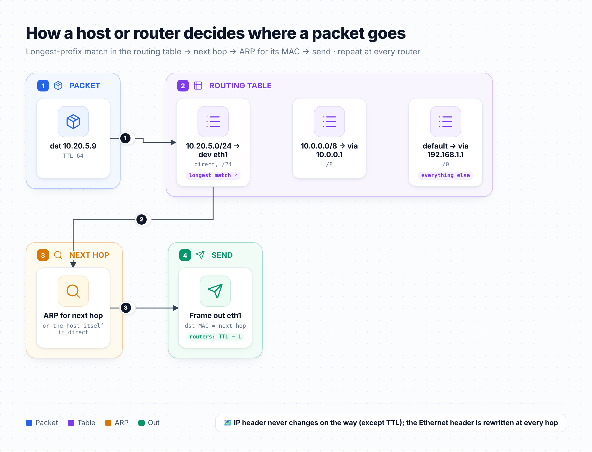

# 5.2 — IP adresleme, subnet'ler ve routing

!!! abstract "Kısaca"
    **IP** her makineye ağlar arasında anlamlı bir adres verir. `/24` gibi bir **CIDR öneki** adresin hangi kısmının ağ
    olduğunu söyler. Her makine ve router bir **routing tablosu** tutar, her hedef için **en uzun eşleşen öneki** seçer
    ve **TTL**'i azaltarak paketi sonraki durağa iletir. Laptopunu, internetin çekirdeğini ve cluster'ındaki pod ağını
    aynı birkaç kural yönetir.

## 📖 Temel terimler ve kısaltmalar

| Terim | Açılımı | Nedir | Nasıl çalışır (tek satır) |
|---|---|---|---|
| **IP** | Internet Protocol | L3: ağlar arası adresleme ve iletim | En iyi çaba, teslim garantisi yok |
| **IPv4 / IPv6** | — | 32 bit / 128 bit adresler | `10.0.1.5` / `2001:db8::5` |
| **CIDR** | Classless Inter-Domain Routing | `adres/önek-uzunluğu` gösterimi | `/24` = ilk 24 bit ağdır |
| **Subnet maskesi** | Subnet mask | Önekle aynı, noktalı | `/24` = `255.255.255.0` |
| **Ağ / yayın adresi** | — | Bir IPv4 subnet'inin ilk / son adresi | Makineler kullanamaz |
| **Özel aralıklar** | RFC 1918 | `10/8`, `172.16/12`, `192.168/16` | İnternette yönlendirilmez → NAT gerekir |
| **CGNAT aralığı** | Carrier-Grade NAT | `100.64.0.0/10` | ISP'ler, pod CIDR'ları için de kullanılır |
| **Routing tablosu** | — | Önek → sonraki durak / arayüz listesi | `ip route` |
| **En uzun önek eşleşmesi** | Longest-prefix match | En özel rota kazanır | `/32`, `/24`'ü; `/24`, `/0`'ı yener |
| **Default rota** | — | `0.0.0.0/0` (`::/0`) | "Geri kalan her şey → gateway" |
| **TTL / hop limit** | Time To Live | Router başına azalan sayaç | 0 → at + ICMP "time exceeded" |
| **ICMP** | Internet Control Message Protocol | Hatalar ve teşhis | ping (echo), unreachable, time exceeded |
| **PMTUD** | Path MTU Discovery | Bir yoldaki en küçük MTU'yu bulmak | ICMP "fragmentation needed"a dayanır |
| **BGP** | Border Gateway Protocol | Ağlar arası rota değişimi | İnternet, ayrıca Calico/MetalLB/bulut router'ları |

## 🗺️ Büyük resim



---

## 1 · Adresler ve CIDR hesabı

### Nasıl çalışır?

`10.0.16.0/20` şu demek: ilk **20 bit** ağ, son **12 bit** makineler → 2¹² = **4096 adres** (`10.0.16.0`–`10.0.31.255`).

| Önek | Adres | Tipik kullanım |
|---|---|---|
| `/32` | 1 | Tek makine rotası |
| `/28` | 16 | Minik subnet (AWS asgarisi) |
| `/24` | 256 | Klasik LAN / küçük subnet |
| `/20` | 4.096 | Kubernetes node subnet'i |
| `/16` | 65.536 | Bir VPC |
| `/8` | 16,7 M | `10.0.0.0/8` özel aralık |

İki adresin ağ bitleri eşleşiyorsa (`ip & maske`) **aynı subnet'tedir**. Bulutlar subnet başına birkaç adres de ayırır (AWS: 5).

**IPv6** 128 bitle aynı şekilde çalışır: subnet başına bir `/64` (18 kentilyon adres), NAT gerekmez, ARP yerine **NDP**, ve her arayüzün bir link-local `fe80::/10` adresi de vardır.

## 2 · Routing: en uzun önek eşleşmesi

```text
$ ip route
default via 192.168.1.1 dev wlan0
10.20.5.0/24 dev eth1 proto kernel scope link src 10.20.5.2
10.0.0.0/8 via 10.0.0.1 dev eth0
172.17.0.0/16 dev docker0
```

`10.20.5.9` için üç rota eşleşir (`/0`, `/8`, `/24`); **en uzun önek (/24) kazanır** → doğrudan `eth1`'den gönder (`10.20.5.9`'un kendisi için ARP). `8.8.8.8` için sadece `default` eşleşir → `192.168.1.1` için ARP yap ve oraya gönder.

Her router aynısını yapar, **TTL**'i azaltır, başlık sağlama toplamını yeniden hesaplar ve L2 başlığını yeniden yazar. Yol boyunca **IP adresleri değişmez** (NAT hariç, 5.3).

## 3 · ICMP, ping ve traceroute

- **ping** ICMP echo istekleri gönderir; cevap L3 erişilebilirliği demektir (uygulamanın ya da portun çalıştığı değil).
- **traceroute / mtr** TTL'i 1, 2, 3… olan paketler gönderir; birini atan her router "time exceeded" döner ve yol ortaya çıkar. `* * *` satırları sadece o durağın cevap vermediğini gösterir.
- **Tüm ICMP'yi engellemek bir şeyleri bozar**: PMTU keşfi "fragmentation needed" mesajlarına ihtiyaç duyar; onlar olmadan büyük paketler sessizce kaybolur (**kara delik** bağlantılar).

## 4 · Kubernetes'te ve bulutlarda routing

- Her node bir **pod CIDR**'ı alır (ör. `10.244.3.0/24`); pod'lar IP'lerini oradan alır. CNI her pod'u diğer her pod'dan **NAT'sız** erişilebilir yapar: **rotalarla** (Calico BGP, bulut route table'ları, pod'lara gerçek VPC IP'leri veren AWS VPC CNI) ya da bir **overlay** ile (VXLAN/Geneve).
- **Service CIDR** (ör. `10.96.0.0/12`) sanaldır: rota yoktur, kube-proxy/eBPF hedefi yeniden yazar (5.3).
- **CIDR planlaması önemli**: pod, service, VPC, şirket içi ve peer edilmiş VPC aralıkları **çakışmamalı**; yoksa trafik yanlış yere gider ve peering reddedilir. Büyümeye yer bırakarak planla.
- **VPC route table'ları** bir subnet'in trafiğinin nereye gideceğine karar verir: local, internet gateway, NAT gateway, peering, transit gateway, VPN.

## 🔧 DevOps bağlantısı

- **"X'e ulaşamıyorum" kontrol listesi:** DNS → `ip route get <ip>` (hangi rota?) → gateway'e ping → traceroute → security group'lar/NACL'ler → servis dinliyor mu.
- **Çakışan CIDR'lar** başarısız VPC peering, VPN ve cluster birleştirmelerinin başlıca sebebi. Bir IPAM tablosu tut.
- **AWS VPC CNI ile IP tükenmesi**: her pod bir VPC IP'si kullanır; küçük subnet'ler tükenir. Prefix delegation, ikincil CIDR'lar (100.64.0.0/10) ya da overlay kullan.
- **Asimetrik routing** (cevabın farklı bir yoldan dönmesi) durumlu firewall'ları ve NAT'ı bozar.

## 🧪 Kendin dene

```bash
ip -br addr; ip route                          # adresler ve routing tablosu
ip route get 8.8.8.8                           # hangi rota/arayüz/kaynak kullanılır
ip -6 route 2>/dev/null | head -5
python3 -c "import ipaddress as i; n=i.ip_network('10.0.16.0/20'); print(n.num_addresses, n[0], n[-1], i.ip_address('10.0.20.7') in n)"
ping -c3 1.1.1.1
traceroute -n 1.1.1.1 2>/dev/null || tracepath -n 1.1.1.1
mtr -rwc 10 1.1.1.1 2>/dev/null | head -15     # durak başına kayıp/gecikme
kubectl get nodes -o custom-columns=NAME:.metadata.name,PODCIDR:.spec.podCIDR 2>/dev/null
```

## 🃏 Hatırlatma kartı

| İhtiyaç | Komut / kural |
|---|---|
| Hangi rota kullanılıyor | `ip route get <ip>` |
| `/n`'deki adres sayısı | 2^(32−n) (IPv4 makineleri için eksi 2) |
| Aynı subnet mi? | `ip & maske` eşit |
| Bir makineye giden yol | `traceroute -n`, `mtr` |
| Asla çakıştırma | VPC, pod, service, şirket içi, peer CIDR'ları |
| Engelleme | ICMP tip 3 kod 4 (frag needed) |

## ❓ Kendini test et

??? question "1. Bir /22'de kaç adres var, 10.1.4.0/22 hangi aralığı kapsar?"
    1024 adres: 10.1.4.0 – 10.1.7.255.

??? question "2. Bir makinede A üzerinden 10.0.0.0/8 ve B üzerinden 10.0.5.0/24 rotası var. 10.0.5.20 nereye gider?"
    B üzerinden: /24 en uzun eşleşen önek.

??? question "3. Paket router'ları geçerken kaynak ve hedef IP'ler değişir mi?"
    Hayır (NAT yoksa). Her durakta sadece TTL/sağlama toplamı ve L2 (MAC) başlığı değişir.

??? question "4. Tüm ICMP'yi engellemek neden bazı kullanıcılar için HTTPS'i bozabilir?"
    PMTU keşfi ICMP "fragmentation needed"a dayanır; o olmadan büyük paketler sessizce atılır ve bağlantılar takılır.

??? question "5. Pod CIDR'ları neden şirket ağınla çakışmamalı?"
    Rotalar belirsizleşir: şirket IP'lerine giden trafik cluster'a gönderilir (ya da tersi) ve peering/VPN kurulamaz.

---

## 📚 Kaynaklar

- [RFC 4632 — CIDR](https://www.rfc-editor.org/rfc/rfc4632) · [RFC 1918 — Private addresses](https://www.rfc-editor.org/rfc/rfc1918)
- [RFC 8200 — IPv6](https://www.rfc-editor.org/rfc/rfc8200)
- [Kubernetes — Cluster networking model](https://kubernetes.io/docs/concepts/services-networking/)
- [AWS — VPC CIDR blocks](https://docs.aws.amazon.com/vpc/latest/userguide/vpc-cidr-blocks.html)

## ✍️ Notlarım

> Ortamındaki her CIDR'ı yaz (VPC'ler, pod'lar, service'ler, VPN, ofis). Çakışan var mı?
