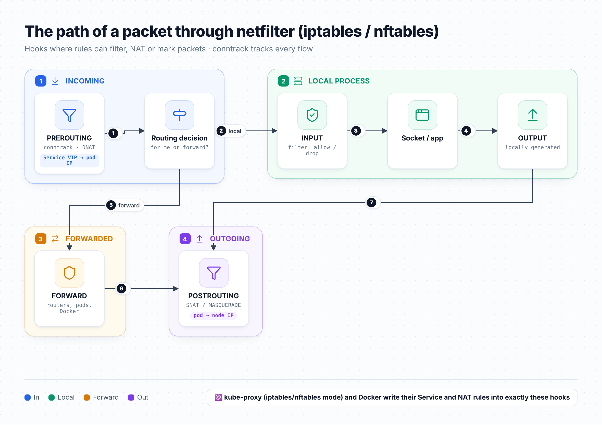

# 5.3 — NAT, firewalls & conntrack

!!! abstract "In one sentence"
    The Linux kernel's **netfilter** framework lets rules inspect every packet at fixed **hooks**; **conntrack** remembers
    each connection so firewalls can be **stateful** ("allow replies") and **NAT** can rewrite addresses consistently —
    **SNAT** to share one public IP, **DNAT** to send traffic for a virtual IP to a real backend, which is exactly how
    Docker port publishing and Kubernetes **Services** work.

## 📖 Key terms & abbreviations

| Term | Stands for | What it is | How it works (one line) |
|---|---|---|---|
| **Firewall** | — | Allows or blocks traffic by rules | Match on IP, port, protocol, state, interface |
| **Stateless / stateful** | — | Judges each packet alone / knows connections | Stateful allows replies automatically |
| **netfilter** | — | Kernel packet-processing framework | Hooks: PREROUTING, INPUT, FORWARD, OUTPUT, POSTROUTING |
| **iptables / nftables** | — | User tools for netfilter rules | nftables is the modern replacement |
| **conntrack** | connection tracking | Table of active flows | States: NEW, ESTABLISHED, RELATED, INVALID |
| **NAT** | Network Address Translation | Rewriting IPs/ports in packets | Reverse rewrite on replies via conntrack |
| **SNAT / MASQUERADE** | Source NAT | Change the source address | Many private hosts behind one IP |
| **DNAT** | Destination NAT | Change the destination address | Port forwarding, Service VIP → pod |
| **Port exhaustion** | — | Running out of source ports for SNAT | ~64K per (src IP, dst IP, dst port) |
| **kube-proxy** | — | Implements Services on each node | iptables / IPVS / nftables modes |
| **eBPF** | extended Berkeley Packet Filter | Programs run safely in the kernel | Cilium replaces kube-proxy and iptables |
| **NetworkPolicy** | — | Kubernetes pod-level firewall | Enforced by the CNI |
| **Security group / NACL** | — / Network Access Control List | Cloud firewall per interface / per subnet | Stateful / stateless |

## 🗺️ Big picture



---

## 1 · Stateless vs stateful filtering

A **stateless** rule looks at one packet: "allow TCP to port 443". Replies from the server go out to random high ports, so a stateless firewall needs a second wide rule for them (cloud **NACLs** work this way).

A **stateful** firewall uses **conntrack**: the first packet of a flow is `NEW`; if allowed, everything belonging to that flow (`ESTABLISHED`, `RELATED` like ICMP errors or FTP data) is allowed automatically. One rule `ct state established,related accept` + rules for `NEW` is the classic pattern. **Security groups** and almost every host firewall are stateful.

## 2 · netfilter hooks and tables

| Hook | Sees | Typical use |
|---|---|---|
| **PREROUTING** | Every incoming packet, before routing | DNAT (port forwarding, Service VIPs) |
| **INPUT** | Packets for this host | Host firewall |
| **FORWARD** | Packets being routed through | Router / container / pod traffic |
| **OUTPUT** | Locally generated packets | Local DNAT, egress filtering |
| **POSTROUTING** | Every outgoing packet, after routing | SNAT / MASQUERADE |

`iptables` organises rules in tables (`filter`, `nat`, `mangle`, `raw`) and chains; **nftables** (`nft`) is the modern, faster replacement with one syntax and sets/maps. Both drive the same netfilter hooks.

## 3 · NAT and conntrack

### How does SNAT work?

1. A pod `10.244.1.7:51544` connects to `93.184.215.14:443`.
2. **POSTROUTING / MASQUERADE** rewrites the source to the node IP `10.0.16.5:40001` and stores the mapping in conntrack.
3. The reply comes to `10.0.16.5:40001`; conntrack finds the flow and rewrites the destination back to `10.244.1.7:51544`.

### Limits

- **conntrack table full** (`nf_conntrack: table full, dropping packet`) → new connections dropped. Tune `nf_conntrack_max`, reduce short-lived connections.
- **SNAT port exhaustion**: one public IP can hold ~64K connections to the *same* destination IP:port. Many pods calling one API through one NAT IP hits this (cloud NAT gateways show "port allocation errors").
- **UDP and conntrack races** caused the infamous 5-second DNS delays in Kubernetes (5.2/6.2).

## 4 · How Kubernetes Services use NAT

A ClusterIP like `10.96.12.7:80` exists on **no interface**. kube-proxy (iptables mode) writes rules:

1. **PREROUTING/OUTPUT:** packets to `10.96.12.7:80` jump to the Service chain.
2. The chain picks one endpoint at random (probability rules) and **DNATs** to e.g. `10.244.2.15:8080`.
3. conntrack remembers it, so the whole connection sticks to that pod and replies are un-NATed.
4. **NodePort / LoadBalancer** add DNAT on node ports, and SNAT if the backend is on another node (unless `externalTrafficPolicy: Local`, which preserves the client IP).

**Scaling:** thousands of Services = tens of thousands of iptables rules evaluated linearly. **IPVS** mode, **nftables** mode, or **eBPF** (Cilium, replacing kube-proxy with hash-map lookups) scale much better.

## 5 · NetworkPolicies and cloud firewalls

- **NetworkPolicy:** "pods labelled `app=api` accept traffic only from `app=web` on 8080". Default is allow-all; once any policy selects a pod, everything not allowed is denied. Enforced by the CNI (Calico, Cilium); flannel alone doesn't.
- **Security groups:** stateful, attached to instances/ENIs, can reference other groups. **NACLs:** stateless, per subnet, ordered rules.
- Layers stack: SG → NACL → node firewall → NetworkPolicy → app auth. Debug from the outside in.

## 🔧 DevOps connection

- **Client IP lost behind Services/LBs** → SNAT. Use `externalTrafficPolicy: Local`, proxy protocol, or `X-Forwarded-For` (6.1).
- **Intermittent connection failures at scale** → conntrack table full or NAT port exhaustion; check `conntrack -S`, `dmesg`, cloud NAT metrics.
- **Start NetworkPolicies with default-deny** per namespace, then allow DNS (port 53 to kube-dns!) and required flows.
- **Docker publishes ports by inserting iptables rules that bypass ufw** on many distros — a common surprise.

## 🧪 Try it yourself

```bash
sudo iptables -t nat -S | head -30             # NAT rules (Docker, kube-proxy)
sudo nft list ruleset 2>/dev/null | head -40   # nftables view
sudo conntrack -L 2>/dev/null | head           # tracked connections (conntrack-tools)
sudo conntrack -S 2>/dev/null | head -3        # stats: drops, insert_failed
cat /proc/sys/net/netfilter/nf_conntrack_count /proc/sys/net/netfilter/nf_conntrack_max 2>/dev/null

# A Kubernetes Service, as kube-proxy sees it (iptables mode)
sudo iptables -t nat -S KUBE-SERVICES 2>/dev/null | head
kubectl get svc,endpointslices -n default 2>/dev/null | head

# Docker port publishing = DNAT
docker run -d --rm -p 8080:80 --name web nginx:alpine && sudo iptables -t nat -S DOCKER; docker stop web
```

## 🃏 Cheat sheet

| Need | Mechanism |
|---|---|
| Many hosts share one public IP | SNAT / MASQUERADE |
| Expose an internal port | DNAT (port forward) |
| Allow replies automatically | conntrack `established,related` |
| Pod-to-pod firewall | NetworkPolicy (CNI) |
| Keep client IP on NodePort/LB | `externalTrafficPolicy: Local` |
| Huge clusters, fast Services | IPVS / nftables / eBPF (Cilium) |

## ❓ Test yourself

??? question "1. Why does a stateful firewall need only one rule for HTTPS while a NACL needs two?"
    conntrack lets replies of an allowed flow through automatically; a stateless NACL must explicitly allow the return traffic to ephemeral ports.

??? question "2. How does a packet to a ClusterIP reach a pod when no interface has that IP?"
    kube-proxy rules DNAT the destination to a chosen pod IP in PREROUTING/OUTPUT; conntrack keeps the mapping for the connection.

??? question "3. Many pods call one external API through a NAT gateway and get random connection timeouts. Likely cause?"
    SNAT source-port exhaustion to that single destination IP:port. Add NAT IPs, reuse connections, or spread destinations.

??? question "4. What happens to other traffic once a NetworkPolicy selects a pod for ingress?"
    All ingress not explicitly allowed by some policy is denied for that pod.

??? question "5. Why does `externalTrafficPolicy: Local` preserve the client IP?"
    Traffic only goes to pods on the node that received it, so no SNAT to another node is needed.

---

## 📚 Sources

- [netfilter.org](https://www.netfilter.org/) · [nftables wiki](https://wiki.nftables.org/)
- [Kubernetes — Virtual IPs and Service proxies](https://kubernetes.io/docs/reference/networking/virtual-ips/)
- [Kubernetes — Network Policies](https://kubernetes.io/docs/concepts/services-networking/network-policies/)
- [Cilium — kube-proxy replacement](https://docs.cilium.io/en/stable/network/kubernetes/kubeproxy-free/)
- [AWS — Security groups vs network ACLs](https://docs.aws.amazon.com/vpc/latest/userguide/infrastructure-security.html)

## ✍️ My notes

> Pick one Service in your cluster and trace it: ClusterIP → kube-proxy rule (or eBPF map) → endpoint pod IPs.

-
