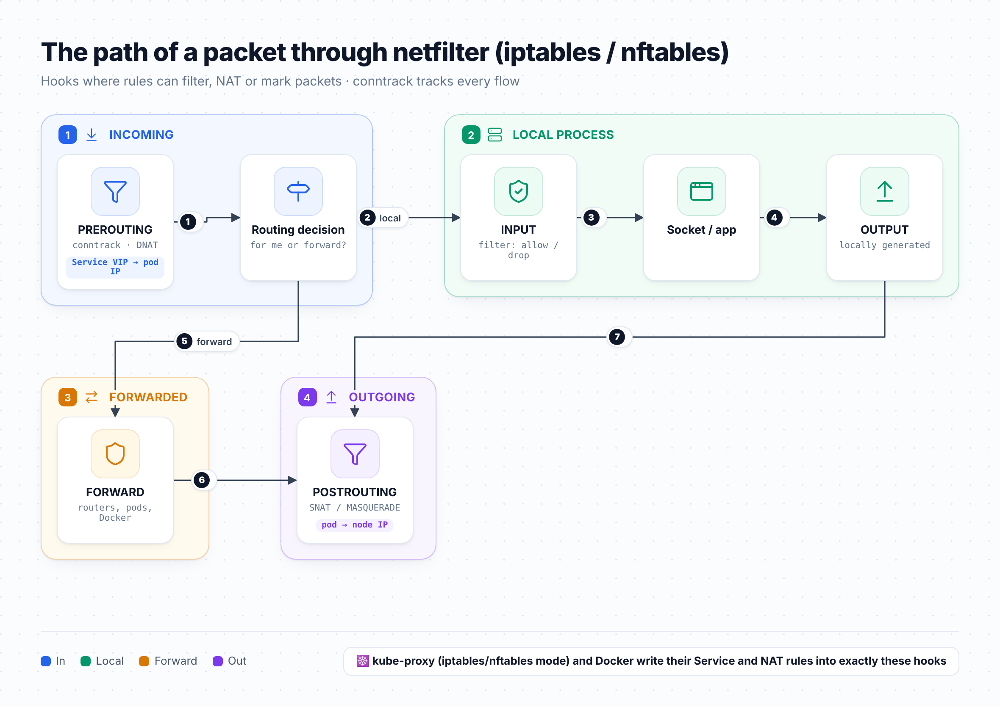

# 5.3 — NAT, firewall'lar ve conntrack

!!! abstract "Tek cümlede"
    Linux kernel'inin **netfilter** çerçevesi kuralların her paketi sabit **kancalarda** incelemesine izin verir;
    **conntrack** her bağlantıyı hatırlar, böylece firewall'lar **durumlu** olabilir ("cevaplara izin ver") ve **NAT**
    adresleri tutarlı biçimde yeniden yazabilir: tek bir genel IP'yi paylaşmak için **SNAT**, sanal bir IP'ye gelen
    trafiği gerçek bir backend'e göndermek için **DNAT**; Docker port yayınlama ve Kubernetes **Service**'leri tam olarak böyle çalışır.

## 📖 Temel terimler ve kısaltmalar

| Terim | Açılımı | Nedir | Nasıl çalışır (tek satır) |
|---|---|---|---|
| **Firewall** | — | Trafiğe kurallarla izin verir ya da engeller | IP, port, protokol, durum, arayüze göre eşleştirir |
| **Durumsuz / durumlu** | Stateless / stateful | Her paketi tek başına değerlendirir / bağlantıları bilir | Durumlu olan cevaplara otomatik izin verir |
| **netfilter** | — | Kernel paket işleme çerçevesi | Kancalar: PREROUTING, INPUT, FORWARD, OUTPUT, POSTROUTING |
| **iptables / nftables** | — | netfilter kuralları için kullanıcı araçları | nftables modern yerine geçen |
| **conntrack** | connection tracking | Aktif akışlar tablosu | Durumlar: NEW, ESTABLISHED, RELATED, INVALID |
| **NAT** | Network Address Translation | Paketlerde IP/port'ları yeniden yazmak | Cevaplarda conntrack ile ters çeviri |
| **SNAT / MASQUERADE** | Source NAT | Kaynak adresi değiştir | Tek IP arkasında çok sayıda özel makine |
| **DNAT** | Destination NAT | Hedef adresi değiştir | Port yönlendirme, Service VIP → pod |
| **Port tükenmesi** | Port exhaustion | SNAT için kaynak portların bitmesi | (kaynak IP, hedef IP, hedef port) başına ~64K |
| **kube-proxy** | — | Her node'da Service'leri uygular | iptables / IPVS / nftables modları |
| **eBPF** | extended Berkeley Packet Filter | Kernel'de güvenle çalışan programlar | Cilium kube-proxy ve iptables'ın yerini alır |
| **NetworkPolicy** | — | Kubernetes pod düzeyinde firewall | CNI uygular |
| **Security group / NACL** | — / Network Access Control List | Arayüz başına / subnet başına bulut firewall'u | Durumlu / durumsuz |

## 🗺️ Büyük resim



---

## 1 · Durumsuz ve durumlu filtreleme

**Durumsuz** bir kural tek bir pakete bakar: "443 portuna TCP'ye izin ver". Sunucudan gelen cevaplar rastgele yüksek portlara gider; durumsuz bir firewall'un bunlar için ikinci, geniş bir kurala ihtiyacı vardır (bulut **NACL**'leri böyle çalışır).

**Durumlu** bir firewall **conntrack** kullanır: bir akışın ilk paketi `NEW`'dir; izin verilirse o akışa ait her şeye (`ESTABLISHED`, ICMP hataları ya da FTP verisi gibi `RELATED`) otomatik izin verilir. Tek bir `ct state established,related accept` kuralı + `NEW` için kurallar klasik desendir. **Security group**'lar ve neredeyse her host firewall'u durumludur.

## 2 · netfilter kancaları ve tabloları

| Kanca | Gördüğü | Tipik kullanım |
|---|---|---|
| **PREROUTING** | Routing'den önce gelen her paket | DNAT (port yönlendirme, Service VIP'leri) |
| **INPUT** | Bu makineye gelen paketler | Host firewall'u |
| **FORWARD** | Üzerinden yönlendirilen paketler | Router / container / pod trafiği |
| **OUTPUT** | Yerelde üretilen paketler | Yerel DNAT, çıkış filtreleme |
| **POSTROUTING** | Routing'den sonra giden her paket | SNAT / MASQUERADE |

`iptables` kuralları tablolar (`filter`, `nat`, `mangle`, `raw`) ve zincirler halinde düzenler; **nftables** (`nft`) tek sözdizimi ve set/map'lerle modern, daha hızlı yerine geçendir. İkisi de aynı netfilter kancalarını kullanır.

## 3 · NAT ve conntrack

### SNAT nasıl çalışır?

1. `10.244.1.7:51544` pod'u `93.184.215.14:443`'e bağlanır.
2. **POSTROUTING / MASQUERADE** kaynağı node IP'si `10.0.16.5:40001` olarak yeniden yazar ve eşlemeyi conntrack'te saklar.
3. Cevap `10.0.16.5:40001`'e gelir; conntrack akışı bulur ve hedefi `10.244.1.7:51544`'e geri çevirir.

### Limitler

- **conntrack tablosu dolu** (`nf_conntrack: table full, dropping packet`) → yeni bağlantılar düşer. `nf_conntrack_max`'i ayarla, kısa ömürlü bağlantıları azalt.
- **SNAT port tükenmesi**: bir genel IP *aynı* hedef IP:port'a ~64K bağlantı tutabilir. Tek bir NAT IP'si üzerinden tek bir API'yi çağıran çok sayıda pod buna takılır (bulut NAT gateway'leri "port allocation errors" gösterir).
- **UDP ve conntrack yarışları** Kubernetes'teki meşhur 5 saniyelik DNS gecikmelerine yol açtı (5.2/6.2).

## 4 · Kubernetes Service'leri NAT'ı nasıl kullanır

`10.96.12.7:80` gibi bir ClusterIP **hiçbir arayüzde** yoktur. kube-proxy (iptables modu) kurallar yazar:

1. **PREROUTING/OUTPUT:** `10.96.12.7:80`'e giden paketler Service zincirine atlar.
2. Zincir rastgele bir endpoint seçer (olasılık kuralları) ve ör. `10.244.2.15:8080`'e **DNAT** yapar.
3. conntrack bunu hatırlar; tüm bağlantı o pod'a yapışır ve cevaplarda NAT geri alınır.
4. **NodePort / LoadBalancer** node portlarına DNAT ekler, backend başka bir node'daysa SNAT da yapar (`externalTrafficPolicy: Local` hariç; o istemci IP'sini korur).

**Ölçekleme:** binlerce Service = doğrusal değerlendirilen on binlerce iptables kuralı. **IPVS** modu, **nftables** modu ya da **eBPF** (Cilium, kube-proxy'yi hash-map aramalarıyla değiştirir) çok daha iyi ölçeklenir.

## 5 · NetworkPolicy'ler ve bulut firewall'ları

- **NetworkPolicy:** "`app=api` etiketli pod'lar 8080'de sadece `app=web`'den trafik kabul eder". Varsayılan her şeye izin; bir pod'u herhangi bir politika seçince izin verilmeyen her şey reddedilir. CNI uygular (Calico, Cilium); tek başına flannel uygulamaz.
- **Security group'lar:** durumlu, instance'lara/ENI'lere bağlı, diğer grupları referans alabilir. **NACL'ler:** durumsuz, subnet başına, sıralı kurallar.
- Katmanlar üst üste biner: SG → NACL → node firewall'u → NetworkPolicy → uygulama kimlik doğrulaması. Dıştan içe doğru hata ayıkla.

## 🔧 DevOps bağlantısı

- **Service/LB arkasında istemci IP'si kayboluyor** → SNAT. `externalTrafficPolicy: Local`, proxy protocol ya da `X-Forwarded-For` (6.1) kullan.
- **Ölçekte ara sıra bağlantı hataları** → conntrack tablosu dolu ya da NAT port tükenmesi; `conntrack -S`, `dmesg`, bulut NAT metriklerine bak.
- **NetworkPolicy'lere namespace başına default-deny ile başla**, sonra DNS'e (kube-dns'e 53 portu!) ve gereken akışlara izin ver.
- **Docker portları birçok dağıtımda ufw'yu atlayan iptables kuralları ekleyerek yayınlar**; yaygın bir sürpriz.

## 🧪 Kendin dene

```bash
sudo iptables -t nat -S | head -30             # NAT kuralları (Docker, kube-proxy)
sudo nft list ruleset 2>/dev/null | head -40   # nftables görünümü
sudo conntrack -L 2>/dev/null | head           # izlenen bağlantılar (conntrack-tools)
sudo conntrack -S 2>/dev/null | head -3        # istatistikler: drop, insert_failed
cat /proc/sys/net/netfilter/nf_conntrack_count /proc/sys/net/netfilter/nf_conntrack_max 2>/dev/null

# Bir Kubernetes Service'i, kube-proxy'nin gözünden (iptables modu)
sudo iptables -t nat -S KUBE-SERVICES 2>/dev/null | head
kubectl get svc,endpointslices -n default 2>/dev/null | head

# Docker port yayınlama = DNAT
docker run -d --rm -p 8080:80 --name web nginx:alpine && sudo iptables -t nat -S DOCKER; docker stop web
```

## 🃏 Hatırlatma kartı

| İhtiyaç | Mekanizma |
|---|---|
| Çok makine tek genel IP'yi paylaşsın | SNAT / MASQUERADE |
| İç bir portu dışarı aç | DNAT (port yönlendirme) |
| Cevaplara otomatik izin | conntrack `established,related` |
| Pod'dan pod'a firewall | NetworkPolicy (CNI) |
| NodePort/LB'de istemci IP'sini koru | `externalTrafficPolicy: Local` |
| Dev cluster'lar, hızlı Service'ler | IPVS / nftables / eBPF (Cilium) |

## ❓ Kendini test et

??? question "1. Durumlu bir firewall HTTPS için neden tek kurala ihtiyaç duyarken bir NACL iki kural ister?"
    conntrack izin verilen bir akışın cevaplarını otomatik geçirir; durumsuz bir NACL ephemeral portlara dönen trafiğe açıkça izin vermelidir.

??? question "2. Hiçbir arayüzde o IP yokken ClusterIP'ye giden bir paket pod'a nasıl ulaşır?"
    kube-proxy kuralları PREROUTING/OUTPUT'ta hedefi seçilen bir pod IP'sine DNAT yapar; conntrack eşlemeyi bağlantı boyunca tutar.

??? question "3. Çok sayıda pod bir NAT gateway üzerinden tek bir dış API'yi çağırıyor ve rastgele zaman aşımları alıyor. Muhtemel sebep?"
    O tek hedef IP:port'a SNAT kaynak port tükenmesi. NAT IP'si ekle, bağlantıları yeniden kullan ya da hedefleri dağıt.

??? question "4. Bir NetworkPolicy bir pod'u ingress için seçince diğer trafiğe ne olur?"
    Hiçbir politikanın açıkça izin vermediği tüm gelen trafik o pod için reddedilir.

??? question "5. `externalTrafficPolicy: Local` istemci IP'sini neden korur?"
    Trafik sadece onu alan node'daki pod'lara gider; başka bir node'a SNAT gerekmez.

---

## 📚 Kaynaklar

- [netfilter.org](https://www.netfilter.org/) · [nftables wiki](https://wiki.nftables.org/)
- [Kubernetes — Virtual IPs and Service proxies](https://kubernetes.io/docs/reference/networking/virtual-ips/)
- [Kubernetes — Network Policies](https://kubernetes.io/docs/concepts/services-networking/network-policies/)
- [Cilium — kube-proxy replacement](https://docs.cilium.io/en/stable/network/kubernetes/kubeproxy-free/)
- [AWS — Security groups vs network ACLs](https://docs.aws.amazon.com/vpc/latest/userguide/infrastructure-security.html)

## ✍️ Notlarım

> Cluster'ından bir Service seç ve izini sür: ClusterIP → kube-proxy kuralı (ya da eBPF map'i) → endpoint pod IP'leri.

-
