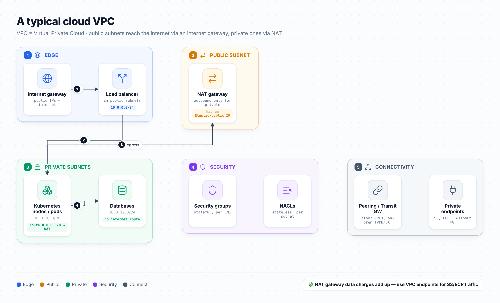

# 5.4 — Cloud networking (VPC)

!!! abstract "In one sentence"
    A **VPC** is your own private, software-defined network inside a cloud region: you choose an IP range, split it into
    **subnets** per availability zone, decide with **route tables** whether each subnet reaches the internet directly
    (**internet gateway**), only outbound (**NAT gateway**) or not at all, guard every interface with **security
    groups**, and connect to other VPCs and your data centre with **peering, transit gateways, VPN or Direct Connect**.

## 📖 Key terms & abbreviations

| Term | Stands for | What it is | How it works (one line) |
|---|---|---|---|
| **VPC / VNet** | Virtual Private Cloud / Virtual Network | Isolated network in a region | AWS/GCP call it VPC, Azure VNet |
| **SDN** | Software-Defined Networking | Network implemented in hypervisors/NICs | No real L2; the cloud decides who reaches whom |
| **Region / AZ** | — / Availability Zone | Geographic area / isolated data centre(s) in it | Subnets live in one AZ (AWS) |
| **Subnet (public / private)** | — | Slice of the VPC CIDR | "Public" = has a route to an internet gateway |
| **Route table** | — | Per-subnet routing rules | `0.0.0.0/0 → igw-…` or `→ nat-…` |
| **IGW** | Internet Gateway | Connects the VPC to the internet | 1:1 NAT for public IPs |
| **NAT gateway** | — | Outbound-only internet for private subnets | Managed SNAT, charged per GB |
| **ENI** | Elastic Network Interface | Virtual NIC attached to an instance | Has IPs and security groups |
| **Security group (SG)** | — | Stateful firewall on ENIs | Can allow traffic "from SG X" |
| **NACL** | Network Access Control List | Stateless subnet firewall | Ordered allow/deny rules |
| **VPC endpoint / PrivateLink** | — | Private access to cloud services | S3, ECR, APIs without NAT/internet |
| **Peering / TGW** | — / Transit Gateway | Connect two VPCs / hub for many VPCs + on-prem | Peering is non-transitive |
| **VPN / Direct Connect** | — | Encrypted tunnel / private fibre to the cloud | Hybrid connectivity |
| **Egress** | — | Traffic leaving a region/cloud | Usually the expensive direction |

## 🗺️ Big picture



---

## 1 · How is a VPC different from a physical network?

### How does it work?

There are no real switches or broadcast domains. Every packet leaving a VM is captured by the host (hypervisor / smart NIC such as AWS Nitro), checked against your **security groups, route tables and NACLs**, encapsulated and sent across the provider's fabric to the destination host. Consequences:

- **No broadcast/multicast, no gratuitous ARP**: the SDN answers ARP for you (5.1).
- **Source/destination checks**: an instance only receives traffic for its own IPs unless you disable the check (needed for NAT instances, some CNIs).
- **Per-instance limits** on bandwidth, packets per second and connections tracked.

## 2 · Subnets, route tables and gateways

| Subnet type | Default route | Use for |
|---|---|---|
| **Public** | `0.0.0.0/0 → internet gateway` | Load balancers, bastions, NAT gateways |
| **Private** | `0.0.0.0/0 → NAT gateway` | App servers, Kubernetes nodes |
| **Isolated** | none | Databases, sensitive workloads |

Spread subnets across **≥ 3 AZs** for availability; put one NAT gateway **per AZ** (otherwise one AZ's outage or cross-AZ data charges hit everyone).

## 3 · Security groups vs NACLs

| | Security group | NACL |
|---|---|---|
| Attached to | ENI / instance | Subnet |
| State | Stateful | Stateless (allow return ports!) |
| Rules | Allow only | Allow and deny, ordered |
| Reference | Other SGs ("from sg-web") | CIDRs only |

Typical design: **SGs do the real work** (least privilege by role), NACLs stay mostly open or block known-bad ranges.

## 4 · Connecting networks

- **VPC peering:** private routing between two VPCs; **not transitive** (A↔B and B↔C doesn't give A↔C). CIDRs must not overlap.
- **Transit gateway / Cloud Router / Virtual WAN:** a hub that connects many VPCs, VPNs and Direct Connects with route tables.
- **Site-to-site VPN** (IPsec over the internet) or **Direct Connect / Interconnect / ExpressRoute** (private links, stable latency).
- **PrivateLink / Private Service Connect:** expose a service (yours or the cloud's) into another VPC as a private IP, without routing whole networks.
- **VPC endpoints for S3/ECR/DynamoDB**: avoid NAT gateway charges and keep traffic private.

## 5 · Cloud load balancers

| Type | Layer | Notes |
|---|---|---|
| **AWS NLB / GCP passthrough** | L4 | TCP/UDP, preserves client IP, static IPs, very high scale |
| **AWS ALB / GCP HTTP(S) LB / Azure App Gateway** | L7 | Host/path routing, TLS, WAF, HTTP/2/3 |
| **Global anycast LBs** (GCP, Cloudflare, Front Door) | L7 | One IP worldwide, routes to nearest healthy region |

In Kubernetes, `Service type: LoadBalancer` or Ingress/Gateway objects create these through the cloud controller / load balancer controller.

## 🔧 DevOps connection

- **Kubernetes in the cloud:** AWS VPC CNI gives pods real VPC IPs (watch IP exhaustion, use prefix delegation); GKE uses alias IP ranges; AKS Azure CNI overlay or Cilium. Pods can then be targeted directly by LBs (`target-type: ip`).
- **Costs:** NAT gateway processing per GB, cross-AZ traffic, internet egress and inter-region traffic often dominate the network bill. Use VPC endpoints, keep chatty services in one AZ where it's safe, cache at the CDN.
- **IaC:** build VPCs with Terraform/OpenTofu modules; plan CIDRs centrally (IPAM) so future peering and acquisitions don't collide.
- **Debugging:** VPC Flow Logs (accepted/rejected flows), Reachability Analyzer / Connectivity Tests, then node-level tools.

## 🧪 Try it yourself

```bash
# AWS examples (read-only)
aws ec2 describe-vpcs --query 'Vpcs[].{id:VpcId,cidr:CidrBlock}' --output table
aws ec2 describe-subnets --query 'Subnets[].{id:SubnetId,az:AvailabilityZone,cidr:CidrBlock,free:AvailableIpAddressCount}' --output table
aws ec2 describe-route-tables --query 'RouteTables[].Routes[]' --output table | head -30
aws ec2 describe-security-groups --group-ids sg-xxxx --query 'SecurityGroups[].IpPermissions'
aws ec2 describe-nat-gateways --query 'NatGateways[].{id:NatGatewayId,subnet:SubnetId,state:State}'

# From inside an instance: metadata about its network (IMDSv2)
TOKEN=$(curl -s -X PUT http://169.254.169.254/latest/api/token -H 'X-aws-ec2-metadata-token-ttl-seconds: 60')
curl -s -H "X-aws-ec2-metadata-token: $TOKEN" http://169.254.169.254/latest/meta-data/network/interfaces/macs/
```

## 🃏 Cheat sheet

| Want | Use |
|---|---|
| Internet-facing LB | Public subnets + IGW |
| Private servers that download updates | Private subnets + NAT gateway (per AZ) |
| Reach S3/ECR without NAT | Gateway / interface VPC endpoints |
| Allow app → DB | DB SG allows port 5432 **from** app SG |
| Connect many VPCs + on-prem | Transit gateway (hub-and-spoke) |
| See dropped traffic | VPC Flow Logs |

## ❓ Test yourself

??? question "1. What makes a subnet 'public'?"
    Its route table has a default route to an internet gateway (and instances have public IPs).

??? question "2. Instances in a private subnet can't download packages. What do you check?"
    The subnet's route table has 0.0.0.0/0 → a NAT gateway in a public subnet, the NAT gateway is healthy, and SG/NACL allow outbound + return traffic.

??? question "3. VPC A is peered with B, and B with C. Can A reach C?"
    No. Peering isn't transitive; use a transit gateway or peer A and C directly.

??? question "4. Why is it better to reference security groups than CIDRs in rules?"
    Rules follow roles, not IPs: any instance (or pod with SG-for-pods) in the app SG is allowed, even as IPs change with autoscaling.

??? question "5. Your NAT gateway bill is huge. What's a common fix?"
    Add VPC endpoints for S3/ECR/other AWS services so that traffic bypasses the NAT gateway.

---

## 📚 Sources

- [AWS — How Amazon VPC works](https://docs.aws.amazon.com/vpc/latest/userguide/how-it-works.html)
- [Google Cloud — VPC overview](https://cloud.google.com/vpc/docs/vpc)
- [Azure — Virtual Network overview](https://learn.microsoft.com/en-us/azure/virtual-network/virtual-networks-overview)
- [Amazon EKS — Pod networking (VPC CNI)](https://docs.aws.amazon.com/eks/latest/userguide/managing-vpc-cni.html)

## ✍️ My notes

> Draw your production VPC: subnets per AZ, route tables, gateways, endpoints, peering. Where does traffic leave the cloud, and what does it cost?

-
