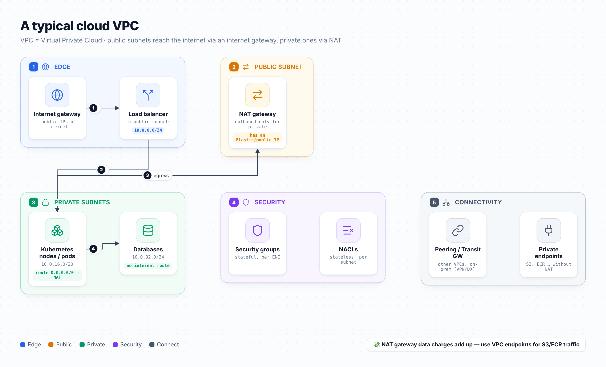

# 5.4 — Bulut ağları (VPC)

!!! abstract "Tek cümlede"
    **VPC**, bir bulut bölgesi içinde sana ait özel, yazılım tanımlı bir ağdır: bir IP aralığı seçersin, onu availability
    zone başına **subnet**'lere bölersin, her subnet'in internete doğrudan mı (**internet gateway**), sadece dışa doğru mu
    (**NAT gateway**) yoksa hiç mi çıkacağına **route table**'larla karar verirsin, her arayüzü **security group**'larla
    korursun ve diğer VPC'lere ve veri merkezine **peering, transit gateway, VPN ya da Direct Connect** ile bağlanırsın.

## 📖 Temel terimler ve kısaltmalar

| Terim | Açılımı | Nedir | Nasıl çalışır (tek satır) |
|---|---|---|---|
| **VPC / VNet** | Virtual Private Cloud / Virtual Network | Bir bölgedeki izole ağ | AWS/GCP VPC, Azure VNet der |
| **SDN** | Software-Defined Networking | Hypervisor'larda/NIC'lerde uygulanan ağ | Gerçek L2 yok; kimin kime ulaşacağına bulut karar verir |
| **Bölge / AZ** | Region / Availability Zone | Coğrafi alan / içindeki izole veri merkez(ler)i | Subnet'ler tek bir AZ'de yaşar (AWS) |
| **Subnet (public / private)** | — | VPC CIDR'ının bir dilimi | "Public" = internet gateway'e rotası var |
| **Route table** | — | Subnet başına routing kuralları | `0.0.0.0/0 → igw-…` ya da `→ nat-…` |
| **IGW** | Internet Gateway | VPC'yi internete bağlar | Genel IP'ler için 1:1 NAT |
| **NAT gateway** | — | Private subnet'ler için sadece dışa internet | Yönetilen SNAT, GB başına ücretli |
| **ENI** | Elastic Network Interface | Bir instance'a bağlı sanal NIC | IP'leri ve security group'ları var |
| **Security group (SG)** | — | ENI'lerde durumlu firewall | "SG X'ten" gelen trafiğe izin verebilir |
| **NACL** | Network Access Control List | Durumsuz subnet firewall'u | Sıralı izin/red kuralları |
| **VPC endpoint / PrivateLink** | — | Bulut servislerine özel erişim | NAT/internet olmadan S3, ECR, API'ler |
| **Peering / TGW** | — / Transit Gateway | İki VPC'yi bağla / çok VPC + şirket içi için merkez | Peering geçişli değildir |
| **VPN / Direct Connect** | — | Şifreli tünel / buluta özel fiber | Hibrit bağlantı |
| **Egress** | — | Bölgeden/buluttan çıkan trafik | Genelde pahalı olan yön |

## 🗺️ Büyük resim



---

## 1 · VPC fiziksel bir ağdan nasıl farklı?

### Nasıl çalışır?

Gerçek switch'ler ya da yayın alanları yoktur. Bir VM'den çıkan her paketi host (hypervisor / AWS Nitro gibi akıllı NIC) yakalar, **security group, route table ve NACL**'lerine göre kontrol eder, kapsüller ve sağlayıcının ağı üzerinden hedef host'a gönderir. Sonuçları:

- **Yayın/multicast yok, gratuitous ARP yok**: ARP'yi SDN senin yerine cevaplar (5.1).
- **Kaynak/hedef kontrolleri**: bir instance kontrolü kapatmadıkça sadece kendi IP'lerine gelen trafiği alır (NAT instance'ları ve bazı CNI'lar için gerekli).
- Bant genişliği, saniyedeki paket ve izlenen bağlantılar için **instance başına limitler**.

## 2 · Subnet'ler, route table'lar ve gateway'ler

| Subnet tipi | Default rota | Ne için |
|---|---|---|
| **Public** | `0.0.0.0/0 → internet gateway` | Load balancer'lar, bastion'lar, NAT gateway'ler |
| **Private** | `0.0.0.0/0 → NAT gateway` | Uygulama sunucuları, Kubernetes node'ları |
| **İzole** | yok | Veritabanları, hassas iş yükleri |

Erişilebilirlik için subnet'leri **≥ 3 AZ**'ye yay; **AZ başına bir** NAT gateway koy (yoksa bir AZ'nin kesintisi ya da AZ'ler arası veri ücretleri herkesi vurur).

## 3 · Security group ve NACL

| | Security group | NACL |
|---|---|---|
| Bağlı olduğu | ENI / instance | Subnet |
| Durum | Durumlu | Durumsuz (dönüş portlarına izin ver!) |
| Kurallar | Sadece izin | İzin ve red, sıralı |
| Referans | Diğer SG'ler ("sg-web'den") | Sadece CIDR'lar |

Tipik tasarım: **asıl işi SG'ler yapar** (role göre en az yetki), NACL'ler çoğunlukla açık kalır ya da bilinen kötü aralıkları engeller.

## 4 · Ağları bağlamak

- **VPC peering:** iki VPC arasında özel routing; **geçişli değil** (A↔B ve B↔C, A↔C vermez). CIDR'lar çakışmamalı.
- **Transit gateway / Cloud Router / Virtual WAN:** çok sayıda VPC'yi, VPN'i ve Direct Connect'i route table'larla bağlayan bir merkez.
- **Site-to-site VPN** (internet üzerinden IPsec) ya da **Direct Connect / Interconnect / ExpressRoute** (özel bağlantılar, sabit gecikme).
- **PrivateLink / Private Service Connect:** bir servisi (seninkini ya da bulutunkini) tüm ağları yönlendirmeden başka bir VPC'ye özel bir IP olarak aç.
- **S3/ECR/DynamoDB için VPC endpoint'leri**: NAT gateway ücretlerinden kaçın ve trafiği özel tut.

## 5 · Bulut load balancer'ları

| Tip | Katman | Notlar |
|---|---|---|
| **AWS NLB / GCP passthrough** | L4 | TCP/UDP, istemci IP'sini korur, sabit IP'ler, çok yüksek ölçek |
| **AWS ALB / GCP HTTP(S) LB / Azure App Gateway** | L7 | Host/yol yönlendirme, TLS, WAF, HTTP/2/3 |
| **Global anycast LB'ler** (GCP, Cloudflare, Front Door) | L7 | Dünya çapında tek IP, en yakın sağlıklı bölgeye yönlendirir |

Kubernetes'te `Service type: LoadBalancer` ya da Ingress/Gateway nesneleri bunları cloud controller / load balancer controller üzerinden oluşturur.

## 🔧 DevOps bağlantısı

- **Bulutta Kubernetes:** AWS VPC CNI pod'lara gerçek VPC IP'leri verir (IP tükenmesine dikkat, prefix delegation kullan); GKE alias IP aralıkları kullanır; AKS Azure CNI overlay ya da Cilium. Pod'lar sonra LB'ler tarafından doğrudan hedeflenebilir (`target-type: ip`).
- **Maliyetler:** GB başına NAT gateway işleme, AZ'ler arası trafik, internet çıkışı ve bölgeler arası trafik çoğu zaman ağ faturasına hükmeder. VPC endpoint'leri kullan, güvenliyse konuşkan servisleri tek AZ'de tut, CDN'de önbelleğe al.
- **IaC:** VPC'leri Terraform/OpenTofu modülleriyle kur; gelecekteki peering ve şirket satın almaları çakışmasın diye CIDR'ları merkezi planla (IPAM).
- **Hata ayıklama:** VPC Flow Logs (kabul/red edilen akışlar), Reachability Analyzer / Connectivity Tests, sonra node düzeyi araçlar.

## 🧪 Kendin dene

```bash
# AWS örnekleri (salt okunur)
aws ec2 describe-vpcs --query 'Vpcs[].{id:VpcId,cidr:CidrBlock}' --output table
aws ec2 describe-subnets --query 'Subnets[].{id:SubnetId,az:AvailabilityZone,cidr:CidrBlock,free:AvailableIpAddressCount}' --output table
aws ec2 describe-route-tables --query 'RouteTables[].Routes[]' --output table | head -30
aws ec2 describe-security-groups --group-ids sg-xxxx --query 'SecurityGroups[].IpPermissions'
aws ec2 describe-nat-gateways --query 'NatGateways[].{id:NatGatewayId,subnet:SubnetId,state:State}'

# Bir instance'ın içinden: ağıyla ilgili metadata (IMDSv2)
TOKEN=$(curl -s -X PUT http://169.254.169.254/latest/api/token -H 'X-aws-ec2-metadata-token-ttl-seconds: 60')
curl -s -H "X-aws-ec2-metadata-token: $TOKEN" http://169.254.169.254/latest/meta-data/network/interfaces/macs/
```

## 🃏 Hatırlatma kartı

| İstek | Kullan |
|---|---|
| İnternete açık LB | Public subnet'ler + IGW |
| Güncelleme indiren private sunucular | Private subnet'ler + NAT gateway (AZ başına) |
| NAT'sız S3/ECR'a ulaş | Gateway / interface VPC endpoint'leri |
| Uygulama → DB izni | DB SG'si 5432 portuna uygulama SG'sinden **gelen** trafiğe izin verir |
| Çok VPC + şirket içini bağla | Transit gateway (hub-and-spoke) |
| Düşen trafiği gör | VPC Flow Logs |

## ❓ Kendini test et

??? question "1. Bir subnet'i 'public' yapan nedir?"
    Route table'ında bir internet gateway'e default rota olması (ve instance'ların genel IP'si olması).

??? question "2. Private subnet'teki instance'lar paket indiremiyor. Neyi kontrol edersin?"
    Subnet'in route table'ında 0.0.0.0/0 → public subnet'teki bir NAT gateway var mı, NAT gateway sağlıklı mı, SG/NACL dışa ve dönüş trafiğine izin veriyor mu.

??? question "3. VPC A, B ile; B de C ile peer edilmiş. A, C'ye ulaşabilir mi?"
    Hayır. Peering geçişli değildir; transit gateway kullan ya da A ile C'yi doğrudan peer et.

??? question "4. Kurallarda CIDR yerine security group referans almak neden daha iyi?"
    Kurallar IP'leri değil rolleri takip eder: otomatik ölçeklemeyle IP'ler değişse de uygulama SG'sindeki her instance'a (ya da SG-for-pods ile pod'a) izin verilir.

??? question "5. NAT gateway faturan çok büyük. Yaygın bir çözüm?"
    Trafiğin NAT gateway'i atlaması için S3/ECR/diğer AWS servislerine VPC endpoint'leri ekle.

---

## 📚 Kaynaklar

- [AWS — How Amazon VPC works](https://docs.aws.amazon.com/vpc/latest/userguide/how-it-works.html)
- [Google Cloud — VPC overview](https://cloud.google.com/vpc/docs/vpc)
- [Azure — Virtual Network overview](https://learn.microsoft.com/en-us/azure/virtual-network/virtual-networks-overview)
- [Amazon EKS — Pod networking (VPC CNI)](https://docs.aws.amazon.com/eks/latest/userguide/managing-vpc-cni.html)

## ✍️ Notlarım

> Production VPC'ni çiz: AZ başına subnet'ler, route table'lar, gateway'ler, endpoint'ler, peering. Trafik buluttan nerede çıkıyor ve maliyeti ne?

-
