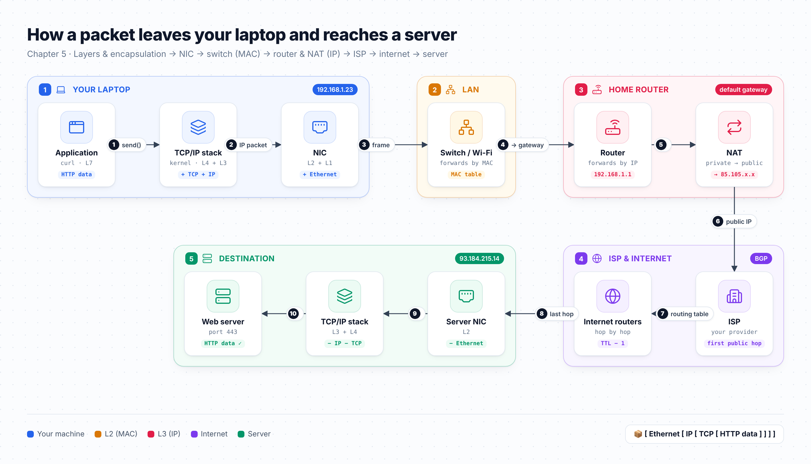
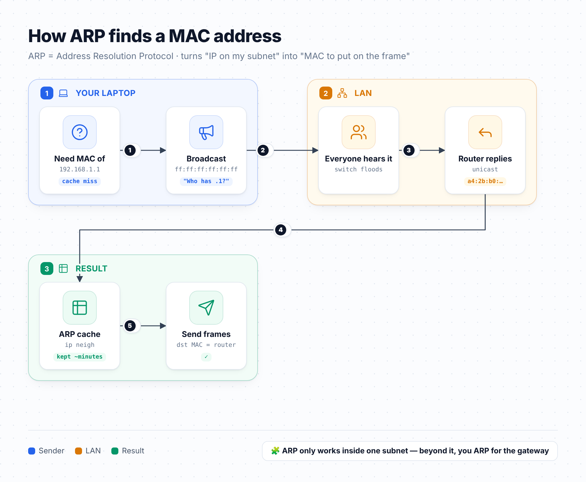
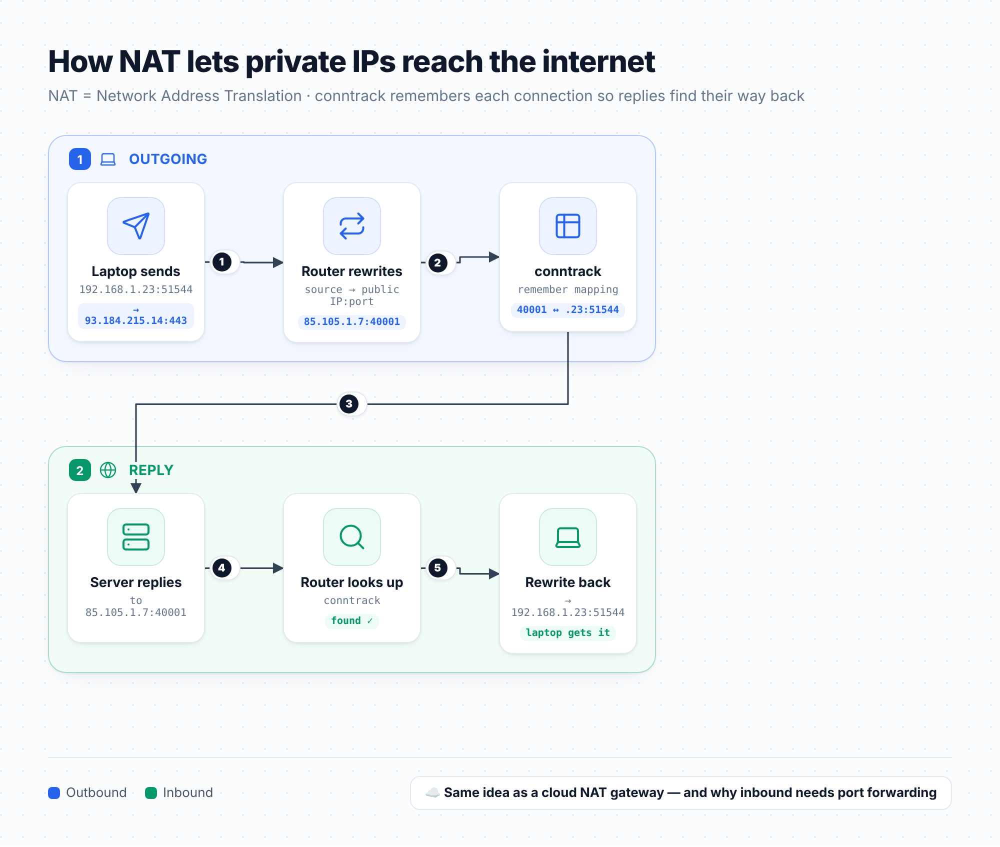

# Chapter 5 — Networking fundamentals

!!! abstract "In short"
    Your data gets wrapped in **layers** of headers (TCP → IP → Ethernet). A **switch** delivers it inside your local
    network using **MAC** addresses. A **router** moves it between networks using **IP** addresses, and **NAT** swaps
    your private IP for a public one. Then dozens of routers forward it **hop by hop** until it reaches the server,
    which unwraps the layers in reverse.

## 📖 Key terms & abbreviations

| Term | Stands for | What it is | How it works (one line) |
|---|---|---|---|
| **OSI / TCP/IP model** | Open Systems Interconnection | Layered models of networking | Each layer solves one problem and adds one header |
| **MAC address** | Media Access Control | 48-bit hardware address on a local link | Used by switches to deliver frames |
| **IP address** | Internet Protocol | Address of a host on the internet (IPv4 32-bit, IPv6 128-bit) | Routers forward packets by destination IP |
| **Port** | — | 16-bit number selecting a program on a host | TCP/UDP header carries source and destination ports |
| **Subnet / CIDR** | Classless Inter-Domain Routing | A block of IPs like 192.168.1.0/24 | /24 = first 24 bits are the network part |
| **Default gateway** | — | The router for everything outside your subnet | Frames for remote IPs go to its MAC |
| **ARP** | Address Resolution Protocol | Finds the MAC for an IP on the local network | Broadcast 'who has X?', owner replies, result cached |
| **Switch** | — | L2 device forwarding frames by MAC | Learns which MAC is behind which port |
| **Router** | — | L3 device forwarding packets between networks | Longest-prefix match in the routing table, TTL−1 |
| **NAT** | Network Address Translation | Rewrites private addresses to a public one | Remembers each connection in a conntrack table |
| **MTU** | Maximum Transmission Unit | Largest payload per frame (usually 1500 bytes) | Bigger data is split into several packets |
| **TTL** | Time To Live | Hop counter in the IP header | Each router decrements it; 0 = drop (prevents loops) |
| **BGP / AS** | Border Gateway Protocol / Autonomous System | How networks on the internet share routes | Each AS announces the IP ranges it can reach |
| **VPC** | Virtual Private Cloud | A private network in a cloud | Subnets, route tables, gateways, security groups in software |

## 🗺️ Big picture



---

## 1 · Layers: each one solves one problem

| Layer (OSI #) | Name | Problem it solves | Address | Device | Examples |
|---|---|---|---|---|---|
| 7 | Application | What do the bytes *mean*? | URL, hostname | — | HTTP, DNS, SSH |
| 4 | Transport | Which **program** on the machine? Reliable or fast? | **Port** (16-bit) | — (end hosts) | TCP, UDP |
| 3 | Network | Which **machine** in the world? | **IP** (IPv4 32-bit, IPv6 128-bit) | Router | IP, ICMP |
| 2 | Data link | Which machine on **this cable / Wi-Fi**? | **MAC** (48-bit) | Switch, AP | Ethernet, Wi-Fi |
| 1 | Physical | Turn bits into signals | — | Cable, radio | Copper, fibre, 2.4/5 GHz |

> OSI layers 5 and 6 exist on paper. In practice TLS and the application cover them.

## 2 · Encapsulation: envelopes inside envelopes

```text
[ Ethernet 14 B | [ IP 20 B | [ TCP 20 B | [ HTTP data … ] ] ] | FCS 4 B ]
```

- Going **down** the stack, each layer adds its header. Going **up** at the receiver, each layer removes its own.
- The maximum frame payload on Ethernet is usually **1500 bytes** (**MTU**). Bigger data is split into multiple TCP segments.
- **MAC addresses change at every hop, IP addresses do not** (except where NAT rewrites them). The IP is the final destination; the MAC is just "the next device".

## 3 · Your local network: subnet, ARP, switch

Your laptop has `192.168.1.23/24`. The `/24` (subnet mask `255.255.255.0`) means "the first 24 bits are the network": everyone from `192.168.1.0` to `192.168.1.255` is on **my** local network.

The laptop asks itself one question for every packet:

| Destination on my subnet? | Then |
|---|---|
| **Yes** (e.g. `192.168.1.50`) | Send the frame directly to that machine's MAC. |
| **No** (e.g. `93.184.215.14`) | Send the frame to the **default gateway** (the router, `192.168.1.1`). |

To get a MAC from an IP, it uses **ARP**:

```text
Broadcast: "Who has 192.168.1.1? Tell 192.168.1.23"
Reply:     "192.168.1.1 is at a4:2b:b0:12:34:56"     → cached in the ARP table
```

A **switch** (or Wi-Fi access point) learns which MAC lives behind which port and forwards frames only there. It never looks at IP addresses.

### How does ARP work?

To send a frame on the LAN you need the destination's **MAC**. If it is not in the cache, the host broadcasts *who has 192.168.1.1?*; every device hears it, only the owner replies with its MAC. The answer is cached (`ip neigh`) and frames can flow.



## 4 · The router and NAT

| # | What happens |
|---|---|
| 4 | The frame arrives at the router because its destination MAC is the router's MAC. |
| 5 | The router strips the Ethernet header, reads the **destination IP**, checks its **routing table** (longest matching prefix wins; `0.0.0.0/0` = "everything else → ISP"), decrements **TTL**, and builds a new frame for the next hop. |
| — | **NAT:** `192.168.x.x` addresses are **private** (also `10.0.0.0/8` and `172.16.0.0/12`). They're not routable on the internet, so the router rewrites the source to its **public IP** and a port, and remembers the mapping in a **connection tracking** table so replies can find their way back. |

> That's also why someone on the internet can't simply connect *to* your laptop: there is no NAT entry until you start the conversation (unless you add port forwarding).

### How does NAT work?

On the way out, the router replaces the private source IP:port with its public IP and a free port, and writes the mapping into **conntrack**. When the reply arrives at that public port, it looks up the mapping and rewrites the destination back to the private address.



## 5 · The internet: a network of networks

- Your ISP, the cloud providers and big companies each run their own networks, called **autonomous systems** (AS).
- They tell each other which IP ranges they can reach using **BGP**. That's how a router in Istanbul knows where to send a packet for an address in Virginia.
- Every router on the way repeats the same job: read the destination IP, look up the table, forward, `TTL − 1`. `traceroute` makes these hops visible by sending packets with TTL 1, 2, 3, …

## 6 · At the destination

The server's NIC accepts the frame because it's addressed to its MAC. The kernel removes the Ethernet and IP headers, uses the **destination port** (443) to find the socket that the web server is listening on, and hands the data to the process.

> DevOps connection: an AWS/GCP **VPC** is this exact model in software: **subnets** (CIDR blocks), **route tables** (`0.0.0.0/0 → internet gateway`), a **NAT gateway** so private subnets can reach out, and **security groups** acting as per-instance firewalls on IP + port. Kubernetes adds its own pod CIDR on top.

---

## 🚨 Incident story: peering that broke half the cluster

!!! failure "The alarm"
    A new VPC peering to the data team's VPC goes live. Minutes later, some pods can no longer reach each other, and the data team can reach *some* of your services but not others.

Try to diagnose it yourself first, then open the clues one by one.

??? info "🔍 Clue 1"
    Your cluster's pod CIDR is `10.244.0.0/16`. The data VPC is `10.244.0.0/16` too (both teams used a common default).

??? info "🔍 Clue 2"
    `ip route get 10.244.3.8` on a node now picks the peering route for part of the range: longest-prefix match prefers the more specific routes that were just added.

??? success "🎯 Root cause"
    Overlapping address ranges make routing ambiguous: packets for pod IPs are sent to the other VPC (and vice versa), depending on which route is more specific.

??? tip "🛠️ Fix and lesson"
    Remove the peering, renumber one side (new pod CIDR or secondary VPC CIDR), and keep a central IPAM plan. **Lesson:** VPC, pod, service, on-prem and peered CIDRs must never overlap; plan them before the first cluster.

## 🧭 Go deeper

| Page | What's inside |
|---|---|
| **[5.1 — Ethernet, ARP & VLANs (Layer 2)](01-ethernet-arp-vlan.md)** | How Ethernet frames, MAC addresses and switches work, MAC learning and flooding, ARP and its cache, broadcast domains and VLANs (802.1Q), MTU and jumbo frames, loops and STP, and how Layer 2 appears in Linux bridges, Docker and Kubernetes CNIs. |
| **[5.2 — IP addressing, subnets & routing](02-ip-routing.md)** | IPv4 and IPv6 addresses, CIDR and subnet math, private ranges, routing tables and longest-prefix match, default gateways, ICMP, traceroute, TTL, fragmentation and PMTU, and how routing works between Kubernetes pods and across VPCs. |
| **[5.3 — NAT, firewalls & conntrack](03-nat-firewall.md)** | Stateless vs stateful firewalls, netfilter hooks, iptables vs nftables, connection tracking, SNAT, DNAT and masquerading, port exhaustion, how kube-proxy implements Services with NAT, eBPF alternatives (Cilium), NetworkPolicies and cloud security groups. |
| **[5.4 — Cloud networking (VPC)](04-cloud-networking.md)** | How cloud networks are built on SDN, VPCs, subnets and availability zones, route tables, internet and NAT gateways, security groups and NACLs, private endpoints, peering, transit gateways, VPN and Direct Connect, cloud load balancers, egress costs and Kubernetes networking in the cloud. |

## 🧪 Try it yourself (Linux / macOS)

!!! example "🧪 Ready-made lab"
    Run this chapter's experiments with one command: `./labs/run.sh 05-network` ([scripts](https://github.com/gaskinimbuspro/silicon-to-cloud/tree/main/labs/05-network/)). No setup? [Open in Codespaces](https://codespaces.new/gaskinimbuspro/silicon-to-cloud). <!-- s2c-lab -->


```bash
# 1) Your addresses, subnet and MAC
ip addr                     # macOS: ifconfig
ip route                    # 'default via 192.168.1.1' = your gateway
ip neigh                    # ARP table: IP → MAC   (macOS: arp -a)

# 2) Is it local or through the gateway?
ip route get 192.168.1.50
ip route get 8.8.8.8

# 3) Hops to a server, live
traceroute example.com      # or: mtr example.com

# 4) Watch ARP and ping on the wire (Ethernet headers included)
sudo tcpdump -n -e -i any 'arp or icmp'   # in another terminal: ping -c 3 192.168.1.1

# 5) Your public IP (what NAT turns you into)
curl -s https://ifconfig.me ; echo

# 6) Open sockets: local IP:port ↔ remote IP:port
ss -tn
```

**Exercise:** compare the IP you see in `ip addr` with the one from `ifconfig.me`. Which device is rewriting it, and where is that mapping stored?

---

## 🃏 Cheat sheet

```text
L7 data → L4 +TCP header (ports) → L3 +IP header (IPs) → L2 +Ethernet (MACs) → L1 signals
Same subnet? → ARP for target MAC → switch delivers
Other subnet? → ARP for gateway MAC → router → routing table → next hop (TTL−1)
Private IP → NAT (conntrack) → public IP → ISP → BGP-routed internet → server
MAC changes every hop, IP stays (except NAT). Port picks the program.
MTU 1500 · /24 = 256 addresses · private: 10/8, 172.16/12, 192.168/16
```

---

## ❓ Test yourself

??? question "1. A packet goes through 12 routers. How many times does the destination IP change? And the destination MAC?"
    The destination IP stays the same the whole way (ignoring NAT on the server side). The destination MAC changes at every hop, because each L2 frame only goes to the next device.

??? question "2. Your laptop wants to reach 192.168.1.50 and 8.8.8.8. Which MAC address does it put on each frame?"
    For 192.168.1.50 (same /24): that machine's own MAC, found via ARP. For 8.8.8.8 (outside the subnet): the **gateway's** MAC.

??? question "3. What does a switch look at, and what does a router look at?"
    A switch looks at **MAC** addresses (L2). A router looks at **IP** addresses (L3) and its routing table.

??? question "4. Why can't a server on the internet open a connection to your laptop at home?"
    Your laptop only has a private IP behind NAT. The router only knows where to send incoming packets for conversations your side started (conntrack entries). Unsolicited inbound traffic has no mapping, unless you configure port forwarding.

??? question "5. What is the AWS equivalent of your home router's NAT?"
    A **NAT gateway**: instances in a private subnet send outbound traffic through it, and it rewrites their private IPs to a public one.

---

## 📚 Sources

- [Computer Networking: A Top-Down Approach (Kurose & Ross)](https://gaia.cs.umass.edu/kurose_ross/index.php)
- [RFC 826: ARP](https://www.rfc-editor.org/rfc/rfc826) · [RFC 1918: private address space](https://www.rfc-editor.org/rfc/rfc1918) · [RFC 791: IPv4](https://www.rfc-editor.org/rfc/rfc791)
- [Cloudflare Learning Center: What is BGP?](https://www.cloudflare.com/learning/security/glossary/what-is-bgp/)
- [AWS VPC: how it works](https://docs.aws.amazon.com/vpc/latest/userguide/how-it-works.html)

## ✍️ My notes

> Explain why MAC addresses change at every hop but IP addresses don't, in your own words in 5 lines.
