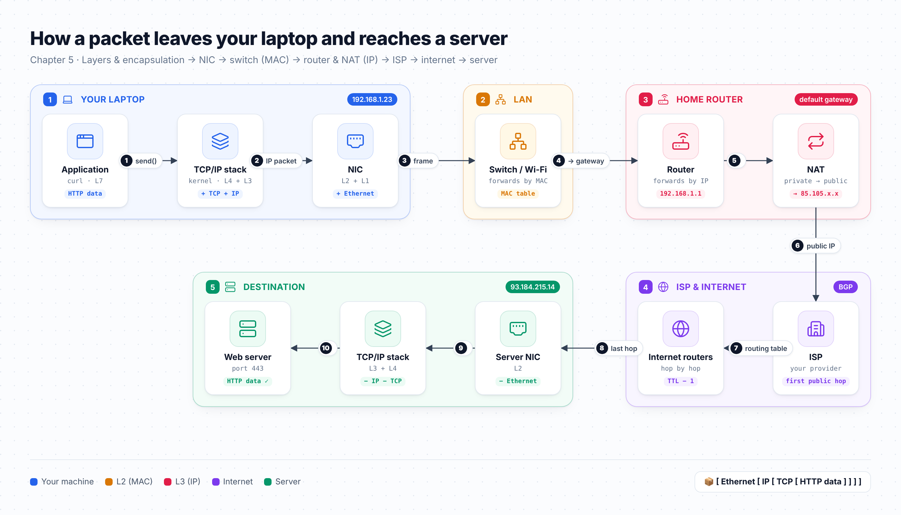
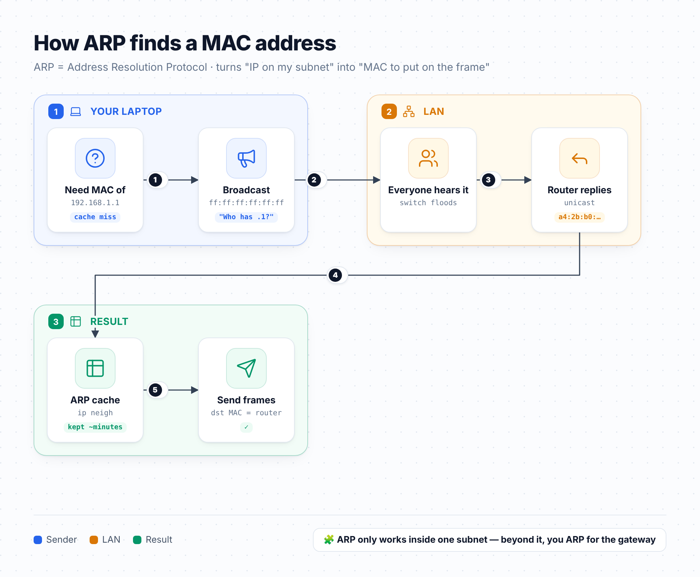
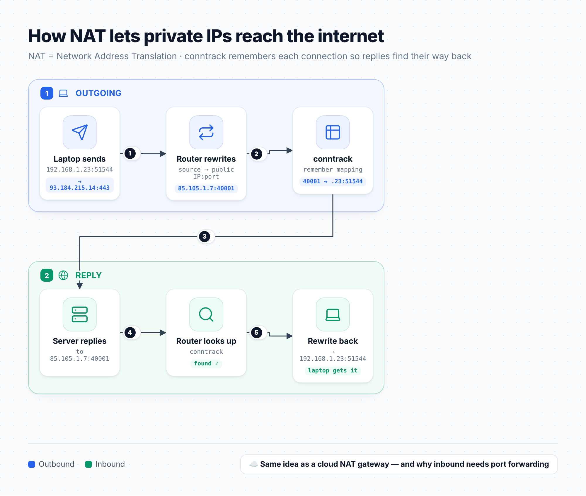

# Bölüm 5 — Ağın temelleri

!!! abstract "Tek cümlede"
    Verin başlık **katmanlarına** sarılır (TCP → IP → Ethernet). Yerel ağın içinde onu **MAC** adreslerini kullanan
    bir **switch** teslim eder. Ağlar arasında **IP** adreslerini kullanan bir **router** taşır, **NAT** ise özel IP'ni
    genel bir IP ile değiştirir. Sonra onlarca router paketi sunucuya ulaşana kadar **hop hop** iletir.
    Sunucu da katmanları ters sırayla açar.

## 📖 Temel terimler ve kısaltmalar

| Terim | Açılımı | Nedir | Nasıl çalışır (tek satır) |
|---|---|---|---|
| **OSI / TCP/IP model** | Open Systems Interconnection | Ağın katmanlı modelleri | Her katman tek bir sorunu çözer ve bir başlık ekler |
| **MAC address** | Media Access Control | Yerel bağlantıdaki 48 bitlik donanım adresi | Switch'ler çerçeveleri teslim etmek için kullanır |
| **IP address** | Internet Protocol | İnternetteki bir makinenin adresi (IPv4 32 bit, IPv6 128 bit) | Router'lar paketleri hedef IP'ye göre iletir |
| **Port** | — | Bir makinedeki programı seçen 16 bitlik sayı | TCP/UDP başlığı kaynak ve hedef portları taşır |
| **Subnet / CIDR** | Classless Inter-Domain Routing | 192.168.1.0/24 gibi bir IP bloğu | /24 = ilk 24 bit ağ kısmıdır |
| **Default gateway** | — | Subnet dışındaki her şey için router | Uzak IP'lere giden çerçeveler onun MAC'ine gider |
| **ARP** | Address Resolution Protocol | Yerel ağda bir IP'nin MAC'ini bulur | 'X kimde?' yayını, sahibi cevaplar, sonuç önbelleğe alınır |
| **Switch** | — | MAC'e göre çerçeve ileten L2 cihazı | Hangi MAC'in hangi portun arkasında olduğunu öğrenir |
| **Router** | — | Ağlar arasında paket ileten L3 cihazı | Yönlendirme tablosunda en uzun önek eşleşmesi, TTL−1 |
| **NAT** | Network Address Translation | Özel adresleri genel bir adrese çevirir | Her bağlantıyı bir conntrack tablosunda hatırlar |
| **MTU** | Maximum Transmission Unit | Çerçeve başına en büyük yük (genelde 1500 byte) | Daha büyük veri birden fazla pakete bölünür |
| **TTL** | Time To Live | IP başlığındaki hop sayacı | Her router bir azaltır; 0 = at (döngüleri önler) |
| **BGP / AS** | Border Gateway Protocol / Autonomous System | İnternetteki ağların rota paylaşma şekli | Her AS ulaşabildiği IP aralıklarını duyurur |
| **VPC** | Virtual Private Cloud | Bulutta özel bir ağ | Yazılımda subnet, route table, gateway, security group |

## 🗺️ Büyük resim



---

## 1 · Katmanlar: her biri tek bir sorunu çözer

| Katman (OSI #) | Adı | Çözdüğü sorun | Adres | Cihaz | Örnekler |
|---|---|---|---|---|---|
| 7 | Uygulama | Byte'lar ne *anlama* geliyor? | URL, hostname | — | HTTP, DNS, SSH |
| 4 | Taşıma | Makinedeki hangi **program**? Güvenilir mi, hızlı mı? | **Port** (16 bit) | — (uç makineler) | TCP, UDP |
| 3 | Ağ | Dünyadaki hangi **makine**? | **IP** (IPv4 32 bit, IPv6 128 bit) | Router | IP, ICMP |
| 2 | Veri bağlantısı | **Bu kablodaki / Wi-Fi'daki** hangi makine? | **MAC** (48 bit) | Switch, AP | Ethernet, Wi-Fi |
| 1 | Fiziksel | Bitleri sinyale çevir | — | Kablo, radyo | Bakır, fiber, 2.4/5 GHz |

> OSI'nin 5. ve 6. katmanları kâğıt üzerinde var. Pratikte bu işleri TLS ve uygulamanın kendisi görür.

## 2 · Kapsülleme: zarf içinde zarf

```text
[ Ethernet 14 B | [ IP 20 B | [ TCP 20 B | [ HTTP verisi … ] ] ] | FCS 4 B ]
```

- Yığında **aşağı** inerken her katman kendi başlığını ekler. Alıcıda **yukarı** çıkarken her katman kendi başlığını çıkarır.
- Ethernet'te bir çerçevenin taşıyabileceği en büyük yük genelde **1500 byte**'tır (**MTU**). Daha büyük veri birden fazla TCP segmentine bölünür.
- **MAC adresleri her hop'ta değişir, IP adresleri değişmez** (NAT'ın yeniden yazdığı yerler hariç). IP son hedeftir, MAC sadece "sıradaki cihaz"dır.

## 3 · Yerel ağın: subnet, ARP, switch

Laptopunun adresi `192.168.1.23/24`. Buradaki `/24` (subnet maskesi `255.255.255.0`) "ilk 24 bit ağı gösterir" demek. Yani `192.168.1.0` ile `192.168.1.255` arasındaki herkes **benim** yerel ağımda.

Laptop her paket için kendine tek bir soru sorar:

| Hedef benim subnet'imde mi? | O zaman |
|---|---|
| **Evet** (ör. `192.168.1.50`) | Çerçeveyi doğrudan o makinenin MAC'ine gönder. |
| **Hayır** (ör. `93.184.215.14`) | Çerçeveyi **varsayılan ağ geçidine** (router, `192.168.1.1`) gönder. |

Bir IP'nin MAC adresini bulmak için **ARP** kullanılır:

```text
Yayın (broadcast): "192.168.1.1 kimde? 192.168.1.23'e söyle"
Cevap:             "192.168.1.1, a4:2b:b0:12:34:56'da"     → ARP tablosuna kaydedilir
```

Bir **switch** (ya da Wi-Fi erişim noktası) hangi MAC'in hangi portun arkasında olduğunu öğrenir ve çerçeveleri sadece oraya iletir. IP adreslerine hiç bakmaz.

### ARP nasıl çalışır?

LAN'da bir çerçeve göndermek için hedefin **MAC**'i gerekir. Önbellekte yoksa makine *192.168.1.1 kimde?* diye yayın yapar; herkes duyar, sadece sahibi MAC'iyle cevap verir. Cevap önbelleğe alınır (`ip neigh`) ve çerçeveler akmaya başlar.



## 4 · Router ve NAT

| # | Ne oluyor |
|---|---|
| 4 | Çerçevenin hedef MAC'i router'ın MAC'i olduğu için çerçeve router'a ulaşır. |
| 5 | Router Ethernet başlığını söker, **hedef IP**'yi okur ve **yönlendirme tablosuna** bakar. En uzun eşleşen önek kazanır, `0.0.0.0/0` = "geri kalan her şey → ISP" demektir. Ardından **TTL**'i bir azaltır ve sıradaki hop için yeni bir çerçeve kurar. |
| — | **NAT:** `192.168.x.x` adresleri **özeldir** (`10.0.0.0/8` ve `172.16.0.0/12` de öyle). İnternette yönlendirilemezler. Bu yüzden router kaynak adresi kendi **genel IP**'si ve bir port ile değiştirir ve bu eşleşmeyi bir **bağlantı takip (conntrack)** tablosunda hatırlar ki cevaplar geri dönüş yolunu bulabilsin. |

> İnternetteki birinin laptopuna öylece bağlanamamasının sebebi de bu: konuşmayı sen başlatana kadar NAT tablosunda bir girdi yoktur (port yönlendirme eklemediğin sürece).

### NAT nasıl çalışır?

Giderken router özel kaynak IP:port'u kendi genel IP'si ve boş bir portla değiştirir, eşleşmeyi **conntrack**'e yazar. Cevap o genel porta geldiğinde eşleşmeye bakar ve hedefi özel adrese geri çevirir.



## 5 · İnternet: ağların ağı

- ISP'in, bulut sağlayıcılar ve büyük şirketler kendi ağlarını işletir. Bunlara **otonom sistem** (AS) denir.
- Hangi IP aralıklarına ulaşabildiklerini birbirlerine **BGP** ile bildirirler. İstanbul'daki bir router'ın Virginia'daki bir adrese giden paketi nereye göndereceğini böyle bilir.
- Yoldaki her router aynı işi tekrarlar: hedef IP'yi oku, tabloya bak, ilet, `TTL − 1`. `traceroute`, TTL'i 1, 2, 3, … olan paketler göndererek bu hop'ları görünür kılar.

## 6 · Hedefte

Sunucunun NIC'i çerçeveyi kabul eder, çünkü çerçeve onun MAC'ine gönderilmiştir. Kernel Ethernet ve IP başlıklarını çıkarır, **hedef port**'u (443) kullanarak web sunucusunun dinlediği soketi bulur ve veriyi process'e verir.

> DevOps bağlantısı: AWS/GCP'deki **VPC** tam olarak bu modelin yazılım halidir: **subnet**'ler (CIDR blokları), **route table**'lar (`0.0.0.0/0 → internet gateway`), özel subnet'lerin dışarı çıkabilmesi için **NAT gateway** ve instance başına IP + port üzerinde güvenlik duvarı gibi çalışan **security group**'lar. Kubernetes bunun üstüne kendi pod CIDR'ını ekler.

---

## 🧪 Kendin dene (Linux / macOS)

```bash
# 1) Adreslerin, subnet'in ve MAC'in
ip addr                     # macOS: ifconfig
ip route                    # 'default via 192.168.1.1' = ağ geçidin
ip neigh                    # ARP tablosu: IP → MAC   (macOS: arp -a)

# 2) Hedef yerel mi, ağ geçidi üzerinden mi?
ip route get 192.168.1.50
ip route get 8.8.8.8

# 3) Bir sunucuya giden hop'lar, canlı
traceroute example.com      # ya da: mtr example.com

# 4) Kablodaki ARP ve ping'i izle (Ethernet başlıkları dahil)
sudo tcpdump -n -e -i any 'arp or icmp'   # başka bir terminalde: ping -c 3 192.168.1.1

# 5) Genel IP'n (NAT'ın seni dönüştürdüğü adres)
curl -s https://ifconfig.me ; echo

# 6) Açık soketler: yerel IP:port ↔ uzak IP:port
ss -tn
```

**Görev:** `ip addr`'da gördüğün IP ile `ifconfig.me`'den gelen IP'yi karşılaştır. Onu hangi cihaz değiştiriyor ve bu eşleşme nerede saklanıyor?

---

## 🃏 Hatırlatma kartı

```text
L7 veri → L4 +TCP başlığı (portlar) → L3 +IP başlığı (IP'ler) → L2 +Ethernet (MAC'ler) → L1 sinyal
Aynı subnet mi? → hedefin MAC'i için ARP → switch teslim eder
Başka subnet mi? → gateway MAC'i için ARP → router → yönlendirme tablosu → sonraki hop (TTL−1)
Özel IP → NAT (conntrack) → genel IP → ISP → BGP ile yönlendirilen internet → sunucu
MAC her hop'ta değişir, IP aynı kalır (NAT hariç). Port, programı seçer.
MTU 1500 · /24 = 256 adres · özel: 10/8, 172.16/12, 192.168/16
```

---

## ❓ Kendini test et

??? question "1. Bir paket 12 router'dan geçiyor. Hedef IP kaç kez değişir? Ya hedef MAC?"
    Hedef IP yol boyunca aynı kalır (sunucu tarafındaki NAT'ı saymazsak). Hedef MAC her hop'ta değişir, çünkü her L2 çerçevesi sadece sıradaki cihaza gider.

??? question "2. Laptopun 192.168.1.50'ye ve 8.8.8.8'e ulaşmak istiyor. Her çerçeveye hangi MAC adresini koyar?"
    192.168.1.50 için (aynı /24): o makinenin kendi MAC'ini, ARP ile bulur. 8.8.8.8 için (subnet dışında): **ağ geçidinin** MAC'ini.

??? question "3. Switch neye bakar, router neye bakar?"
    Switch **MAC** adreslerine bakar (L2). Router **IP** adreslerine (L3) ve yönlendirme tablosuna bakar.

??? question "4. İnternetteki bir sunucu neden evdeki laptopuna bağlantı açamaz?"
    Laptopunun NAT arkasında sadece özel bir IP'si var. Router gelen paketleri sadece senin tarafının başlattığı konuşmalar (conntrack girdileri) için nereye göndereceğini bilir. İstenmeden gelen trafiğin bir eşleşmesi yoktur, port yönlendirme ayarlamadığın sürece.

??? question "5. Evdeki router'ının NAT'ının AWS'deki karşılığı nedir?"
    **NAT gateway**: özel subnet'teki instance'lar dışarı giden trafiklerini onun üzerinden gönderir, o da özel IP'leri genel bir IP ile değiştirir.

---

## 📚 Kaynaklar

- [Computer Networking: A Top-Down Approach (Kurose & Ross)](https://gaia.cs.umass.edu/kurose_ross/index.php)
- [RFC 826: ARP](https://www.rfc-editor.org/rfc/rfc826) · [RFC 1918: özel adres alanı](https://www.rfc-editor.org/rfc/rfc1918) · [RFC 791: IPv4](https://www.rfc-editor.org/rfc/rfc791)
- [Cloudflare Learning Center: BGP nedir?](https://www.cloudflare.com/learning/security/glossary/what-is-bgp/)
- [AWS VPC: nasıl çalışır](https://docs.aws.amazon.com/vpc/latest/userguide/how-it-works.html)

## ✍️ Kendi notlarım

> MAC adreslerinin neden her hop'ta değiştiğini ama IP adreslerinin neden değişmediğini kendi cümlelerinle 5 satırda anlat.

-
