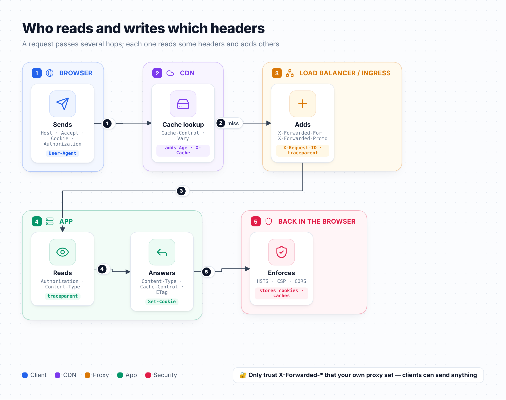
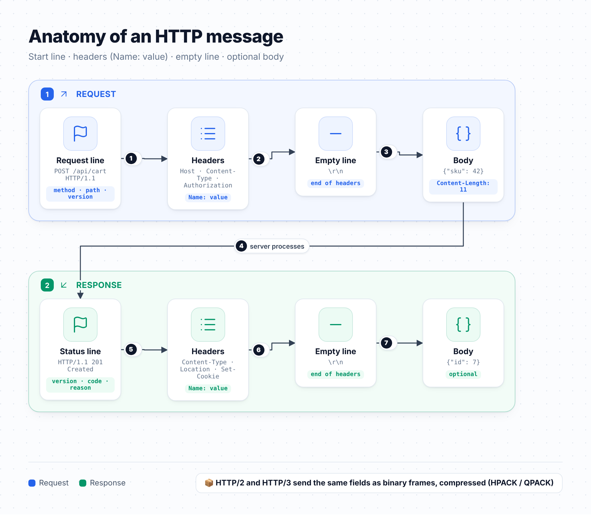
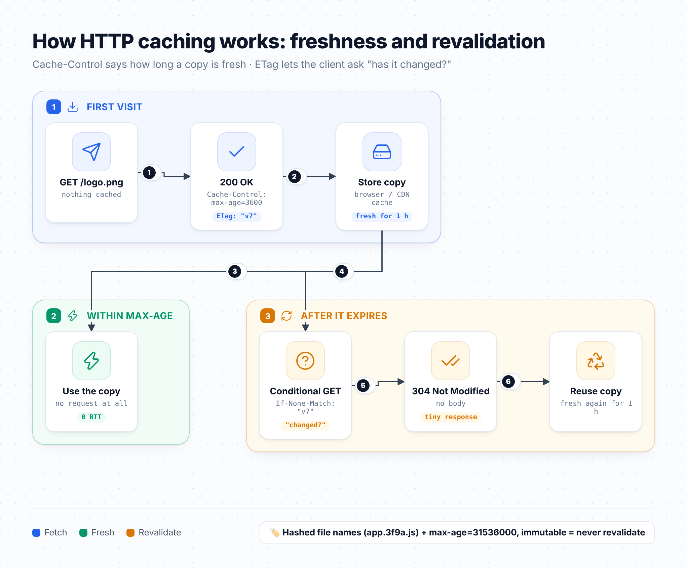
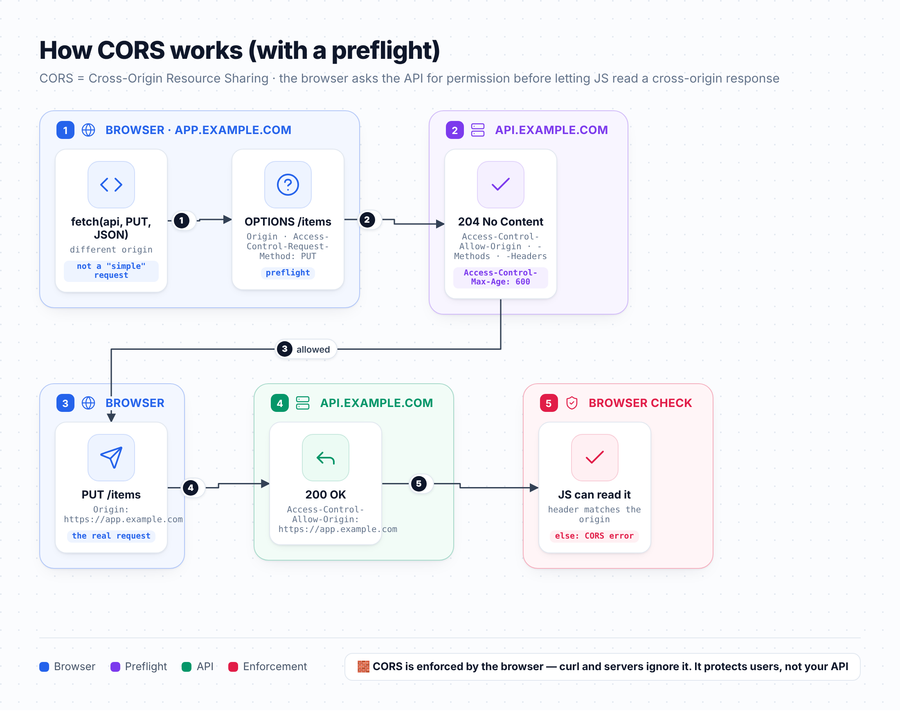

# 6.1 — HTTP headers deep dive

!!! abstract "In short"
    A **header** is a `Name: value` line of **metadata** that travels with every HTTP request and response. The body is
    the content. The headers say **who it is for, what format it is in, how long it may be cached, who is asking, what
    the browser is allowed to do with it, and which hops it passed through**. Most of what CDNs, load balancers, ingress
    controllers, auth and browser security do is driven by headers.

## 📖 Key terms & abbreviations

| Term | Stands for | What it is | How it works (one line) |
|---|---|---|---|
| **Header (field)** | — | A `Name: value` line of metadata | Names are case-insensitive; sent before the body |
| **Request / response header** | — | Metadata sent by the client / by the server | `Accept`, `Authorization` vs `Content-Type`, `Set-Cookie` |
| **Start line / status line** | — | First line of a request / response | `GET /path HTTP/1.1` / `HTTP/1.1 200 OK` |
| **MIME type** | Multipurpose Internet Mail Extensions | Format label like `application/json` | Put in `Content-Type` and `Accept` |
| **Content negotiation** | — | Client says what it can take, server picks | `Accept-*` in, `Content-*` + `Vary` out |
| **Hop-by-hop / end-to-end** | — | Headers for one connection / for the final recipient | Proxies strip hop-by-hop ones (`Connection`, `Keep-Alive`) |
| **Cache-Control** | — | Caching rules for browsers and CDNs | `max-age`, `no-store`, `private`, `s-maxage` … |
| **ETag** | Entity Tag | Version id of a response | Client sends it back in `If-None-Match`; unchanged → `304` |
| **Cookie / Set-Cookie** | — | Small state the browser stores and sends back | Server sets it; browser adds `Cookie` to matching requests |
| **Authorization / Bearer** | — | Credentials for a request | `Authorization: Bearer <token>`; missing/invalid → `401` |
| **CORS** | Cross-Origin Resource Sharing | Browser rule for cross-origin reads | API answers with `Access-Control-Allow-*` headers |
| **Origin** | — | scheme + host + port of a page | `https://app.example.com` ≠ `https://api.example.com` |
| **HSTS** | HTTP Strict Transport Security | "Always use HTTPS for this site" | `Strict-Transport-Security: max-age=…` |
| **CSP** | Content Security Policy | Allow-list of where scripts/styles may load from | Browser blocks everything else (stops most XSS) |
| **XSS** | Cross-Site Scripting | Attacker's script running in your page | Prevented by escaping output + CSP |
| **X-Forwarded-For (XFF)** | — | Original client IP behind proxies | Each proxy appends the address it received from |
| **traceparent** | W3C Trace Context | Distributed-trace id passed between services | `00-<trace-id>-<span-id>-<flags>` |
| **HPACK / QPACK** | — | Header compression in HTTP/2 / HTTP/3 | Static + dynamic tables replace repeated headers with indexes |
| **Pseudo-header** | — | HTTP/2+ fields that replace the start line | `:method`, `:path`, `:authority`, `:scheme`, `:status` |

## 🗺️ Big picture



---

## 1 · What is a header?

### What is it?

An HTTP message has four parts: a **start line**, a block of **headers**, an **empty line**, and an optional **body**.
The headers are metadata: they describe the body and the request, and they tell every hop what to do.



```http
POST /api/cart HTTP/1.1
Host: shop.example.com
Content-Type: application/json
Content-Length: 11
Authorization: Bearer eyJhbGciOi…
Accept: application/json

{"sku": 42}
```

### How does it work?

- **Format:** `Name: value`, one per line, ending with `\r\n`. An empty line ends the header block; then come exactly `Content-Length` bytes of body (or `chunked` pieces).
- **Names are case-insensitive:** `content-type` = `Content-Type`. HTTP/2 and HTTP/3 require them lowercase on the wire.
- **Repeated headers** can be merged with commas (`Accept: a, b`), **except** `Set-Cookie`, which must stay one per line.
- **HTTP/2 and HTTP/3** don't send text lines. The start line becomes **pseudo-headers** (`:method: POST`, `:path: /api/cart`, `:authority: shop.example.com`), and all headers are **compressed** with HPACK / QPACK, so a repeated `Cookie` or `User-Agent` costs only a few bytes after the first request.
- **Size limits exist.** Servers and proxies cap header size (nginx: `large_client_header_buffers`, default 4 × 8 KB). Too-large cookies or JWTs give `400 Request Header Or Cookie Too Large` or `431 Request Header Fields Too Large`.
- **Custom headers:** just pick a name (`X-Tenant-Id`, `Acme-Feature-Flag`). The `X-` prefix is an old convention and is no longer recommended for new standards, but it's still common.

## 2 · The header families

| Family | Request headers | Response headers | Used for |
|---|---|---|---|
| **Routing** | `Host` (`:authority` in h2/h3) | `Location` (with 3xx / 201) | Virtual hosting, ingress rules, redirects |
| **Content negotiation** | `Accept`, `Accept-Encoding`, `Accept-Language` | `Content-Type`, `Content-Encoding`, `Content-Language`, `Vary` | JSON vs HTML, gzip/br/zstd, language |
| **Body framing** | `Content-Length`, `Transfer-Encoding` | same | Where the body ends |
| **Connection** | `Connection`, `Upgrade` | `Connection`, `Keep-Alive` | Keep-alive, WebSocket upgrade (hop-by-hop) |
| **Caching** | `Cache-Control`, `If-None-Match`, `If-Modified-Since` | `Cache-Control`, `ETag`, `Last-Modified`, `Age`, `Expires` | Browser and CDN caching |
| **Auth** | `Authorization`, `Cookie` | `WWW-Authenticate`, `Set-Cookie` | Logins, API tokens, sessions |
| **Security** | `Origin`, `Sec-Fetch-*` | `Strict-Transport-Security`, `Content-Security-Policy`, `X-Content-Type-Options`, `Referrer-Policy` | Telling the browser how to protect the user |
| **CORS** | `Origin`, `Access-Control-Request-*` | `Access-Control-Allow-*` | Cross-origin API calls from JS |
| **Proxies** | `X-Forwarded-For`, `X-Forwarded-Proto`, `Forwarded`, `Via` | `Via` | Real client IP and scheme behind LBs |
| **Observability** | `X-Request-ID`, `traceparent`, `tracestate` | `X-Request-ID`, `Server-Timing` | Correlating logs and traces |
| **Rate limiting** | — | `Retry-After` (+ `RateLimit-*` drafts) | Telling clients when to retry after `429` / `503` |

## 3 · Content negotiation and compression

### How does it work?

1. The client lists what it accepts: `Accept: application/json`, `Accept-Encoding: gzip, br, zstd`, `Accept-Language: tr, en;q=0.8` (`q` = preference weight).
2. The server picks one and labels the response: `Content-Type: application/json; charset=utf-8`, `Content-Encoding: br`.
3. It adds **`Vary: Accept-Encoding`** so caches know the URL has several versions and must key on that header too. A missing `Vary` is a classic CDN bug: users get a compressed (or wrong-language) copy meant for someone else.

!!! tip "DevOps note"
    A wrong `Content-Type` breaks things quietly: JSON served as `text/html`, or JS as `text/plain` is blocked when
    `X-Content-Type-Options: nosniff` is set. Check it with `curl -sI`.

## 4 · Caching headers

### What is it?

Caching headers tell browsers and CDNs **whether** they may keep a copy, **for how long** it stays fresh, and **how to check** whether it has changed.

| `Cache-Control` directive | Meaning |
|---|---|
| `max-age=3600` | Fresh for 3600 s; use it without asking |
| `s-maxage=600` | Same, but only for shared caches (CDN); overrides `max-age` there |
| `no-cache` | You may store it but **must revalidate** before every use (not "don't cache"!) |
| `no-store` | Never store it (bank pages, personal data) |
| `private` / `public` | Only the browser may cache it / CDNs may too |
| `immutable` | Will never change during its lifetime; don't revalidate even on reload |
| `stale-while-revalidate=60` | Serve the stale copy for up to 60 s while fetching a new one in the background |

### How does it work?



- **Freshness:** while `max-age` hasn't expired, the cache answers on its own, without any request.
- **Revalidation:** after that, the cache sends a **conditional request** with `If-None-Match: "<etag>"` (or `If-Modified-Since`). If nothing changed the server answers **`304 Not Modified`** with no body, and the copy is fresh again.
- **The common pattern:** HTML gets `no-cache` (always check), static assets with a hash in the file name get `max-age=31536000, immutable` (cache forever; a new deploy means a new file name).

## 5 · Authentication and cookies

### How does `Authorization` work?

The client sends credentials on every request: `Authorization: Bearer <token>` (OAuth/JWT) or `Authorization: Basic <base64(user:pass)>`. If they are missing or invalid, the server answers **`401 Unauthorized`** with `WWW-Authenticate` saying which scheme to use. **`403 Forbidden`** means "I know who you are, but you're not allowed."

!!! warning
    Base64 is **encoding, not encryption**. Basic auth and bearer tokens are only safe over HTTPS, and they must never be logged.

### How do cookies work?

1. The server sends `Set-Cookie: session=abc123; Path=/; HttpOnly; Secure; SameSite=Lax; Max-Age=86400`.
2. The browser stores it, and on every later request to a matching site and path it adds `Cookie: session=abc123`.

| Attribute | What it does |
|---|---|
| `HttpOnly` | JavaScript can't read it, so XSS can't steal the session |
| `Secure` | Only sent over HTTPS |
| `SameSite=Lax / Strict / None` | Whether it's sent on cross-site requests (CSRF protection). `None` requires `Secure` |
| `Domain` / `Path` | Which hosts and paths receive it |
| `Max-Age` / `Expires` | Lifetime; without them it's a session cookie |
| `__Host-` name prefix | Forces `Secure`, `Path=/` and no `Domain` (strongest scoping) |

## 6 · Security headers

These headers ask the **browser** to enforce rules that protect the user:

| Header | Example | Protects against |
|---|---|---|
| `Strict-Transport-Security` (HSTS) | `max-age=31536000; includeSubDomains` | Downgrade to HTTP, SSL stripping |
| `Content-Security-Policy` (CSP) | `default-src 'self'; script-src 'self' cdn.example.com` | XSS, injected scripts |
| `X-Content-Type-Options` | `nosniff` | The browser guessing a file's type |
| `X-Frame-Options` / CSP `frame-ancestors` | `DENY` / `frame-ancestors 'none'` | Clickjacking (your page inside an iframe) |
| `Referrer-Policy` | `strict-origin-when-cross-origin` | Leaking full URLs to other sites |
| `Permissions-Policy` | `camera=(), geolocation=()` | Pages using powerful browser features |

`X-XSS-Protection` is obsolete; modern browsers ignore it. Use CSP instead.

## 7 · CORS

### What is it?

Browsers apply the **same-origin policy**: JavaScript from `https://app.example.com` can't read responses from `https://api.example.com` (a different **origin**), unless the API explicitly allows it. CORS is how the API gives that permission, using headers.

### How does it work?



- **Simple requests** (GET/POST with basic content types) go straight out with an `Origin` header. The browser lets JS read the response only if it contains a matching `Access-Control-Allow-Origin`.
- **Other requests** (PUT/DELETE, `Content-Type: application/json`, custom headers) first send an **`OPTIONS` preflight**. The API answers with the allowed origin, methods and headers; `Access-Control-Max-Age` lets the browser cache that answer.
- **With cookies** (`credentials: 'include'`), `Access-Control-Allow-Origin: *` is not allowed: name the exact origin and add `Access-Control-Allow-Credentials: true`.
- CORS is enforced **only by browsers**. It is not authentication, and it doesn't protect your API from curl or scripts.

## 8 · Proxies and tracing

### How does `X-Forwarded-For` work?

Behind a load balancer, your app sees the **LB's IP**, not the user's. So each proxy appends the address it received the connection from:

```http
X-Forwarded-For: 203.0.113.7, 10.0.1.12
X-Forwarded-Proto: https
X-Forwarded-Host: shop.example.com
```

The leftmost value is the client **as claimed**. A client can send a fake `X-Forwarded-For`, so configure your app or ingress to trust only your own proxies' entries (nginx `set_real_ip_from` + `real_ip_header`, Express `trust proxy`). The standard form is `Forwarded: for=203.0.113.7;proto=https`.

### How does `traceparent` work?

The first service (or the ingress) creates a trace id. Every service passes it on in outgoing calls and adds its own span id:

```http
traceparent: 00-4bf92f3577b34da6a3ce929d0e0e4736-00f067aa0ba902b7-01
             ver ── trace-id (16 bytes) ───────── parent span ─── sampled
```

OpenTelemetry SDKs read and write this header automatically, so one request can be followed across the LB, the services and the database calls. `X-Request-ID` is the simpler version: one id to grep for in all logs.

## 🔧 DevOps connection

- **Ingress / nginx:** `proxy_set_header Host $host; proxy_set_header X-Forwarded-For $proxy_add_x_forwarded_for; proxy_set_header X-Forwarded-Proto $scheme;`. Add security headers with `add_header … always;` so they're present on error pages too.
- **WebSockets through nginx** need `proxy_set_header Upgrade $http_upgrade; proxy_set_header Connection "upgrade";`, because these are hop-by-hop headers and aren't forwarded by default.
- **"Login loops behind the LB"** usually mean the app thinks the request is `http` because it ignores `X-Forwarded-Proto`, so it redirects forever or sets `Secure` cookies wrongly.
- **CDN hit ratio** depends on `Cache-Control`, `Vary` and cookies. A `Set-Cookie` on a static response, or `Vary: User-Agent`, can make it uncacheable.
- **Big JWTs or many cookies** hit header size limits on ingress or the LB. Raise the buffers or slim the tokens.

## 🧪 Try it yourself

```bash
# 1. Only the response headers (HEAD request)
curl -sI https://github.com | head -25

# 2. Everything: request headers (>) and response headers (<)
curl -sv https://example.com -o /dev/null 2>&1 | grep -E '^[<>]'

# 3. Content negotiation and compression
curl -sI -H 'Accept-Encoding: br, gzip' https://www.wikipedia.org | grep -iE 'content-(type|encoding)|vary'

# 4. Conditional request: get the ETag, then ask "changed?"
URL=https://www.wikipedia.org/portal/wikipedia.org/assets/img/Wikipedia-logo-v2.png
ETAG=$(curl -sI $URL | grep -i '^etag' | cut -d' ' -f2 | tr -d '\r')
curl -s -o /dev/null -w '%{http_code}\n' -H "If-None-Match: $ETAG" $URL   # → 304

# 5. A CORS preflight by hand
curl -si -X OPTIONS https://api.github.com/user \
  -H 'Origin: https://example.com' -H 'Access-Control-Request-Method: GET' | grep -i '^access-control'

# 6. See exactly what a server receives
python3 - <<'PYEOF'
from http.server import BaseHTTPRequestHandler, HTTPServer
class H(BaseHTTPRequestHandler):
    def do_GET(self):
        print(self.requestline); print(self.headers)
        self.send_response(200); self.send_header('Content-Type','text/plain'); self.end_headers()
        self.wfile.write(b'ok\n')
HTTPServer(('127.0.0.1', 8080), H).handle_request()
PYEOF
# in another terminal: curl -H 'X-Hello: world' http://127.0.0.1:8080/
```

## 🃏 Cheat sheet

| I want to… | Header |
|---|---|
| Route by hostname | `Host` |
| Say what the body is | `Content-Type` |
| Compress responses | `Accept-Encoding` → `Content-Encoding` + `Vary` |
| Cache static files forever | `Cache-Control: max-age=31536000, immutable` |
| Always revalidate HTML | `Cache-Control: no-cache` + `ETag` |
| Never store a response | `Cache-Control: no-store` |
| Send an API token | `Authorization: Bearer …` |
| Keep a safe session cookie | `Set-Cookie: …; HttpOnly; Secure; SameSite=Lax` |
| Force HTTPS | `Strict-Transport-Security` |
| Block injected scripts | `Content-Security-Policy` |
| Allow a front-end on another origin | `Access-Control-Allow-Origin` (+ preflight) |
| Know the real client IP | `X-Forwarded-For` / `Forwarded` (from trusted proxies only) |
| Follow a request across services | `traceparent`, `X-Request-ID` |

## ❓ Test yourself

??? question "1. What does `Cache-Control: no-cache` actually mean?"
    The response **may** be stored, but it must be revalidated with the server (e.g. `If-None-Match`) before each use. To forbid storing, use `no-store`.

??? question "2. Your API works with curl but the browser shows a CORS error. Why, and where is the fix?"
    CORS is enforced only by browsers. The API (or the ingress in front of it) must return `Access-Control-Allow-Origin` for that origin, and answer the `OPTIONS` preflight with the allowed methods and headers.

??? question "3. Behind your load balancer every log line shows the same client IP. What's wrong?"
    The app logs the TCP peer (the LB). Read the client IP from `X-Forwarded-For` / `Forwarded`, and trust only entries added by your own proxies.

??? question "4. Why must a CDN see `Vary: Accept-Encoding`?"
    The same URL exists in several encodings (br, gzip, none). Without `Vary` the CDN may serve a brotli body to a client that can't decode it.

??? question "5. Which cookie attributes stop JavaScript from reading a session cookie and stop it being sent over HTTP?"
    `HttpOnly` (no JS access) and `Secure` (HTTPS only). Add `SameSite=Lax` or `Strict` against CSRF.

---

## 📚 Sources

- [RFC 9110 — HTTP Semantics](https://www.rfc-editor.org/rfc/rfc9110) · [RFC 9111 — HTTP Caching](https://www.rfc-editor.org/rfc/rfc9111) · [RFC 9113 — HTTP/2](https://www.rfc-editor.org/rfc/rfc9113)
- [MDN — HTTP headers](https://developer.mozilla.org/en-US/docs/Web/HTTP/Headers) · [MDN — HTTP caching](https://developer.mozilla.org/en-US/docs/Web/HTTP/Caching) · [MDN — CORS](https://developer.mozilla.org/en-US/docs/Web/HTTP/CORS)
- [MDN — Set-Cookie](https://developer.mozilla.org/en-US/docs/Web/HTTP/Headers/Set-Cookie)
- [OWASP Secure Headers Project](https://owasp.org/www-project-secure-headers/)
- [RFC 7239 — Forwarded](https://www.rfc-editor.org/rfc/rfc7239) · [W3C Trace Context](https://www.w3.org/TR/trace-context/)

## ✍️ My notes

> Pick one site you work on. Run `curl -sI` against it and explain every response header in one line each. Which security headers are missing?
