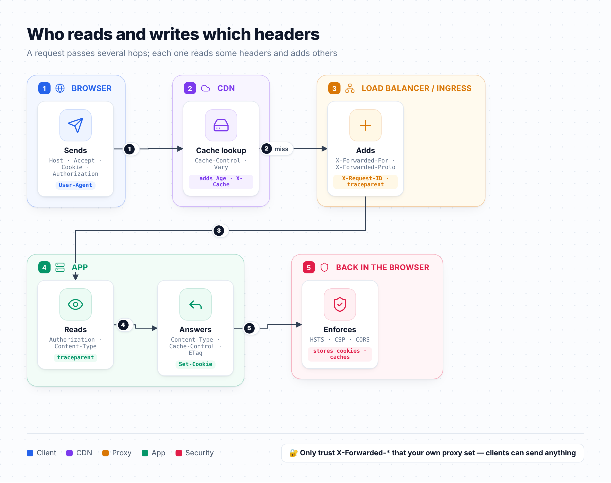
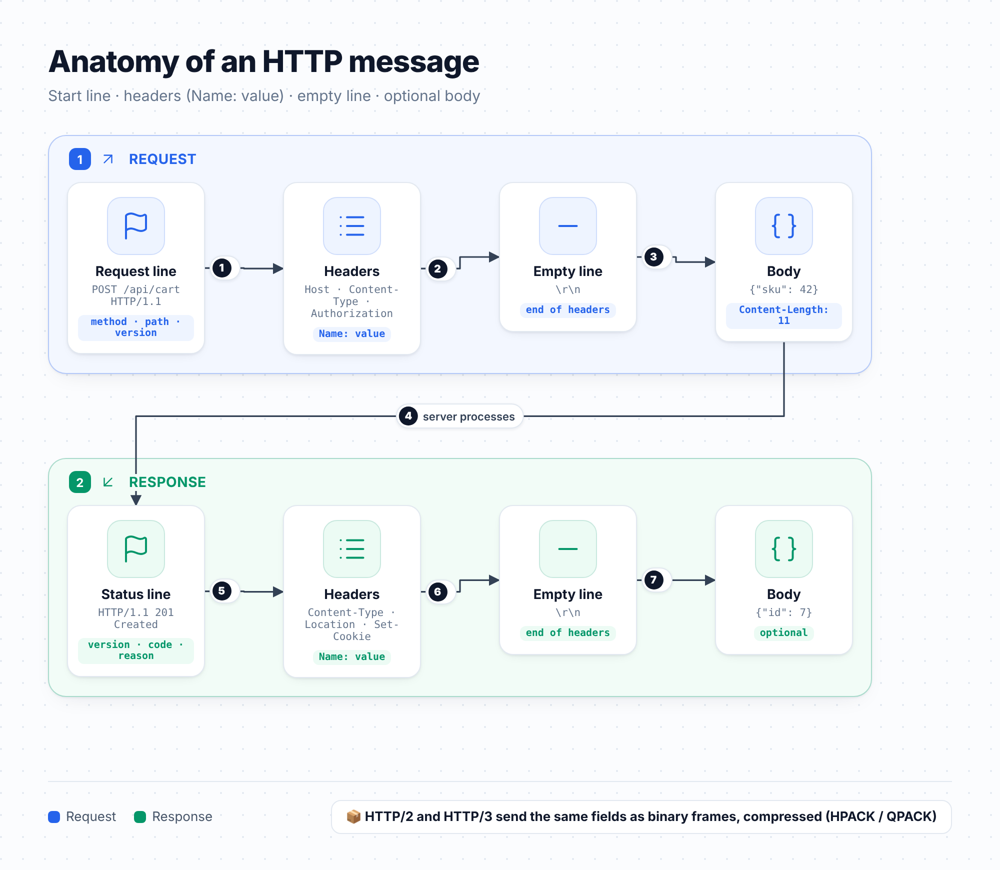
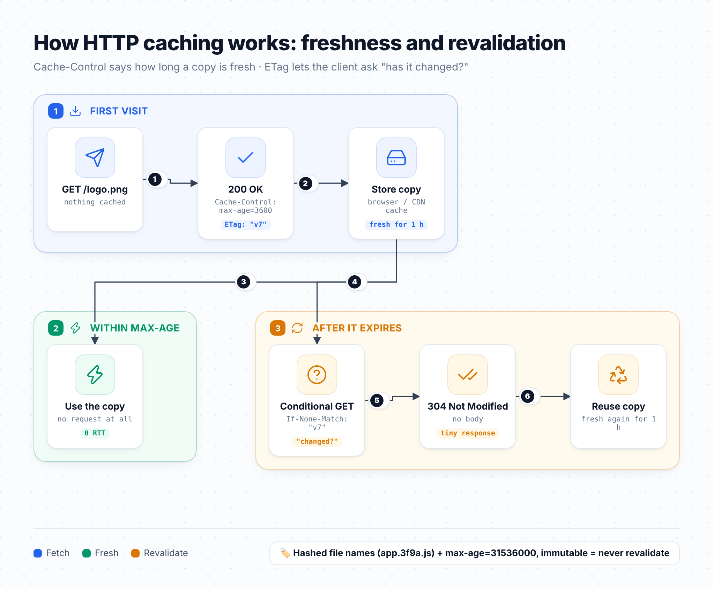
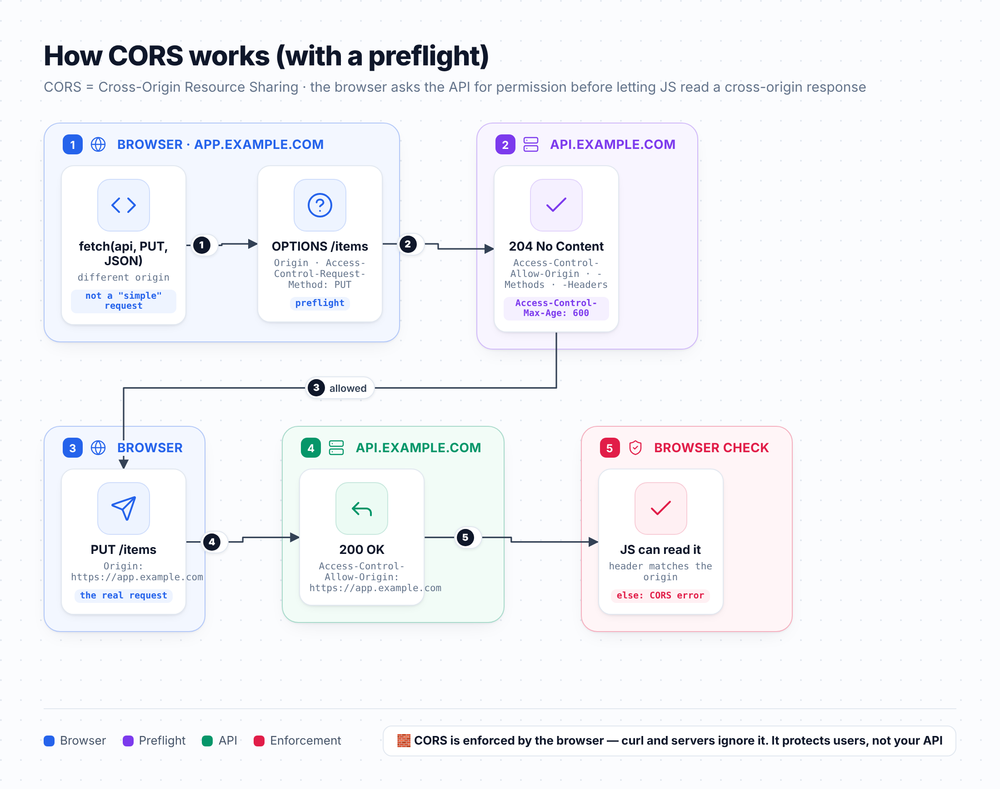

# 6.1 — HTTP header'larına derin dalış

!!! abstract "Tek cümlede"
    **Header**, her HTTP istek ve cevabıyla birlikte giden `Ad: değer` biçiminde bir **üst veri (metadata)** satırıdır.
    Gövde içeriktir; header'lar ise **kime gittiğini, hangi formatta olduğunu, ne kadar önbellekte tutulabileceğini,
    kimin sorduğunu, tarayıcının onunla neler yapabileceğini ve hangi duraklardan geçtiğini** söyler. CDN'lerin, load
    balancer'ların, ingress controller'ların, kimlik doğrulamanın ve tarayıcı güvenliğinin yaptığı işlerin çoğu header'larla yürür.

## 📖 Temel terimler ve kısaltmalar

| Terim | Açılımı | Nedir | Nasıl çalışır (tek satır) |
|---|---|---|---|
| **Header (alan)** | — | `Ad: değer` biçiminde bir üst veri satırı | Adlar büyük/küçük harfe duyarsız; gövdeden önce gönderilir |
| **İstek / cevap header'ı** | — | İstemcinin / sunucunun gönderdiği üst veri | `Accept`, `Authorization` ve `Content-Type`, `Set-Cookie` |
| **Başlangıç / durum satırı** | — | İsteğin / cevabın ilk satırı | `GET /yol HTTP/1.1` / `HTTP/1.1 200 OK` |
| **MIME tipi** | Multipurpose Internet Mail Extensions | `application/json` gibi format etiketi | `Content-Type` ve `Accept` içine yazılır |
| **İçerik pazarlığı** | Content negotiation | İstemci ne alabileceğini söyler, sunucu seçer | Gelen `Accept-*`, giden `Content-*` + `Vary` |
| **Hop-by-hop / end-to-end** | — | Tek bağlantıya ait / son alıcıya ait header'lar | Proxy'ler hop-by-hop olanları siler (`Connection`, `Keep-Alive`) |
| **Cache-Control** | — | Tarayıcı ve CDN için önbellek kuralları | `max-age`, `no-store`, `private`, `s-maxage` … |
| **ETag** | Entity Tag | Bir cevabın sürüm kimliği | İstemci `If-None-Match` ile geri yollar; değişmediyse `304` |
| **Cookie / Set-Cookie** | — | Tarayıcının saklayıp geri yolladığı küçük durum | Sunucu koyar; tarayıcı uyan isteklere `Cookie` ekler |
| **Authorization / Bearer** | — | Bir isteğin kimlik bilgisi | `Authorization: Bearer <token>`; yok/geçersiz → `401` |
| **CORS** | Cross-Origin Resource Sharing | Farklı origin'den okuma için tarayıcı kuralı | API `Access-Control-Allow-*` header'larıyla izin verir |
| **Origin** | — | Bir sayfanın şema + host + port'u | `https://app.example.com` ≠ `https://api.example.com` |
| **HSTS** | HTTP Strict Transport Security | "Bu siteye hep HTTPS ile gel" | `Strict-Transport-Security: max-age=…` |
| **CSP** | Content Security Policy | Script/stillerin nereden yüklenebileceğinin izin listesi | Tarayıcı geri kalanını engeller (XSS'in çoğunu durdurur) |
| **XSS** | Cross-Site Scripting | Saldırganın script'inin senin sayfanda çalışması | Çıktıyı escape etmek + CSP ile önlenir |
| **X-Forwarded-For (XFF)** | — | Proxy'lerin arkasındaki asıl istemci IP'si | Her proxy bağlantıyı aldığı adresi ekler |
| **traceparent** | W3C Trace Context | Servisler arasında taşınan dağıtık trace kimliği | `00-<trace-id>-<span-id>-<flags>` |
| **HPACK / QPACK** | — | HTTP/2 / HTTP/3'te header sıkıştırma | Statik + dinamik tablolar tekrarlanan header'ları indeksle değiştirir |
| **Pseudo-header** | — | HTTP/2+'da başlangıç satırının yerini alan alanlar | `:method`, `:path`, `:authority`, `:scheme`, `:status` |

## 🗺️ Büyük resim



---

## 1 · Header nedir?

### Nedir?

Bir HTTP mesajının dört parçası var: bir **başlangıç satırı**, bir **header** bloğu, bir **boş satır** ve isteğe bağlı bir **gövde**.
Header'lar üst veridir: gövdeyi ve isteği tarif eder, yoldaki her durağa ne yapacağını söyler.



```http
POST /api/cart HTTP/1.1
Host: shop.example.com
Content-Type: application/json
Content-Length: 11
Authorization: Bearer eyJhbGciOi…
Accept: application/json

{"sku": 42}
```

### Nasıl çalışır?

- **Format:** her satıra bir `Ad: değer`, satır sonu `\r\n`. Boş satır header bloğunu bitirir; ardından tam olarak `Content-Length` byte'lık gövde (ya da `chunked` parçalar) gelir.
- **Adlar büyük/küçük harfe duyarsızdır:** `content-type` = `Content-Type`. HTTP/2 ve HTTP/3'te kabloda küçük harf zorunludur.
- **Tekrarlanan header'lar** virgülle birleştirilebilir (`Accept: a, b`). **İstisna** `Set-Cookie`: her biri ayrı satırda kalmalıdır.
- **HTTP/2 ve HTTP/3** metin satırı göndermez. Başlangıç satırı **pseudo-header**'lara dönüşür (`:method: POST`, `:path: /api/cart`, `:authority: shop.example.com`), tüm header'lar HPACK / QPACK ile **sıkıştırılır**. Böylece ilk istekten sonra tekrarlanan bir `Cookie` ya da `User-Agent` sadece birkaç byte tutar.
- **Boyut limiti vardır.** Sunucular ve proxy'ler header boyutunu sınırlar (nginx: `large_client_header_buffers`, varsayılan 4 × 8 KB). Çok büyük cookie'ler ya da JWT'ler `400 Request Header Or Cookie Too Large` veya `431 Request Header Fields Too Large` hatası verir.
- **Özel header'lar:** bir isim seçmen yeterli (`X-Tenant-Id`, `Acme-Feature-Flag`). `X-` öneki eski bir gelenek; yeni standartlar için artık önerilmiyor ama hâlâ çok yaygın.

## 2 · Header aileleri

| Aile | İstek header'ları | Cevap header'ları | Ne için kullanılır |
|---|---|---|---|
| **Yönlendirme** | `Host` (h2/h3'te `:authority`) | `Location` (3xx / 201 ile) | Sanal hosting, ingress kuralları, yönlendirmeler |
| **İçerik pazarlığı** | `Accept`, `Accept-Encoding`, `Accept-Language` | `Content-Type`, `Content-Encoding`, `Content-Language`, `Vary` | JSON mu HTML mi, gzip/br/zstd, dil |
| **Gövde sınırı** | `Content-Length`, `Transfer-Encoding` | aynı | Gövdenin nerede bittiği |
| **Bağlantı** | `Connection`, `Upgrade` | `Connection`, `Keep-Alive` | Keep-alive, WebSocket'e yükseltme (hop-by-hop) |
| **Önbellek** | `Cache-Control`, `If-None-Match`, `If-Modified-Since` | `Cache-Control`, `ETag`, `Last-Modified`, `Age`, `Expires` | Tarayıcı ve CDN önbelleği |
| **Kimlik** | `Authorization`, `Cookie` | `WWW-Authenticate`, `Set-Cookie` | Girişler, API token'ları, oturumlar |
| **Güvenlik** | `Origin`, `Sec-Fetch-*` | `Strict-Transport-Security`, `Content-Security-Policy`, `X-Content-Type-Options`, `Referrer-Policy` | Tarayıcıya kullanıcıyı nasıl koruyacağını söylemek |
| **CORS** | `Origin`, `Access-Control-Request-*` | `Access-Control-Allow-*` | JS'ten farklı origin'deki API'lere çağrı |
| **Proxy** | `X-Forwarded-For`, `X-Forwarded-Proto`, `Forwarded`, `Via` | `Via` | LB arkasında gerçek istemci IP'si ve şeması |
| **Gözlemlenebilirlik** | `X-Request-ID`, `traceparent`, `tracestate` | `X-Request-ID`, `Server-Timing` | Log ve trace'leri ilişkilendirmek |
| **Hız sınırı** | — | `Retry-After` (+ `RateLimit-*` taslakları) | `429` / `503` sonrası istemciye ne zaman tekrar deneyeceğini söylemek |

## 3 · İçerik pazarlığı ve sıkıştırma

### Nasıl çalışır?

1. İstemci neleri kabul ettiğini listeler: `Accept: application/json`, `Accept-Encoding: gzip, br, zstd`, `Accept-Language: tr, en;q=0.8` (`q` = tercih ağırlığı).
2. Sunucu birini seçer ve cevabı etiketler: `Content-Type: application/json; charset=utf-8`, `Content-Encoding: br`.
3. **`Vary: Accept-Encoding`** ekler; böylece önbellekler o URL'nin birden fazla sürümü olduğunu ve anahtara bu header'ı da katmaları gerektiğini bilir. Eksik `Vary` klasik bir CDN hatasıdır: kullanıcılar başkası için hazırlanmış sıkıştırılmış (ya da yanlış dilde) kopyayı alır.

!!! tip "DevOps notu"
    Yanlış `Content-Type` sessizce bozar: `text/html` olarak sunulan JSON ya da `X-Content-Type-Options: nosniff`
    açıkken `text/plain` olarak sunulduğu için engellenen JS. `curl -sI` ile kontrol et.

## 4 · Önbellek header'ları

### Nedir?

Önbellek header'ları tarayıcılara ve CDN'lere bir kopyayı **tutup tutamayacaklarını**, **ne kadar süre** taze kalacağını ve **değişip değişmediğini nasıl kontrol edeceklerini** söyler.

| `Cache-Control` direktifi | Anlamı |
|---|---|
| `max-age=3600` | 3600 sn taze; sormadan kullan |
| `s-maxage=600` | Aynısı ama sadece paylaşımlı önbellekler (CDN) için; orada `max-age`'i ezer |
| `no-cache` | Saklayabilirsin ama her kullanımdan önce **yeniden doğrulamalısın** ("önbelleğe alma" demek değil!) |
| `no-store` | Asla saklama (banka sayfaları, kişisel veri) |
| `private` / `public` | Sadece tarayıcı önbelleğe alabilir / CDN'ler de alabilir |
| `immutable` | Ömrü boyunca hiç değişmeyecek; sayfa yenilense bile yeniden doğrulama |
| `stale-while-revalidate=60` | Arka planda yenisi alınırken eski kopyayı 60 sn'ye kadar sun |

### Nasıl çalışır?



- **Tazelik:** `max-age` dolmadığı sürece önbellek hiç istek atmadan kendisi cevap verir.
- **Yeniden doğrulama:** süre dolunca önbellek `If-None-Match: "<etag>"` (ya da `If-Modified-Since`) ile **koşullu istek** atar. Bir şey değişmediyse sunucu gövdesiz **`304 Not Modified`** döner ve kopya yeniden taze olur.
- **Yaygın desen:** HTML'e `no-cache` (hep kontrol et), dosya adında hash olan statik dosyalara `max-age=31536000, immutable` (sonsuza dek önbellekte tut; yeni deploy yeni dosya adı demek).

## 5 · Kimlik doğrulama ve cookie'ler

### `Authorization` nasıl çalışır?

İstemci her istekte kimlik bilgisini yollar: `Authorization: Bearer <token>` (OAuth/JWT) ya da `Authorization: Basic <base64(kullanıcı:şifre)>`. Eksik ya da geçersizse sunucu, hangi şemanın kullanılacağını söyleyen `WWW-Authenticate` ile **`401 Unauthorized`** döner. **`403 Forbidden`** ise "kim olduğunu biliyorum ama iznin yok" demektir.

!!! warning
    Base64 **şifreleme değil, kodlamadır**. Basic auth ve bearer token'lar sadece HTTPS üzerinde güvenlidir ve asla loglanmamalıdır.

### Cookie'ler nasıl çalışır?

1. Sunucu şunu gönderir: `Set-Cookie: session=abc123; Path=/; HttpOnly; Secure; SameSite=Lax; Max-Age=86400`.
2. Tarayıcı saklar ve sonraki her uyan site/yol isteğine `Cookie: session=abc123` ekler.

| Öznitelik | Ne yapar |
|---|---|
| `HttpOnly` | JavaScript okuyamaz, XSS oturumu çalamaz |
| `Secure` | Sadece HTTPS üzerinden gönderilir |
| `SameSite=Lax / Strict / None` | Siteler arası isteklerde gönderilip gönderilmeyeceği (CSRF koruması). `None`, `Secure` gerektirir |
| `Domain` / `Path` | Hangi host ve yolların alacağı |
| `Max-Age` / `Expires` | Ömür; yoksa oturum cookie'sidir |
| `__Host-` ad öneki | `Secure`, `Path=/` ve `Domain` yokluğunu zorunlu kılar (en sıkı kapsam) |

## 6 · Güvenlik header'ları

Bu header'lar **tarayıcıdan** kullanıcıyı koruyan kuralları uygulamasını ister:

| Header | Örnek | Neye karşı korur |
|---|---|---|
| `Strict-Transport-Security` (HSTS) | `max-age=31536000; includeSubDomains` | HTTP'ye düşürme, SSL stripping |
| `Content-Security-Policy` (CSP) | `default-src 'self'; script-src 'self' cdn.example.com` | XSS, enjekte edilen script'ler |
| `X-Content-Type-Options` | `nosniff` | Tarayıcının dosya tipini tahmin etmesi |
| `X-Frame-Options` / CSP `frame-ancestors` | `DENY` / `frame-ancestors 'none'` | Clickjacking (sayfanın bir iframe içinde açılması) |
| `Referrer-Policy` | `strict-origin-when-cross-origin` | Tam URL'lerin başka sitelere sızması |
| `Permissions-Policy` | `camera=(), geolocation=()` | Sayfaların güçlü tarayıcı özelliklerini kullanması |

`X-XSS-Protection` artık geçersiz; modern tarayıcılar yok sayıyor. Yerine CSP kullan.

## 7 · CORS

### Nedir?

Tarayıcılar **same-origin policy** (aynı köken kuralı) uygular: `https://app.example.com`'dan gelen JavaScript, API açıkça izin vermedikçe `https://api.example.com`'un (farklı bir **origin**) cevaplarını okuyamaz. CORS, API'nin bu izni header'larla vermesinin yoludur.

### Nasıl çalışır?



- **Basit istekler** (temel içerik tipleriyle GET/POST) doğrudan `Origin` header'ıyla gider. Tarayıcı, cevapta eşleşen bir `Access-Control-Allow-Origin` varsa JS'in okumasına izin verir.
- **Diğer istekler** (PUT/DELETE, `Content-Type: application/json`, özel header'lar) önce bir **`OPTIONS` preflight** gönderir. API izin verilen origin, metot ve header'larla cevaplar; `Access-Control-Max-Age` bu cevabın tarayıcıda önbelleğe alınmasını sağlar.
- **Cookie ile** (`credentials: 'include'`) `Access-Control-Allow-Origin: *` kullanılamaz: tam origin'i yaz ve `Access-Control-Allow-Credentials: true` ekle.
- CORS'u **sadece tarayıcılar** uygular. Kimlik doğrulama değildir; API'ni curl'e ya da script'lere karşı korumaz.

## 8 · Proxy'ler ve trace

### `X-Forwarded-For` nasıl çalışır?

Load balancer arkasında uygulaman kullanıcının değil **LB'nin IP'sini** görür. Bu yüzden her proxy bağlantıyı aldığı adresi ekler:

```http
X-Forwarded-For: 203.0.113.7, 10.0.1.12
X-Forwarded-Proto: https
X-Forwarded-Host: shop.example.com
```

En soldaki değer istemcinin **iddia ettiği** adrestir. İstemci sahte bir `X-Forwarded-For` gönderebilir; uygulamanı ya da ingress'ini sadece kendi proxy'lerinin eklediği girdilere güvenecek şekilde ayarla (nginx `set_real_ip_from` + `real_ip_header`, Express `trust proxy`). Standart biçimi `Forwarded: for=203.0.113.7;proto=https`.

### `traceparent` nasıl çalışır?

İlk servis (ya da ingress) bir trace kimliği üretir. Her servis bunu giden çağrılarına aktarır ve kendi span kimliğini ekler:

```http
traceparent: 00-4bf92f3577b34da6a3ce929d0e0e4736-00f067aa0ba902b7-01
             sürüm ── trace-id (16 byte) ──────── üst span ─────── örneklendi
```

OpenTelemetry SDK'ları bu header'ı otomatik okur ve yazar; böylece tek bir istek LB, servisler ve veritabanı çağrıları boyunca izlenebilir. `X-Request-ID` daha basit versiyonu: tüm loglarda grep'lenecek tek bir kimlik.

## 🔧 DevOps bağlantısı

- **Ingress / nginx:** `proxy_set_header Host $host; proxy_set_header X-Forwarded-For $proxy_add_x_forwarded_for; proxy_set_header X-Forwarded-Proto $scheme;`. Güvenlik header'larını `add_header … always;` ile ekle ki hata sayfalarında da olsunlar.
- **nginx üzerinden WebSocket** için `proxy_set_header Upgrade $http_upgrade; proxy_set_header Connection "upgrade";` gerekir; bunlar hop-by-hop header'lardır ve varsayılan olarak iletilmez.
- **"LB arkasında giriş döngüsü"** genelde uygulamanın `X-Forwarded-Proto`'yu yok saydığı için isteği `http` sandığı anlamına gelir: sonsuz yönlendirme yapar ya da `Secure` cookie'leri yanlış koyar.
- **CDN isabet oranı** `Cache-Control`, `Vary` ve cookie'lere bağlıdır. Statik bir cevaptaki `Set-Cookie` ya da `Vary: User-Agent` onu önbelleğe alınamaz yapabilir.
- **Büyük JWT'ler ya da çok sayıda cookie** ingress ya da LB'de header boyut limitine takılır. Buffer'ları büyüt ya da token'ları küçült.

## 🧪 Kendin dene

```bash
# 1. Sadece cevap header'ları (HEAD isteği)
curl -sI https://github.com | head -25

# 2. Hepsi: istek header'ları (>) ve cevap header'ları (<)
curl -sv https://example.com -o /dev/null 2>&1 | grep -E '^[<>]'

# 3. İçerik pazarlığı ve sıkıştırma
curl -sI -H 'Accept-Encoding: br, gzip' https://www.wikipedia.org | grep -iE 'content-(type|encoding)|vary'

# 4. Koşullu istek: ETag'i al, sonra "değişti mi?" diye sor
URL=https://www.wikipedia.org/portal/wikipedia.org/assets/img/Wikipedia-logo-v2.png
ETAG=$(curl -sI $URL | grep -i '^etag' | cut -d' ' -f2 | tr -d '\r')
curl -s -o /dev/null -w '%{http_code}\n' -H "If-None-Match: $ETAG" $URL   # → 304

# 5. Elle bir CORS preflight
curl -si -X OPTIONS https://api.github.com/user \
  -H 'Origin: https://example.com' -H 'Access-Control-Request-Method: GET' | grep -i '^access-control'

# 6. Bir sunucunun tam olarak ne aldığını gör
python3 - <<'PYEOF'
from http.server import BaseHTTPRequestHandler, HTTPServer
class H(BaseHTTPRequestHandler):
    def do_GET(self):
        print(self.requestline); print(self.headers)
        self.send_response(200); self.send_header('Content-Type','text/plain'); self.end_headers()
        self.wfile.write(b'ok\n')
HTTPServer(('127.0.0.1', 8080), H).handle_request()
PYEOF
# başka bir terminalde: curl -H 'X-Hello: world' http://127.0.0.1:8080/
```

## 🃏 Hatırlatma kartı

| Şunu istiyorum… | Header |
|---|---|
| Host adına göre yönlendirmek | `Host` |
| Gövdenin ne olduğunu söylemek | `Content-Type` |
| Cevapları sıkıştırmak | `Accept-Encoding` → `Content-Encoding` + `Vary` |
| Statik dosyaları sonsuza dek önbellekte tutmak | `Cache-Control: max-age=31536000, immutable` |
| HTML'i hep yeniden doğrulamak | `Cache-Control: no-cache` + `ETag` |
| Bir cevabı asla saklamamak | `Cache-Control: no-store` |
| API token'ı göndermek | `Authorization: Bearer …` |
| Güvenli oturum cookie'si | `Set-Cookie: …; HttpOnly; Secure; SameSite=Lax` |
| HTTPS'i zorlamak | `Strict-Transport-Security` |
| Enjekte script'leri engellemek | `Content-Security-Policy` |
| Başka origin'deki front-end'e izin vermek | `Access-Control-Allow-Origin` (+ preflight) |
| Gerçek istemci IP'sini bilmek | `X-Forwarded-For` / `Forwarded` (sadece güvenilen proxy'lerden) |
| Bir isteği servisler arasında izlemek | `traceparent`, `X-Request-ID` |

## ❓ Kendini test et

??? question "1. `Cache-Control: no-cache` aslında ne demek?"
    Cevap saklanabilir **ama** her kullanımdan önce sunucuyla yeniden doğrulanmalıdır (ör. `If-None-Match`). Saklamayı yasaklamak için `no-store` kullanılır.

??? question "2. API'n curl ile çalışıyor ama tarayıcı CORS hatası veriyor. Neden, düzeltme nerede?"
    CORS'u sadece tarayıcılar uygular. API'nin (ya da önündeki ingress'in) o origin için `Access-Control-Allow-Origin` döndürmesi ve `OPTIONS` preflight'ına izin verilen metot ve header'larla cevap vermesi gerekir.

??? question "3. Load balancer arkasında her log satırı aynı istemci IP'sini gösteriyor. Sorun ne?"
    Uygulama TCP karşı tarafını (LB'yi) logluyor. İstemci IP'sini `X-Forwarded-For` / `Forwarded`'dan oku ve sadece kendi proxy'lerinin eklediği girdilere güven.

??? question "4. Bir CDN neden `Vary: Accept-Encoding` görmeli?"
    Aynı URL birden fazla kodlamada var (br, gzip, sıkıştırmasız). `Vary` olmadan CDN, brotli çözemeyen bir istemciye brotli gövde sunabilir.

??? question "5. Hangi cookie öznitelikleri oturum cookie'sinin JavaScript ile okunmasını ve HTTP üzerinden gönderilmesini engeller?"
    `HttpOnly` (JS erişimi yok) ve `Secure` (sadece HTTPS). CSRF'e karşı `SameSite=Lax` ya da `Strict` ekle.

---

## 📚 Kaynaklar

- [RFC 9110 — HTTP Semantics](https://www.rfc-editor.org/rfc/rfc9110) · [RFC 9111 — HTTP Caching](https://www.rfc-editor.org/rfc/rfc9111) · [RFC 9113 — HTTP/2](https://www.rfc-editor.org/rfc/rfc9113)
- [MDN — HTTP header'ları](https://developer.mozilla.org/en-US/docs/Web/HTTP/Headers) · [MDN — HTTP önbelleği](https://developer.mozilla.org/en-US/docs/Web/HTTP/Caching) · [MDN — CORS](https://developer.mozilla.org/en-US/docs/Web/HTTP/CORS)
- [MDN — Set-Cookie](https://developer.mozilla.org/en-US/docs/Web/HTTP/Headers/Set-Cookie)
- [OWASP Secure Headers Project](https://owasp.org/www-project-secure-headers/)
- [RFC 7239 — Forwarded](https://www.rfc-editor.org/rfc/rfc7239) · [W3C Trace Context](https://www.w3.org/TR/trace-context/)

## ✍️ Notlarım

> Üzerinde çalıştığın bir siteyi seç. `curl -sI` çalıştır ve her cevap header'ını birer satırda açıkla. Hangi güvenlik header'ları eksik?

-
