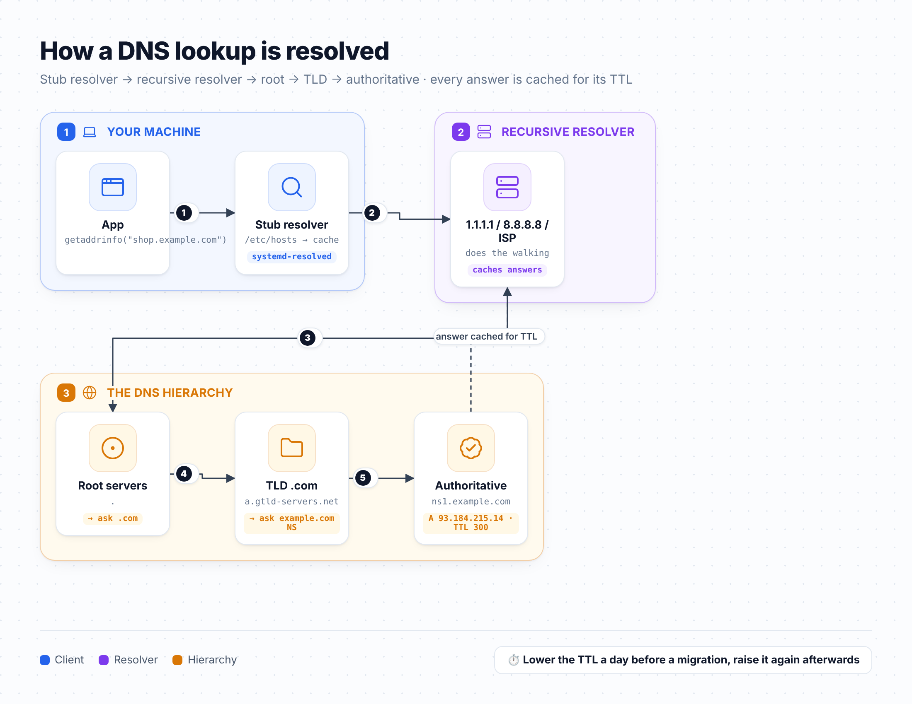
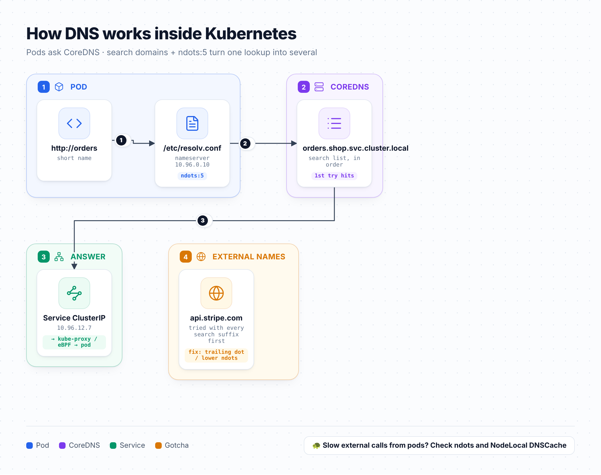

# 6.2 — DNS deep dive

!!! abstract "In one sentence"
    **DNS** is the internet's distributed phone book: a **recursive resolver** walks from the **root** to the **TLD**
    to the domain's **authoritative** servers to turn a name into records (IP addresses, aliases, mail servers, text),
    and every answer is **cached for its TTL**. That makes DNS fast, and it's also why DNS changes "take time".

## 📖 Key terms & abbreviations

| Term | Stands for | What it is | How it works (one line) |
|---|---|---|---|
| **DNS** | Domain Name System | Distributed database of names | Hierarchy of zones, each served by its own name servers |
| **Zone** | — | The part of the tree one operator controls | `example.com` zone holds its records and delegations |
| **Stub resolver** | — | The small resolver in your OS | Asks one recursive resolver, caches answers |
| **Recursive resolver** | — | Server that does the lookup for you | Walks root → TLD → authoritative, caches everything |
| **Authoritative server** | — | Server that holds the zone's real answers | Answers with the AA (authoritative answer) flag |
| **Root / TLD** | Top-Level Domain | Top of the tree / `.com`, `.org`, `.tr` | Root points to TLD servers; TLD points to domain NS |
| **Record (RR)** | Resource Record | One entry: name, type, TTL, value | `shop.example.com. 300 IN A 93.184.215.14` |
| **TTL** | Time To Live | Seconds an answer may be cached | Lower TTL = faster changes, more queries |
| **Negative caching** | — | Caching "this name doesn't exist" (NXDOMAIN) | Lasts the zone's SOA minimum TTL |
| **Glue record** | — | IP of a name server, stored in the parent | Breaks the loop when NS is inside its own zone |
| **DNSSEC** | DNS Security Extensions | Signatures on DNS records | Resolver validates a chain of keys from the root |
| **DoH / DoT** | DNS over HTTPS / DNS over TLS | Encrypted DNS | Hides queries from the network path |
| **CoreDNS** | — | Kubernetes' cluster DNS server | Answers `*.svc.cluster.local`, forwards the rest |
| **ndots** | — | resolv.conf option | Names with fewer dots than this try search domains first |

## 🗺️ Big picture



---

## 1 · How does resolution work?

1. Your app calls `getaddrinfo("shop.example.com")`. The OS checks `/etc/hosts`, then its own cache (`systemd-resolved`, `mDNSResponder` on macOS).
2. On a miss it asks the **recursive resolver** configured in `/etc/resolv.conf` (your router, ISP, `1.1.1.1`, `8.8.8.8`, or the VPC resolver in the cloud).
3. If the resolver has nothing cached, it asks a **root server**: "where is `.com`?" The root answers with a **referral** to the `.com` TLD servers.
4. It asks a **TLD server**: "where is `example.com`?" It gets a referral to `ns1.example.com` (plus glue IPs).
5. It asks the **authoritative server** and gets the final answer: `A 93.184.215.14, TTL 300`.
6. Every step is cached. The next lookup for anything under `.com` skips the root, and the next lookup for `shop.example.com` within 300 s is answered from cache in under a millisecond.

DNS mostly uses **UDP port 53** (one packet each way). Large answers and zone transfers use **TCP 53**.

## 2 · Record types

| Type | Holds | Example | Used for |
|---|---|---|---|
| `A` / `AAAA` | IPv4 / IPv6 address | `93.184.215.14` / `2606:2800::1` | The basic name → IP |
| `CNAME` | Alias to another name | `www → shop.example.com.` | Pointing at a CDN or LB hostname. Not allowed at the zone apex |
| `ALIAS` / `ANAME` | Provider-specific apex alias | `example.com → lb-123.elb.amazonaws.com` | CNAME-like behaviour at the apex (Route 53 alias) |
| `NS` | Name servers of a zone | `ns1.example.com.` | Delegation |
| `SOA` | Zone metadata | serial, refresh, negative TTL | Zone management |
| `MX` | Mail servers + priority | `10 mx1.example.com.` | Email delivery |
| `TXT` | Free text | `v=spf1 …`, `google-site-verification=…` | SPF, DKIM, DMARC, domain verification, ACME DNS-01 |
| `SRV` | host + port of a service | `_sip._tcp 10 5 5060 sip.example.com.` | Service discovery (also in Kubernetes) |
| `CAA` | Which CAs may issue certs | `0 issue "letsencrypt.org"` | Certificate security |
| `HTTPS` / `SVCB` | Connection hints | `alpn="h3,h2"` | Advertise HTTP/3, ECH (Encrypted Client Hello) |
| `PTR` | IP → name | `14.215.184.93.in-addr.arpa.` | Reverse DNS, mail server reputation |

## 3 · TTL and caching: why "DNS takes time"

### How does it work?

Every resolver and stub caches each answer for its **TTL**. If a record had `TTL 86400` and you change it, some users keep the old IP for up to a day. There is no "propagation"; old copies just **expire**.

- **Before a migration**, lower the TTL (e.g. to 60) at least one old-TTL period ahead. Do the switch, check, then raise it again.
- **Negative answers** (`NXDOMAIN`) are cached too. If you query a name *before* creating it, you may keep seeing "doesn't exist" for the SOA's negative TTL.
- **Applications cache too.** The JVM (`networkaddress.cache.ttl`), some HTTP clients and connection pools keep IPs far longer than the TTL. That is a classic cause of "we failed over but traffic still goes to the old IP".

## 4 · DNS inside Kubernetes



- Every Service gets a name: `<service>.<namespace>.svc.cluster.local` → its ClusterIP. Headless Services (`clusterIP: None`) return the pod IPs directly.
- Pods get `/etc/resolv.conf` with `nameserver <kube-dns IP>`, a search list (`<ns>.svc.cluster.local svc.cluster.local cluster.local`) and **`ndots:5`**.
- **`ndots:5`** means any name with fewer than 5 dots is first tried with every search suffix. `api.stripe.com` (2 dots) becomes `api.stripe.com.shop.svc.cluster.local`, `api.stripe.com.svc.cluster.local` … before the real query, so one lookup costs 4–5 round trips (×2 for A and AAAA).
- **Fixes:** use FQDNs with a trailing dot (`api.stripe.com.`), set `dnsConfig.options: ndots: "2"` on the pod, and run **NodeLocal DNSCache** so lookups are answered on the node.
- Intermittent 5-second delays usually point to UDP conntrack races or packet loss to CoreDNS. Check the CoreDNS metrics and logs.

## 5 · Security: DNSSEC and encrypted DNS

- **DNSSEC** signs records. Each zone's key is vouched for by its parent (`DS` record), up to the root. A validating resolver rejects forged answers. It proves **authenticity**, not privacy.
- **DoT (TCP 853)** and **DoH (HTTPS 443)** encrypt the query between you and the resolver, so the network path can't read or change it. Browsers and phones increasingly use them by default.
- **DNS is an attack surface:** dangling CNAMEs to deleted cloud resources allow **subdomain takeover**; open resolvers are used for amplification attacks; and registrar or DNS-provider accounts deserve MFA.

## 🔧 DevOps connection

- **Cloud:** private hosted zones and the VPC resolver (AWS `.2` address, Route 53 Resolver endpoints for hybrid), split-horizon DNS (different answers inside and outside).
- **ExternalDNS** watches Services and Ingresses and writes records to Route 53, Cloud DNS, Cloudflare and others, so DNS becomes part of GitOps.
- **Health-checked / weighted / geo DNS** is a cheap global load balancer, but clients only notice changes as fast as TTLs (and app caches) allow.
- **"It's always DNS"**: when something fails intermittently, check resolution first (`dig` from inside the pod, not from your laptop).

## 🧪 Try it yourself

```bash
dig shop.example.com +short             # just the answer
dig example.com +trace                  # walk root → TLD → authoritative yourself
dig example.com NS +short               # who is authoritative
dig example.com MX TXT CAA              # several record types
dig @1.1.1.1 example.com +stats         # ask a specific resolver, see query time
dig cloudflare.com HTTPS +short         # HTTP/3 hints in DNS
dig -x 1.1.1.1 +short                   # reverse lookup (PTR)
resolvectl status                       # which resolver your Linux box uses

# Inside Kubernetes
kubectl run -it --rm dnstest --image=busybox:1.36 --restart=Never -- sh -c \
  'cat /etc/resolv.conf; nslookup kubernetes.default'
```

## 🃏 Cheat sheet

| Symptom | Likely cause | Check |
|---|---|---|
| Change not visible | Old TTL still cached | `dig +ttlid`, query the authoritative NS directly |
| Works on laptop, not in pod | Search domains / ndots / CoreDNS | `cat /etc/resolv.conf` in the pod |
| `NXDOMAIN` right after creating a record | Negative caching | SOA minimum TTL |
| Traffic still hits old IP after failover | App-level DNS cache | JVM TTL, connection pools |
| Random 5 s delays | UDP loss / conntrack race | CoreDNS metrics, NodeLocal DNSCache |
| Can't put CNAME on `example.com` | Apex restriction | Use ALIAS/ANAME or A records |

## ❓ Test yourself

??? question "1. Who actually walks the root → TLD → authoritative chain: your laptop or the resolver?"
    The recursive resolver. Your laptop's stub resolver sends one query and gets the final answer.

??? question "2. You changed an A record with TTL 3600 ten minutes ago. Why do some users still see the old IP?"
    Resolvers that cached it before the change keep it until their copy's TTL expires (up to an hour), and some apps cache even longer.

??? question "3. Why can a pod's lookup of `api.stripe.com` be slow, and what are two fixes?"
    `ndots:5` makes it try every search suffix first, each for A and AAAA. Use the FQDN with a trailing dot, lower `ndots`, and/or run NodeLocal DNSCache.

??? question "4. What does DNSSEC protect against, and what doesn't it protect?"
    Forged or modified answers (authenticity and integrity). It doesn't hide which names you look up; that's DoH/DoT.

??? question "5. What is a subdomain takeover?"
    A CNAME still points at a cloud resource (bucket, app, CDN) that was deleted. An attacker claims that resource name and now serves content on your subdomain.

---

## 📚 Sources

- [RFC 1034](https://www.rfc-editor.org/rfc/rfc1034) · [RFC 1035](https://www.rfc-editor.org/rfc/rfc1035) — DNS concepts and protocol
- [Cloudflare Learning — What is DNS?](https://www.cloudflare.com/learning/dns/what-is-dns/)
- [Kubernetes — DNS for Services and Pods](https://kubernetes.io/docs/concepts/services-networking/dns-pod-service/)
- [Kubernetes — NodeLocal DNSCache](https://kubernetes.io/docs/tasks/administer-cluster/nodelocaldns/)
- [ExternalDNS](https://kubernetes-sigs.github.io/external-dns/)

## ✍️ My notes

> Run `dig +trace` for your company's main domain and write down every server that answered.

-
